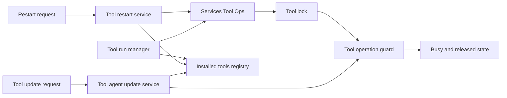
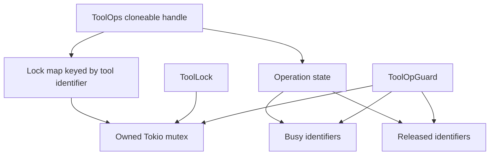
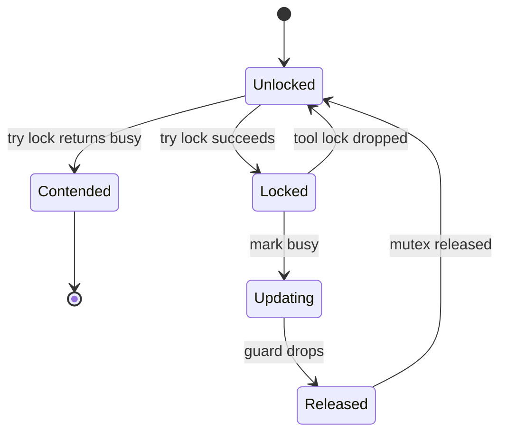
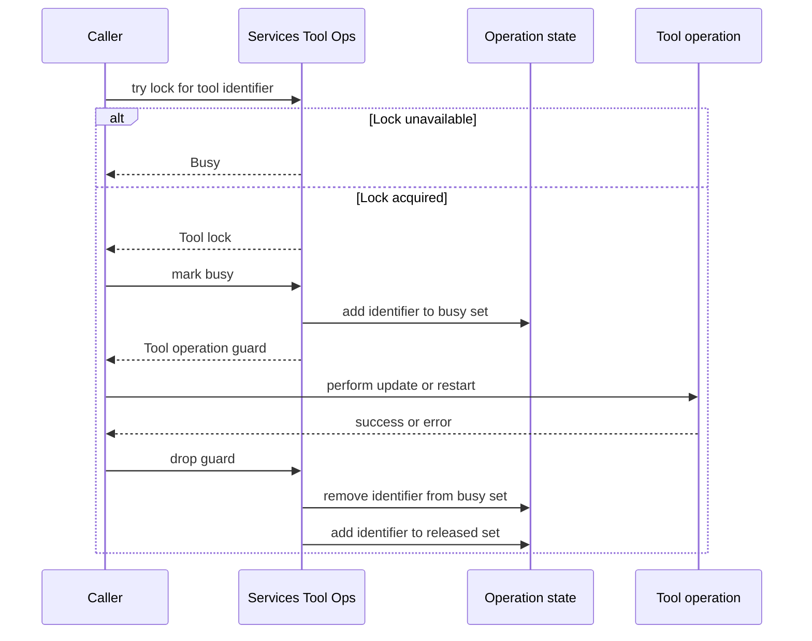
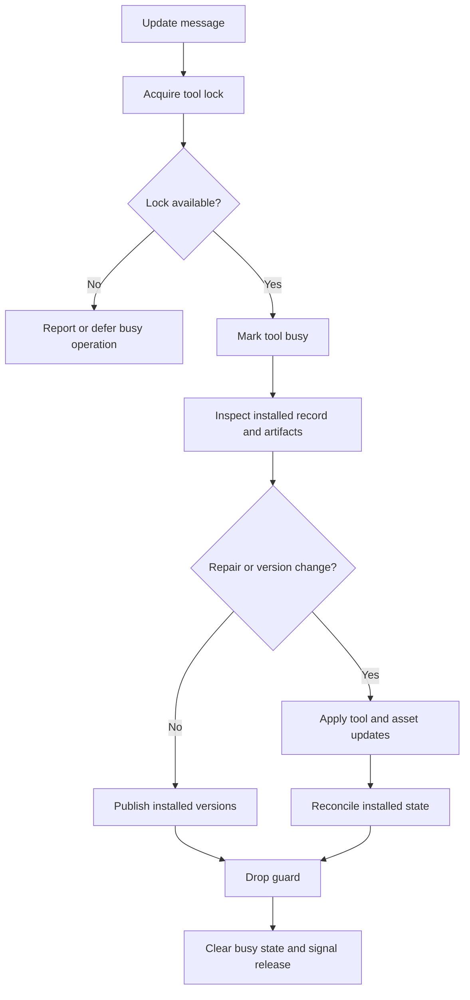

# Services Tool Ops

Services Tool Ops is the OpenFrame Client agent's in-process coordination primitive for operations on an individual managed tool. It prevents concurrent update or restart work for the same tool identifier, exposes whether any tool is updating, and releases the coordination state automatically when the owning operation ends.

The implementation is supplied by the OpenFrame OSS Library as part of the Rust `openframe_agent_lib` artifact and is executed by this repository's OpenFrame Client deployment. Its source of truth is [`tool_ops.rs`](https://github.com/flamingo-stack/openframe-oss-lib/blob/7a766f00e4f58b5d89db007b878ac8d6e0c344f4/clients/openframe-client/src/services/tool_ops.rs).

## Purpose and guarantees

Tool installation, update, restart, and run supervision can overlap in an asynchronous client. Services Tool Ops gives callers a narrow critical section keyed by `tool_agent_id`:

- **Per-tool exclusion:** `try_lock` obtains an owned Tokio mutex for one tool identifier. A second contender for that same identifier receives `Busy` immediately rather than waiting.
- **Independent progress:** locks are distinct per identifier, so operations for different tools can proceed concurrently.
- **Observable update state:** `mark_busy` records the identifier in a shared busy set. `is_busy`, `any_busy`, and `busy_tools().any()` report that state.
- **Scope-bound cleanup:** `ToolOpGuard` owns the mutex guard. Its `Drop` implementation clears the busy flag and records a release signal even when the guarded operation returns early or fails.
- **Restart wake-up signal:** dropping the guard marks the tool identifier as released. Package-private helpers `is_released` and `take_released` support a run loop that has parked for a restart delay and should relaunch early.

The module is deliberately a coordination mechanism, not a persistent operation journal. Lock and busy state exist only in the current agent process.

## Runtime position

Services Tool Ops is shared by higher-level client services. The tool restart path visibly acquires the lock, marks the tool busy, then executes a bounded restart. The tool run manager also holds a `ToolOps` dependency, while the tool-agent update service accepts an already-created guard for locked update processing.

This relationship keeps lifecycle work outside the lock implementation:

| Collaborator | Responsibility around Services Tool Ops |
|---|---|
| Tool restart service | Calls `try_lock`, converts a successful `ToolLock` into a `ToolOpGuard`, then applies a timeout and panic boundary around the restart operation. It returns a busy restart outcome if the lock is unavailable. |
| Tool-agent update service | Performs version comparison, repair detection, asset selection, update execution, and installed-tool state reconciliation. Its locked processing entry point receives `ToolOpGuard`, making the lock lifetime part of the update call. |
| Tool run manager | Supervises installed tools, avoids duplicate running instances, and owns a `ToolOps` dependency so running and restart behavior can coordinate with update activity. |
| Installed tools service | Stores the tool records that update, restart, and run services use. It is separate from the in-memory exclusion and busy state maintained here. |

## Architecture

`ToolOps` is cheap to clone because its mutable state is held behind `Arc` values. It maintains two independently protected data structures:

1. A map from tool identifier to Tokio mutex. This map supplies serialization for each individual tool.
2. An operation state containing a `busy` identifier set and a `released` identifier set. The first supports status inspection; the second carries the post-operation wake-up signal.

### Core types

| Type | Role | Lifetime behavior |
|---|---|---|
| `ToolOps` | Cloneable coordinator and entry point for locking and status queries. | Shares the lock map and operation state with all clones. |
| `ToolLock` | Successful, exclusive acquisition for a specific tool. | Holds the owned Tokio mutex until it is converted to a guard or dropped. |
| `ToolOpGuard` | Busy-marked operation token. | On drop, removes the tool from the busy set, inserts it in the released set, and releases the owned mutex. |
| `BusyTools` | Read-only-style handle over shared operation state. | Its `any` method reports whether the busy set is nonempty. |
| `Busy` | Marker error returned when a non-blocking acquisition cannot get the tool mutex. | Carries no additional data. |

### Synchronization strategy

The module uses a standard mutex for short synchronous access to the lock map and operation state, and Tokio's owned asynchronous mutex guard for the resource that must remain owned across asynchronous work. Recovery from a poisoned standard mutex uses the contained state instead of propagating a poisoning error. This favors continuing client operation after a prior panic while preserving the lock's current contents.

The lock map retains entries after operations finish. Therefore, the coordinator preserves a mutex object for each tool identifier observed by this process; it does not implement automatic lock-map eviction.

## Operation lifecycle

A caller must acquire and mark an operation in two steps. A successful `try_lock` alone serializes access but does not make the operation visible through busy-state queries. Calling `mark_busy` performs that visibility transition and returns the guard that owns both the lock and cleanup responsibility.

### Detailed flow

The cleanup action is controlled by Rust ownership rather than a separate success-only completion call. Consequently, ordinary error propagation from guarded work still clears the busy flag and unlocks the tool when the guard leaves scope. A process termination, however, ends all in-memory state rather than producing a durable release record.

## Update and restart behavior

### Guarded restart

The restart service provides the clearest integration path:

1. It invokes `try_lock` for the target tool.
2. If another operation holds that tool's mutex, it returns its busy restart outcome without starting another restart.
3. On acquisition, it calls `mark_busy` and keeps the resulting guard in scope.
4. It executes the restart under a fixed timeout and catches panics at the async boundary.
5. When the service returns—whether successful, timed out, panicked, or failed—the guard is dropped, clearing busy state and signaling release.

The timeout limits how long a wedged operating-system restart call can retain the lock and busy flag. A timed-out restart can still leave a tool stopped; subsequent self-healing or server-driven restart cycles are responsible for later recovery.

### Locked update processing

The tool-agent update service's locked path receives `ToolOpGuard` as an argument. Within that guarded span it:

- loads the installed-tool record;
- detects interrupted installations or missing binaries and treats them as repair cases;
- compares target and installed tool or asset versions, rejecting disallowed downgrades;
- executes needed updates;
- moves repaired records to the installed state when appropriate; and
- relaunches a previously graphical Windows application after a successful update.

Services Tool Ops does not decide whether an update is needed. It ensures the chosen update path owns the target tool's exclusion and busy visibility for the duration of that work.

## Status and release APIs

| API | Meaning | Important distinction |
|---|---|---|
| `try_lock(tool identifier)` | Attempts immediate exclusive access for one tool. | It does not wait and does not set busy state. |
| `mark_busy()` | Converts a `ToolLock` to a `ToolOpGuard` and records the identifier as updating. | The original lock is consumed, so the guard is the sole owner of the operation lifetime. |
| `is_busy(tool identifier)` | Checks whether a tool has been explicitly marked busy. | It is a state query, not a lock-acquisition test. |
| `any_busy()` | Checks whether at least one tool is marked busy. | Delegates through `BusyTools`. |
| `busy_tools().any()` | Provides the same aggregate busy check through a cloneable state view. | It reveals only whether the busy set is empty. |
| `is_released(tool identifier)` | Checks for a release signal. | Package-private helper intended for internal coordination. |
| `take_released(tool identifier)` | Reads and consumes a release signal. | Each inserted release is observable once through this consuming operation. |

## Concurrency invariants

Maintain these properties when integrating or changing Services Tool Ops:

1. Use the same cloned `ToolOps` family wherever operations must exclude one another. Independent `ToolOps::default()` instances do not share state.
2. Use a stable tool-agent identifier for the entire operation. Different strings produce independent locks and busy entries.
3. Retain the `ToolOpGuard` for all work that must block concurrent update or restart activity. Dropping it early makes another operation eligible immediately.
4. Do not rely on `is_busy` as a reservation. It is only an observation and can change before a caller acts; `try_lock` is the exclusion boundary.
5. Treat a `Busy` result as normal contention, not as a failed mutex. The caller decides whether to return a busy outcome, defer work, or retry later.
6. Consume release signals with `take_released` only when the caller is ready to act on them. A consumed signal is removed from the released set.

## Operational considerations

- **Observability:** transitions to and from busy state are logged with the affected tool identifier. The module does not publish metrics or messages itself.
- **Failure cleanup:** RAII cleanup covers normal returns, early returns, and unwinding that executes Rust destructors. It does not make cross-process coordination or persistence guarantees.
- **Contention scope:** contention is per tool, avoiding unnecessary serialization across unrelated managed tools.
- **Lock acquisition policy:** because acquisition is non-blocking, callers must supply any retry or scheduling policy. This avoids occupying an async task while waiting for a tool operation to finish.
- **Release notification:** the released set exists specifically to shorten restart-delay handling in a run loop after an update ends; it is not a history of every completed operation.

## Maintainer checklist

When adding a tool operation that changes executable files, service registration, or process state:

1. Identify the canonical tool-agent identifier shared with update, restart, and run services.
2. Inject or clone the existing `ToolOps` instance rather than constructing a disconnected coordinator.
3. Call `try_lock` before starting the conflicting work and handle `Busy` explicitly.
4. Call `mark_busy` only for work that represents an externally meaningful updating interval.
5. Keep the returned guard alive until file replacement, process control, and any required registry reconciliation are complete.
6. Validate failure paths and timeouts to confirm the guard leaves scope and the next lifecycle attempt can proceed.
7. If a delayed run loop reacts to operation completion, consume its per-tool release signal once and avoid treating it as durable state.
