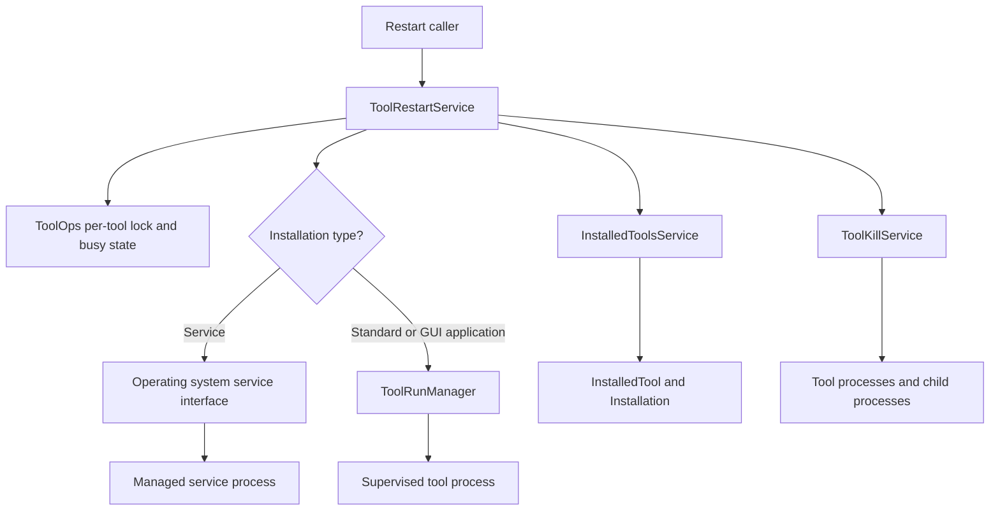
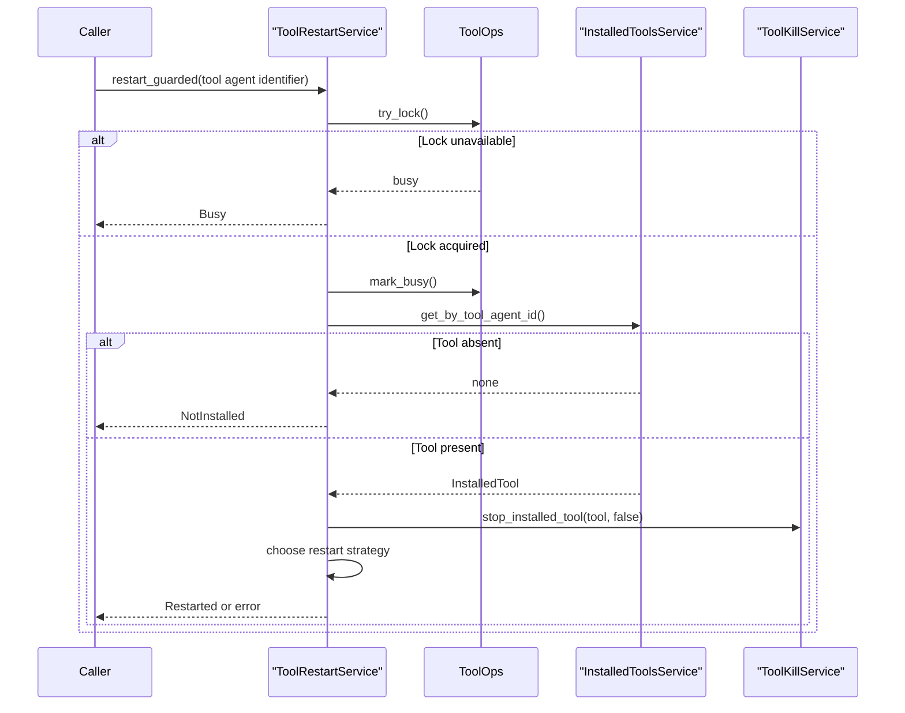
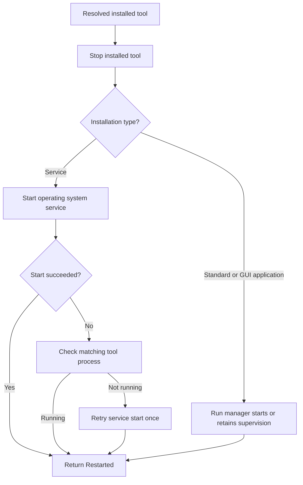
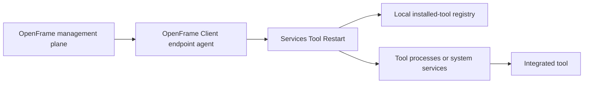

# Services Tool Restart

Services Tool Restart is the OpenFrame Client agent capability that performs a safe, serialized restart of one installed integrated tool. It is implemented by `ToolRestartService` in the `openframe_agent_lib` Rust artifact supplied by [OpenFrame OSS Library](https://github.com/flamingo-stack/openframe-oss-lib/blob/7a766f00e4f58b5d89db007b878ac8d6e0c344f4/clients/openframe-client/src/services/tool_restart_service.rs) and run by this repository's OpenFrame Client deployment.

The service treats restarts as a stateful operation rather than a simple stop/start pair. It resolves the local installed-tool record, prevents concurrent changes to the same tool, stops the current installation, selects a restart strategy from the installation type, and ensures cleanup even when the operation fails, panics, or exceeds its deadline.

## Responsibilities

- Serialize restart, installation, update, and related tool operations per tool agent identifier.
- Mark the tool as busy for the complete guarded operation.
- Resolve the current tool definition from local installed-tool state.
- Stop the tool without requesting deletion.
- Restart service installations through the operating system service interface.
- Return standard and GUI installations to the tool run manager for supervision.
- Distinguish a missing registration from contention and operational failure.
- Limit a guarded restart to `TOOL_RESTART_TIMEOUT_SECS`, currently 600 seconds.

## Public Interface

| Component | Role |
|---|---|
| `ToolRestartService` | Holds the installed-tool registry, termination service, run manager, and per-tool operation coordinator. |
| `new` | Constructs the service from those four collaborators. |
| `restart_guarded` | Public asynchronous restart entry point. Acquires the per-tool guard, enforces the deadline, converts panics into errors, and returns a `RestartOutcome`. |
| `RestartOutcome` | Reports `Restarted`, `NotInstalled`, or `Busy` without treating expected non-action states as errors. |

An `Err` result is reserved for unexpected conditions: registry access failures, stop failures, restart failures, timeout, or a caught panic.

## Architecture

The service is intentionally narrow. It does not download assets, mutate the installed-tool registry, or decide whether an update is allowed. Those concerns remain with the installation, update, operation-coordination, and run-management capabilities of the client library.

## Guarded Restart Flow

`restart_guarded` is the transaction boundary for the operation:

1. It asks `ToolOps` for a non-blocking lock keyed by the tool agent identifier.
2. If the lock is unavailable, it returns `Busy` immediately. It does not wait behind another operation.
3. On success, it marks the tool busy while retaining the lock in a scoped guard.
4. It invokes the internal restart path inside both a timeout and panic catcher.
5. Guard destruction clears the busy state and releases the lock when the method returns, errors, unwinds, or is cancelled.

The timeout bounds the entire internal flow. If it expires, the caller receives an error identifying the tool and configured deadline. The tool may remain stopped; later self-healing or server-initiated restart cycles are expected to provide recovery. A panic is caught and converted to an error for the same reason: callers are not left with an indefinitely held operation state.

## Restart Strategies

The persisted `Installation` model selects the startup mechanism.

| Installation variant | Stop behavior | Restart behavior |
|---|---|---|
| `Service` | Stops the operating-system service and detached children through `ToolKillService`. | Calls the platform system-service start function with the recorded service name. |
| `Standard` | Stops matching executable or command-pattern processes. | Calls `ToolRunManager.run_new_tool`, which establishes managed execution if it is not already running. |
| `GuiApp` | Stops the GUI application process. | Calls `ToolRunManager.run_new_tool` so the client supervision path can relaunch it. |

For a service installation, a first system-service start failure is not automatically fatal. The restart service checks whether the tool is already running, because an operating-system supervisor may have started it concurrently. If it is running, the restart is accepted. Otherwise, the service start is retried once; failure of that retry is returned with service-name context.

## Coordination and State Safety

The principal safety mechanism is the `ToolOps` guard. `try_lock` uses a lock specific to the tool agent identifier, so operations on different tools need not block one another. `mark_busy` also records the identifier in shared busy state. The scoped guard owns both concerns and releases them together.

This prevents overlapping restart activity with operations that use the same tool coordinator, such as installation or update work. It also supplies a consistent busy signal to callers that need to defer rather than duplicate an action.

The operation does not rely only on the run manager's own running set. `ToolRunManager.run_new_tool` independently avoids starting a duplicate process when a tool is already marked running. That makes the standard and GUI path idempotent with respect to the manager's supervision state.

## Failure Semantics and Operations

| Condition | Observable result | Operational meaning |
|---|---|---|
| Tool record is absent | `NotInstalled` | No local tool is available to restart. |
| Another operation owns the tool lock | `Busy` | Caller should defer rather than force a concurrent operation. |
| Stop or startup step fails | Error with restart context | The restart did not complete successfully. |
| Service start reports an error but the process is present | `Restarted` | The operating-system supervisor likely restored the service. |
| Guarded flow exceeds 600 seconds | Timeout error | The lock and busy state are released; the tool can be recovered by a later cycle. |
| Internal flow panics | Panic error | The panic is contained and the operation guard is released. |

Logs record the major lifecycle points: tool absence, stop initiation, service startup, tolerated start errors for an already running process, retry attempts, and restart triggering. These events are useful when correlating client-side action with service-manager behavior.

## System Placement

Services Tool Restart runs on managed endpoints as part of the Rust OpenFrame Client. It is not a server HTTP endpoint. Higher-level client workflows request restarts, while this module performs the local lifecycle transition using persisted installation data and platform-specific control primitives.

The repository consumes the `openframe_agent_lib` Cargo artifact at version `v0.0.5`; the source implementation documented here is supplied by OpenFrame OSS Library. The client deployment also contains the adjacent installed-tools registry, tool termination, tool operation coordination, run manager, and platform system-service capabilities used by this module.

## Maintenance Considerations

- Preserve the outer guard for every code path that restarts a tool. Removing it can reintroduce races between restart, update, and installation.
- Preserve timeout and panic containment when adding blocking platform work. The deadline exists to prevent a wedged operating-system operation from leaving a tool permanently busy.
- Treat a service-manager start error as ambiguous until process state is checked; supervisors can race with explicit start requests.
- Keep `allow_delete` false when stopping for restart. Restart must retain the installed tool and its registry record.
- Add installation variants only with an explicit stop and restart strategy. Defaulting an unknown lifecycle model to one of the current paths could create unsupervised or duplicate processes.
