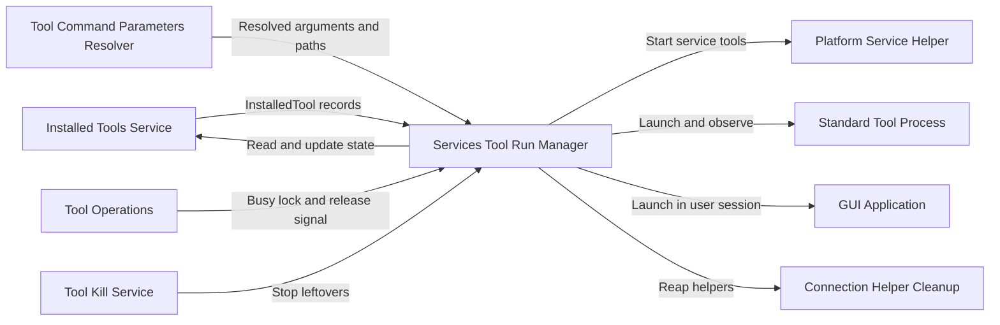
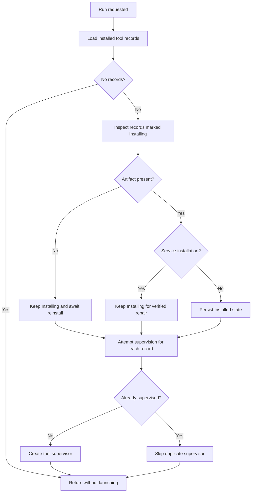
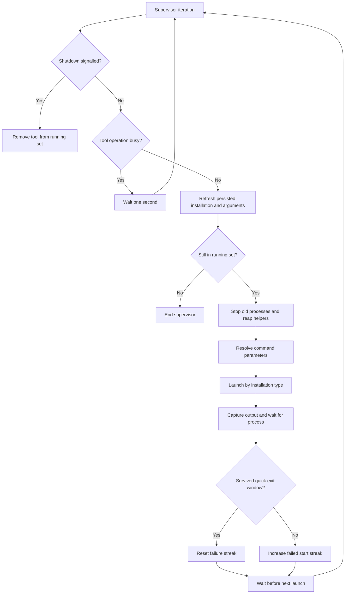
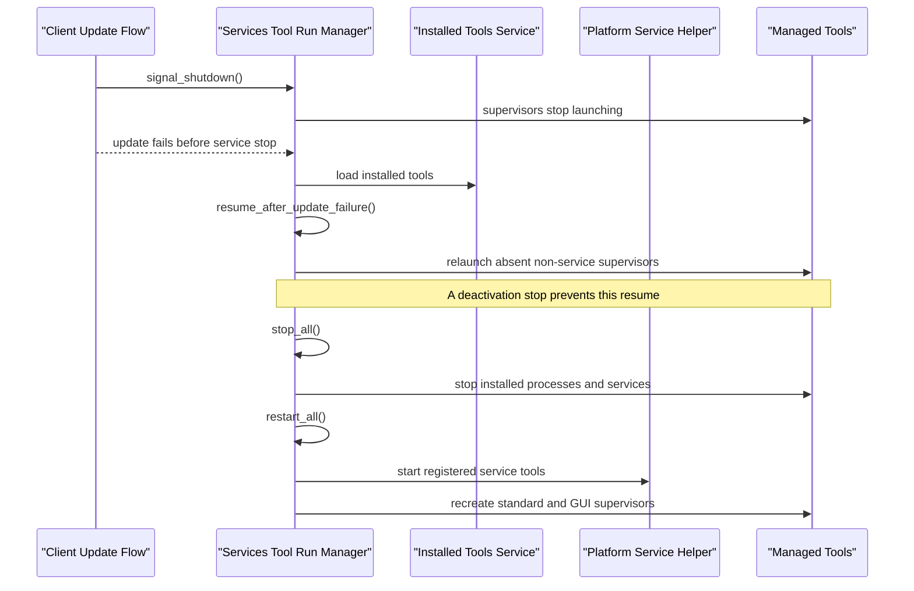

# Services Tool Run Manager

Services Tool Run Manager supervises locally installed integrated tools in the OpenFrame client agent. It is implemented by `ToolRunManager` in the Rust `openframe_agent_lib` supplied by the OpenFrame OSS Library. The tenant repository runs that client as part of the OpenFrame platform, while the implementation itself is maintained in the library source: [tool run manager source](https://github.com/flamingo-stack/openframe-oss-lib/blob/7a766f00e4f58b5d89db007b878ac8d6e0c344f4/clients/openframe-client/src/services/tool_run_manager.rs).

Its responsibilities are deliberately supervisory rather than install-oriented: it decides which installed records can be launched, ensures one supervisor exists per tool, resolves runtime arguments, starts and observes processes, recovers from unexpected exits, and coordinates stopping or restarting tools during deactivation and client updates. Service-type tools remain owned by the operating system service manager; standard tools and supported graphical applications are launched under agent supervision.

## Scope and Responsibilities

The module manages three installation categories represented by `Installation` and the persisted `InstalledTool` record:

| Installation category | Services Tool Run Manager behavior |
|---|---|
| Standard | Starts the executable as a managed child process, captures output, watches for exit, and retries as needed. |
| Service | Does not spawn a child process. During a bulk restart, it asks the platform service helper to start the registered service. |
| Gui App | Uses platform-specific launch behavior. Windows launches once into a user session for a fresh launch, macOS waits for a usable console session and launches as that user, and other Unix targets fall back to standard spawning. |

The manager does not install, update, or remove a tool. Those operations are coordinated by neighboring services. It does, however, observe `ToolOps`: a busy tool is not launched while an operation is in flight, and a released operation can cut short the retry delay so the manager can re-evaluate and relaunch with fresh persisted metadata.

## Runtime Architecture

`ToolRunManager` owns the following coordination state:

- **Running tool set:** an asynchronous read-write locked set of tool agent identifiers. It prevents duplicate supervisors and records which tools remain under supervision.
- **Shutdown signal:** an atomic flag that prevents new launches and makes active loops exit. Self-update uses this before the updater terminates the client service.
- **Tools stopped signal:** an atomic flag marking a deactivation-driven stop. It prevents an aborted self-update from unintentionally reviving deactivated tools.
- **Client update pending flag:** a timestamped, shareable signal that causes callers to treat new tool operations as busy while a client update is pending. Its validity is bounded by the configured client-update pending time-to-live.
- **Failure log backoff:** per-supervisor loop state that reduces repeated failure logging while retaining full logging when a recently completed tool operation explicitly requested a relaunch.

## Construction and Public Interface

`new` accepts four collaborators: `InstalledToolsService`, `ToolCommandParamsResolver`, `ToolKillService`, and `ToolOps`. It initializes empty supervision state and no shutdown or deactivation condition.

| API | Purpose |
|---|---|
| `run` | Reconciles persisted tool records and starts supervisors for all eligible records. |
| `run_new_tool` | Starts supervision for one newly installed tool when no supervisor is already registered. |
| `ensure_gui_app_running` | Starts an installed GUI application only when it is not already being updated. |
| `stop_all` | Reversibly stops all installed tools without uninstalling them. |
| `restart_all` | Clears the stopped and shutdown conditions, restarts service tools, then recreates standard and GUI supervision. |
| `signal_shutdown` | Stops active loops from launching another process. |
| `resume_after_update_failure` | Clears an update shutdown after a failed update, except when deactivation stopped tools. |
| `mark_client_update_pending` | Marks new tool operations as busy for the configured time-to-live. |
| `is_client_update_pending` and `client_update_pending` | Read the client update pending state directly or through its shareable view. |
| `clear_client_update_pending` | Removes the update pending condition after the update flow completes or is cancelled. |
| `clear_running_tool` | Removes a tool identifier from the supervision set. |

## Startup Reconciliation

Before spawning supervisors, `run` loads all persisted installed-tool records and handles interrupted installation state conservatively.

A non-service record left in `Installing` is promoted to `Installed` only when its expected executable artifact is present and non-empty. A service record is intentionally not promoted by a disk-only check because service registration cannot be verified that way. This protects repair and installation workflows from a false success classification.

## Supervision Loop

For standard tools, `run_tool` creates a Tokio task that continues until shutdown, explicit unsupervision, or a platform-specific GUI path completes. Each loop iteration refreshes the persisted installation and run arguments, allowing completed operations to change what is launched without recreating the manager.

### Launch Preparation

Before a normal relaunch, the loop can stop a leftover process using `ToolKillService` and then invoke connection-helper cleanup. On Windows, GUI applications are excluded from this kill path because they are associated with the system-wide Run autorun mechanism. If terminating leftovers fails, the loop does not launch a second instance; it retries with a delay that grows from the base retry interval up to a five-minute ceiling.

The command parameter resolver is run before every launch. Resolver errors also block launch and retry after the base delay, preventing execution with incomplete or invalid arguments. The executable path comes from the directory manager and the current installation's declared executable path.

### Process Observation and Restart Policy

A standard child process receives piped standard output and standard error. The manager drains both streams asynchronously. Output is forwarded through structured logs for attempts selected by failure logging, and becomes enabled after the process survives the quick-exit window.

A process that remains alive for at least 60 seconds is treated as a successful start and resets the failure streak. A process that exits sooner, unless a tool operation is currently busy, is treated as a failed start. The retry sequence is 5, 30, 120, 300, and 900 seconds; further failed starts continue at 900 seconds. A process that exits after the quick-exit window is still restarted after the normal five-second delay because managed standard tools are expected to remain running.

Long waits are sliced into one-second intervals. Shutdown, removal from the running set, or a released tool-operation guard can therefore interrupt a pending retry promptly.

## Platform-specific GUI Behavior

| Platform | Behavior |
|---|---|
| Windows | A fresh GUI installation may be launched in the interactive user session. If it is already running, it is not duplicated. Subsequent service starts rely on the system-wide Run autorun at user logon. The supervisor removes the tool from its running set after this handoff. |
| macOS | The manager waits for a console user and a ready GUI session. If a bundle identifier is available, it writes resolved arguments as application preferences and uses the background flag when applicable. It verifies that the process is running after launch; failed verification is retried. |
| Other Unix | The GUI record falls through to standard process spawning. |

For the designated chat tool, supported Windows and macOS GUI launches append a background launch flag. The manager performs a second running-process check on macOS after session waits, avoiding a duplicate launch if login or system resume started the application in the meantime.

## Stop, Restart, and Update Coordination

`stop_all` is a reversible deactivation action. Under the supervision lock it marks tools stopped, signals shutdown, and clears the running set so a later restart does not have to wait for every loop to observe shutdown. It then retrieves every installed tool and asks the kill service to stop it. Per-tool stop errors are logged as warnings, while the operation itself completes after attempting all records.

`restart_all` reverses both stop flags, clears the running set, starts registered service tools through the platform service helper, and invokes `run` to supervise non-service records. Failure to load records for the service-start phase is logged, after which normal manager startup still proceeds.

During self-update, `signal_shutdown` is one-way until a successful restart or `resume_after_update_failure`. The resume path acquires the supervision lock, declines to proceed if deactivation has stopped tools, clears shutdown otherwise, and creates supervisors only for non-service tools absent from the running set. It therefore preserves still-live loops and relaunches only those that already exited.

## Safety and Concurrency Invariants

- At most one manager supervisor is registered for a tool agent identifier at a time. `try_mark_running` inserts the identifier under the write lock before a task is spawned.
- The shutdown check and removal from the running set are performed under the same supervision lock. This avoids a concurrent recovery path observing an ambiguous supervisor state.
- A busy `ToolOps` entry defers launching until the installation or update operation finishes. A tool-operation release also accelerates a retrying supervisor's next attempt.
- Service tools are never spawned as unmanaged child processes by this module. Their lifecycle belongs to system service facilities.
- Client update pending is time-bounded. A stale flag expires through the configured time-to-live rather than indefinitely blocking operations.
- A deactivation stop has precedence over recovery from a failed client update, preventing tools from reconnecting to endpoints after the tenant is no longer available.

## Operational Diagnostics

The manager emits structured logs around lifecycle boundaries and failures. Useful fields include `tool_id`, service name, process identifier, user name on macOS, failed attempt count, failure duration, exit status, and retry delay.

When troubleshooting, distinguish these conditions:

| Symptom | Manager behavior | Primary investigation area |
|---|---|---|
| Tool is skipped as already running | The tool identifier is in the in-memory supervision set. | Concurrent manager calls or a supervisor that has not yet exited. |
| Tool remains Installing | Artifact is missing, empty, or the record is a service whose registration needs verified repair. | Installation workflow, executable artifact, or service registration. |
| No relaunch during update | Shutdown is signalled or the tool operation lock is busy. | Client update state and tool operation completion. |
| Relaunch is delayed | The process exited quickly or leftovers could not be terminated. | Tool startup logs, executable arguments, process ownership, and termination permissions. |
| GUI tool does not start | The tool is not an installed GUI record, is being updated, or no eligible user session exists. | Tool state, operation lock, user session, and platform-specific launch prerequisites. |
| Tools do not resume after update failure | A prior deactivation operation set the tools-stopped condition. | Tenant deactivation state and whether `restart_all` is appropriate. |

## Integration Boundaries

Services Tool Run Manager is part of the OpenFrame client agent supplied by the OpenFrame OSS Library artifact `openframe_agent_lib` version `v0.0.5`, which this repository consumes. It bridges persisted tool configuration and host-level execution, while other client services own installation records, command argument resolution, per-tool operation locking, process termination, and operating-system service integration.

At the system level, this separation lets the agent receive integrated-tool changes from the platform, persist an installation result, perform installation or update work under an exclusive tool operation, and then use Services Tool Run Manager to establish or restore the tool's steady-state runtime process.