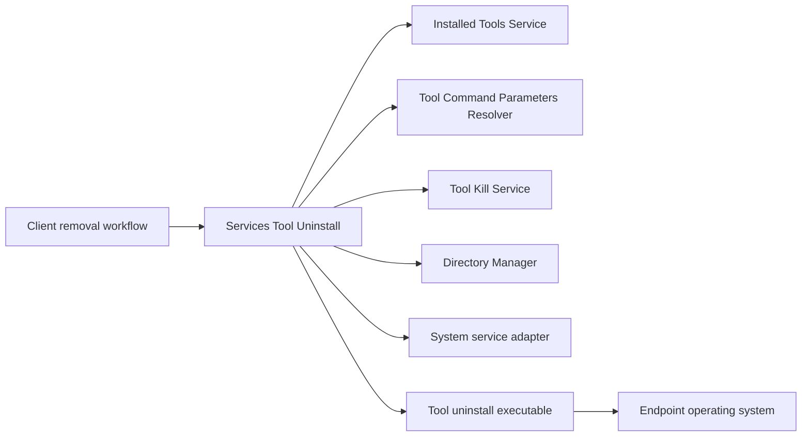
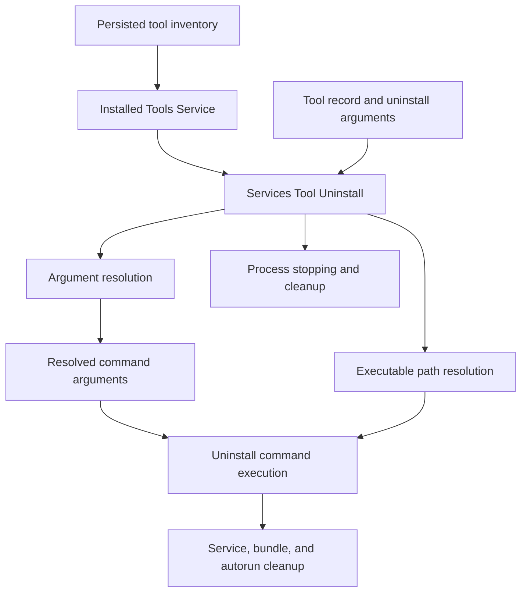
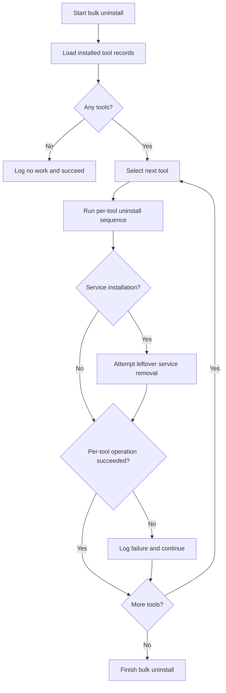
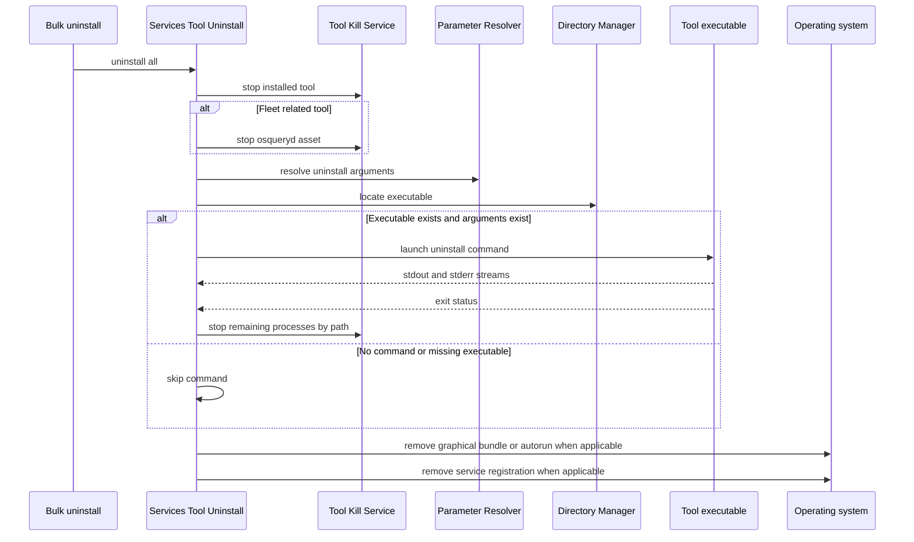
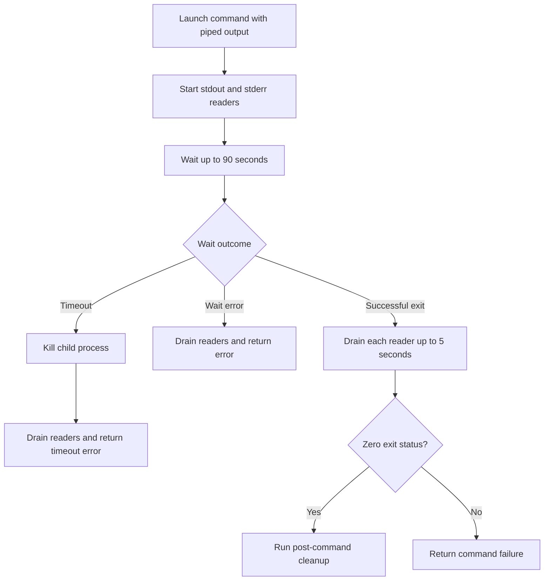

# Services Tool Uninstall

Services Tool Uninstall removes every integrated tool recorded on an OpenFrame Client endpoint during client removal. It is implemented by `ToolUninstallService` in the `openframe_agent_lib` Rust library, version `v0.0.5`, which this repository consumes through the OpenFrame Client runtime. The implementation source is maintained in [OpenFrame OSS Library](https://github.com/flamingo-stack/openframe-oss-lib/blob/7a766f00e4f58b5d89db007b878ac8d6e0c344f4/clients/openframe-client/src/services/tool_uninstall_service.rs).

Its primary contract is resilient bulk cleanup: it attempts every recorded tool even when one fails, while treating the steps for an individual tool as ordered and failure-sensitive. It stops running software before uninstalling, resolves dynamic uninstall arguments, executes the tool-owned uninstall command with bounded runtime and observable output, and performs platform-specific cleanup afterward.

## Role in the Client Lifecycle

This module belongs to the endpoint-resident OpenFrame Client. It is instantiated with four collaborators:

- **Installed Tools Service** supplies the persisted inventory of `InstalledTool` records. When the inventory file does not exist, its lookup returns an empty list rather than failing.
- **Tool Command Parameters Resolver** expands uninstall-command placeholders, including server URL, token-path, machine identifier, and tool asset paths.
- **Tool Kill Service** stops an installed tool before removal and performs best-effort process cleanup after removal.
- **Directory Manager** derives the executable location from the tool identity and installation metadata.

The module operates on the persisted `InstalledTool` model. Each record contains an identifier, optional uninstall arguments, installation classification, executable metadata, installed assets, and state. Installation can be a standard executable, a graphical application, or a named system service. The classification determines which cleanup actions are applicable.

## Architecture and Responsibilities

### Service Construction

`ToolUninstallService::new` receives its dependencies rather than creating them. This makes the service a coordinator: inventory persistence, parameter resolution, process control, directory selection, and native service management remain separate concerns.

| Component | Responsibility during uninstallation |
|---|---|
| `ToolUninstallService` | Enumerates tools, coordinates per-tool work, isolates failures across tools, and emits lifecycle logs. |
| `InstalledToolsService` | Reads the persisted list of installed tools. A missing inventory is interpreted as no work. |
| `ToolCommandParamsResolver` | Converts configured argument templates into executable arguments for the current endpoint and tool. |
| `ToolKillService` | Stops an installed tool, stops the special `osqueryd` asset for Fleet-related tools, and later searches for residual processes by executable path. |
| `DirectoryManager` | Selects either an absolute executable path, a tool-relative path under application support, or the platform default agent name. |
| System-service support | Removes a service registration left behind by service-based tools. On Windows this invokes native removal; on other supported targets the helper is a no-op. |
| macOS application-bundle support | Locates and deletes the enclosing application bundle for graphical tools. |
| Windows autorun support | Removes graphical-tool autorun registration. |

### Dependency Boundaries

The service does not delete the installed-tools inventory itself and does not implement a vendor-specific uninstaller. Instead, it executes uninstall arguments stored with each tool. This keeps tool-specific installation knowledge in installation and update workflows while preserving a consistent cleanup sequence.

## Bulk Uninstall Semantics

`uninstall_all` begins by loading all recorded tools. If none are present, it logs that there is nothing to remove and succeeds. For each tool, it calls the private per-tool operation and then separately attempts service-registration removal for service installations.

A per-tool failure is logged with its causal context, but does **not** prevent processing the next tool. Likewise, a failure to remove a leftover service registration is a warning rather than a bulk-operation failure. Therefore, a successful return means the module completed its traversal; it does not mean that every individual uninstaller completed without warning.

## Per-Tool Process

The per-tool sequence is intentionally ordered. Stopping the tool is required before the uninstall command runs, whereas subsequent cleanup after a successful command is best effort where noted.

1. **Stop the installed tool.** The Tool Kill Service receives the complete record and is called with deletion allowed. Failure stops this tool's sequence immediately.
2. **Handle Fleet-specific process cleanup.** If the tool identifier contains `fleet` without regard to case, the module also stops the `osqueryd` asset. Failure is fatal for this tool.
3. **Validate uninstall arguments.** If arguments are absent or empty, no command runs. The service performs graphical-application cleanup and returns success.
4. **Resolve parameters.** Configured placeholders are expanded before execution. Resolution failure is fatal for this tool.
5. **Locate the executable.** Directory Manager honors an absolute executable path, otherwise resolves a path beneath the tool directory, or uses the platform default agent filename. If the resulting file does not exist, the command is skipped and graphical cleanup proceeds successfully.
6. **Execute and observe the command.** The executable receives the resolved arguments with standard output and standard error captured concurrently.
7. **Require a successful exit.** A non-zero status, spawn failure, wait failure, or timeout fails the current tool.
8. **Clean residual state.** After a successful command, the service attempts a path-based process cleanup, removes a macOS application bundle where relevant, and unregisters Windows graphical autorun where relevant.

## Command Execution, Time Bounds, and Logging

The command is launched with `kill_on_drop` enabled and both output streams piped. Separate asynchronous readers consume output in chunks, split it into lines on carriage return or newline, and log non-empty trimmed lines with the tool identifier and originating stream. This preserves diagnostic output without waiting until command termination.

The main process wait is limited to **90 seconds**. On timeout, the child is killed and the operation returns an error that identifies the tool and notes that the most recent output has already been logged. Following normal completion, wait failure, or timeout, the service drains both output-reading tasks. Each drain has a **5-second** bound; a reader still open after that interval is aborted and a warning explains that a descendant process may be holding the pipe.

## Platform-Specific Cleanup

| Installation type or platform | Behavior |
|---|---|
| Standard executable | Stops the process before command execution and attempts post-command path cleanup. |
| Service installation | Runs the normal per-tool sequence, then attempts removal of the configured service name even if the sequence failed. Service removal is operational on Windows and inert on non-Windows targets. |
| Graphical application on macOS | Removes the containing application bundle after a skipped or successful uninstall command. Bundle-removal failures are warnings. |
| Graphical application on Windows | Removes autorun registration after a skipped or successful uninstall command. |
| Windows command spawn failure | Collects file-lock diagnostics for the executable before returning the spawn error. |

The module only performs the graphical-bundle cleanup for the graphical application installation variant. On non-macOS platforms, the application-bundle path is deliberately unused. Likewise, autorun cleanup is compiled only for Windows.

## Failure Model and Operational Considerations

### Failure Scope

- Loading the inventory fails the whole bulk operation because no safe tool list is available.
- Failure to stop a tool, stop required Fleet-specific `osqueryd`, resolve arguments, spawn or wait for a command, time out, or receive a non-zero exit status fails that tool's sequence.
- Bulk traversal continues after a failed tool, so later tools still receive cleanup attempts.
- Residual path-based process cleanup, macOS bundle deletion, Windows autorun cleanup, and leftover service removal are warning-oriented cleanup actions.

### Important Behaviors for Maintainers

- **Missing metadata is tolerated.** A missing tool executable or missing uninstall command is not itself an error. The command is skipped, then applicable graphical cleanup runs.
- **The recorded command is trusted operational input.** Parameter expansion occurs before process creation, so changes to placeholder semantics in Tool Command Parameters Resolver affect uninstall behavior.
- **Service cleanup is deliberately decoupled.** Service registration removal occurs after the main per-tool attempt, allowing the module to remove a stale Windows service even when that tool's command failed.
- **Completion is not an all-clean guarantee.** The final success log follows traversal, while individual warnings preserve per-tool and best-effort cleanup failures in endpoint logs.

## Observability and Troubleshooting

Use the structured client logs to determine the stage reached for each tool. The service emits messages for inventory size, each selected tool, process stopping, command arguments after resolution at debug level, executable selection, streamed command output, command duration, skipped execution, and cleanup failures.

When a tool remains installed or active after client removal, investigate in this order:

1. Confirm that the tool appears in the persisted installed-tools inventory and that its installation type and executable metadata are accurate.
2. Locate the per-tool stop message and identify whether Tool Kill Service reported an error.
3. Check whether uninstall arguments were present and whether parameter resolution failed.
4. Verify the resolved executable location existed. A missing executable intentionally bypasses the command.
5. Review lines tagged as uninstall command standard output or standard error, then the exit status or 90-second timeout message.
6. On Windows, review adjacent file-lock diagnostics after a command-spawn failure and verify that service or autorun cleanup was attempted.
7. On macOS, check application-bundle cleanup warnings and whether the configured executable path is within an application bundle.

## Source and Integration Notes

Services Tool Uninstall is library code from OpenFrame OSS Library, assembled into this repository's OpenFrame Client service through the `openframe_agent_lib` dependency. It has no network API of its own: its effects are local process control, executable invocation, filesystem-oriented application cleanup, service-registration cleanup, and structured logging. The surrounding client lifecycle is responsible for deciding when client removal invokes this service and for managing the installed-tools inventory before and after removal.
