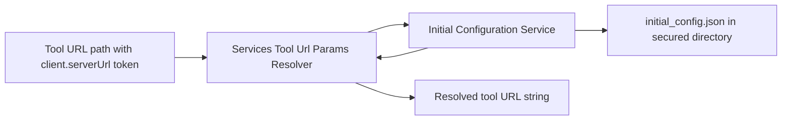
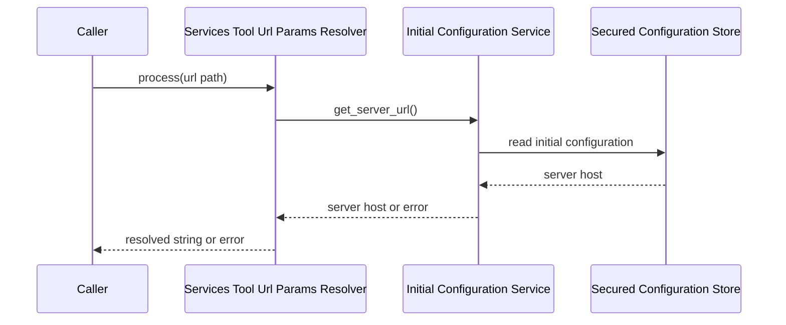
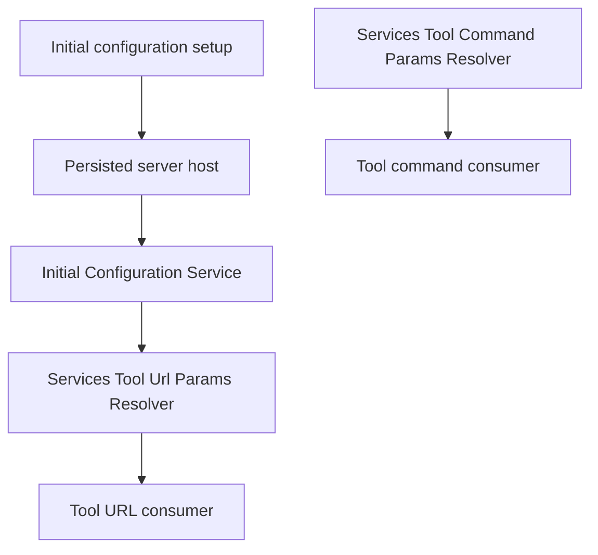
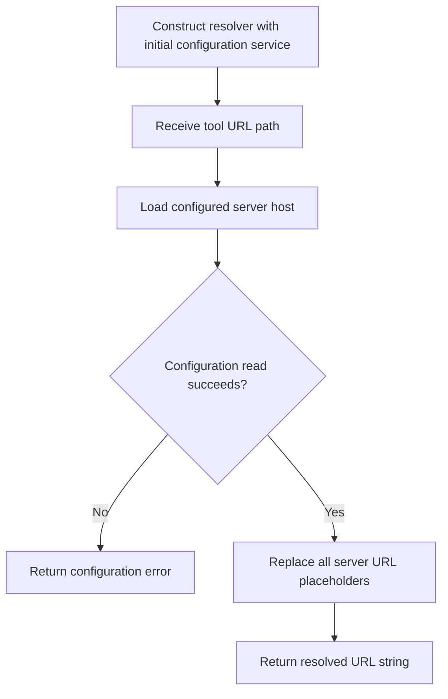

# Services Tool Url Params Resolver

Services Tool Url Params Resolver is a small OpenFrame Client agent service that resolves the `${client.serverUrl}` token embedded in a tool URL path. It reads the agent's persisted initial configuration and returns a new URL string in which every occurrence of that token has been replaced by the configured server host. The service is implemented by the OpenFrame OSS Library's Rust `openframe_agent_lib` artifact, version `v0.0.5`, which this repository assembles into its client runtime.

The implementation is available in the [OpenFrame OSS Library source](https://github.com/flamingo-stack/openframe-oss-lib/blob/7a766f00e4f58b5d89db007b878ac8d6e0c344f4/clients/openframe-client/src/services/tool_url_params_resolver.rs).

## Purpose and Scope

Tool integrations can store a URL path containing the `${client.serverUrl}` placeholder rather than a machine-specific server value. Services Tool Url Params Resolver makes that path usable by substituting the server host recorded during initial agent configuration.

The module deliberately has a narrow responsibility:

- It resolves only the `client.serverUrl` placeholder.
- It obtains the replacement value from `InitialConfigurationService`.
- It performs plain string replacement, so repeated occurrences are all resolved.
- It preserves all other URL content and leaves unrelated placeholders unchanged.
- It does not validate, normalize, parse, encode, or add a protocol to the returned value.

In particular, the stored configuration value is returned by `InitialConfigurationService.get_server_url()` from the `server_host` field. Callers must therefore provide a path whose surrounding format is already correct for the configured host.

## Architecture

The resolver is constructed with an `InitialConfigurationService` dependency. That configuration service maintains the initial configuration in `initial_config.json` beneath the agent's secured directory and performs its persisted writes atomically. At resolution time, Services Tool Url Params Resolver reads the configured host and applies it to the supplied string.



### Component Responsibilities

| Component | Responsibility |
|---|---|
| `ToolUrlParamsResolver` | Holds the configuration-service dependency and defines the server URL placeholder constant. |
| `new` | Constructs the resolver from an existing `InitialConfigurationService`; it does not read configuration or alter state. |
| `process` | Reads the configured server host and replaces every matching placeholder in the input URL path. It returns configuration read errors to its caller. |
| `InitialConfigurationService` | Locates and reads persisted initial configuration. Its `get_server_url` method returns the saved `server_host` value. |

## Resolution Data Flow

`process` accepts an immutable string slice and returns an owned `String`. This makes the operation non-mutating from the caller's perspective: the original URL path is retained, while the caller receives a separately resolved value.



The processing sequence is:

1. The caller supplies a URL path, potentially containing `${client.serverUrl}`.
2. Services Tool Url Params Resolver calls `get_server_url()` before replacement.
3. `InitialConfigurationService` loads the persisted configuration and extracts `server_host`.
4. When the read succeeds, the resolver replaces every exact `${client.serverUrl}` occurrence with that value.
5. The resolver returns the transformed string. If configuration loading fails, it returns that error and does not produce a resolved string.

## Resolution Semantics

The resolver uses Rust string replacement semantics rather than URL-aware processing. The following conceptual example illustrates the transformation; it is a behavior description, not a configuration requirement.

```text
Input:  ${client.serverUrl}/tool/connect?callback=${client.serverUrl}/complete
Host:   tenant.example.net
Output: tenant.example.net/tool/connect?callback=tenant.example.net/complete
```

Consequences of this design:

- Replacement is global, not limited to the first occurrence.
- The configured host is inserted verbatim. A scheme, port, path prefix, or escaping is not added or changed by this module.
- Inputs without the exact placeholder are returned unchanged after the configuration lookup succeeds.
- A configuration read failure also affects inputs that do not contain the placeholder, because `process` reads the server URL before calling `replace`.

## Component Interaction and Boundaries

Services Tool Url Params Resolver is part of the Rust client service layer supplied by OpenFrame OSS Library. It is adjacent in purpose to Services Tool Command Params Resolver, which resolves command-argument placeholders and may construct an HTTPS server URL for command arguments. They are distinct components with different substitution rules: this module substitutes the stored host exactly as retrieved and only for tool URL paths.



Do not merge the two resolver behaviors without explicitly deciding how schemes, paths, and placeholder compatibility should work. The source shown for Services Tool Url Params Resolver provides no URL parsing, credential injection, dynamic asset lookup, or command argument processing.

## Error Handling and Operational Considerations

`process` returns `anyhow::Result<String>`. The only fallible operation in its own implementation is loading the server URL through `InitialConfigurationService`. Replacement itself is in-memory and does not introduce a separate validation or network failure path.

Maintain the following invariants when integrating or changing this module:

- Initial configuration must be available and contain a usable server host before resolution is attempted.
- Treat the returned value as a substituted string, not as a URL that has been validated by this service.
- Preserve the exact placeholder spelling `${client.serverUrl}` for compatibility with the resolver constant.
- If a caller requires a scheme such as HTTPS, it must be represented by the input format or performed by a separate, explicitly defined normalization step.

## Lifecycle



The resolver is cloneable because its underlying configuration-service dependency can be retained by value across client workflows. Construction has no persistence or networking side effect; all configuration access happens when `process` is called.

## Maintenance Guidance

When evolving Services Tool Url Params Resolver, test at least these cases:

1. A path containing one server URL placeholder.
2. A path containing multiple occurrences of the placeholder.
3. A path without the placeholder, confirming that its text remains unchanged when configuration can be read.
4. Missing or unreadable initial configuration, confirming that the error reaches the caller.
5. A configured host with any required deployment-specific port or prefix, confirming that the resolver preserves it verbatim.

Any expansion beyond simple server-host substitution, such as adding URL parsing, protocol handling, or additional placeholder types, changes the module's compatibility boundary and should be specified independently.