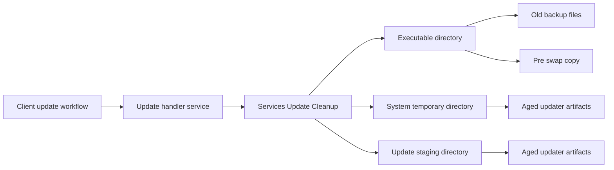
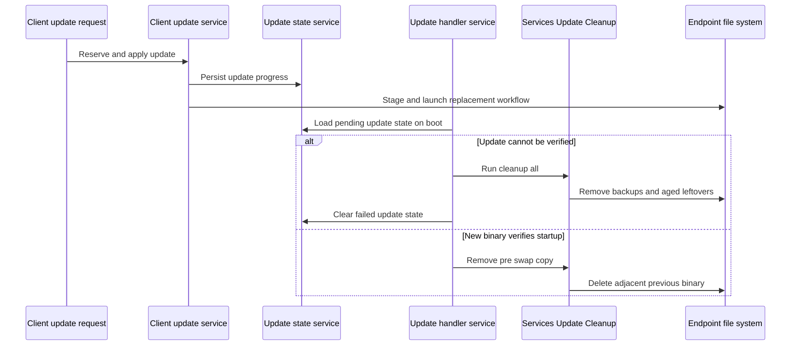
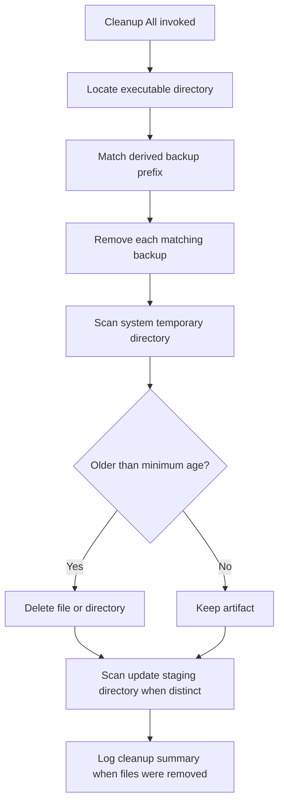

# Services Update Cleanup

Services Update Cleanup is the OpenFrame Client maintenance component that removes files left behind by client self-updates. It runs on the managed endpoint as part of the Rust client supplied by the OpenFrame OSS Library, artifact `openframe_agent_lib`. Its narrowly scoped responsibility is to reclaim obsolete updater artifacts without deleting files that may belong to an active update.

The implementation is provided by [Update Cleanup Service source](https://github.com/flamingo-stack/openframe-oss-lib/blob/7a766f00e4f58b5d89db007b878ac8d6e0c344f4/clients/openframe-client/src/services/update_cleanup_service.rs). This tenant repository assembles and runs that client library; it does not contain a separate cleanup implementation.

## Purpose and boundaries

The module addresses three kinds of file-system residue:

- **Old executable backups** beside the current client binary. Backups are recognized by the current executable name followed by `.backup.`.
- **Pre-swap copy** of the executable, recognized by the `.prev` suffix. This copy is retained through startup verification and can be removed after the replacement binary has proven it booted.
- **Script updater artifacts** in temporary and update-staging locations. Eligible names start with `openframe-update-`, or start with `openframe-updater-` and end in either `.ps1` or `.sh`.

It does not download, verify, launch, or replace binaries. Those actions belong to the client-update workflow. Services Update Cleanup is deliberately a best-effort post-update and failure-recovery operation: individual deletion failures are logged and do not prevent remaining candidates from being considered.

## Architecture

`UpdateCleanupService` holds one piece of state: the executable path whose neighboring backups and pre-swap copy it manages. The normal constructor obtains the currently running executable path. The alternate binary-oriented constructor permits callers and tests to target another executable path without relying on process state.

The staging directory is platform dependent. On Windows it is the client installation directory's `update` directory. On other supported platforms it resolves to the system temporary directory. The cleanup logic avoids scanning the same location twice when staging and temporary directories resolve to the same path.

## Component responsibilities

| Component | Responsibility |
|---|---|
| `UpdateCleanupService` | Owns the target executable path and coordinates cleanup operations. |
| Constructor for the running binary | Obtains the process executable path and returns a configured service, reporting an error when that path cannot be determined. |
| Constructor for an explicit binary | Creates a service for a supplied executable path. |
| Cleanup All | Removes recognized old backups, then sweeps aged updater artifacts. It reports one summary log entry when at least one file was removed. |
| Remove Pre Swap Copy | Deletes the adjacent `.prev` file only when it exists. |
| Sweep Temporary Leftovers | Scans the system temporary directory and update-staging directory, subject to an age threshold. |
| Sweep Update Leftovers | Performs the directory-level recognition, age guard, and file or recursive-directory deletion. |

## Cleanup policy and safety controls

### Backup cleanup

The service derives the backup prefix from the executable file name rather than using a global pattern. Consequently, only files adjacent to that executable whose names begin with the derived backup prefix are candidates. Each candidate is removed independently, allowing a locked or permission-denied file to be reported while cleanup continues for other backups.

### Age-gated updater sweep

Routine cleanup protects live updater work by applying the configured minimum age, `TEMP_LEFTOVER_MIN_AGE_SECS`, to script-based updater artifacts. An item is skipped when its age is below that threshold. It is also skipped when metadata, modification time, or elapsed-time calculation is unavailable: missing age information is treated conservatively as too fresh.

The lower-level directory sweep also supports an age-free mode. Passing no age constraint removes matching update artifacts regardless of age, which is intended for uninstall cleanup rather than the routine post-update sweep.

### File and directory handling

A matching leftover can be either a file or a directory. Files are deleted directly; directories are removed recursively. Unreadable directories are treated as empty cleanup targets, not as fatal errors. The service emits informational logs for successful removals and warning logs for failures, including the affected path.

## Interaction with the client update lifecycle

Services Update Cleanup is one recovery and finalization step in a larger endpoint update lifecycle implemented by the OpenFrame Client library.

The update service prevents overlapping live update scripts with an update guard and defers an update while tool operations or package upgrades are busy. It records update state shortly before launching the updater. At later startup, the update handler evaluates that state against the running version. An unverified update may remain pending for later boot attempts; the crash-loop guard eventually treats an unresolved attempt as failed.

On the failure path, the update handler records failed status, reports a failed delivery result, invokes Cleanup All, prunes updater transcripts through the last-known-good service, and clears the persisted update state. On the successful path, the pre-swap copy is no longer needed after boot verification and is eligible for removal. This sequencing ensures cleanup does not discard the previous binary before the replacement has had a chance to establish a successful boot.

## Routine cleanup flow

The sweep recognizes only the updater naming conventions described above. It does not perform broad temporary-directory deletion. A routine invocation may therefore leave newly created updater artifacts in place until they age past the configured threshold, which prevents a concurrent updater from losing its staged files.

## Operational behavior

### Observability

Use client logs to distinguish expected maintenance from a cleanup problem:

- A successful deletion produces an informational entry identifying the removed backup, pre-swap copy, or update artifact.
- A successful routine sweep with one or more removals emits an aggregate count of old files removed.
- Failure to inspect the executable path or directory is reported as a warning where applicable.
- Failure to delete one target is a warning with the path and operating-system error; the service continues processing other candidates.

### Failure tolerance

The API exposes an asynchronous Cleanup All operation because it is invoked in the asynchronous update-handler lifecycle, although the individual file-system operations are synchronous. Its fault model is intentionally non-blocking: old-backup enumeration errors are caught and warned, directory-read errors result in no candidates, and deletion errors are isolated per entry. The only construction-time failure is inability to discover the current executable path.

### Permissions and locked files

Cleanup runs with the file-system permissions of the OpenFrame Client process. Antivirus activity, service locks, or ownership and access-control restrictions can prevent deletion. The module does not escalate privileges, retry indefinitely, or remove arbitrary files to compensate. Operators should investigate persistent warnings in the client logs and the surrounding update workflow rather than manually widening cleanup patterns.

## Maintenance guidance

When changing this module, preserve these invariants:

1. Keep name matching specific to known updater outputs and executable-derived backups.
2. Maintain the conservative age check for routine sweeps, including the behavior that unknown modification age is skipped.
3. Do not delete the `.prev` pre-swap copy before successful boot verification.
4. Keep deletion failures non-fatal so one locked artifact cannot block state cleanup or recovery reporting.
5. Consider Windows staging behavior and the shared temporary-directory behavior on non-Windows systems when adding scan locations.

The source file includes a dedicated test module, indicating that cleanup matching, age behavior, and deletion semantics should be covered whenever artifact naming or retention rules change.
