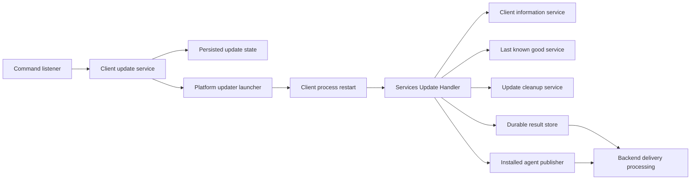
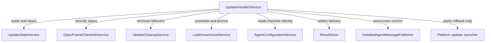
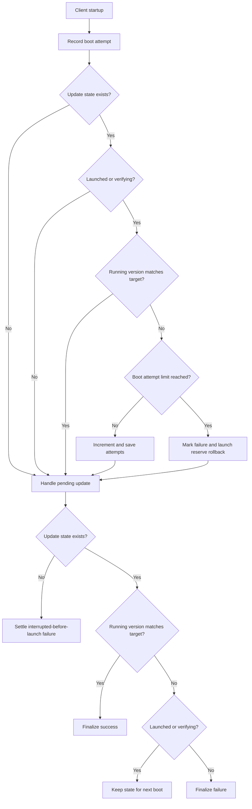
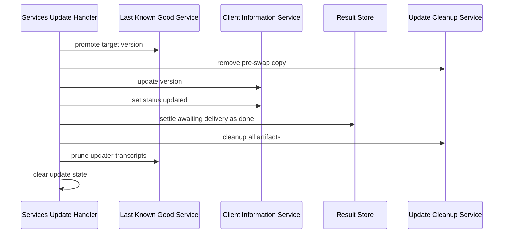
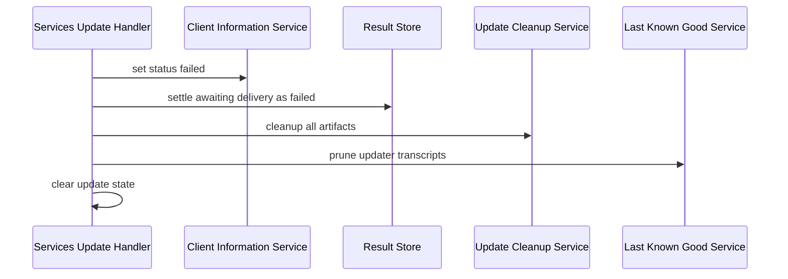
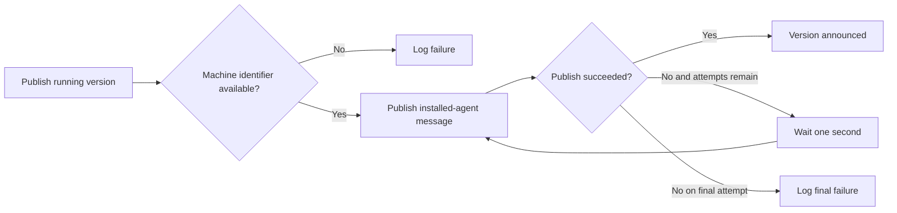

# Services Update Handler

Services Update Handler is the startup-time reconciliation component for an OpenFrame Client self-update. It is implemented by `UpdateHandlerService` in the OpenFrame OSS Library and runs in the Rust client assembled by this repository. Its responsibility is to turn the persisted outcome of a prior updater launch into a durable success or failure result, protect a device from an unresolved update crash loop, and report the version that is actually running.

The implementation is supplied by the `openframe_agent_lib` artifact from OpenFrame OSS Library. The exact implementation is available in [update handler service source](https://github.com/flamingo-stack/openframe-oss-lib/blob/7a766f00e4f58b5d89db007b878ac8d6e0c344f4/clients/openframe-client/src/services/update_handler_service.rs).

## Responsibilities

The handler has four externally relevant jobs:

1. **Account for boots during an incomplete update.** `record_boot_attempt` increments persisted boot attempts only while the update is in the `UpdaterLaunched` or `Verifying` phase and the active binary does not already match the target version.
2. **Reconcile the update on startup.** `handle_pending_update` compares the compile-time `OPENFRAME_VERSION` of the running client with the target stored in update state.
3. **Settle command delivery.** A client-update delivery parked while the process restarts is completed as `Done` or `Failed` through the durable result store. Successful sequenced deliveries are also recorded as applied for the machine.
4. **Publish the active version.** `publish_running_version` sends an installed-agent version message, retrying publication up to five times when the machine identifier is available.

The module does not download or swap a binary itself. The client-update service reserves and applies an update; platform-specific updater launchers perform the executable transition. Services Update Handler observes their persisted state after startup and makes the outcome authoritative.

## Position in the Update Lifecycle

The pre-restart path creates an `UpdateState` containing at least the target version, phase, boot-attempt count, and an optional failure reason. Before launching an update, the client-update service rejects overlapping work, marks a client update as pending, avoids an update that targets the running version, and refuses a downgrade below the last-known-good anchor when downgrade is disabled. It changes client bookkeeping to `Updating` before handing off to the updater.

## Component Model

`UpdateHandlerService` is constructed with the collaborators below. The constructor is dependency injection only; it performs no reconciliation until the caller invokes a public operation.

| Collaborator | Role in Services Update Handler |
|---|---|
| `UpdateStateService` | Loads, saves, clears, and locates the persisted update-state file. State writes use an atomic write path. |
| `OpenFrameClientInfoService` | Updates the local client version and update status after a terminal outcome. |
| `UpdateCleanupService` | Removes the pre-swap executable copy after success and sweeps update leftovers for either terminal result. |
| `LastKnownGoodService` | Promotes a validated running binary into the reserve copy and anchor, supplies paths for rollback, and prunes updater transcripts. |
| `InstalledAgentMessagePublisher` | Publishes the running `openframe-client` version for the machine. |
| `AgentConfigurationService` | Resolves the local machine identifier used in applied-sequence recording and version publication. |
| `ResultStore` | Durably settles client-update deliveries that are awaiting a restart, and records applied sequences after success. |

### Dependency Boundaries

Only the crash-loop rollback path invokes the platform updater launcher directly. That path is restricted to Windows and macOS; on other platforms it logs that reserve rollback is not implemented.

## Startup Reconciliation

A caller should invoke boot accounting before pending-update reconciliation. This preserves evidence of an update that restarts the agent before reaching a conclusive phase.

### Boot-Attempt Guard

`record_boot_attempt` is deliberately narrow:

- It returns without modification when no state exists or the phase is outside `UpdaterLaunched` and `Verifying`.
- If the target equals the running version, it does not increment the counter. The later reconciliation path can recognize success.
- If the counter has already reached `CRASH_LOOP_MAX_BOOT_ATTEMPTS`, it calls failure handling and attempts a reserve rollback. The rollback uses the current executable as target, the persisted state path, the last-known-good reserve path, a new rollback transcript path, and the full service name.
- Otherwise it increments `boot_attempts` and saves state atomically.

The check tests the persisted count before incrementing. Consequently, the guard takes the terminal failure branch on a later boot after the configured maximum was recorded, rather than in the boot that writes that maximum.

### In-Flight States

When the running version does not match the target but the persisted phase is `UpdaterLaunched` or `Verifying`, `handle_pending_update` leaves state intact. This treats the outcome as unresolved and allows a later boot to continue verification or trigger the crash-loop guard. Any other nonmatching phase is terminally failed.

If no update state can be loaded during pending-update handling, the handler settles an awaiting client-update delivery as failed with the reason `interrupted by agent restart before the updater started`. This is relevant to delivery-backed updates; legacy updates may have no matching delivery to settle.

## Terminal Outcome Processing

### Successful Update

Success is determined exclusively by the running binary version matching the persisted target version. The success path intentionally makes best-effort bookkeeping failures nonfatal while ensuring that cleanup and state removal continue.

The handler tries to promote the running binary as the last-known-good reserve and writes the target version as the anchor. Failure to promote is logged but does not invalidate an update whose running version already matches the target. It then:

- removes the pre-swap copy;
- records the target as the client version and sets update status to `Updated`;
- settles awaiting client-update deliveries as `Done`;
- removes update leftovers, retains only the configured number of updater transcripts, and clears persisted update state.

### Failed Update

Failure handling logs the target, phase, and persisted error when available. If no explicit error was stamped by the updater, the log directs operators to the updater transcript in the logs directory and delivery reporting uses a synthesized reason containing the target version and phase.

A failed status update or a failed delivery settlement is logged and does not stop cleanup. `clear` can still surface an error because it is part of the method's `Result` contract.

## Delivery Semantics

The result store is the handoff between a restart-spanning update and backend delivery processing. Services Update Handler settles only records that are both in `AwaitingRestart` and of the client-update delivery type.

| Outcome | Delivery action | Applied sequence action |
|---|---|---|
| Success | Settle matched deliveries as `Done`. | For each settled delivery with a sequence, persist the sequence for the resolved machine identifier. |
| Failure | Settle matched deliveries as `Failed` with an error when known. | No sequence is recorded. |
| No matching delivery | No-op after state processing. | No-op. |
| Result-store error | Log that backend timeout closure is the fallback. | No applied-sequence work occurs. |

Sequence recording is monotonic for a delivery key and machine: an existing sequence that is equal to or newer than the proposed value is preserved. If the machine identifier cannot be resolved, the delivery remains settled but sequence recording is skipped and logged.

## Running-Version Publication

After startup reconciliation, `publish_running_version` retrieves the machine identifier and publishes an installed-agent message for `openframe-client` with the running `OPENFRAME_VERSION`. It makes at most five publication attempts and waits one second between unsuccessful attempts except after the final attempt. Failure to obtain the machine identifier or to publish after all attempts is logged; it does not change update state or delivery state.

## Operational Invariants

- A target version equal to the active binary is the success criterion; status bookkeeping alone cannot establish a successful update.
- Terminal success and failure both clean residual update files, prune retained updater transcripts, and clear persisted update state.
- An unresolved launch or verification state is preserved across boots rather than prematurely marked failed.
- Crash-loop rollback is a recovery attempt, not proof that rollback succeeded. Launcher errors are logged and do not prevent the update from being marked failed.
- Status, version, delivery, promotion, and publication integrations are best effort where noted in the implementation. Operators should use logs and retained updater transcripts when an update remains unresolved or reporting fails.

## Maintenance Considerations

Changes to update phases, target-version formatting, state-file location, or updater-launch behavior must be evaluated together with this handler. In particular, a new nonterminal phase must be added to both boot accounting and pending-update reconciliation if it should survive a restart. A phase omitted from those decisions will be treated as failure when the target version is not running.

Testing should cover the following boundaries:

- no state file during startup;
- a matching target and running version;
- each unresolved phase across successive boots;
- the boot-attempt threshold and rollback-launch failure;
- a failure reason supplied by the updater and the synthesized fallback reason;
- success and failure when client-information, delivery, cleanup, or last-known-good operations fail;
- version publication failures before a later successful retry and after the fifth failure.
