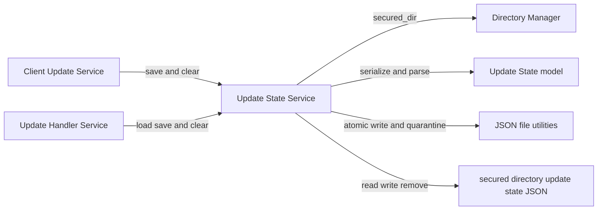
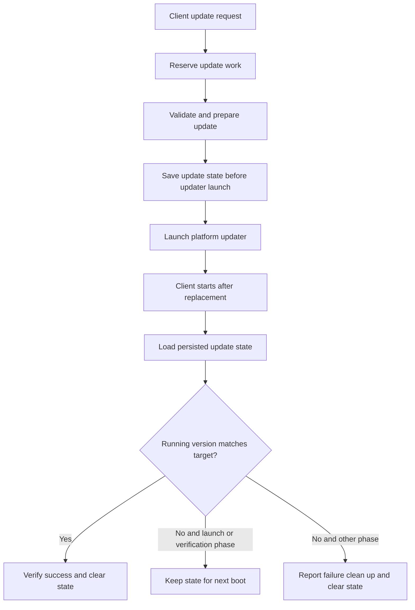
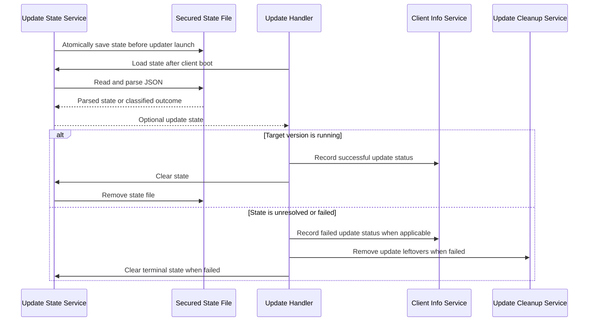

# Services Update State

Services Update State is the OpenFrame Client persistence boundary for an in-progress client binary update. It stores an `UpdateState` document in the agent's secured directory so that the next client process can determine whether an update must be verified, recovered, or treated as failed.

The implementation is supplied by the OpenFrame OSS Library's `openframe_agent_lib` Cargo artifact, version `v0.0.5`, which this repository consumes. Its source is maintained in the [OpenFrame OSS Library update state service](https://github.com/flamingo-stack/openframe-oss-lib/blob/7a766f00e4f58b5d89db007b878ac8d6e0c344f4/clients/openframe-client/src/services/update_state_service.rs).

## Responsibilities

`UpdateStateService` owns the lifecycle of `update_state.json`:

- Resolves the state file under the `DirectoryManager` secured directory and ensures the directory structure exists during construction.
- Reads and classifies the file as missing, valid, or corrupt.
- Serializes valid `UpdateState` values as pretty JSON and replaces the file atomically.
- Removes state after a completed or terminally failed update.
- Exposes a simple incomplete-update check for recovery paths.

It deliberately does not download artifacts, replace binaries, start an updater, or decide whether a version is acceptable. Those decisions belong to the client update and update handler services.

## Architecture and Boundaries

The service stores a small recovery record rather than a full update plan. The record contains the target version, an update phase, boot-attempt count, optional start time, and optional updater error. The phase enumeration retains earlier stages such as `Validating`, `Downloading`, `Extracting`, and `PreparingUpdater` for compatibility with older state files. Current client behavior persists its state immediately before launching the updater, normally using the `UpdaterLaunched` phase; later updater or boot processing can also use `Verifying`, `Completed`, `RolledBack`, or `Failed`.

## Persistence Contract

### State location

Construction derives the exact path as `DirectoryManager.secured_dir()` joined with `update_state.json`. `UpdateStateService::new` calls `ensure_directories`; construction fails if the secured directory cannot be prepared. `get_state_file_path` returns the resolved path as a string for diagnostics.

### State shape

| Field | Purpose |
|---|---|
| `target_version` | Version that the updater is expected to install and verify. |
| `phase` | Current `UpdatePhase` used by recovery logic. |
| `boot_attempts` | Counter used by the boot crash-loop guard; absent values deserialize as zero. |
| `started_at` | Optional RFC 3339 start timestamp; absent values are accepted. |
| `last_error` | Optional failure reason supplied by the updater. |

New state starts with phase `Validating`, zero boot attempts, a UTC RFC 3339 start timestamp, and no error. Callers update its phase before persistence when appropriate.

### Write guarantees

`save` renders pretty JSON and delegates replacement to `atomic_write`. That utility creates a temporary file in the destination directory, writes the complete content, flushes it to storage, then persists it over the target. On Unix, it sets the temporary file permissions to `0644`; on Windows, the utility has a fallback for a held target file. These behaviors reduce the chance that a process interruption leaves a partially written state document.

### Read classification and corrupt-file handling

`read_state` differentiates all three storage outcomes through `JsonFile<UpdateState>`:

| Result | Meaning | Consequence |
|---|---|---|
| `Missing` | No state file exists. | There is no persisted update to recover. |
| `Parsed` | JSON successfully deserialized to `UpdateState`. | The caller receives the state. |
| `Corrupt` | The file exists but cannot be deserialized. | The parser logs the issue and attempts to move the file aside under a quarantine name, then starts fresh. |

`load` is the convenience interface: it maps both missing and corrupt outcomes to `None`. Therefore `has_incomplete_update` returns `true` only for a successfully parsed state; a corrupt file is treated as no recoverable state. Use `read_state` when a caller must distinguish corruption from absence.

## Update Lifecycle

The state file is an inter-process handoff between an update request, the platform-specific updater, and a subsequent client boot.

### Coordination with the client update service

The client update service prevents overlapping live updates with an update guard, defers a request while tools or package work is busy, validates requested version syntax, and ignores a request for the currently running version. It also applies a last-known-good downgrade guard when configured not to allow downgrades.

After preparation, it creates an `UpdateState` for the canonical requested version. The update implementation persists the state once, immediately before updater launch. If execution fails, the update service marks client information as failed when possible, clears stale update state, and allows message delivery retry behavior to handle another attempt.

### Recovery and boot accounting

On startup, the update handler loads the record:

1. If no parsed state exists where a pending result is expected, it reports an interrupted-before-launch failure.
2. If the running client version equals `target_version`, success processing verifies the result and clears the state.
3. If the version differs but the phase is `UpdaterLaunched` or `Verifying`, it retains the state for another boot rather than declaring failure immediately.
4. For all other mismatches, it reports failure, performs update cleanup, prunes retained updater transcripts, and clears state.

Before that resolution, the handler records boot attempts only for unresolved `UpdaterLaunched` and `Verifying` records whose target does not already match the running version. When the configured crash-loop limit is reached, it handles the update as a failure and requests a rollback using the reserved last-known-good binary. This makes the persisted record the durable input to both recovery and crash-loop protection.

## Component Interaction

## Operational Notes

- A valid state file means recovery is required; it is not merely an informational log.
- Do not hand-edit the state file while an update is active. Invalid JSON is quarantined and the recovery path sees no parsed state, potentially changing the updater's behavior to that of an uninstalled or nonrecoverable state.
- Preserve the atomic-write path when changing persistence behavior. Direct writes can expose a truncated or zero-filled file after interruption.
- State removal is intentionally idempotent: `clear` succeeds when the file is already absent.
- Read operations log the path and raw file content at information level. Treat state contents and logging policy as operationally relevant when extending the model.

## Maintenance Guidance

When extending the persisted model or phase transitions:

1. Keep deserialization compatible with existing state files; the phase list explicitly supports older clients.
2. Decide how boot recovery should interpret each new phase before allowing it to be persisted.
3. Ensure failure paths either retain state for intentional retry or call `clear` after terminal cleanup; stale state participates in later boot recovery.
4. Exercise missing, valid, corrupt, write-failure, version-match, unresolved, and crash-loop scenarios.
5. Keep writes atomic and keep corrupt-file handling nonfatal so that a bad recovery file does not prevent client startup.
