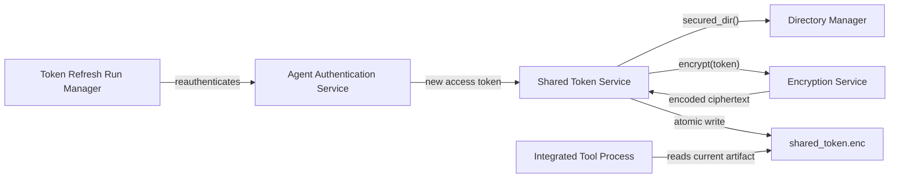
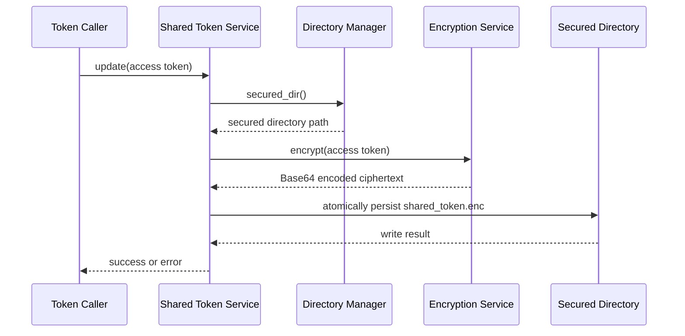
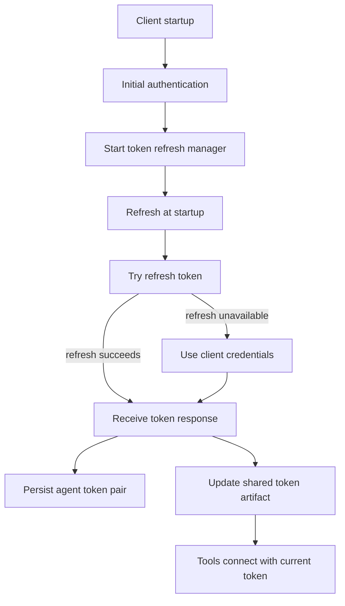
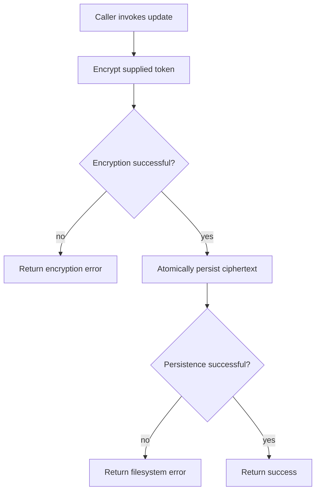

# Shared Token Service

Shared Token Service maintains the OpenFrame Client's tool-consumable access token as an encrypted file. It is a small synchronous adapter around the client directory layout, the encryption service, and atomic file persistence. The implementation belongs to the `openframe_agent_lib` Cargo artifact supplied by OpenFrame OSS Library version `v0.0.5` and is run by this repository's OpenFrame Client deployment.

The source implementation is [shared_token_service.rs](https://github.com/flamingo-stack/openframe-oss-lib/blob/16e7c1cbd9664e7d10ec5ebca7d53c9bd314decf/clients/openframe-client/src/services/shared_token_service.rs).

## Responsibilities and Boundaries

Shared Token Service has one responsibility: replace the current shared token artifact when a caller supplies a new access token.

- It receives a plaintext token only for the duration of `update`.
- It asks `DirectoryManager` for the secured client directory.
- It encrypts the token through `EncryptionService`.
- It atomically writes the resulting encoded ciphertext to `shared_token.enc`.
- It returns an error if encryption or persistence fails.

It does **not** acquire tokens, determine refresh timing, persist the agent's access and refresh-token pair, decrypt the shared file, or distribute the token over the network. Those concerns belong to the authentication, configuration, refresh, and tool-connection portions of the OpenFrame Client.

## Architecture



At startup, the OpenFrame Client completes registration and authentication before it starts Token Refresh Run Manager. The refresh manager immediately refreshes because the remaining lifetime of the stored token is not trusted, and its implementation records that `shared_token.enc` must be valid before tools connect. The service therefore sits at the boundary between client authentication and locally integrated tools.

## Components

| Component | Role | Behavior |
|---|---|---|
| `SharedTokenService` | Token-file coordinator | Holds cloneable `DirectoryManager` and `EncryptionService` dependencies. |
| `new` | Constructor | Receives and stores the directory and encryption dependencies without I/O. |
| `update` | Rotation operation | Resolves the secured path, encrypts the supplied token, and atomically replaces the artifact. |
| `DirectoryManager` | Filesystem location provider | Supplies `secured_dir()`, which is joined with the fixed filename `shared_token.enc`. |
| `EncryptionService` | Confidentiality boundary | Encrypts the supplied token before any file write. The observed encrypt operation uses AES-256-GCM, creates a fresh random 12-byte nonce, prefixes it to ciphertext, then Base64-encodes the combined value. |
| `atomic_write` | Durable replacement primitive | Creates the parent directory if necessary, writes and synchronizes a temporary file, then persists it over the target path. It includes a Windows held-file replacement path. |

## Token Update Flow



The operation has a strict order: encryption precedes persistence, and a persistence attempt occurs only after encryption succeeds. `atomic_write` synchronizes the temporary file before persisting it, reducing the risk that a power loss leaves a renamed but incomplete token file. A failed encryption or filesystem operation is propagated to the caller; the service does not retry, log, or retain the plaintext itself.

## Authentication and Refresh Relationship



`AgentAuthService.reauthenticate` first attempts refresh-token authentication and falls back to client credentials when that attempt fails. Separately, `AgentConfigurationService.update_tokens` persists both the access token and refresh token under its asynchronous write lock. Shared Token Service is narrower: it receives the access token selected by that workflow and materializes the encrypted file for local tool use.

The Token Refresh Run Manager repeats reauthentication on its schedule. On a successful refresh, it calculates the next schedule from the response and logs that the shared token file was updated. Failures are retried using the manager's retry interval. When tenant deactivation suspends the client, the manager uses the deactivation probe delay instead of the normal refresh loop.

## Persistence Contract

The artifact location is conceptually:

```text
DirectoryManager.secured_dir() / shared_token.enc
```

The file contains the output returned by `EncryptionService.encrypt`, not the original token. The file name and location are fixed by the implementation; Shared Token Service has no configuration surface for another name, path, encryption policy, retention period, or reader authorization.

Although the token payload is encrypted before writing, operational deployments must still protect the secured directory. The shared file is an authentication-related artifact, and the atomic writer may create its parent directory. On Unix, the generic atomic writer explicitly applies mode `0644` to its temporary file before persistence, so directory ownership and permissions remain an important part of the local security boundary.

## Failure Semantics



A failure leaves the caller responsible for recovery. The module does not offer rollback, in-memory fallback storage, decryption validation, or its own retry policy. Because replacement is delegated to `atomic_write`, an existing target is replaced only after the temporary content has been written and synchronized successfully.

## Maintenance Guidance

- Preserve the operation order: resolve destination, encrypt, then atomically replace the file. Writing plaintext, even transiently, would violate the module boundary.
- Keep `update` free of token acquisition and refresh policy. Those belong to the authentication and refresh services.
- Treat the filename as an interoperability contract with local tool processes. Coordinate any rename with every reader and deployment migration.
- Exercise failures from encryption, directory creation, write, synchronization, and replacement paths when changing this service or the atomic writer.
- Review directory permissions together with encryption changes. Encryption protects the contents, while the secured directory controls which local principals can access the artifact.

## Source and Runtime Context

The implementation is sourced from OpenFrame OSS Library's `openframe_agent_lib` artifact, pinned by this repository at version `v0.0.5`. This repository deploys the OpenFrame Client as part of the tenant platform; the client configuration points the broader platform to MongoDB, Redis, Kafka, and NATS, while Shared Token Service itself performs no network, database, message-broker, or HTTP operation.
