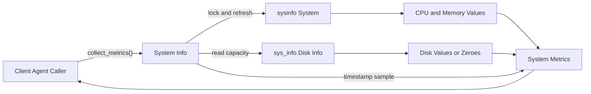
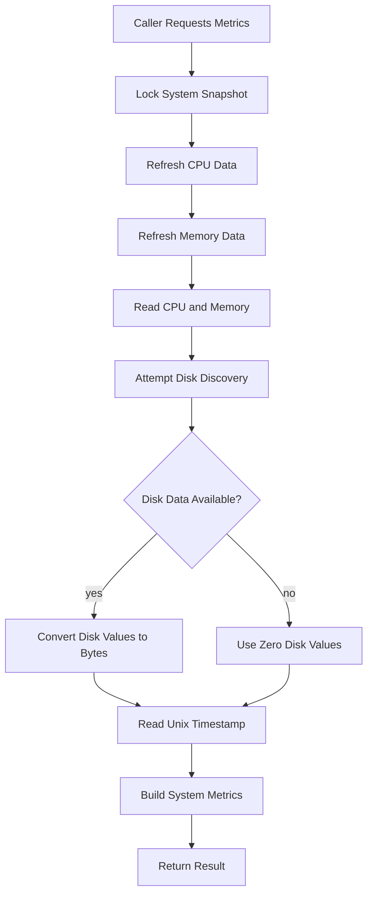
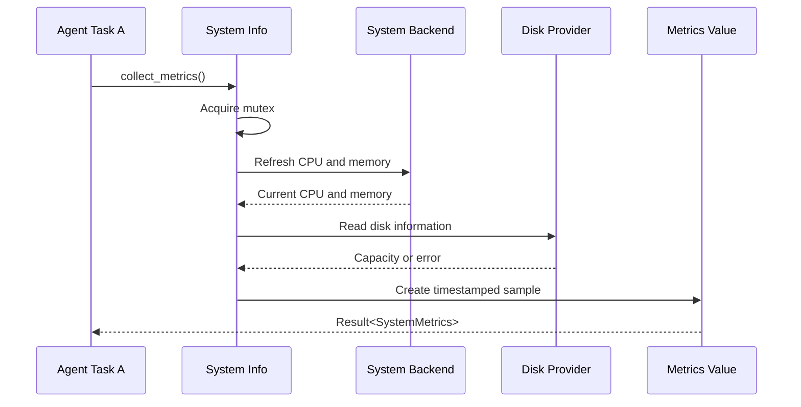

# System Info

System Info is a small, synchronous telemetry collector in the OpenFrame client agent. It owns a reusable `sysinfo::System` snapshot behind a mutex, refreshes CPU and memory data for each collection, obtains host disk capacity through `sys_info`, and returns a serializable `SystemMetrics` value. The implementation is supplied by the `openframe_agent_lib` Cargo dependency from OpenFrame OSS Library version `v0.0.5`; the tenant repository assembles and runs that library as part of its client workload.

Source: [system.rs in OpenFrame OSS Library](https://github.com/flamingo-stack/openframe-oss-lib/blob/16e7c1cbd9664e7d10ec5ebca7d53c9bd314decf/clients/openframe-client/src/system.rs).

## Responsibilities

- Initialize the system-information backend with CPU and memory refresh capabilities.
- Serialize access to the mutable backend so concurrent callers do not refresh or read it simultaneously.
- Refresh and return the global CPU utilization, total memory, and used memory.
- Attempt to read total and used disk capacity, while preserving a successful metrics response when disk discovery fails.
- Timestamp every sample as Unix epoch seconds for downstream correlation.

System Info does not publish metrics itself, retain sample history, schedule collection, or calculate uptime. Its `uptime` output field is currently retained for compatibility and is set to `0`.

## Architecture

`SystemInfo` is the stateful collector. `SystemMetrics` is the output boundary: it derives `Serialize`, allowing a caller to encode a completed sample without exposing the internal `sysinfo::System` instance.

## Core Types

| Component | Role | Important behavior |
|---|---|---|
| `SystemInfo` | Collector and synchronization boundary | Contains `Mutex<System>` so the mutable operating-system snapshot is safely shared between callers. |
| `SystemMetrics` | Serializable sample | Carries timestamp, CPU utilization, memory totals and use, disk totals and use, plus the compatibility uptime field. |
| `SystemInfo::new` | Constructor | Builds `sysinfo::System` with CPU and memory refresh details enabled. |
| `SystemInfo::collect_metrics` | Sampling operation | Locks the backend, refreshes CPU and memory, reads disk information on a best-effort basis, and constructs one sample. |

## Metric Contract

| Field | Type | Source | Semantics |
|---|---|---|---|
| `timestamp` | `u64` | System clock | Unix epoch seconds when the sample is created. Clock conversion failures are returned to the caller. |
| `cpu_usage` | `f32` | Global CPU information | Current global CPU utilization as reported after CPU refresh. |
| `memory_total` | `u64` | `sysinfo` | Total host memory reported by the backend. |
| `memory_used` | `u64` | `sysinfo` | Used host memory reported by the backend. |
| `disk_total` | `u64` | `sys_info` | Total disk space converted from the provider unit to bytes; `0` when disk discovery fails. |
| `disk_used` | `u64` | `sys_info` | Total minus free disk space, converted to bytes; `0` when disk discovery fails. |
| `uptime` | `u64` | Constant | Deprecated compatibility field, always `0` in this implementation. |

The code multiplies the disk provider's `total` and `total - free` values by `1024`, so consumers should treat both disk fields as bytes. CPU and memory are refreshed immediately before their values are read. Disk capacity is fetched separately and does not cause `collect_metrics` to fail if the provider returns an error.

## Collection Flow

### Error and fallback behavior

- Mutex acquisition uses `lock().unwrap()`. A poisoned mutex therefore causes a panic rather than an error result.
- `sys_info::disk_info()` is optional. Its failure produces zero-valued disk fields and still returns metrics.
- Obtaining the timestamp uses `duration_since(UNIX_EPOCH)` and can return an error if the system clock precedes the Unix epoch.
- The constructor currently returns `Result`, although its initialization path has no fallible operation in the shown implementation. Callers must still handle the declared result.

## Concurrency and Lifecycle

The collector is intended to be constructed once and reused. Reuse matters because `SystemInfo` stores the backend snapshot instead of allocating a new one per sample. The mutex makes individual collections mutually exclusive: a caller waits while another caller refreshes and reads the same snapshot. This avoids races in the stateful `sysinfo` backend, but it also means collection should remain short and no external work should be added while the lock is held.

## Integration Context

System Info belongs to the Rust OpenFrame client core and runs on managed endpoints, not as a tenant-side HTTP endpoint. It provides host-state data that a higher-level client workflow may consume alongside the client's logging, metrics, heartbeat, or message-publishing facilities. Those workflows own scheduling, transport, persistence, and any policy for reporting the collected values; System Info is deliberately limited to acquiring one local sample.

At the platform level, the tenant deployment includes the OpenFrame client service and publishes its container image as `ghcr.io/flamingo-stack/openframe-oss-tenant/openframe-client`. The shared configuration also identifies NATS and Kafka as client-service dependencies. This module itself does not open a network connection or depend directly on either service.

## Maintenance Notes

- Keep `SystemMetrics` serialization-compatible when fields are consumed outside the client process.
- Preserve the best-effort disk fallback unless callers are changed to require disk availability explicitly.
- If uptime is removed, coordinate the change with all serializers and consumers because the field remains part of the emitted structure even though it has no active value.
- When adding a new metric provider, avoid holding the `SystemInfo` mutex across blocking I/O; collect independent data before or after the protected refresh/read section when possible.
- Test platform-specific disk behavior and units whenever changing disk collection, because the byte conversion is part of the current contract.
