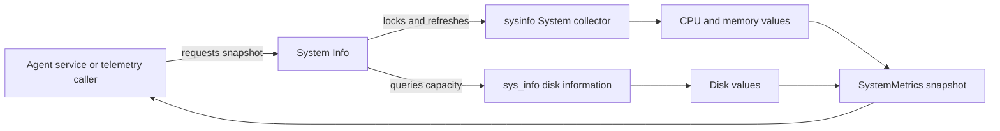
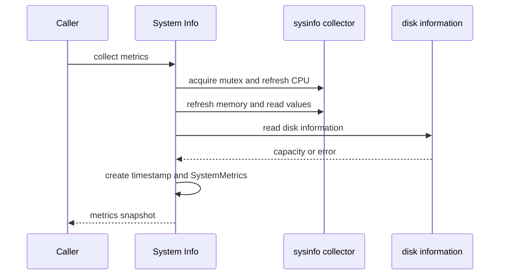
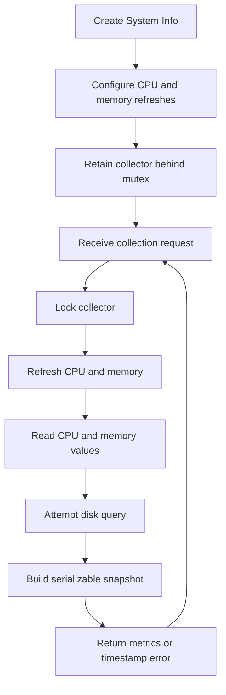
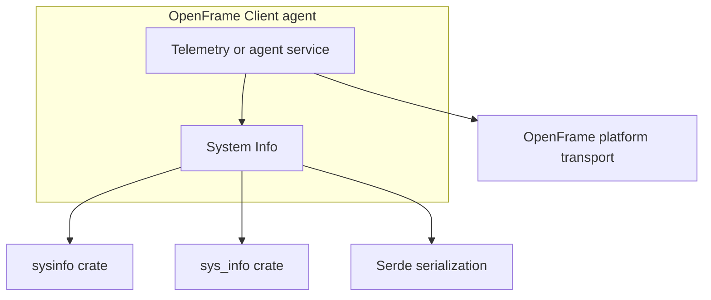

# System Info

System Info is the OpenFrame Client agent's small, synchronous host-observability component. It owns a reusable `sysinfo::System` collector and produces a serializable snapshot containing CPU utilisation, memory capacity and use, disk capacity and use, and a Unix-epoch timestamp. The implementation is supplied by the `openframe_agent_lib` Rust dependency from OpenFrame OSS Library; this tenant repository runs it through its OpenFrame Client packaging and deployment.

The source implementation is [system.rs in OpenFrame OSS Library](https://github.com/flamingo-stack/openframe-oss-lib/blob/7a766f00e4f58b5d89db007b878ac8d6e0c344f4/clients/openframe-client/src/system.rs).

## Responsibilities and Boundaries

System Info has a deliberately narrow boundary:

- Creates a system collector configured to refresh CPU and memory data.
- Serializes an observation with the `SystemMetrics` data type.
- Refreshes CPU and memory immediately before reading their values.
- Reads disk capacity separately through `sys_info::disk_info` because the retained collector is not configured for disk refresh.
- Protects the mutable collector with a mutex so callers sharing one System Info instance do not concurrently mutate it.

It does not schedule collection, publish the result, persist samples, expose an endpoint, or evaluate alert thresholds. Those responsibilities belong to the agent services and their telemetry or messaging integrations. The module tree places System Info alongside logging, metrics bootstrap, NATS messaging, heartbeat publishing, and device-data services; it is a local data-source primitive rather than a transport protocol.

## Architecture

### Core Types

| Type or operation | Role |
|---|---|
| `SystemInfo` | Stateful façade around a mutex-protected `sysinfo::System` instance. One instance can be reused for repeated sampling. |
| `SystemMetrics` | Debuggable, serializable observation containing timestamp, CPU usage, total and used memory, total and used disk, and uptime. Its fields are private, so producers serialize it rather than directly accessing fields outside this module. |
| `new` | Constructs the system collector with CPU and memory refresh kinds set to everything, then wraps it in a mutex. |
| `collect_metrics` | Locks the collector, refreshes CPU and memory, reads values, optionally reads disk information, stamps the observation, and returns it. |

## Collection Flow

The CPU value comes from the global CPU information after a CPU refresh. Memory total and used values are read after a memory refresh. The module preserves the units returned by `sysinfo` for memory rather than performing a conversion. Disk data is handled differently: `sys_info` reports blocks that are multiplied by 1024, so the documented output calculation produces byte counts for `disk_total` and `disk_used`.

Disk collection is best effort. If the disk query fails, System Info still returns a successful snapshot with both disk fields set to zero. By contrast, failure to derive a timestamp since the Unix epoch is returned to the caller as an error.

## Lifecycle and Concurrency

The mutex serializes refresh-and-read sequences, making each successful call internally coherent with respect to the shared collector. The lock uses `unwrap`, so a prior panic while holding the mutex poisons it and causes a later collection attempt to panic instead of yielding a recoverable error. Callers that require fault isolation should execute collection within their own supervision boundary.

The object is initialized once and then sampled repeatedly. Refreshing immediately before reads avoids returning only startup-time CPU and memory state, although the module intentionally does not establish a sampling interval or cache policy.

## Metric Semantics

| Field | Population rule | Notes |
|---|---|---|
| Timestamp | Current system time expressed as seconds since the Unix epoch | Construction can fail only if this conversion fails. |
| CPU usage | Global CPU usage after refresh | Stored as a floating-point value. |
| Memory total | Collector total-memory value after refresh | Unit is inherited unchanged from `sysinfo`. |
| Memory used | Collector used-memory value after refresh | Unit is inherited unchanged from `sysinfo`. |
| Disk total | Disk total blocks multiplied by 1024 | Zero when disk inspection fails. |
| Disk used | Total minus free disk blocks, multiplied by 1024 | Zero when disk inspection fails. |
| Uptime | Constant zero | The source marks this as deprecated pending removal. Consumers must not treat it as host uptime. |

## Dependencies and System Placement

At build time, the tenant consumes OpenFrame OSS Library version `7.0.11`, including the Cargo artifact `openframe_agent_lib` at `v0.0.5`. The library source shown above is the runtime implementation assembled into the OpenFrame Client. System Info itself has no network dependency: any later delivery to the platform is owned by its caller.

## Operational Considerations

- **Disk values of zero are ambiguous.** They can represent a failed disk probe rather than an empty disk. Downstream telemetry should retain collection-error context from its own call path if that distinction matters.
- **Uptime is not valid telemetry.** It is always zero in the current implementation and is explicitly deprecated.
- **A snapshot is not a time series.** The timestamp describes one collection event; sampling cadence, retries, aggregation, and retention must be implemented by the caller.
- **CPU and memory are refreshed together under one lock.** Avoid adding blocking work while holding that lock, because every other collector call waits for it.
- **Serialization is supported directly.** The snapshot derives Serde serialization, allowing a caller to encode it without adding a mapping layer.

## Maintenance Guide

When changing System Info, preserve the boundary between local collection and agent orchestration. Add fields only when their source, units, error behavior, and compatibility expectations are explicit. In particular, replacing the deprecated uptime value should be coordinated with all consumers because it changes a currently constant serialized field into a dynamic value.

Changes to failure handling should consider the two current modes separately: disk discovery is intentionally non-fatal, while timestamp conversion propagates an error. If mutex poisoning becomes a realistic operational concern, replace the unconditional lock unwrap with an error policy that the surrounding agent can observe and supervise.
