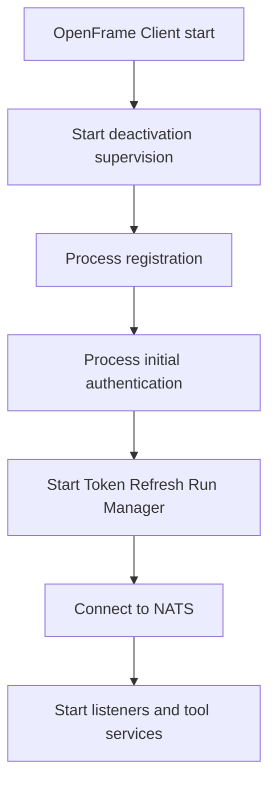
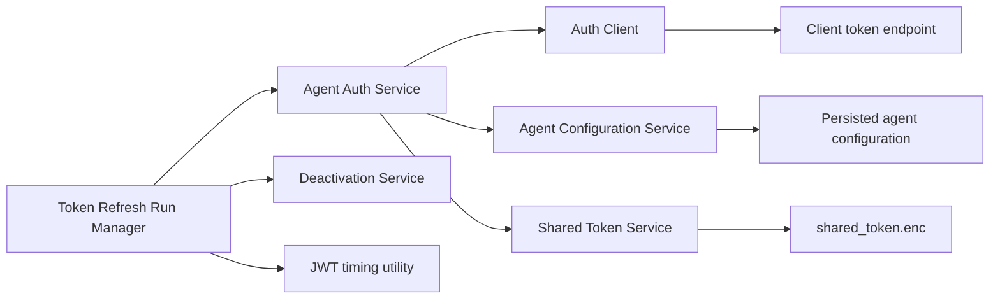
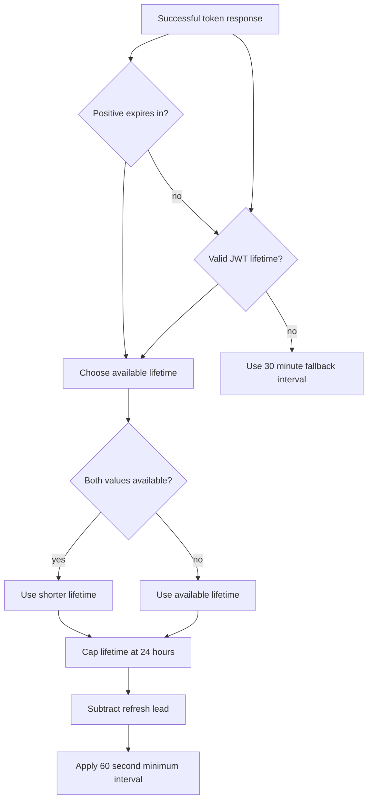
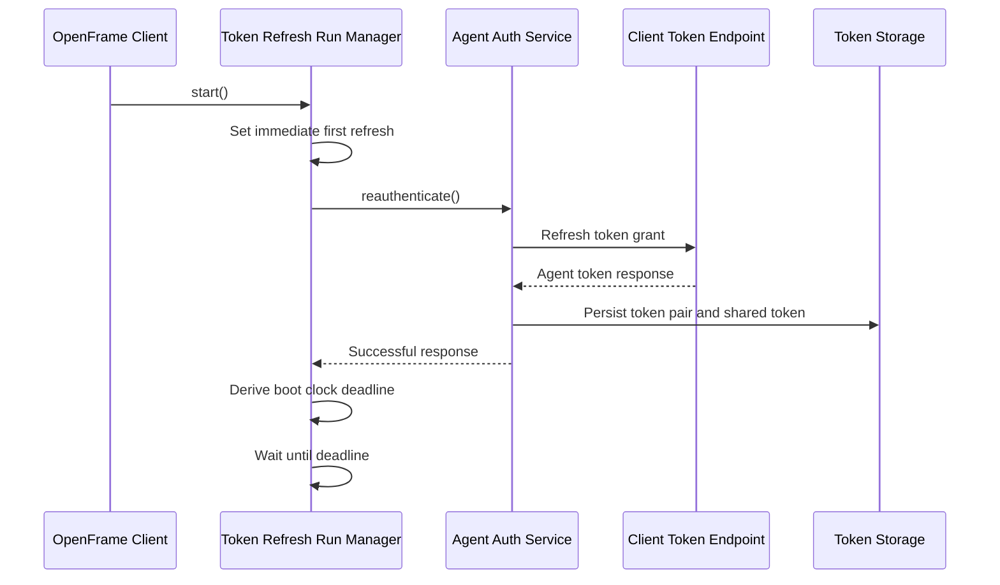
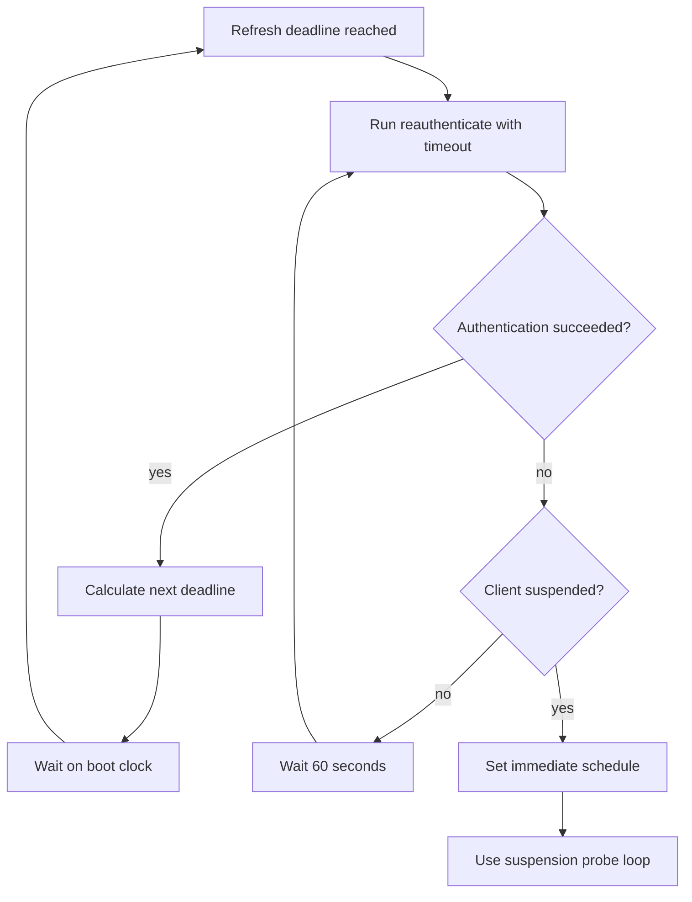

# Token Refresh Run Manager

The Token Refresh Run Manager is the OpenFrame Client background task that keeps an agent's access token valid before it expires. It runs in the Rust `openframe_agent_lib` supplied by the OpenFrame OSS Library and is assembled into this repository's OpenFrame Client service. Its source is [`token_refresh_run_manager.rs`](https://github.com/flamingo-stack/openframe-oss-lib/blob/16e7c1cbd9664e7d10ec5ebca7d53c9bd314decf/clients/openframe-client/src/services/token_refresh_run_manager.rs).

The manager refreshes credentials proactively, persists the replacement token pair through the authentication service, and updates the encrypted token consumed by connected tools. It also cooperates with tenant deactivation handling: while the agent is suspended after a tenant-gone response, it performs the controlled authentication probes that can either preserve suspension or detect recovery.

## Responsibilities

- Start a detached Tokio task after client authentication has completed.
- Refresh immediately on startup so the encrypted shared access token is established before tools connect.
- Derive a future refresh deadline from token lifetime information rather than trusting the local wall clock for scheduling.
- Refresh ahead of expiry, while enforcing a minimum interval to prevent a hot loop.
- Bound each reauthentication request and retry failed attempts at a fixed interval.
- Detect substantial device-to-server clock skew for diagnostics without using that skew to schedule refreshes.
- Yield refresh control to the deactivation probe loop when the client is suspended.

## Runtime Position

The OpenFrame Client starts deactivation supervision first, completes registration and initial authentication, then starts the Token Refresh Run Manager before connecting to NATS and starting the remaining long-running client services. This ordering means the initial refresh can populate `shared_token.enc` before tools establish connections.

## Architecture and Dependencies

`TokenRefreshRunManager` holds cloned handles to `AgentAuthService` and `DeactivationService`, plus an internal immutable timing policy. The manager does not directly issue HTTP calls or write credential files. Instead, it uses the authentication service, keeping transport and persistence decisions in their dedicated components.

### Component roles

| Component | Role in the refresh path |
|---|---|
| `TokenRefreshRunManager` | Owns the asynchronous loop, deadline calculation, timeouts, retries, and suspension-aware control flow. |
| `AgentAuthService` | Reauthenticates by attempting refresh-token authentication first and then falling back to client credentials when needed. |
| `AuthClient` | Posts a form-encoded refresh grant to the client token endpoint and reports the HTTP status to deactivation handling. |
| `AgentConfigurationService` | Serializes configuration updates and persists the new access and refresh tokens together. |
| `SharedTokenService` | Encrypts the access token and atomically writes `shared_token.enc` in the secured directory. |
| `DeactivationService` | Tracks suspension, increases the probe backoff, and reacts to gateway statuses such as HTTP 410 and successful responses. |
| JWT timing utility | Parses a well-formed JWT payload to obtain `exp` and optional `iat`, allowing the manager to evaluate the claimed lifetime. |

The authentication service is the integration boundary for token persistence. A successful authentication response contains access and refresh tokens and optional `expires_in`. The service stores the replacement pair in agent configuration and updates the encrypted shared access-token file used by tools.

## Refresh Scheduling

### Deadline source

The manager schedules from a platform boot clock rather than the device wall clock:

- On Linux it uses `CLOCK_BOOTTIME`.
- On Apple platforms it uses `CLOCK_MONOTONIC`.
- On other supported platforms it uses an elapsed `Instant`-based fallback.

The selected clocks continue across sleep or hibernation on the intended platforms. The manager also sleeps in bounded slices and re-reads the boot clock after each slice. Therefore, a Tokio timer that does not advance while a device sleeps cannot postpone refresh by the entire sleep duration; lateness is limited by the configured slice length.

### Lifetime calculation

After a successful response, the manager considers two possible lifetime values:

1. The positive `expires_in` value returned by the server.
2. The positive `exp - iat` lifetime decoded from the access token.

When both are available, it selects the shorter value. When only one is available, it uses that value. A selected lifetime is capped at 24 hours, preventing a malformed claim from producing an unsafe timer value. If neither source is available, the manager logs a warning and uses the fallback interval.

The deadline is measured from the instant the request was sent, not the instant its response arrived. Network latency therefore reduces the remaining lead time instead of extending token use toward expiry.

### Default timing policy

| Setting | Default | Effect |
|---|---:|---|
| Normal refresh margin | 5 minutes | Refreshes this long before expiry when the lifetime exceeds the margin. |
| Short-token lead | 30 seconds | Used when lifetime is no greater than the normal margin. |
| Minimum refresh interval | 60 seconds | Prevents repeated refresh attempts caused by short or malformed lifetimes. |
| Fallback interval | 30 minutes | Used when token lifetime cannot be determined. |
| Maximum accepted lifetime | 24 hours | Caps a declared or JWT-derived lifetime. |
| Wait slice | 60 seconds | Bounds refresh lateness following sleep or hibernation. |
| Retry interval | 60 seconds | Waits between failed refresh attempts. |
| Reauthentication timeout | 30 seconds | Caps each call to `reauthenticate`. |
| Clock-skew warning threshold | 5 minutes | Emits a warning when local wall time differs from token `iat` by at least this amount. |

For a lifetime longer than five minutes, the normal refresh delay is `lifetime - 5 minutes`, subject to the 60-second floor. For a lifetime of five minutes or less, the delay is `lifetime - 30 seconds`, also subject to that floor.

## Normal Refresh Flow

The manager begins with a deadline due immediately. It then waits until due, attempts reauthentication, and replaces the schedule only after success. Failures do not discard the current loop; they are retried until a successful response or suspension changes the control flow.

`reauthenticate()` first attempts the refresh-token grant. If that attempt fails, it falls back to client-credential authentication. The refresh-token request is form encoded, calls the client token endpoint, and reports its response status to the deactivation service before returning success or failure.

## Failure and Suspension Behavior

### Failed refreshes

A failed result and a timeout are handled separately in logs, but both wait for the retry interval before attempting authentication again. The manager remains in this retry loop until reauthentication succeeds. A timeout does not cancel the manager itself; it only bounds one authentication attempt.

### Tenant-gone suspension

The authentication client passes HTTP statuses to the deactivation service. A gateway response indicating tenant removal can put the agent into suspension; successful responses allow the service to record recovery. While suspended, the Token Refresh Run Manager becomes the single periodic probe:

1. Read the next probe delay from `DeactivationService`.
2. Sleep for that delay. The service doubles the backoff for the next probe, capped by its own policy.
3. Attempt reauthentication with the normal 30-second timeout.
4. On success, calculate and retain a new refresh schedule. The status-processing path determines whether suspension remains active or is cleared.
5. If a refresh retry detects suspension partway through, abandon the retry cadence and return to the probe loop with an immediately due schedule.

This separation avoids rapid authentication retries while the tenant is unavailable and lets deactivation state govern recovery behavior.

## Clock Skew and Time Safety

The manager deliberately separates scheduling time from diagnostic time:

- **Scheduling:** uses token lifetime and the boot clock, so local wall-clock jumps do not move the deadline.
- **Diagnostics:** compares the request wall-clock timestamp with the token `iat`. A difference of at least five minutes emits a warning stating that refresh timing remains based on token lifetime.

JWT parsing is intentionally limited to timing extraction. The utility requires exactly three dot-separated JWT parts, base64url-decodes the payload, and deserializes its timestamps. Failure to obtain a valid lifetime does not block authentication; it activates the fallback schedule.

## Lifecycle and Concurrency Notes

- `start()` is non-blocking: it clones dependencies and launches the long-running task with `tokio::spawn`.
- The manager is cloneable, while the scheduled deadline and retry state live within the spawned task.
- The timing policy is internal and uses production defaults; test builds can use reduced values to exercise the real loop at short timescales.
- Token persistence is serialized by the agent configuration service's write lock, preventing concurrent read-modify-write operations from losing fields.
- The shared token is encrypted and atomically written, reducing the chance that tools observe a partially written token file.
- No NATS reconnection is required solely to distribute a refreshed access token because tools read the maintained shared token file.

## Operational Troubleshooting

| Symptom | Interpretation | Investigation focus |
|---|---|---|
| Repeated refresh-failure messages | Reauthentication returned an error and the manager is retrying. | Validate reachability and credentials for the client token endpoint; inspect the underlying authentication error. |
| Timeout messages every retry interval | The token request exceeded 30 seconds. | Check network latency, proxy behavior, TLS connectivity, and authorization-server responsiveness. |
| Unknown-lifetime warning | Neither usable `expires_in` nor usable JWT `exp` and `iat` lifetime was available. | Inspect the token response format and JWT claims; the manager will use the 30-minute fallback. |
| Clock-difference warning | The device wall clock differs from token issuance time by at least five minutes. | Correct host time synchronization; refresh scheduling remains lifetime based. |
| Tenant-gone suspension messages | The deactivation service is controlling probe cadence after a gateway status. | Inspect tenant availability and deactivation handling; avoid treating the expanding probe delay as a normal token-refresh failure. |

## Source and Ownership

The implementation belongs to the OpenFrame OSS Library's Rust client code and is consumed by this repository through the `openframe_agent_lib` dependency. The OpenFrame Client service in this repository assembles and starts the component; the token refresh logic itself is maintained in the linked library source.
