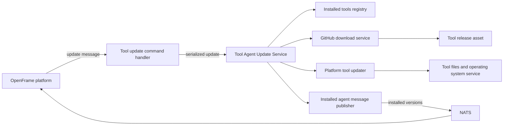
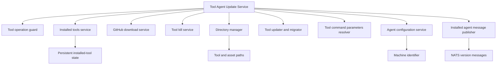
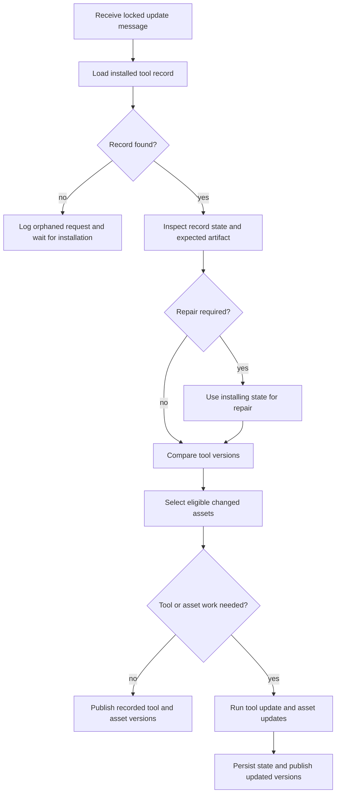
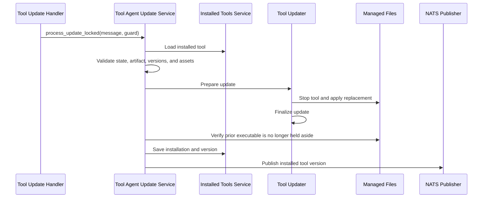
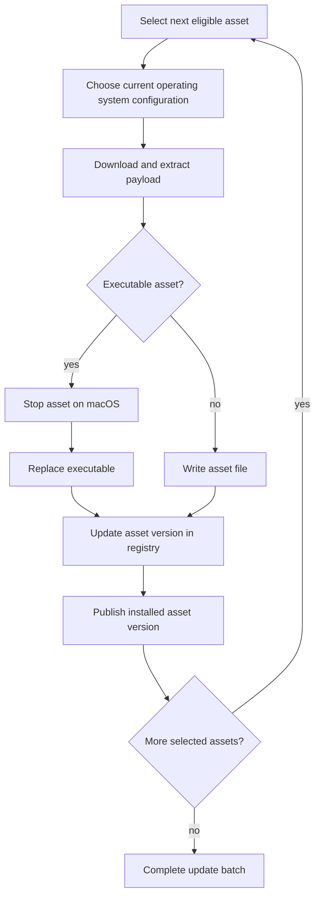

# Tool Agent Update Service

The Tool Agent Update Service applies versioned updates to an OpenFrame Client's installed tools and their associated assets. It is implemented by the `openframe_agent_lib` crate from the OpenFrame OSS Library and runs locally within the repository's OpenFrame Client deployment. Its primary responsibilities are to prevent unsafe concurrent updates, select operating-system-compatible artifacts, replace or migrate installations, maintain the local installed-tool registry, and report installed versions back to the platform.

The implementation is in the [OpenFrame OSS Library source](https://github.com/flamingo-stack/openframe-oss-lib/blob/16e7c1cbd9664e7d10ec5ebca7d53c9bd314decf/clients/openframe-client/src/services/tool_agent_update_service.rs).

## Scope and Responsibilities

`ToolAgentUpdateService` receives a `ToolAgentUpdateMessage` containing a tool agent identifier, target tool version, platform-specific download configurations, and optional asset updates. It coordinates the following work:

- Finds the local `InstalledTool` record by tool agent identifier.
- Repairs a tool whose record remains in the `Installing` state or whose expected binary is absent.
- Rejects version downgrades when the client configuration disallows them.
- Updates only assets that have a version and at least one download configuration, skipping unchanged assets.
- Stops a tool before replacing its executable or before an asset-only update batch.
- Chooses an updater appropriate for a standard executable, operating-system service, or graphical application; it can also migrate between installation types.
- Persists the resulting tool and asset versions and publishes them using the installed-agent message publisher.

The service does not create an installation from an unknown update request. If no local tool record exists, it treats the message as an orphaned update and waits for a separate installation workflow to establish the record.

## System Context

The service is part of the Rust OpenFrame Client supplied by the OpenFrame OSS Library. The surrounding tenant deployment provides the platform services, including the NATS data source used by OpenFrame Client workloads. The update service itself runs on the managed endpoint and changes local files, processes, services, and platform-specific startup configuration.

## Core Components

| Component | Role |
|---|---|
| `ToolAgentUpdateService` | Coordinates validation, update execution, registry persistence, and version publication. |
| `new` | Stores dependencies and immediately ensures managed directories exist. Construction fails fast if the secured directory cannot be prepared. |
| `process_update_locked` | Main asynchronous entry point. It expects a `ToolOpGuard`, so the caller has already obtained a per-tool operation lock. |
| `publish_installed_versions` | Publishes versions for every registry record currently marked `Installed`, including each recorded asset. |

### Update Message and Local State

The request model provides these fields:

| Field | Purpose |
|---|---|
| `tool_agent_id` | Stable identifier used for lookup, locking, filesystem paths, and reporting. |
| `version` | Desired tool version. |
| `download_configurations` | Candidate tool artifacts from which the downloader selects one compatible with the current operating system. |
| `assets` | Optional collection of independently versioned files associated with the tool. |

The local `InstalledTool` record contains the identifier, installed version, installation form, launch arguments, list of installed assets, and record state. The service uses this record as the source of truth for an in-place update; it intentionally does not synthesize missing metadata.

## Dependencies and Boundaries

### Dependency Roles

- **Tool operation guard:** serializes work for one tool agent. The lock is acquired upstream, and this service accepts the guard for the duration of `process_update_locked`.
- **Installed tools service:** reads and saves the registry. Its save operation serializes writers, replaces a matching tool agent record, and persists the complete collection.
- **GitHub download service:** selects a download configuration for the current operating system and downloads or extracts the requested payload. For archive downloads, it validates minimum sizes before and after extraction.
- **Tool updater and migrator:** encapsulate installation-form-specific preparation, application, finalization, rollback, and migration behavior. The general updater rolls back when applying an update fails.
- **Tool kill service:** stops installed tools, and on macOS can stop executable assets before replacement.
- **Directory manager and binary writer:** locate managed paths, detect missing artifacts, and safely replace executable files.
- **Agent configuration and installed-agent publisher:** obtain the local machine identifier and publish tool or asset identifiers with their installed versions through NATS. Reporting failures are logged rather than made fatal to a completed local update.
- **Command parameters resolver:** expands launch parameters when a Windows graphical application is registered for autorun or relaunched.

## Update Decision Flow

The service first determines whether it must repair or update the tool, then independently selects assets that require replacement. Repair is mandatory when the record was interrupted during installation or when the expected binary is missing.

### Version Policy

The service compares the installed and requested versions with the shared version comparator. If versions are valid semantic versions and the requested update is a downgrade, it rejects the request unless `ALLOW_DOWNGRADE` is enabled. The same policy applies independently to each asset.

If either side cannot be parsed as a semantic version, a difference is still applied but a warning is emitted because downgrade ordering cannot be enforced. Equal versions do not cause an update. A repair bypasses the usual version-change requirement because the artifact must be restored even when the registry already records the requested version.

An asset is eligible for processing only when it includes a version and non-empty download configurations. New asset identifiers are eligible; existing ones are eligible only when their version differs and they are not rejected as forbidden downgrades.

## Tool Update Processing

When the tool itself requires work, the service selects a current-operating-system download configuration and constructs `ToolUpdaterDeps` from the downloader, process control, directory manager, and parameter resolver.

### Installation Type Migration

Before a same-type update, the service compares the local installation form to the requested installation type.

1. It first calls installation detection. If the endpoint already has the target form, it corrects stale metadata and saves the record.
2. Otherwise, it runs the platform migrator. The migrator exposes preparation, migration, finalization, and optional rollback operations.
3. After successful migration, the service records the target version and installation metadata, configures Windows graphical-app autorun when applicable, and publishes the installed version.

For a same-type update, the platform updater performs explicit prepare, apply, and finalize phases. If application fails, the updater attempts rollback and returns the update failure. After a successful replacement, the service verifies that a pre-update executable is not still held aside. If it remains locked, it preserves the old recorded version even though newer bytes may exist on disk, avoiding a false report that the new version is running.

## Asset Update Processing

Asset updates are processed after the tool update. If only assets need updating, the service stops the tool once before processing the complete batch. It restarts a service installation after the batch; on macOS it asks the run manager to launch a graphical application again. Processing stops at the first asset failure, so later assets are not attempted in that invocation.

For executable assets, the service uses the executable flag from an existing local asset record when present, preserving first-install metadata; otherwise it uses the incoming message flag. Executables are written with the binary replacement path, while non-executable assets are written directly. The updated asset version is saved to the enclosing `InstalledTool` record before the version event is published.

## Platform-Specific Behavior

| Platform or installation type | Behavior |
|---|---|
| Service installation | The service is stopped by updater behavior or by the asset-only preparation path and is started again after an asset-only batch. A failed restart is logged and leaves the tool down until later recovery. |
| macOS graphical application | A graphical application is launched through the run manager after an asset-only update. Migration can self-relaunch, so post-update relaunch is limited to applications that were already graphical. |
| Windows graphical application | The service registers autorun and persists resolved launch arguments after successful tool update or migration. It then makes one fire-and-forget launch attempt in the user session; future logons are owned by autorun. The chat tool receives an additional background argument. |
| Standard installation | The updater selected for the installation form performs its normal replacement lifecycle. |

## Persistence, Reporting, and Recovery

The service advances persistent state only after the corresponding local operation succeeds:

- A repair sets the record to `Installing` while recovery runs and tries to finalize it as `Installed` after success.
- A tool version is persisted after update or migration succeeds and after the held-aside executable check permits it.
- An asset version is persisted immediately after its file is written.
- Every successful tool or asset update attempts to publish an installed-agent message with the local machine identifier, the tool or asset identifier, and its version.

`publish_installed_versions` supports reconciliation at startup or another lifecycle boundary. It loads all tools, filters to records in the `Installed` state, and publishes both each tool version and every associated asset version. Registry read errors and message-publishing errors do not crash this reconciliation loop; they are reported through warning logs.

## Operational Guarantees and Failure Handling

| Condition | Service behavior |
|---|---|
| Missing local tool record | Skips the update and waits for a tool installation message. |
| Interrupted installation or missing binary | Forces a repair even without a target version change. |
| Disallowed downgrade | Skips the tool or asset that would downgrade. |
| No matching operating-system artifact | Returns an error before tool or asset replacement. |
| Updater apply failure | The updater attempts rollback, then returns failure. |
| Pre-update executable still locked | Keeps the old recorded version and does not falsely announce the new version as active. |
| One asset fails | Stops the asset loop; previously successful assets remain persisted and reported. |
| Version publication failure | Logs a warning; a later reconciliation can republish versions. |
| Windows graphical-app relaunch failure | Logs a warning; autorun will attempt launch at the next user logon. |

## Maintenance Notes

- Preserve the per-tool locking contract. Callers should acquire the tool operation lock before invoking `process_update_locked`; bypassing it risks update, installation, and process-control races.
- Keep tool registry transitions aligned with on-disk state. In particular, do not record a target version until replacement and executable-unlock checks satisfy the service's invariants.
- Add support for a new installation form in the platform updater factory and, when needed, in the migration factory rather than branching update mechanics in this coordinator.
- Treat installed-version publication as eventually consistent. Local mutation is authoritative for the endpoint, while NATS notification can be retried through `publish_installed_versions`.
- Test both tool and asset paths, including missing records, absent binaries, interrupted installation state, semantic and non-semantic versions, downgrade policy, platform-specific restarts, and failure between asset updates.
