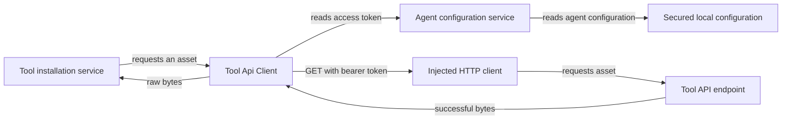
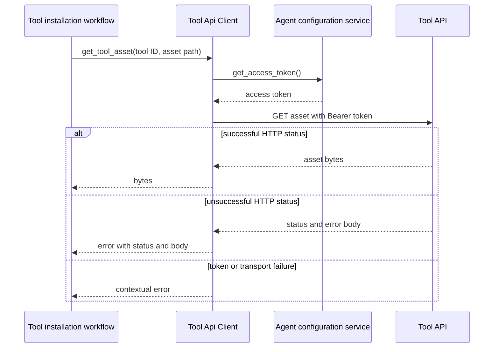
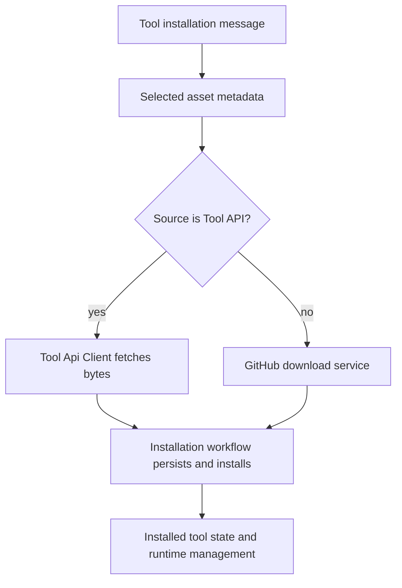

# Tool Api Client

Tool Api Client is the OpenFrame endpoint agent's authenticated binary-asset retrieval adapter. It is implemented in the `openframe_agent_lib` dependency from the OpenFrame OSS Library and is assembled by this repository's OpenFrame Client runtime. Given a tool identifier and an asset path, it obtains the current agent access token from local configuration, requests the tool API endpoint, and returns the successful response as raw bytes for downstream installation logic.

The implementation is [`tool_api_client.rs`](https://github.com/flamingo-stack/openframe-oss-lib/blob/7a766f00e4f58b5d89db007b878ac8d6e0c344f4/clients/openframe-client/src/clients/tool_api_client.rs) in the OpenFrame OSS Library. This repository consumes `openframe_agent_lib` version `v0.0.5` as part of the client service.

## Responsibilities and Boundary

Tool Api Client has a deliberately narrow transport boundary:

- Constructs a tool asset request from an injected API base URL, a tool ID, and an asset path.
- Reads the current bearer token at request time through `AgentConfigurationService`.
- Sends an HTTP `GET` using an injected `reqwest::Client`.
- Returns an opaque `bytes::Bytes` payload only when the server reports a successful HTTP status.
- Preserves server failure context by including both the HTTP status and response body in the returned error.

It does **not** select assets, write files, extract archives, validate an asset's contents, launch tools, refresh tokens, or retry failures. Those concerns belong to surrounding agent services and platform code.

## Public Surface

| Component | Role |
|---|---|
| `ToolApiClient` | Cloneable adapter holding the HTTP client, API base URL, and agent configuration service. |
| `new` | Constructs the adapter from those three dependencies. It performs no I/O or configuration validation. |
| `get_tool_asset` | Asynchronously fetches one tool asset and resolves to raw response bytes or a contextual error. |

The constructor keeps dependencies injectable. This lets the client runtime choose its API endpoint, transport configuration, and credential store rather than embedding those decisions in this adapter.

## Architecture



The client-side asset model distinguishes `TOOL_API` from `GITHUB` sources. Tool Api Client is the retrieval path for a `TOOL_API` asset; GitHub-backed downloads are handled separately by the download service. The receiving installation workflow owns how the returned bytes are persisted and installed.

## Dependencies

| Dependency | How Tool Api Client uses it | Operational implication |
|---|---|---|
| `reqwest::Client` | Executes the asset `GET` request. | Connection, timeout, TLS, and default-header behavior are supplied by the caller. |
| API base URL | Prefixes the request path. | The injected value must identify the tool API host and routing prefix. |
| `AgentConfigurationService` | Retrieves the current access token immediately before every request. | A missing or unreadable local token fails the operation before any network call. |
| Tool installation workflow | Calls the adapter while processing tool assets. | It is responsible for the resulting bytes after retrieval. |

A related HTTP client factory can build agent transport with a machine-ID default header, a configured timeout, optional invalid-certificate acceptance, proxy bypass, and disabled idle connection pooling. Tool Api Client itself neither requires that factory nor reconfigures a supplied HTTP client.

## Request Contract

For a call with `tool_id` and `asset_path`, Tool Api Client concatenates the endpoint as follows:

```text
{base_url}/tools/agent/{tool_id}{asset_path}
```

The asset path is appended directly after the tool ID. Callers and the upstream API therefore share responsibility for supplying compatible path formatting. Tool Api Client does not URL-encode, normalize, or add a separator to `asset_path`.

Before sending the request, the adapter obtains the configured access token and emits this header:

```text
Authorization: Bearer {access_token}
```

The request uses `GET`. A response with any HTTP success status is read as bytes and returned without inspecting content type, length, checksum, or filename. For every non-success status, the client reads the response body and returns an error that includes the status and body text. Transport failures, token lookup failures, and failures while reading an error body are wrapped with operation-specific context.

## Asset Retrieval Flow



## Component Interaction

Tool installation messages can carry a tool ID and an optional collection of assets. Each asset declares its source and may provide a path, executable flag, local filename configuration, download configuration, and version. The broader installation service coordinates source-specific download behavior, tool directories, installed-tool state, process control, and tool startup. Tool Api Client receives only the final tool ID and selected asset path; it does not interpret installation metadata.



## Failure Semantics

| Stage | Failure behavior |
|---|---|
| Read access token | Returns an error annotated as failure to get an access token from configuration. No request is sent. |
| Send request | Returns an error annotated as failure to get a tool asset from the tool API. |
| Read non-success response | Returns an error annotated as failure to read response text. |
| Non-success response | Returns an error containing the HTTP status and server-provided body. |
| Read successful response | Propagates the byte-read error. |

There is no internal retry, token-refresh attempt, fallback source, content verification, or error classification. Callers that need recovery must compose it above this module. In particular, be careful when logging the non-success error: the returned error includes an upstream response body and should be treated as potentially sensitive operational data.

## Security and Maintenance Considerations

- **Credential freshness:** The token is fetched for each request, so updates made by the agent configuration flow can be used by subsequent asset downloads without reconstructing the client.
- **Credential storage boundary:** Agent configuration is stored in the agent's secured directory. Tool Api Client reads only the access-token value exposed by `AgentConfigurationService`.
- **Transport policy:** TLS validation and timeout policy are not hard-coded here. Review the HTTP client supplied by the client bootstrap, especially in deployments that permit invalid certificates.
- **Path composition:** Keep the API path contract synchronized with callers. Because `asset_path` is concatenated unchanged, an omitted or extra leading slash changes the requested URL.
- **Payload handling:** Successful bytes are unbounded by this module and are not integrity-checked here. Downstream installation code should enforce any size, checksum, signature, and filesystem safety requirements appropriate to the asset type.

## Maintenance Checklist

When changing Tool Api Client or its upstream route, verify:

1. The base URL and `/tools/agent/` route still compose into the intended request URL.
2. The access token remains available through `AgentConfigurationService` before a tool asset is needed.
3. The injected HTTP client has the intended certificate, timeout, DNS, and machine-identification policies.
4. Both success bytes and non-success response bodies are handled safely by the installation workflow and logs.
5. Tool API and GitHub asset-source handling remain separate, so source-specific download behavior is preserved.
