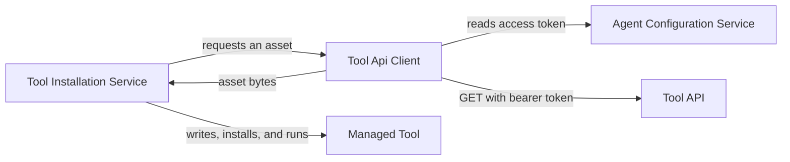
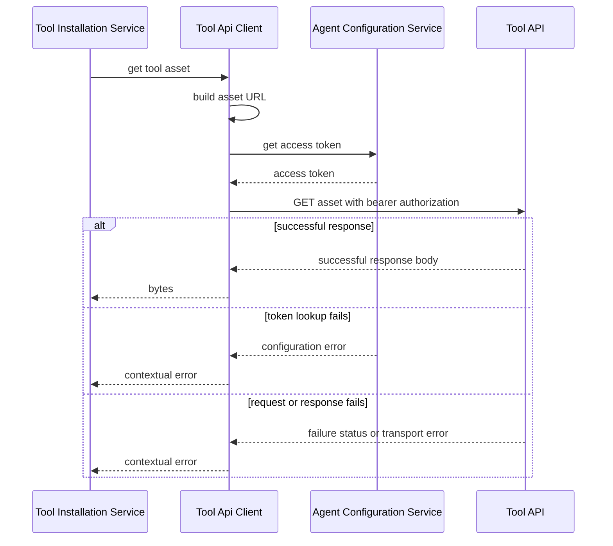
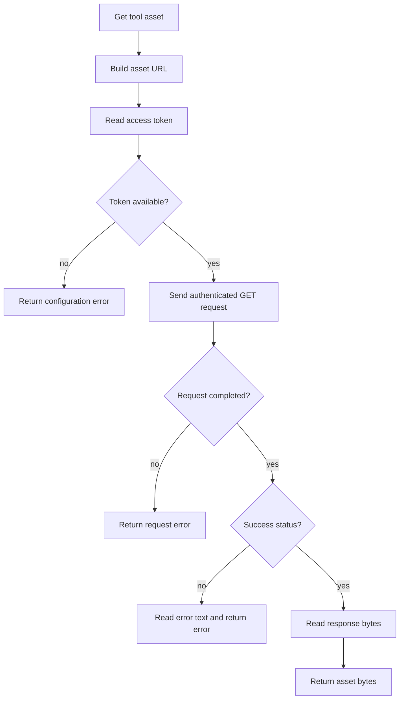

# Tool Api Clients

Tool Api Clients is the authenticated binary-download boundary used by the OpenFrame endpoint client. It is implemented by `ToolApiClient` in the `openframe_agent_lib` Rust library from [OpenFrame OSS Library](https://github.com/flamingo-stack/openframe-oss-lib/blob/16e7c1cbd9664e7d10ec5ebca7d53c9bd314decf/clients/openframe-client/src/clients/tool_api_client.rs), which this repository consumes at version `v0.0.5`.

The module has one responsibility: retrieve the raw bytes for a requested tool asset from the server-side tool API. It obtains the current agent access token from persistent agent configuration and attaches it to the request, but it does not choose an installation destination, validate an artifact, extract it, or start a tool. Those concerns belong to the surrounding endpoint-client services.

## Scope and Responsibilities

`ToolApiClient` owns three dependencies:

| Dependency | Purpose in Tool Api Clients |
|---|---|
| `reqwest::Client` | Executes the outbound HTTP request. |
| Base URL | Provides the server origin and any configured base path. |
| `AgentConfigurationService` | Supplies the agent access token used to authorize each asset request. |

Its public operations are intentionally narrow:

| Operation | Behavior |
|---|---|
| `new` | Creates a client from an HTTP client, base URL, and configuration service. It does not perform network I/O or token lookup. |
| `get_tool_asset` | Builds the tool-asset URL, retrieves an access token, sends an authenticated GET request, checks the HTTP status, and returns the successful response body as `bytes::Bytes`. |

## Position in the Endpoint Client

The module is part of the Rust endpoint client supplied by OpenFrame OSS Library. The repository's OpenFrame Client service packages and runs that library on managed machines. In the library's broader design, the Tool Installation Service holds a `ToolApiClient` alongside download, installation, directory, lifecycle, and connection-management services; Tool Api Clients therefore provides artifact retrieval rather than orchestration.



The exact API implementation and its storage are outside this module. Tool Api Clients only requires a server that accepts bearer authentication and exposes the tool-asset resource used by the endpoint client.

## Request Construction and Data Flow

`get_tool_asset(tool_id, asset_path)` constructs its target by concatenating the configured base URL with `/tools/agent/`, the supplied tool identifier, and the supplied asset path:

```text
{base URL}/tools/agent/{tool ID}{asset path}
```

The asset path is appended directly. Callers are responsible for passing it in the form expected by the server, including any needed leading slash. The method does not URL-encode or normalize either argument.



### Authentication Boundary

The authorization value is generated at request time from the token returned by `AgentConfigurationService`. This avoids storing a duplicate token in `ToolApiClient` and lets later requests use refreshed credentials. If token retrieval fails, the operation ends before an HTTP request is sent and returns an error with context that identifies the configuration lookup.

On successful token lookup, the request includes an `Authorization` header with the `Bearer` scheme. Tool Api Clients does not authenticate with a registration secret and does not implement token refresh; the endpoint client's authentication and token-refresh services maintain the configuration data it reads.

### HTTP Client Behavior

The injected HTTP client determines transport settings. The endpoint client provides a factory, `build_agent_http_client`, that configures a timeout, sends the machine identifier as a default header, can accept invalid certificates when configured, disables proxy use, and disables idle connection pooling to force fresh DNS resolution for requests. Tool Api Clients does not override those settings.

This separation is important for maintenance: configure transport policy where the HTTP client is built, configure the service origin where the base URL is supplied, and configure credentials through the agent configuration service.

## Response and Failure Semantics

A response is considered successful only when its HTTP status is in the success range. On success, the entire response body is read and returned as an in-memory `bytes::Bytes` value. The module does not stream the body to disk and does not deserialize it.

For a non-success status, the client reads the response text and returns an error containing both the status and server response body. This gives the caller diagnostic detail, but callers should treat propagated errors as potentially containing server-provided content and avoid exposing them to untrusted users without appropriate logging controls.

| Stage | Success result | Failure result |
|---|---|---|
| Read token | Current access token | Error contextualized as an access-token configuration failure |
| Send request | HTTP response | Error contextualized as a tool API request failure |
| Check status | Continue for a success status | Error containing status and response text |
| Read body | Asset bytes | Body-read error propagated to the caller |



## Integration Contracts

### Inputs

- The base URL must identify the server reachable by the endpoint client.
- The tool identifier and asset path must resolve to an asset resource under the tool API route.
- Agent configuration must contain a usable access token when an asset is requested.
- The injected HTTP client must be suitable for the endpoint's network and TLS policy.

### Output

The successful output is an opaque byte buffer. A caller such as the tool installation workflow decides whether to save the bytes, extract an archive, install an executable, or otherwise process the asset. Keeping the response opaque prevents this transport module from coupling to operating-system-specific installation formats.

### Operational Considerations

- The complete asset response is retained in memory before returning. Large artifacts therefore affect the client process's memory use.
- Non-success responses are read as text for diagnostics. An upstream service should return safe, bounded error responses.
- Because the API path is composed by direct string concatenation, changes to the base URL trailing slash convention or asset-path leading slash convention must be tested against the resulting URL.
- The module clones cheaply at the structural level because `ToolApiClient` derives `Clone`; however, each clone continues to rely on the same logical configuration and transport policies supplied at construction.

## Maintenance Guide

When changing Tool Api Clients, preserve the division of responsibilities:

1. Keep endpoint construction, credential lookup, and HTTP retrieval localized in this module.
2. Keep token persistence and refresh in the configuration and authentication services.
3. Keep file handling, integrity policy, installation, and process control in the tool-management services.
4. Preserve contextual errors around credential retrieval and network failure so deployments can distinguish local configuration problems from server-side failures.
5. Test the success path, missing or unreadable token path, transport failure, non-success response, and body-read failure. Include URL cases that exercise the base URL and asset-path slash boundary.

The source implementation is maintained in the [Tool Api Client source file](https://github.com/flamingo-stack/openframe-oss-lib/blob/16e7c1cbd9664e7d10ec5ebca7d53c9bd314decf/clients/openframe-client/src/clients/tool_api_client.rs).