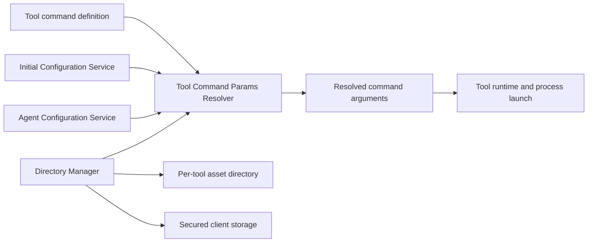
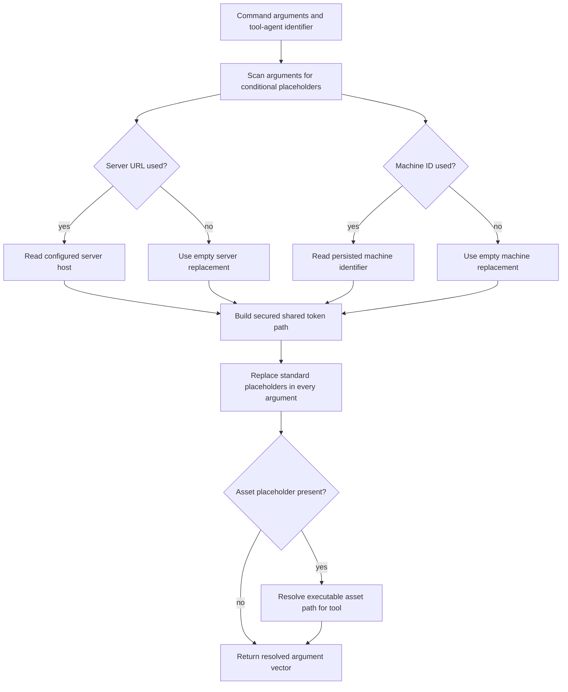
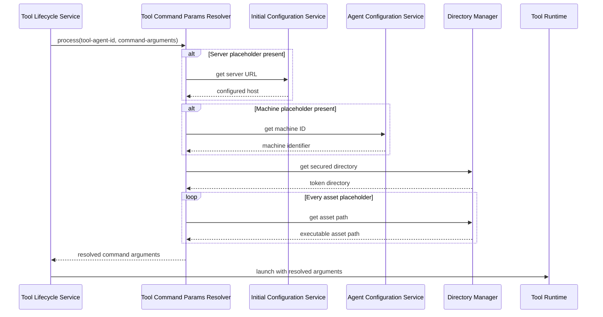

# Tool Command Params Resolver

The Tool Command Params Resolver prepares command-line arguments for an integrated tool running on an OpenFrame client. It replaces well-known configuration placeholders and per-tool asset-path placeholders with values available on the managed device. The implementation is supplied by the OpenFrame OSS Library's `openframe_agent_lib` artifact, version `v0.0.5`, and is executed by the tenant repository's OpenFrame client deployment.

The source implementation is [Tool Command Params Resolver](https://github.com/flamingo-stack/openframe-oss-lib/blob/16e7c1cbd9664e7d10ec5ebca7d53c9bd314decf/clients/openframe-client/src/services/tool_command_params_resolver.rs).

## Responsibilities

The resolver has a narrow transformation role:

- Preserve the number, order, and otherwise literal contents of incoming command arguments.
- Resolve server, machine identity, token-file, and OpenFrame secret placeholders.
- Resolve `${client.assetPath.<asset-name>}` occurrences against the asset directory for the current tool-agent identifier.
- Avoid reading the server URL and machine identifier unless an input argument actually references the associated placeholder.
- Return a fallible result so configuration and path-resolution errors prevent launching a partially resolved command.

It does not execute the command, download an asset, authenticate to a service, or persist configuration. Those responsibilities remain with the surrounding client and tool lifecycle services.

## Placement in the Client

`ToolCommandParamsResolver` is constructed with three collaborators:

| Collaborator | Used for | Resolver behavior |
| --- | --- | --- |
| `DirectoryManager` | Client-owned filesystem locations | Builds the encrypted shared-token path and locates named assets beneath the current tool's directory. |
| `InitialConfigurationService` | Bootstrap configuration | Reads the configured server host when an argument contains `${client.serverUrl}`. |
| `AgentConfigurationService` | Persisted agent registration configuration | Reads the machine identifier when an argument contains `${client.machineId}`. |

The directory manager maintains application support, secured, log, and optional user-log locations. The two configuration services hold file paths and serialize read-modify-write operations; the resolver only reads from them.

## Placeholder Contract

The resolver performs literal substitution for four standard placeholders, then applies a regular expression replacement for asset paths.

| Placeholder | Replacement source | Notes |
| --- | --- | --- |
| `${client.serverUrl}` | `InitialConfigurationService.get_server_url()` | The resolved host is prefixed with `https://`. The saved value is therefore expected to be a host or authority, not an already-prefixed URL. |
| `${client.openframeSecret}` | A fixed 32-character placeholder string | The current implementation inserts `12345678901234567890123456789012`; it does not obtain a secret from a credential store. Treat this as implementation behavior rather than a dynamically issued secret. |
| `${client.openframeTokenPath}` | `DirectoryManager.secured_dir()` plus `shared_token.enc` | Produces the local path to the client shared-token file. |
| `${client.machineId}` | `AgentConfigurationService.get_machine_id()` | Read only if used by at least one argument. |
| `${client.assetPath.<asset-name>}` | `DirectoryManager.get_asset_path(tool-agent-id, asset-name, true)` | The final `true` identifies command-referenced assets as typically executable. `<asset-name>` may contain any characters other than `}`. |

The regular expression is anchored to the exact `client.assetPath` spelling and matches each occurrence within an argument. Placeholder names are case-sensitive. An unknown standard placeholder, or a differently spelled asset placeholder, is not changed.

## Resolution Flow

### Processing sequence

1. `process` receives the tool-agent identifier and an owned vector of argument strings.
2. It scans the vector to determine whether it must read the server host or machine ID. This avoids configuration reads for unused values.
3. It always builds the shared-token path from the secured directory.
4. For each argument, it replaces the four fixed placeholder forms using chained literal replacements.
5. It then finds every asset placeholder with the compiled `ASSETS_PATH_REGEX` expression and replaces each match with an asset path scoped to the provided tool-agent identifier.
6. It returns the transformed argument vector, or propagates an error from required configuration reads or path resolution.

## Component Interaction

## Data and Filesystem Boundaries

The resolver operates on string arguments and exposes no network interface. Its meaningful boundaries are local configuration and filesystem paths:

- **Initial configuration:** supplies the server host used to construct the HTTPS endpoint value.
- **Agent configuration:** supplies a locally persisted machine identifier.
- **Secured directory:** determines the location of `shared_token.enc`; the resolver publishes the path but does not open the file.
- **Tool asset directory:** is selected by `tool_agent_id` and asset name. The resolver marks command assets as executable when requesting the path.

The returned strings can contain sensitive operational locations and a machine identifier. Callers should avoid logging the fully resolved vector unless their logging policy permits those values. In particular, the static OpenFrame secret replacement becomes part of an argument string.

## Error Handling and Edge Cases

| Situation | Result |
| --- | --- |
| No server or machine placeholder | No read is made to the respective configuration service. |
| A needed configuration value cannot be read | `process` returns the underlying error; no resolved vector is returned. |
| Multiple placeholders in one argument | All literal standard placeholders are replaced, then all matching asset placeholders are replaced. |
| Multiple asset placeholders in one argument | Each regex match is independently resolved. |
| Asset placeholder refers to a missing or invalid path | The behavior is delegated to `DirectoryManager.get_asset_path`; the resolver converts its returned path to a lossy string. |
| A standard placeholder appears in an asset name | Standard replacement occurs first, so it can alter the asset-placeholder text before regular-expression processing. |
| A placeholder is not recognized | It remains literal in the output. |

## Maintenance Guidance

### Adding a standard placeholder

1. Define a dedicated constant on `ToolCommandParamsResolver`.
2. Decide whether calculating its value requires I/O. If so, add a conditional `uses` check to preserve the existing lazy-read pattern.
3. Add its literal replacement in the standard transformation stage.
4. Add tests for absence, one occurrence, multiple occurrences, and interaction with asset placeholders.
5. Document whether the new value can be safely logged and whether it is an argument, path, URL, identifier, or secret.

### Changing asset resolution

Keep asset lookup scoped to `tool_agent_id`; removing that input from lookup would risk resolving an asset belonging to a different integrated tool. The executable flag currently reflects the command-argument use case. A future non-executable asset placeholder should use a distinct contract rather than silently changing this resolver's existing behavior.

### Preserving argument semantics

Arguments are transformed as complete strings, not tokenized or shell-escaped. This is intentional: shell parsing and process invocation are owned by the execution layer. Do not add quoting, splitting, or command execution to this resolver, because such changes could alter platform-specific process behavior.

## Validation Focus

Tests or manual verification should cover the following behavior:

- Server host becomes an HTTPS URL only when `${client.serverUrl}` is present.
- Machine configuration is consulted only when `${client.machineId}` is present.
- Token path ends in `shared_token.enc` under the secured directory.
- Asset replacement uses the supplied tool-agent identifier and supports more than one asset placeholder in an argument.
- Unrelated strings preserve order and content.
- Errors from required configuration reads are surfaced to the caller.
- A full resolved command is handled as sensitive operational data in diagnostics.

## Source and Runtime Context

This module is Rust client code from the OpenFrame OSS Library, consumed by this repository through the `openframe_agent_lib` Cargo dependency at `v0.0.5`. It participates in the managed endpoint client; it is not a server-side command API or a standalone command executor. The tenant deployment supplies the client runtime and its surrounding configuration, messaging, tool installation, lifecycle, and process-management services.
