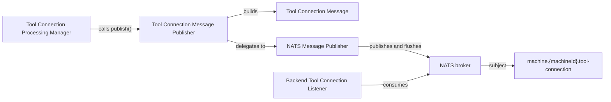
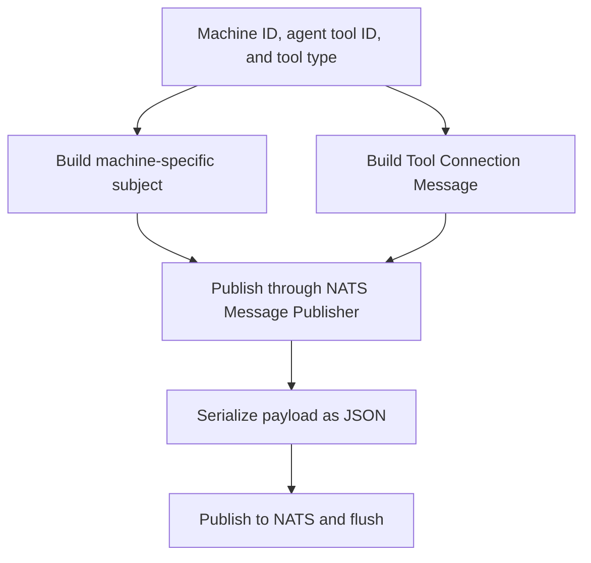
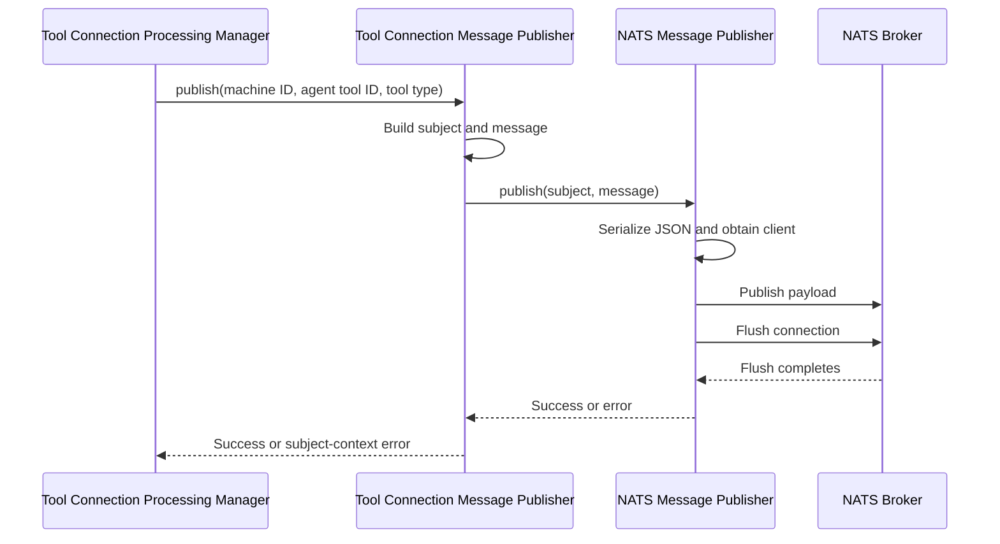
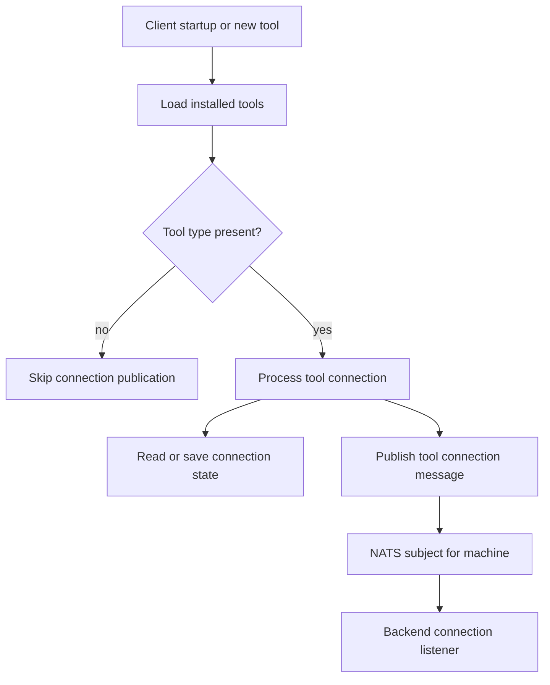

# Tool Connection Message Publisher

Tool Connection Message Publisher is a Rust client-side adapter that announces the association between a managed machine and an installed tool agent. It is implemented in the `openframe_agent_lib` dependency from OpenFrame OSS Library and runs as part of this repository's OpenFrame client deployment. Its single public operation turns a machine identifier, agent-tool identifier, and tool type into a structured NATS message and publishes it to the machine-specific tool-connection subject.

The implementation is small by design: it owns message construction and subject naming, while the shared NATS publisher owns serialization, connection lookup, broker publication, and flushing. The implementation source is [tool_connection_message_publisher.rs](https://github.com/flamingo-stack/openframe-oss-lib/blob/16e7c1cbd9664e7d10ec5ebca7d53c9bd314decf/clients/openframe-client/src/services/tool_connection_message_publisher.rs).

## Responsibilities

- Build the subject `machine.{machineId}.tool-connection` for a particular machine.
- Create a `ToolConnectionMessage` containing `agent_tool_id` and `tool_type`.
- Delegate JSON serialization and publication to `NatsMessagePublisher`.
- Add the target subject to propagated errors so operational failures identify the intended destination.

It does not resolve tool parameters, inspect installed tools, persist connection state, or wait for a broker acknowledgement. Those responsibilities belong to neighbouring client services and the message transport layer.

## Architecture

The module has one injectable dependency: `NatsMessagePublisher`. Construction through `new` stores a cloneable publisher value, allowing Tool Connection Message Publisher to be shared by the processing manager without owning connection lifecycle logic.

## Message Contract

`publish` accepts three owned strings:

| Input | Purpose | Destination |
|---|---|---|
| `machine_id` | Selects the NATS subject for the managed machine. | Subject segment |
| `agent_tool_id` | Identifies the tool-side agent connection. | `ToolConnectionMessage.agent_tool_id` |
| `tool_type` | Describes the installed tool integration type. | `ToolConnectionMessage.tool_type` |

The payload model contains only `tool_type` and `agent_tool_id`. Machine identity is intentionally carried by the subject rather than duplicated in the JSON body.

## Publication Process

1. A caller invokes `publish(machine_id, agent_tool_id, tool_type)`.
2. The module formats the subject as `machine.{machineId}.tool-connection`.
3. It constructs `ToolConnectionMessage` from the agent-tool identifier and tool type.
4. It calls `NatsMessagePublisher.publish` with the subject and payload.
5. The NATS publisher serializes the payload with Serde JSON, obtains the current client from `NatsConnectionManager`, publishes the bytes, then flushes the connection.
6. If serialization, connection acquisition, publish, or flush fails, the result remains an error and is annotated with the tool-connection subject.

## Integration with Tool Processing

Tool Connection Processing Manager orchestrates the upstream workflow. On startup it retrieves installed tools, skips tools with an empty tool type because the backend rejects those messages, and starts one processing loop per tool. When a tool is newly installed, the manager either starts its connection-processing loop or wakes an existing loop for an immediate republish. This republishing behaviour handles agent-tool identifiers that change after a tool re-key or backend data reset.

The manager uses the Tool Connection Service for durable records. A `ToolConnection` stores the tool-agent identifier, the resolved agent-tool identifier, and whether publication has occurred. The publisher itself remains stateless; it sends the outgoing event after the processing workflow has resolved the information to report.

## Delivery Semantics and Failure Handling

This module uses the standard `publish` operation, which confirms that the client has published and flushed data but does not await a JetStream acknowledgement. Its implementation explicitly records a future enhancement to wait for an acknowledgement and retry after failure. Therefore, callers receive success once the NATS publisher completes its publish-and-flush sequence; they should not interpret it as an application-level confirmation that a backend consumer stored the connection.

Failures are returned to the caller rather than suppressed. The contextual error text includes the computed subject, which helps distinguish a machine-specific routing problem from a generic transport failure. The surrounding manager is responsible for scheduling and re-invoking publication as appropriate.

## Maintenance Notes

- Keep subject construction centralized in this module. Changing the `machine.{machineId}.tool-connection` convention changes the broker routing contract with backend listeners.
- Preserve the separation between subject identity and payload identity: machine ID belongs to the subject, while the JSON message holds the tool information.
- Avoid adding durable state or retries here unless the processing and delivery semantics are updated together.
- If acknowledged delivery is required, the shared publisher already exposes a distinct `publish_acked` capability for JetStream. Adopting it would require an explicit decision on stream configuration, retry policy, and how the processing manager records success.

## Source and Runtime Context

The code documented here is supplied by OpenFrame OSS Library through the `openframe_agent_lib` Cargo dependency, pinned by this repository at version `v0.0.5`. OpenFrame OSS Tenant deploys the OpenFrame client alongside NATS in its tenant environment, so this module is part of the endpoint-to-platform messaging path rather than an HTTP API endpoint.
