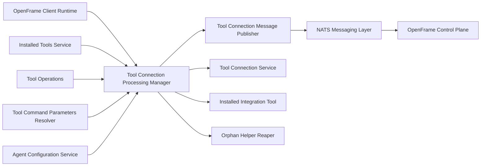
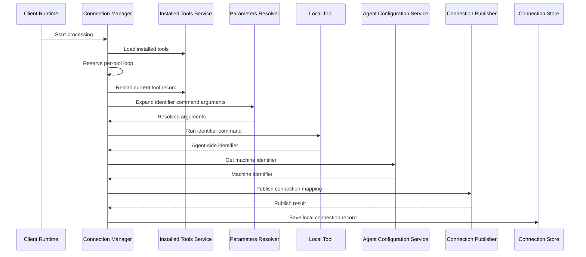
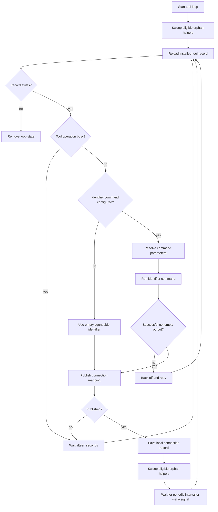
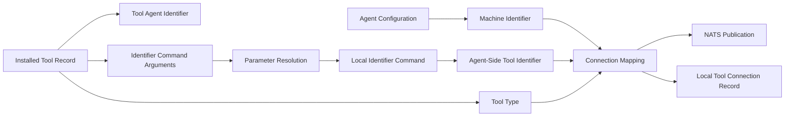

# Tool Connection Processing Manager

The Tool Connection Processing Manager is the OpenFrame Client component that discovers a locally installed integration tool's agent-side identity and publishes the association between the OpenFrame machine and that tool to the control plane. It runs on the endpoint as part of the Rust client supplied by the OpenFrame OSS Library artifact `openframe_agent_lib` and used by this repository's client deployment.

Its implementation is in the [Tool Connection Processing Manager source](https://github.com/flamingo-stack/openframe-oss-lib/blob/16e7c1cbd9664e7d10ec5ebca7d53c9bd314decf/clients/openframe-client/src/services/tool_connection_processing_manager.rs). The manager is deliberately asynchronous: starting it schedules one independent processing loop per installed tool rather than blocking the caller until a connection is available.

## Responsibilities

The Tool Connection Processing Manager:

- loads installed-tool records and ignores records without a tool type, because such records are not publishable by the backend;
- keeps at most one connection-processing loop active for each tool identifier;
- resolves an agent-side tool identifier by running the configured local command, after expanding its parameters;
- associates the resolved identifier with the machine identifier and the tool type, then publishes that association through the client messaging layer;
- persists the most recently published association locally for diagnostic and state-tracking purposes;
- continuously revalidates the installed-tool record, pauses during tool updates, retries transient faults, and republishes periodically;
- cleans up orphaned `osqueryd` helper processes for tools whose configured commands launch that asset; and
- bounds command and cleanup work so a hung child process or sweep does not indefinitely block processing.

The manager does **not** install, update, or start tools. It coordinates with those lifecycle functions by observing the installed-tool registry and the shared tool-operation lock state.

## Position in the endpoint architecture

The installed-tools and tool-connection services are file-backed services with serialized writers. The manager uses the first as its authoritative local lifecycle registry and writes a `ToolConnection` record containing the tool-agent identifier, resolved agent-side identifier, and publication state to the second. The local record does not gate a future publish: a publish that succeeds but cannot be saved still returns to the normal re-publication cadence.

### Main collaborators

| Collaborator | Role in connection processing |
|---|---|
| Installed Tools Service | Lists tools at startup and reloads each record during every loop iteration. A missing record ends that tool's loop. |
| Tool Command Parameters Resolver | Expands configured command arguments. It has access to the directory manager plus initial and agent configuration services, allowing commands to reference endpoint-specific values and tool paths. |
| Directory Manager | Locates the tool executable and asset paths used by the identifier command and helper cleanup. |
| Tool Operations | Reports whether an installation or update is in progress for a tool-agent identifier. The manager defers identifier resolution while the tool is busy. |
| Agent Configuration Service | Supplies the stable OpenFrame machine identifier included in the outbound connection mapping. |
| Tool Connection Message Publisher | Sends the machine identifier, agent-side tool identifier, and tool type using the NATS-backed client messaging path. |
| Tool Connection Service | Stores the local publication record after a successful message publish. |

## Component interaction

At construction, the manager receives all collaborators as dependencies and creates shared concurrent state: a set of active tool identifiers and a per-tool notification handle. The `run` entry point processes every installed tool known at startup. The `run new tool` entry point covers an immediately installed or reinstalled tool.

A second request to process a tool that already has a loop does not create a duplicate loop. Instead, when the existing loop has a registered notification handle, the manager signals it to skip its next scheduled wait and immediately resolve and publish again. This is important for reinstall and re-key scenarios, where the tool's agent-side identity may have changed.

## Processing lifecycle

The manager starts a background task per accepted tool. The background task owns a mutable copy of the latest installed-tool record and refreshes it before every attempt. This allows a reinstall or update to replace command details without retaining stale configuration.

### Identity resolution

For a tool with no configured identifier-command arguments, the agent-side tool identifier is intentionally the empty string. Otherwise, the manager resolves placeholders in the configured arguments and executes the installed tool's configured executable. It captures both standard output and standard error, and accepts only a successful process result whose trimmed standard output is nonempty.

The command has a 15-second deadline. On timeout, the manager kills the whole process tree rather than only the direct child, preventing descendants from surviving the failed resolution. On Windows service installations, timeout logging also attempts to record whether the relevant service is running. Failed parameter expansion, process startup, timeout, nonzero status, and empty output are all treated as resolution failures.

### Retry and degraded behavior

Normal retries occur after 15 seconds. The manager tracks consecutive identifier-resolution failures. After the sixth consecutive failure, it emits a degraded-state error and changes the retry delay to five minutes. It continues retrying indefinitely, so a repaired or reinstalled tool can recover automatically. A successful nonempty identifier resets the failure count.

Different failures have distinct handling:

| Condition | Behavior |
|---|---|
| Tool record removed | Stop the loop and remove its active and wake state. |
| Tool registry read fails | Wait 15 seconds and retry without acting on potentially stale lifecycle state. |
| Tool update in progress | Wait 15 seconds, then recheck the registry and lock state. |
| Machine identifier unavailable | Wait 15 seconds and retry publication preparation. |
| Message publish fails | Wait 15 seconds and retry the loop. |
| Local connection save fails after publish | Log the failure and retain the normal hourly re-publication schedule. |
| Identifier command repeatedly fails | Use the degraded five-minute cadence after the fast retry threshold. |

## Data flow and publication contract

The outbound mapping consists of three values: the machine identifier, the resolved agent-side tool identifier, and the tool type. The persisted local record additionally retains the tool-agent identifier and marks the record as published. The manager publishes first, then stores the local record; therefore, local persistence is not used as an acknowledgement mechanism for remote delivery.

The manager re-resolves and republishes every hour after a successful publish. This periodic reconciliation addresses changes that occur outside the current client process, such as a tool re-key or a reset of tool-side state. An install or reinstall can accelerate the same reconciliation by calling the new-tool entry point.

## Helper-process cleanup

Some tool commands launch the `osqueryd` asset through an asset-path placeholder. For those tools only, the manager asks the orphan reaper to remove orphaned copies of that asset before processing and after a successful publication path. The sweep is executed off the asynchronous runtime and has a 30-second limit. A failed or timed-out sweep is logged but does not prevent connection publication or retries.

This cleanup is intentionally narrow: tools that do not reference the `osqueryd` asset in either identifier-command arguments or run-command arguments are not scanned.

## Concurrency and lifecycle guarantees

- **One loop per tool:** the active-tool set prevents duplicate workers for the same tool identifier.
- **Wake without duplication:** notification handles are registered under the same reservation critical section, so a racing reinstall can wake a loop that has just been marked active.
- **Fresh configuration:** each iteration reloads the installed-tool record and adopts a nonempty tool type from the fresh record.
- **Update coordination:** resolution is deferred while the tool-operation service reports the tool as busy.
- **Removal safety:** every wait path returns to a registry check, allowing uninstalled tools to terminate their loops.
- **Cleanup ordering:** the loop removes its notification entry before clearing the active marker, avoiding deletion of a successor loop's notification handle.

## Operational guidance

When a tool connection is absent, inspect the client logs for the stage that is failing: registry access, parameter resolution, executable location, command exit status, command timeout, machine identifier lookup, publish failure, or local persistence. A degraded-resolution message indicates that identity lookup has exceeded the fast retry threshold and is now retried every five minutes.

For a tool expected to provide an agent-side identity, verify that its configured identifier command produces a nonempty value when invoked with the resolved arguments. If the command times out, investigate the tool process and any child helpers. The manager kills the timed-out command tree and attempts the targeted orphan cleanup, but it intentionally does not install or repair the external tool itself.

Because periodic publication is hourly, a healthy existing connection is eventually reconciled even without an explicit reinstall event. Calling the new-tool path after installation or re-key requests immediate reconciliation without starting a second loop.
