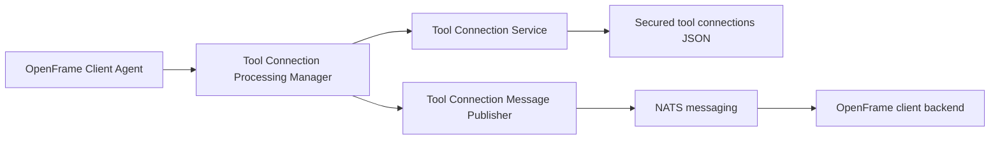
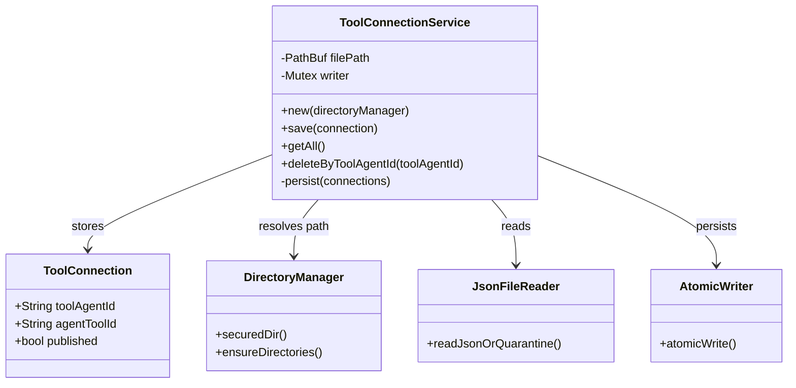
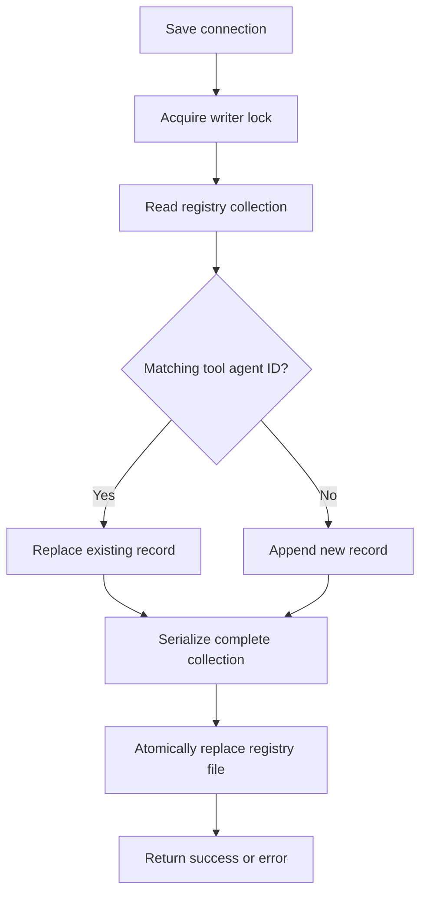
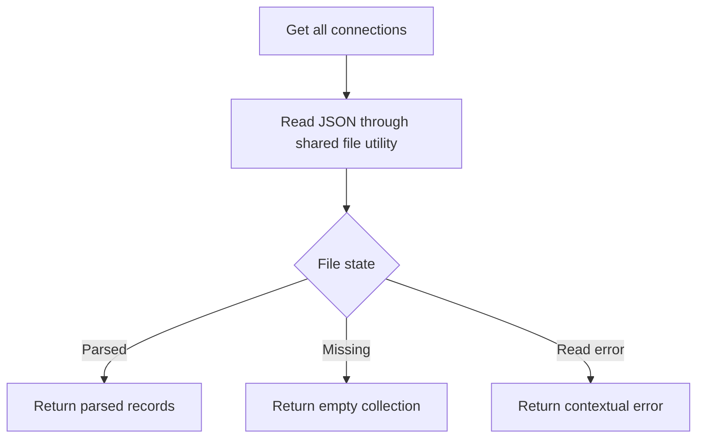
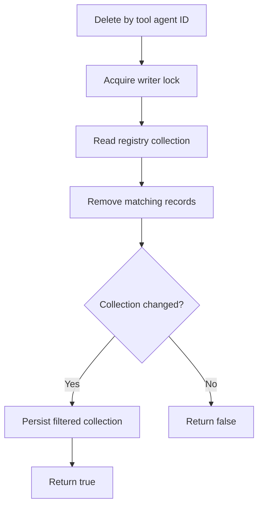
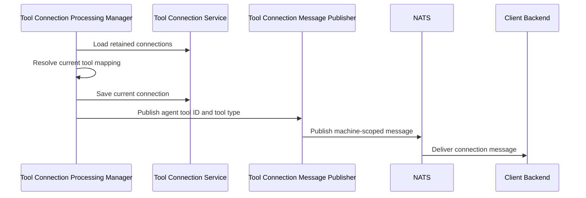

# Tool Connection Service

Tool Connection Service is the OpenFrame client agent's local registry for tool-to-agent connection mappings. It is implemented by the `openframe_agent_lib` dependency from the OpenFrame OSS Library and runs inside this repository's OpenFrame client deployment. The service persists a small JSON collection in the agent's secured directory, allowing the client to retain each installed tool's backend-facing agent identifier and whether its connection has been published.

The implementation is available in the OpenFrame OSS Library: [tool connection service source](https://github.com/flamingo-stack/openframe-oss-lib/blob/16e7c1cbd9664e7d10ec5ebca7d53c9bd314decf/clients/openframe-client/src/services/tool_connection_service.rs).

## Responsibilities

- Create and maintain `tool_connections.json` beneath the `DirectoryManager` secured directory.
- Store `ToolConnection` records, each containing `tool_agent_id`, `agent_tool_id`, and `published`.
- Upsert a record by `tool_agent_id`, so a later observation replaces the complete existing mapping rather than appending a duplicate.
- Return all retained connections, treating a missing registry file as an empty collection.
- Delete a mapping by tool-agent identifier and report whether a record was removed.
- Serialize mutations through a shared asynchronous mutex and use atomic file replacement for persisted changes.
- Delegate malformed-file handling to the shared JSON reader, which can quarantine invalid JSON instead of presenting it as usable registry data.

The service is a persistence boundary, not a transport client or lifecycle controller. It does not install tools, establish a remote session, publish NATS messages, or decide whether a tool should run.

## Runtime Context

The tenant repository consumes OpenFrame OSS Library version `7.0.11`; its Cargo dependency is published as `openframe_agent_lib` version `v0.0.5`. The registry service is assembled into the OpenFrame client agent alongside tool installation, tool execution, and connection-processing services.



The processing manager owns orchestration: it depends on Tool Connection Service to retain mappings and on the message publisher to send a connection message. The publisher carries an agent tool identifier and tool type to a machine-scoped NATS topic. Those responsibilities remain separate from this registry's local persistence work.

## Data Model and Storage Contract

A `ToolConnection` record has three fields:

| Field | Meaning | Registry behavior |
|---|---|---|
| `tool_agent_id` | Identifier of the installed tool-agent record. | Unique key used for replacement and deletion. |
| `agent_tool_id` | Agent-side tool identifier used by the connection workflow. | Stored verbatim as part of the record. |
| `published` | Whether the connection has been published. | Stored verbatim as part of the record. |

The file location is derived rather than hard-coded:

```text
DirectoryManager secured directory / tool_connections.json
```

During construction, the service calls `ensure_directories` before retaining the file path. If that setup fails, construction returns an error contextualized as a failure to ensure the secured directory exists.

### Persistence Properties

- **Missing file:** `read_json_or_quarantine` returns a missing-file state; `get_all` converts that state to an empty vector.
- **Unreadable file:** errors propagate with the registry-file path in the contextual error.
- **Invalid JSON:** the shared file utility parses or quarantines malformed content. The registry does not silently reinterpret malformed data as a valid list.
- **Writes:** the complete collection is pretty-serialized to JSON and passed to `atomic_write`.
- **Atomic replacement:** the shared writer creates and flushes a temporary file, then atomically persists it over the target. This prevents normal updates from exposing a partially written JSON file.
- **Unix permissions:** the shared atomic writer restores `0644` permissions on its temporary file before replacement. The enclosing secured directory remains the primary location-level boundary managed by `DirectoryManager`.

## Component Design



`ToolConnectionService` is cloneable. Its clones share the same file path and the same `Arc<Mutex<()>>`, so concurrent `save` and `delete_by_tool_agent_id` calls made through clones are serialized within the process.

`get_all` intentionally does not acquire the writer mutex because it performs no mutation. Consumers needing a read-modify-write operation must use one of the service's mutation methods rather than compose an unlocked `get_all` call with an independent write.

## Operation Flows

### Save or Replace a Connection

`save` acquires the writer lock, reads the full registry, searches by `tool_agent_id`, and replaces the matched record or appends a new one. It then persists the entire resulting list.



The key is the tool-agent identifier, not the agent tool identifier. Saving a record with an existing `tool_agent_id` replaces all fields, including `agent_tool_id` and `published`.

### Retrieve Connections



A missing registry is expected before the first successful save, so callers receive an empty collection rather than a file-not-found error.

### Delete a Connection



Deletion is idempotent from the caller's perspective: a second request for the same identifier does not write the file and returns `false`.

## Connection Workflow Integration

The registry supports a broader client workflow without owning it. On startup, the Tool Connection Processing Manager obtains installed tools and processes each tool that has a non-empty tool type. It re-resolves and re-publishes mappings on every start because an agent identifier can change independently of the local client. For a newly installed tool, the manager either begins processing or wakes the already-running processing loop for that tool.



The message payload is represented by `ToolConnectionMessage`, which contains `agent_tool_id` and `tool_type`. The local `ToolConnection` registry adds the corresponding `tool_agent_id` and `published` state used by the client-side workflow.

## Failure Handling and Operational Notes

| Condition | Behavior | Maintainer implication |
|---|---|---|
| Secured directory cannot be created | Construction fails. | Correct directory configuration and filesystem permissions before starting the client. |
| Registry file is absent | Reads return no mappings. | Normal on a new installation. |
| Registry cannot be read | The operation returns a contextual error that includes the file path. | Investigate availability and permissions of the secured directory. |
| Registry JSON is malformed | The shared reader quarantines invalid content rather than yielding parsed records. | Preserve the quarantined artifact for diagnosis; the client can rebuild mappings through subsequent workflow activity. |
| Serialization or atomic write fails | The mutation returns an error. | Do not assume a requested save or deletion reached durable storage. |
| Concurrent saves or deletions in one process | Mutations queue on the shared mutex. | Do not bypass the service with direct file writes. |

The mutex only coordinates instances in the same process. Atomic replacement protects file integrity during a write, but the provided implementation does not establish an inter-process lock. Running multiple agent processes against one secured directory is therefore not a supported concurrency model for coordinated read-modify-write updates.

## Maintenance Guidance

- Treat `tool_agent_id` as the stable registry key when changing the model or reconciliation logic.
- Preserve the read-modify-write lock around mutations; removing it can reintroduce lost updates when multiple async tasks save or delete mappings.
- Preserve atomic persistence. A direct truncate-and-write approach risks corrupting the JSON registry after interruption.
- Keep error context around filesystem and serialization operations; the full registry path is valuable when diagnosing endpoint-specific failures.
- If the model gains fields, ensure an upsert replaces a complete record intentionally and consider compatibility with existing JSON content.
- Keep lifecycle and messaging logic in their dedicated client services. Tool Connection Service should remain focused on durable local mappings.
