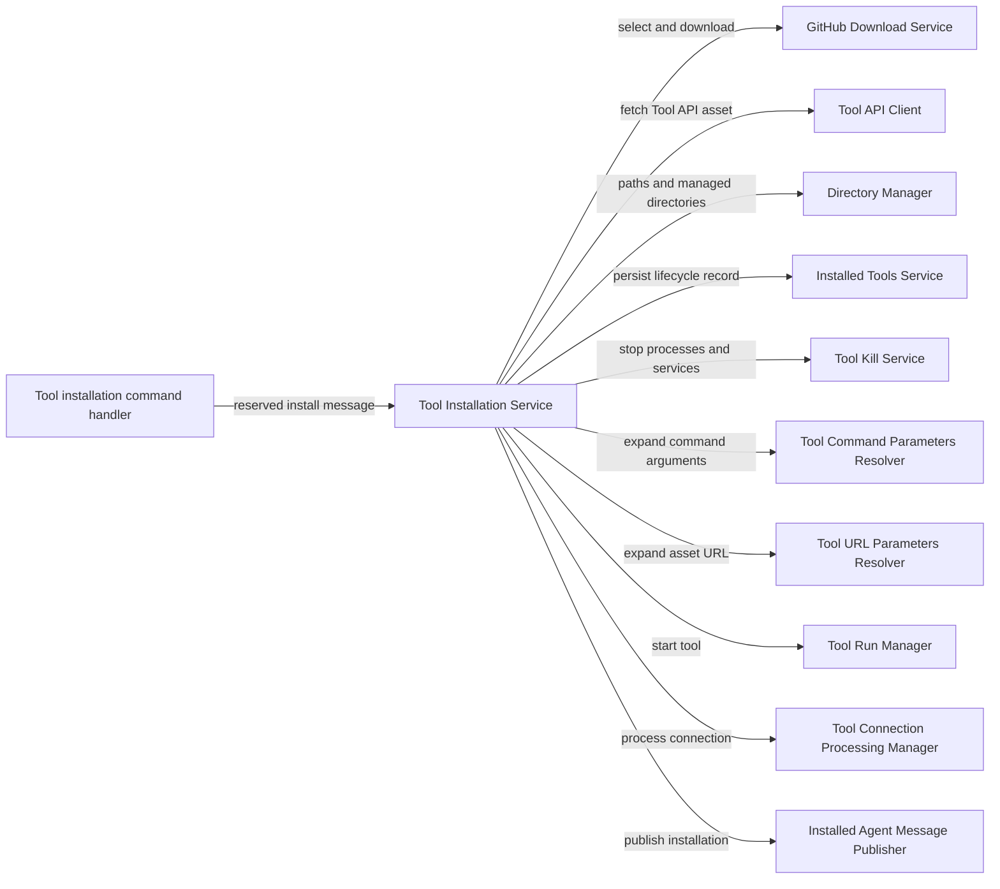
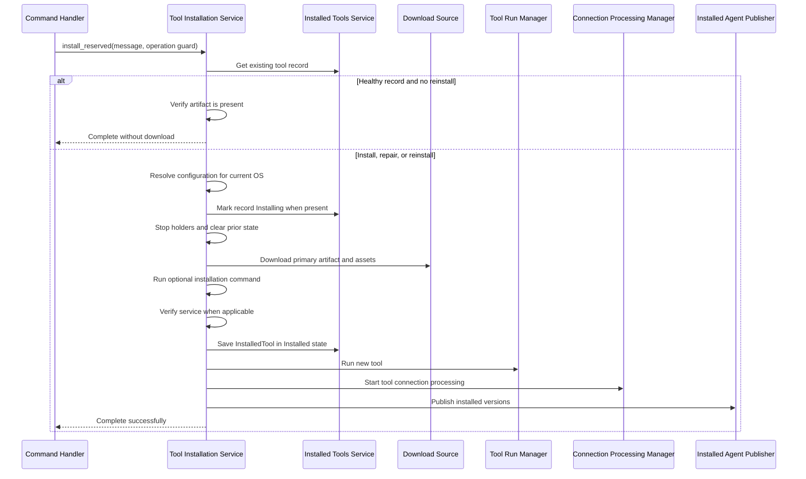
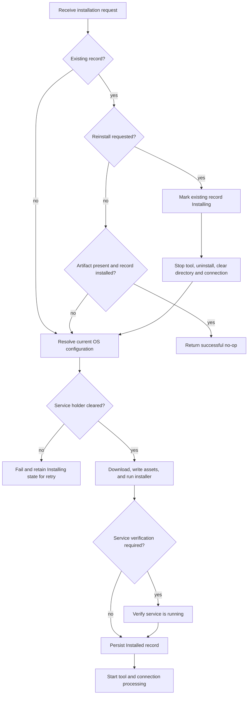

# Tool Installation Service

The Tool Installation Service installs, repairs, and reinstalls managed tools on an endpoint running the OpenFrame client. It is implemented by `ToolInstallationService` in the OpenFrame OSS Library's Rust client and is assembled into this repository through the `openframe_agent_lib` Cargo dependency. Its public entry point, `install_reserved`, receives a tool-installation message only after a caller has reserved the corresponding tool operation with a `ToolOpGuard`.

The implementation is available in the OpenFrame OSS Library: [tool installation service source](https://github.com/flamingo-stack/openframe-oss-lib/blob/16e7c1cbd9664e7d10ec5ebca7d53c9bd314decf/clients/openframe-client/src/services/tool_installation_service.rs).

## Responsibilities

The service coordinates the endpoint-local portion of a tool deployment:

- Selects an operating-system-specific `DownloadConfiguration` and applies the message's effective version override before making destructive changes.
- Detects an already-present, healthy installation and treats a repeated non-reinstall request as a no-op.
- Repairs a stale installation record when its expected artifact is absent.
- Stops processes, clears services where required, removes previous files for reinstall, and handles Fleet-related Orbit leftovers.
- Downloads the primary tool and optional assets from GitHub or the tool API, then writes assets to the managed tool directory.
- Runs optional install and uninstall commands with parameter resolution and a five-minute process limit.
- Validates service startup, persists the installed-tool record, starts the tool and its connection processor, and publishes installed-agent notifications.

The service does not acquire its own operation lock. `install_reserved` accepts a `ToolOpGuard` created by upstream orchestration, ensuring that the guard remains held for the duration of the asynchronous installation. This coordination prevents concurrent operations for the same tool and allows client update logic to defer while tool work is active.

## Inputs and Installation Model

`ToolInstallationMessage` is the deployment contract. It supplies tool identity, requested version, reinstall intent, download configurations, optional install and uninstall arguments, runtime arguments, optional service name, and optional assets. A selected `DownloadConfiguration` provides the operating-system match, download location, target file name, installation type, and optional bundle or service identifiers.

The supported installation types determine path handling and post-install behavior:

| Installation type | Primary artifact location | Required metadata | Validation and launch behavior |
|---|---|---|---|
| Standard | Tool-specific application-support directory | Executable path when available | Persisted as a standard installation, then started by the tool run manager. |
| Service | Tool-specific application-support directory | Service name | Existing service must be clear before replacement, and the installed service must be running before the record becomes installed. |
| GUI application | `/Applications` on macOS, otherwise tool-specific application-support directory | Executable path; optional bundle ID | The resolved path is absolute. On Windows, GUI applications also receive autorun and configuration registry entries. |

The service records an `InstalledTool` with `Installing` or `Installed` state through `InstalledToolsService`. The `Installing` state is deliberately retained when a critical operation fails, allowing later delivery or repair processing to retry instead of reporting a healthy tool prematurely.

## Architecture and Collaborators

### Dependency roles

- **GitHub Download Service** selects the resolved source configuration and downloads either a saved tool artifact or extracted bytes for an asset.
- **Tool API Client** retrieves server-provided assets after the asset URI has been resolved by the URL parameter resolver. This supports generated configuration material separately from the primary binary.
- **Directory Manager** creates the secured working directories and derives primary executable, tool-folder, and asset paths.
- **Installed Tools Service** is the local registry for the tool record and lifecycle state.
- **Tool Kill Service** terminates installed tools, assets, and processes associated with executable or directory paths. It is used before overwriting files or deleting directories.
- **Tool Command Parameters Resolver** expands installation and uninstallation command arguments. **Tool URL Parameters Resolver** expands parameters embedded in tool API asset paths.
- **Tool Run Manager** owns runtime supervision. The installer intentionally does not clear an existing supervisor entry during a reinstall because doing so could create duplicate supervisors.
- **Tool Connection Processing Manager** starts connection processing for the newly installed tool. Its associated connection service removes stale connection data during reinstall cleanup.
- **Agent Configuration Service** supplies the machine ID used for installation notifications. **Installed Agent Message Publisher** emits primary-tool and eligible executable-asset version notices.

## End-to-End Installation Flow

### Detailed process

1. **Inspect and resolve.** The service reads any existing record. A non-reinstall request returns successfully only when the record is not `Installing` and the corresponding executable or GUI application artifact exists. A missing artifact or interrupted state switches the request into repair behavior. The platform download configuration is resolved before any deletion.
2. **Prepare replacement.** For a reinstall with an existing record, the service marks the record `Installing`, stops the installed tool, optionally invokes its uninstall command, kills processes using the tool directory, removes that directory with retries, and deletes persisted connection information. A Fleet-named tool also triggers cleanup of leftover Orbit state and `osqueryd` processes.
3. **Prevent live-overwrite failures.** The service creates the tool directory, builds a provisional installation from the resolved type, and stops any matching process or service. For service tools it verifies that the service is actually clear before continuing. If it cannot be cleared, installation fails rather than overwriting a live agent.
4. **Install the primary artifact.** Standard and service tools are downloaded into the tool directory. GUI applications are installed to `/Applications` on macOS and to the managed tool directory elsewhere. The returned relative or absolute artifact location is normalized into a final executable path.
5. **Materialize assets.** Each asset uses its matching local filename configuration. Tool API assets are fetched through `ToolApiClient`; GitHub assets are resolved and extracted by the download service. Reinstalls refresh Tool API assets, which supports server-generated configuration. Executable assets are stopped before write, marked executable on Unix, hardened through the file access-control helper, and may publish an installed-asset message.
6. **Execute the installer.** If the message contains installation arguments, the service resolves them, stops residual tool processes, removes any prior service registration, and executes the resolved primary artifact. External install and uninstall commands are configured with `kill_on_drop` and time out after 300 seconds. A nonzero exit status, execution error, or timeout aborts installation.
7. **Commit and activate.** Service tools must pass post-install running-state verification. The service saves the final `InstalledTool` record, registers Windows GUI autorun behavior when applicable, starts runtime and connection processing, then makes a best-effort installed-agent publication. Notification failure does not roll back a completed local installation.

## Reinstall and Recovery Semantics

Several choices preserve recoverability:

- Configuration is resolved before the service removes a prior installation, so an unsupported operating system does not destroy a working tool.
- Reinstall uses directory-level process cleanup to catch child processes that hold files under the managed directory.
- A tool whose previous install was interrupted remains repairable: an `Installing` record or a missing binary bypasses the no-op path.
- Service verification occurs before the state changes to `Installed`; an installer that exits successfully but leaves a stopped service is retried rather than accepted.
- The service avoids clearing an existing runtime supervisor during replacement. The supervisor can resume against the new binary, preventing duplicate runners and lock conflicts.

## Operational Boundaries and Failure Handling

The service performs local filesystem, process, service-manager, and network operations; callers should expect errors from any of these boundaries. Errors that prevent safe replacement are propagated: absent platform configuration, failed directory operations, download failures, unresolvable command parameters, failed installer commands, service-clear failures, service verification failures, registry persistence failures, and runtime or connection startup failures.

Some cleanup and reporting work is intentionally best effort. For example, failure to stop a process is logged before the service continues to later checks; failure to remove stale connection data is logged; and inability to publish installed-agent messages does not fail a completed installation. This division keeps the authoritative local installation lifecycle strict while avoiding false installation failures caused by auxiliary telemetry.

The command timeout is particularly important for maintainers. A hung external installer cannot indefinitely retain the upstream operation guard, which would otherwise block tool work and defer client self-update. Timeout termination lets the operation fail cleanly and makes message redelivery available for recovery.

## Maintenance Considerations

- Add a new installation type only by updating configuration selection, executable-path resolution, installation-record construction, stop behavior, and post-install validation as a coherent set.
- Preserve the order of resolving configuration before destructive cleanup.
- Treat service operations as safety boundaries: do not remove the pre-install clear check or post-install running check.
- Keep installer argument resolution separate from URL parameter resolution; they target different fields and trust boundaries.
- When changing asset behavior, retain the distinction between executable assets, which need process handling and permissions, and nonexecutable configuration assets.
- Changes to supervisor lifecycle require care during reinstall. Creating a second runner for an already supervised tool can cause both processes to contend for tool-owned resources.

The Tool Installation Service is therefore the transactional coordinator for endpoint tool deployment: it reconciles desired tool state from a command message with existing on-disk and runtime state, commits the local registry only after the executable installation is credible, and then activates the tool's runtime and connectivity paths.
