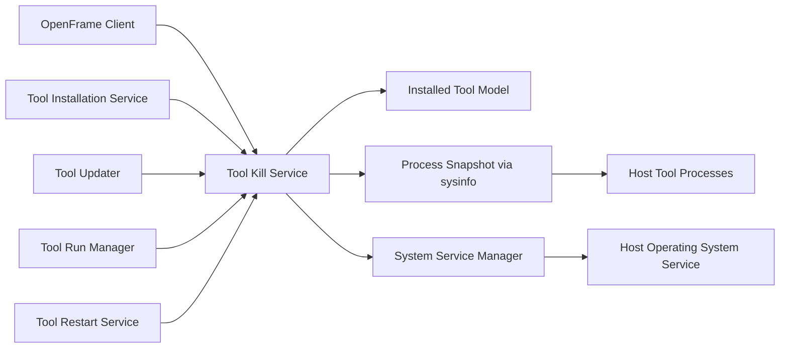
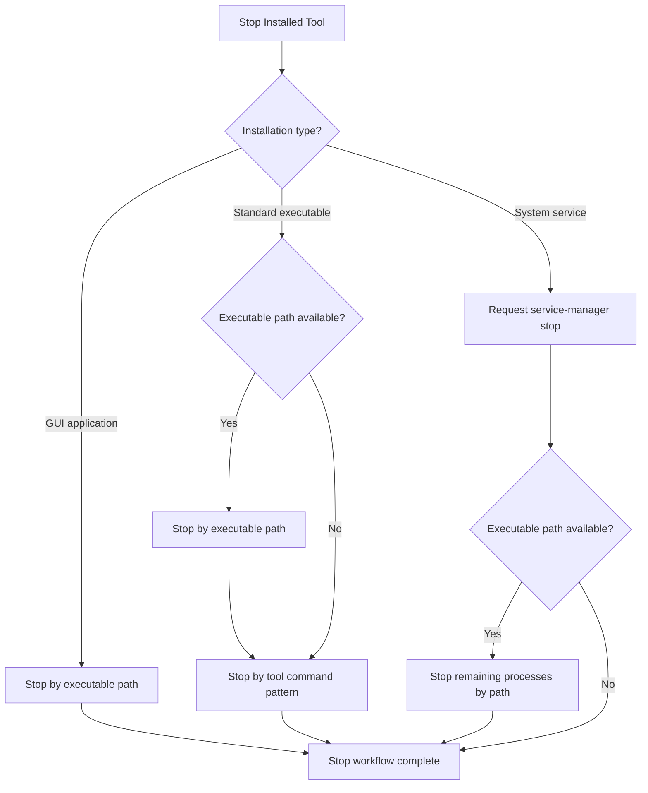
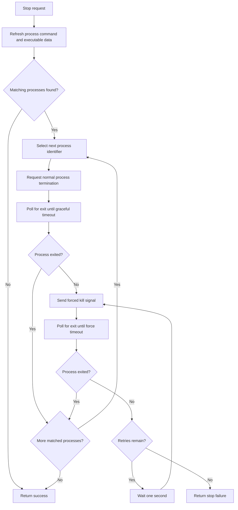
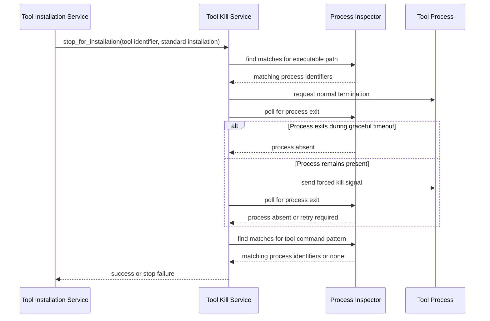

# Tool Kill Service

The Tool Kill Service is the OpenFrame Client component that stops managed tool processes before installation, upgrade, restart, or removal work proceeds. It is implemented by the Rust `ToolKillService` in the OpenFrame OSS Library's `openframe_agent_lib` artifact and runs within this repository's OpenFrame Client deployment.

Its central responsibility is to translate a managed tool identity, asset identity, executable path, installed-tool record, or process identifier into a verified local process stop operation. It attempts a normal termination first, then escalates to a forced kill when the process remains alive. Service-type tools are first stopped through the operating system service manager, with an executable-path cleanup pass for detached child processes.

**Source:** [tool kill service implementation](https://github.com/flamingo-stack/openframe-oss-lib/blob/16e7c1cbd9664e7d10ec5ebca7d53c9bd314decf/clients/openframe-client/src/services/tool_kill_service.rs)

## Scope and Responsibilities

The Tool Kill Service provides the following capabilities:

- Locate processes by inspecting both their command line and executable path.
- Construct platform-specific match patterns for a tool or one of its assets.
- Stop an individual process identifier with graceful termination, bounded waiting, forced-kill retries, and exit verification.
- Stop a tool by identifier, asset by identifier, or process by executable path.
- Apply stop behavior according to an `InstalledTool` installation variant: GUI application, standard executable, or operating-system service.
- Check whether an installed tool appears to be running using the same target-selection rules used for installation preparation.

The component does not download, install, update, launch, or persist installed-tool state. Those responsibilities belong to adjacent client services. Its output is local process and service lifecycle control, surfaced as success or an error after all configured stop attempts fail.

## Position in the Client Architecture

The service is supplied by the OpenFrame OSS Library dependency at version `0.0.5` of the `openframe_client` Cargo artifact. The OpenFrame Client composes it with installation, update, restart, run-management, and service-management behavior.

### Collaborators

| Collaborator | Role in the stop workflow |
|---|---|
| `InstalledTool` and `Installation` | Describe the managed tool and classify it as a GUI application, standard executable, or system service. |
| Process inspection through `sysinfo` | Refreshes command-line and executable-path data to find candidate processes and later confirms that a process exited. |
| System service manager | Stops a service-type tool by service name, optionally allowing deletion behavior requested by the caller. |
| Tool Installation Service | Uses installation-oriented stopping to clear an existing executable or service before installation work. |
| Tool Updater | Coordinates replacement or migration of an installed tool after it is no longer running. |
| Tool Run Manager and Tool Restart Service | Manage the surrounding lifecycle: stopping active tools and starting them again when appropriate. |
| Service-stop configuration | Supplies graceful timeout, forced-kill timeout, retry limit, and process polling interval. |

## Target Resolution

The Tool Kill Service matches against lowercased command lines and executable paths. A process matches when either field contains the requested pattern. Pattern construction is platform-aware:

| Request | Windows command pattern | macOS and Linux command pattern |
|---|---|---|
| Tool identifier | `tool_id\\agent` | `tool_id/agent` |
| Asset and tool identifiers | `\\tool_id\\asset_id` | `/tool_id/asset_id` |
| Executable path | The supplied path, lowercased | The supplied path, lowercased |

A path match is a containment test, not an exact executable-identity comparison. Consequently, tool IDs, asset IDs, and registered executable paths must be specific enough to avoid matching unrelated processes.

### Installed Tool Variants

`stop_for_installation` dispatches by installation type. `stop_installed_tool` is a convenience entry point that extracts the tool agent identifier and installation record from an `InstalledTool`.

For service installations, failure to stop the named service is logged as a warning rather than immediately returned. The service then attempts path-based cleanup when an executable path is available. Failure of that cleanup is returned to the caller. This permits recovery from an unavailable or partially stopped service while still attempting to remove detached child processes.

## Process Stop Algorithm

Each matched process is handled independently. A failure for one process stops the enclosing request and is returned to the caller; therefore, callers must treat an error as a potentially partial operation when multiple processes matched.

### Detailed Behavior

1. The service refreshes process command-line and executable-path information in a blocking task, preventing synchronous process enumeration from blocking the asynchronous runtime.
2. It gathers every process whose lowercased command line or executable path contains the selected pattern.
3. For each matching process identifier, it requests normal termination using `sysinfo`'s `process.kill()` call.
4. It polls process presence at the configured interval until the graceful-shutdown timeout is reached.
5. If the process is still present, it sends `Signal::Kill`, waits through the forced-kill timeout, and repeats this forced attempt up to the configured retry maximum. A one-second delay separates failed forced attempts.
6. If the process has disappeared before a forced attempt begins, that attempt is considered successful because the process has already exited.
7. If all force attempts are exhausted while the process remains present, the service returns an error that identifies the process, target description, and configured retry count.

The service is idempotent for an already absent target: no matching process is a successful result, and a missing process during the force stage is also treated as already stopped.

## Public Operations

| Operation | Input | Outcome |
|---|---|---|
| `new` | None | Creates the stateless service. The default implementation delegates to this constructor. |
| `stop_tool` | Tool agent identifier | Finds processes whose command line or executable path contains the platform-specific tool agent pattern, then stops them. |
| `stop_asset` | Asset identifier and tool agent identifier | Finds and stops processes using the platform-specific nested asset pattern. |
| `stop_tool_by_path` | Executable path | Finds and stops processes whose command line or executable path contains the provided path. |
| `stop_process` | Numeric process identifier and description | Stops the specified process using the retry and verification algorithm. |
| `stop_installed_tool` | Installed-tool record and deletion flag | Delegates to installation-specific stopping. |
| `stop_for_installation` | Tool agent identifier, installation descriptor, and deletion flag | Executes variant-specific GUI, standard, or service stop behavior. |
| `is_installed_tool_running` | Installed-tool record | Returns whether one or more processes match the relevant installed-tool targets. |

## Running-State Detection

`is_installed_tool_running` uses installation-specific patterns designed to mirror installation preparation:

- A GUI application is checked only by its executable path.
- A standard installation checks its executable path when one is recorded, plus the tool command pattern.
- A service checks its executable path when one is recorded. If no path is recorded, it falls back to the tool command pattern rather than reporting that the tool is not running without evidence.

The check executes process enumeration in a blocking task. If that task cannot be joined, it returns `false`; this makes the method a best-effort status probe rather than a definitive liveness guarantee.

## Component Interaction: Installation Preparation

The following sequence illustrates a standard executable that has a registered path. The same process-stop core is used by direct tool, asset, path, and process operations.

## Configuration and Operational Considerations

The service reads these settings from the client service-stop configuration:

- `GRACEFUL_SHUTDOWN_TIMEOUT_SECS`: maximum time to wait after normal termination is requested.
- `FORCE_KILL_TIMEOUT_SECS`: maximum time to wait after one forced-kill request.
- `MAX_KILL_RETRIES`: maximum number of forced-kill attempts after graceful termination fails.
- `PROCESS_CHECK_INTERVAL_MS`: polling cadence used to determine whether the process exited.

These values define the upper bound for the process-stop portion of a request. A request that matches multiple processes applies the full sequence to each process in turn, so its overall duration can grow with the number of matches and failed attempts.

The service emits informational events for discovery, signals, successful exits, and successful completion. It emits warnings for failed normal termination, timeout conditions, and failed retry attempts, while a fully exhausted forced-kill sequence is logged as an error and returned to the caller.

## Failure Semantics

| Condition | Result |
|---|---|
| No process matches the target pattern | Successful no-op. |
| Process exits after normal termination | Successful stop. |
| Process exits after forced kill | Successful stop. |
| Service-manager stop fails for a service tool | Warning, followed by executable-path cleanup when a path exists. |
| Process remains after every forced attempt | Error returned to the caller. |
| A standard tool has no registered path | The service still attempts a tool-pattern stop. |
| A service tool has no registered path | The service relies on the system-service stop result and does not perform path cleanup. |

## Maintenance Guidance

When changing this component, preserve these invariants:

- Keep process discovery off the asynchronous runtime's blocking threads through `spawn_blocking` or an equivalent mechanism.
- Verify process absence after every termination signal; sending a signal alone is not sufficient evidence of completion.
- Keep target resolution consistent between `is_installed_tool_running` and `stop_for_installation` so lifecycle decisions and stop actions observe compatible process sets.
- Maintain the service-first, process-cleanup-second behavior for service installations, since service managers can own lifecycle policy while detached child processes may require direct cleanup.
- Treat path and command-pattern matching as safety-sensitive. Broader patterns increase the possibility of stopping an unintended process.
- Preserve platform-specific separator logic in tool and asset patterns so matching remains correct on Windows, macOS, and Linux.
