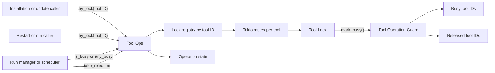
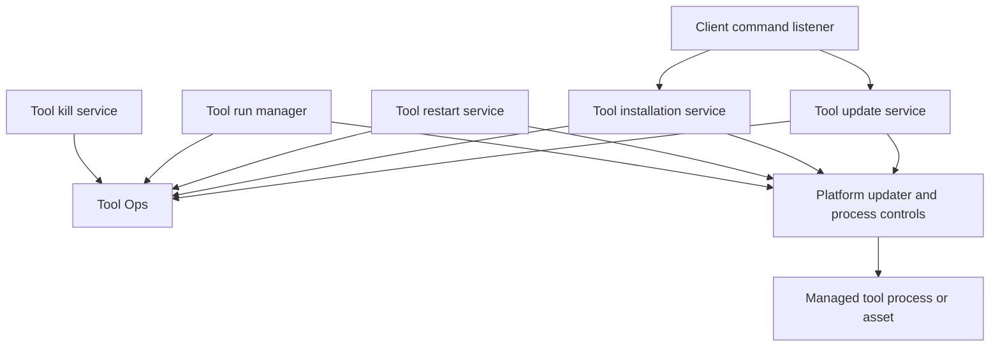
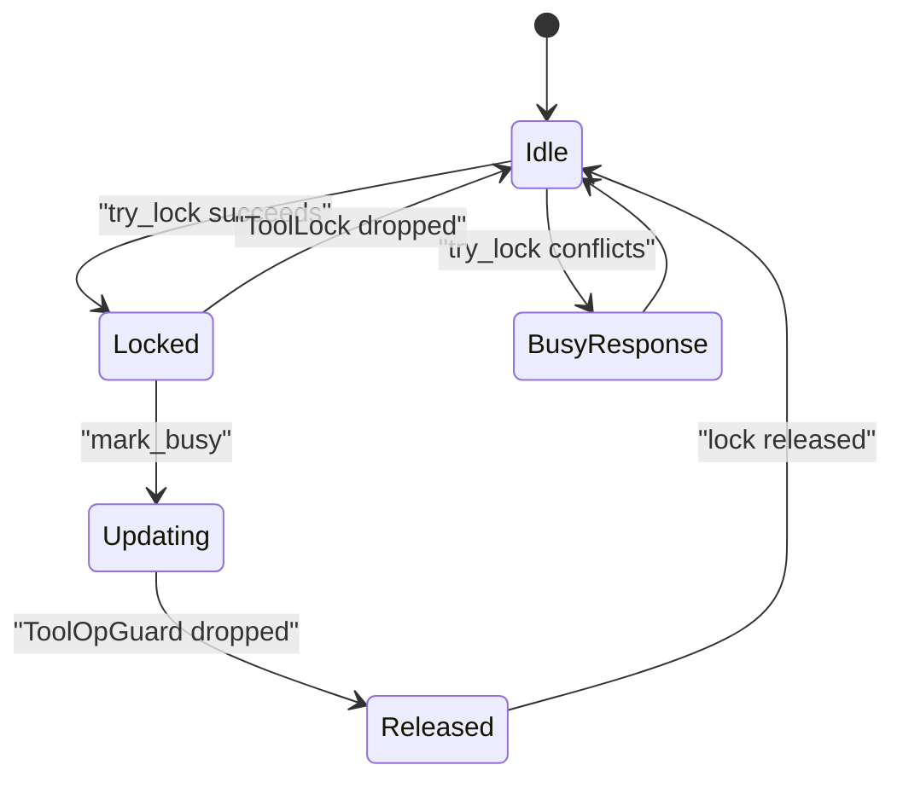
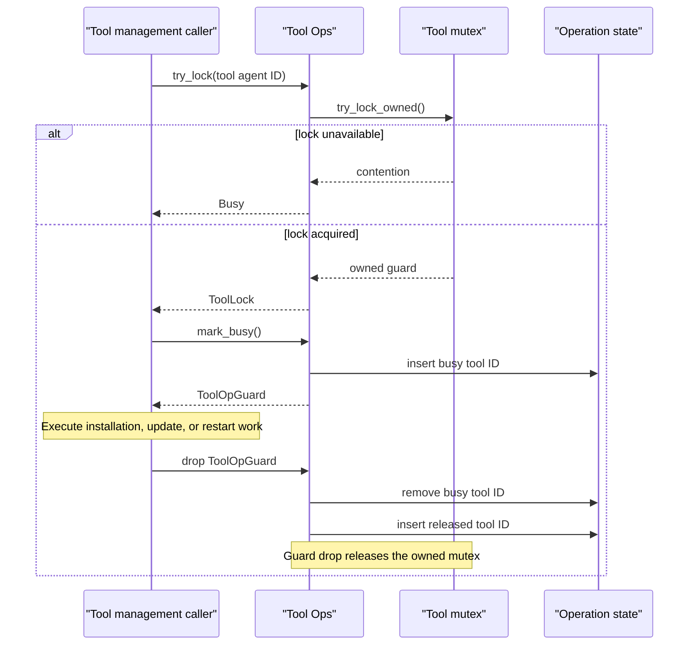
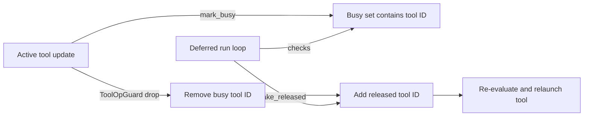

# Tool Ops

Tool Ops is the OpenFrame Client agent's in-process coordination boundary for operations that change one managed tool. It serializes update-sensitive work by tool agent identifier, exposes whether individual or any tools are busy, and releases waiting work promptly when an operation ends. The implementation is supplied by the `openframe_agent_lib` Cargo dependency from [OpenFrame OSS Library](https://github.com/flamingo-stack/openframe-oss-lib/blob/16e7c1cbd9664e7d10ec5ebca7d53c9bd314decf/clients/openframe-client/src/services/tool_ops.rs); it runs inside the tenant repository's OpenFrame Client deployment.

## Purpose and guarantees

Managed tools may be installed, updated, restarted, or launched concurrently by different agent activities. Tool Ops provides a per-tool critical section so those activities do not act on the same tool at the same time.

Its guarantees are intentionally narrow:

- **Per-tool exclusion:** `try_lock` allows one holder for a given tool agent identifier. Operations for different identifiers can proceed independently.
- **Non-blocking admission:** contention returns `Busy` immediately rather than waiting for the existing holder.
- **Explicit busy lifecycle:** an acquired `ToolLock` becomes visible as updating only when the caller invokes `mark_busy`.
- **Automatic cleanup:** dropping `ToolOpGuard` removes the busy marker, records that the tool was released, and releases the asynchronous mutex guard.
- **Read-only coordination view:** `is_busy`, `any_busy`, and `busy_tools().any()` expose current activity without giving callers ownership of an operation.
- **Poison recovery for state maps:** synchronous state and lock-registry mutexes recover their inner value if a prior holder panicked. This preserves availability of coordination state; it does not roll back the failed operation.

Tool Ops does not download artifacts, start processes, persist tool records, or decide update policy. Those responsibilities remain with the client services that perform installation, updates, restarts, and process supervision.

## Architecture

`ToolOps` is cloneable. Every clone shares two `Arc`-owned structures: a registry from tool agent identifiers to Tokio mutexes, and an operation state containing `busy` and `released` identifier sets. The registry is used to acquire the per-tool lock; the state is used for observability and restart wake-up signaling.



### Core types

| Type | Responsibility | Lifecycle |
|---|---|---|
| `ToolOps` | Owns the shared lock registry and operation state, and provides acquisition and query APIs. | Clone freely; clones coordinate through shared `Arc` state. |
| `ToolLock` | Represents exclusive ownership of a specific tool's Tokio mutex before the tool is marked busy. | Returned only by `try_lock`; consumed by `mark_busy`. |
| `ToolOpGuard` | Represents an active update-sensitive operation. Holds the async mutex and manages busy-state cleanup on drop. | Created by `mark_busy`; cleanup is deterministic through `Drop`. |
| `Busy` | Signals that `try_lock` could not acquire the target tool's mutex. | Returned immediately to the caller. |
| `BusyTools` | Cloneable view of shared operation state used to ask whether any tool is busy. | Produced by `busy_tools`; it does not hold a mutex guard. |
| `OpState` | Internal sets for active identifiers and identifiers released since a consumer last took the signal. | Never exposed directly. |

## Dependency and integration context

The module is a small synchronization primitive within the Rust OpenFrame Client, supplied by OpenFrame OSS Library version `v0.0.5` as `openframe_agent_lib`. Its API is most relevant to the client services that mutate or supervise managed tools:

- Tool installation reserves an operation before applying an installation.
- Tool updates coordinate replacement and migration paths with the same per-tool exclusion boundary.
- Tool restart behavior can distinguish an operation still in progress from one that has just completed.
- Tool run management can defer launches during an update and react to the release signal rather than waiting for a restart delay to expire.
- Tool process termination and uninstallation should respect active work to avoid racing an artifact replacement or restart.

The surrounding tenant platform deploys the OpenFrame Client alongside the gateway and NATS infrastructure. The agent's command and tool-management services use that runtime environment, while Tool Ops itself is local-only: it performs no network or disk I/O.



## Lock acquisition and state transitions

`try_lock` looks up or creates a Tokio mutex for the supplied identifier, then performs `try_lock_owned`. It never awaits. If the mutex is already held, it maps the lock error to `Busy`; callers decide whether to defer, retry, or report the conflict.

A successful lock is not automatically marked busy. This separation permits a caller to acquire exclusive access, perform setup, and explicitly declare the operation's externally visible updating interval by consuming `ToolLock` with `mark_busy`.



### Update-operation flow



## Busy and release semantics

The busy set answers current-state questions:

- `is_busy(tool_agent_id)` tests one identifier.
- `any_busy()` delegates to `busy_tools().any()` and returns whether the busy set is nonempty.
- `busy_tools()` returns a lightweight view; `BusyTools::any()` locks shared state only for the query.

The released set is an internal handoff signal. When `ToolOpGuard` is dropped, it adds the identifier to `released` after clearing the busy marker. Internal consumers can call `is_released` to inspect that signal and `take_released` to consume it. The implementation comment identifies its intended behavior: a run loop delayed for a restart can relaunch as soon as an update operation completes.

Because `released` is a set rather than a queue, the signal is coalesced per tool: repeated releases before consumption remain one pending release indication. Consumers should therefore treat it as a prompt to re-evaluate the tool's desired state, not as an event log with one record per operation.



## Concurrency model

The module combines two synchronization mechanisms for different jobs:

1. A `std::sync::Mutex` protects the map that creates and retrieves the per-tool Tokio mutex and protects the `OpState` sets. These short critical sections are synchronous bookkeeping.
2. A `tokio::sync::Mutex<()>` provides the actual async-compatible exclusive ownership for each tool. `ToolLock` and `ToolOpGuard` use `OwnedMutexGuard`, allowing the guard to own the lock independently of a borrowed `ToolOps` reference.

This design means unrelated tools do not block each other at the async lock layer. Lock entries are retained in the registry after an operation; the provided implementation does not evict identifiers. This favors stable reuse of a tool's mutex over registry compaction, so maintenance should consider identifier cardinality when changing how tool agent identifiers are created.

## Maintenance guidance

### Correct usage pattern

The caller must retain the operation guard for the full update-sensitive interval. Dropping it early clears busy state and unlocks the tool, allowing another operation to start while the original work may still be changing files or processes.

```rust
let lock = tool_ops.try_lock(&tool_agent_id).map_err(|_| Busy)?;
let _operation = lock.mark_busy();

perform_tool_update().await?;
// `_operation` drops here, clearing busy state and releasing the per-tool mutex.
```

### Common pitfalls

- Do not use `is_busy` as a substitute for `try_lock`. State observation and acquisition are separate operations, so a check-then-act sequence can race.
- Do not hold a `ToolLock` without deciding whether to call `mark_busy`; it excludes other operations but does not advertise the updating state.
- Do not treat `released` as a durable audit trail. It is in-memory, coalesced, and intentionally consumed by `take_released`.
- Do not assume `any_busy` identifies the responsible tool. Use `is_busy` for a known identifier, or add a deliberate API if callers need an atomic snapshot of identifiers.
- Keep slow work outside the synchronous registry and state mutex sections. The current implementation only holds them for map or set access.

## Testing focus

Tests for this module should verify behavior rather than timing assumptions:

- a second `try_lock` for the same identifier returns `Busy` while a `ToolLock` or `ToolOpGuard` holds the mutex;
- locks for distinct identifiers can be acquired concurrently;
- `mark_busy` makes `is_busy` and `any_busy` true;
- dropping a `ToolOpGuard` clears the busy state and permits a new lock acquisition;
- dropping a guard sets the release signal, and `take_released` consumes it;
- a dropped `ToolLock` that was never marked busy releases the mutex without adding busy or release state;
- cloned `ToolOps` instances observe the same locks and state.

The source declares its test module from `tool_ops_tests.rs`, colocated with the library implementation.

## Source and ownership

Tool Ops is implemented in the OpenFrame OSS Library and assembled into this repository's client runtime through the `openframe_agent_lib` Cargo artifact. The authoritative source is [tool_ops.rs in OpenFrame OSS Library](https://github.com/flamingo-stack/openframe-oss-lib/blob/16e7c1cbd9664e7d10ec5ebca7d53c9bd314decf/clients/openframe-client/src/services/tool_ops.rs). Changes to its locking or guard-drop semantics affect all OpenFrame Client tool installation, update, restart, and run-management flows that share this dependency.
