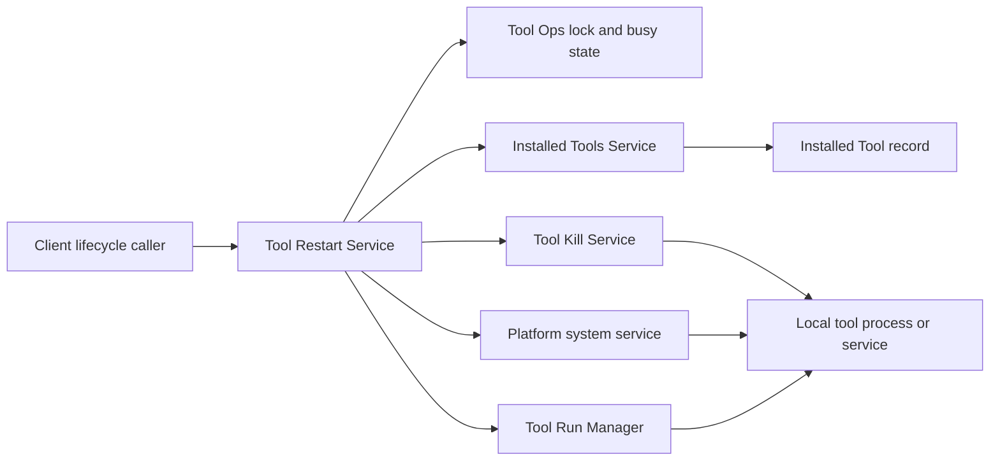
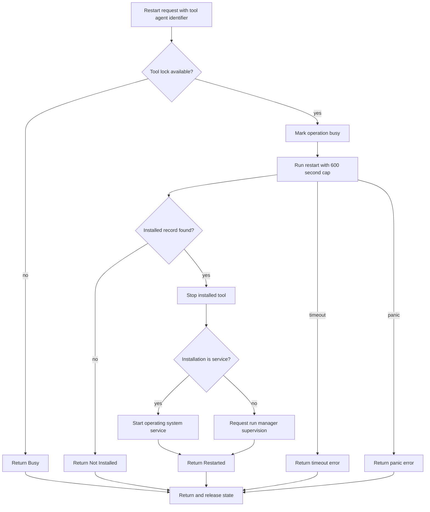
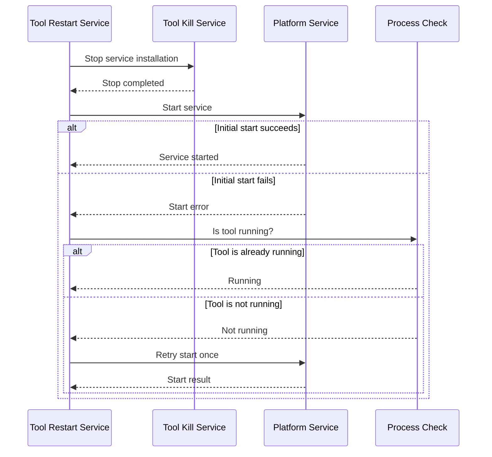
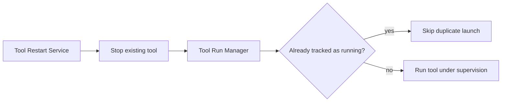

# Tool Restart Service

The Tool Restart Service restarts one installed endpoint tool without allowing concurrent lifecycle work for that same tool. It is implemented in the OpenFrame OSS Library Rust client and runs as part of this repository's OpenFrame client. Its public operation, `restart_guarded`, resolves the registered tool, stops it, and restores execution through the mechanism appropriate to its installation type.

The implementation is supplied by the [`tool_restart_service.rs` source](https://github.com/flamingo-stack/openframe-oss-lib/blob/16e7c1cbd9664e7d10ec5ebca7d53c9bd314decf/clients/openframe-client/src/services/tool_restart_service.rs) file in the OpenFrame OSS Library. This repository consumes that library as the `openframe_agent_lib` Cargo artifact at version `v0.0.5`.

## Responsibilities

Tool Restart Service provides a narrow, guarded restart boundary:

- Serializes lifecycle work per tool agent identifier using `ToolOps`.
- Marks the acquired operation as busy for the full restart attempt.
- Looks up the persisted `InstalledTool` record before acting.
- Stops the recorded installation through `ToolKillService`, including service children where applicable.
- Starts service installations directly through the platform service adapter.
- Delegates non-service installations to `ToolRunManager` supervision.
- Bounds the complete attempt to 600 seconds, including an OS call that might otherwise stall.
- Converts an absent registration, a conflicting operation, a timeout, and a panic into distinct outcomes or errors.

It does not download, install, update, unregister, or persist tool records. Those responsibilities remain with the surrounding client services.

## Position in the Client Architecture

The service is part of the OpenFrame client-side tool lifecycle. Callers provide a tool agent identifier. The service uses local registration state to decide whether there is anything to restart, then routes the restart according to the `Installation` variant.

### Collaborators

| Collaborator | Role during restart |
|---|---|
| `ToolOps` | Attempts a non-blocking, per-tool lock. A successful lock is marked busy and is retained until the restart future returns, panics, or is cancelled. |
| `InstalledToolsService` | Reads the locally persisted tool registry and finds the record matching the tool agent identifier. |
| `ToolKillService` | Stops the known installation. For service installations, this encompasses stopping the OS service and detached children. It also checks whether a service tool is actually running after a failed start call. |
| `ToolRunManager` | Restores supervision for non-service tools by accepting the tool record through `run_new_tool`. Its own running-set guard makes a duplicate launch request a no-op. |
| Platform `system_service` | Starts installations represented as OS services. The active platform implementation performs the operating-system-specific service action. |
| `Installation` model | Selects direct service startup versus managed process supervision. Relevant variants are `Service`, `Standard`, and `GuiApp`. |

## Restart Decision Flow

`restart_guarded` is the only public restart operation. It first uses `ToolOps.try_lock`; it does not wait behind an existing tool operation. A contention result is reported as `Busy`, allowing callers to defer rather than overlap a restart with installation, update, or another lifecycle action.

The operation guard is held across the entire timed future. Rust scope cleanup releases the busy-marked guard when the method exits, including on the timeout and panic paths. The timeout prevents a wedged operating-system operation from indefinitely blocking future tool work.

## Installation-Specific Restart Behavior

### Service Installations

For `Installation::Service`, Tool Restart Service performs an explicit platform service start after the stop succeeds. Service tools are not supervised by `ToolRunManager`, so merely clearing a busy flag would not bring them back.

A failure from the first `start_service` call is not immediately treated as terminal:

1. The service checks whether the tool process is already running.
2. If it is running, the restart is accepted. This covers an OS supervisor that relaunched the service while the explicit start call returned an error.
3. If it is not running, the service logs a warning and retries `start_service` once.
4. A failed retry is returned with context naming the service.

### Standard and GUI Application Installations

For other installation variants, the service stops the tool and calls `ToolRunManager.run_new_tool` with a clone of the persisted tool record. The run manager owns the supervised process lifecycle and tracks currently running tool identifiers. It ignores a duplicate run request when the tool is already marked running, rather than creating another runner.

## Outcomes and Failure Semantics

`RestartOutcome` represents normal, non-exceptional results. Errors are reserved for failed restart work, a timeout, or a captured panic.

| Result | Meaning | Caller implication |
|---|---|---|
| `Restarted` | The tool was found, stopped, and its service start or supervision request completed. | The restart was triggered. For a supervised process, actual execution is owned by the run manager. |
| `NotInstalled` | No persisted record matches the requested tool agent identifier. | No local process or service action was attempted. |
| `Busy` | Another operation already holds the per-tool lock. | Retry or allow the owning lifecycle operation to finish. |
| Error with restart context | Lookup, stop, start, retry, or supervision failed. | The tool may be stopped; inspect the error and lifecycle logs. |
| Timeout error | The guarded work exceeded `TOOL_RESTART_TIMEOUT_SECS`, currently 600 seconds. | The lock is released. A later self-heal or server-sent restart can attempt recovery. |
| Panic error | The inner restart future panicked and was captured. | The lock is released and the caller receives a tool-specific failure. |

A timeout is deliberately not a rollback. The code notes that a timed-out tool can remain stopped, while later self-heal or server-initiated restart cycles provide recovery opportunities.

## State and Concurrency Guarantees

The service’s correctness depends on the boundaries around `restart_guarded`:

- **Per-tool isolation:** locks are keyed by tool agent identifier, so unrelated tools can restart independently.
- **No queuing under contention:** an unavailable lock produces `Busy`; the method does not wait for it.
- **Busy lifetime:** the busy mark begins only after the lock is acquired and lasts until the guarded operation has resolved, timed out, panicked, or been cancelled.
- **Bounded blocking:** the complete inner restart future is wrapped in a 600-second timeout.
- **Panic containment:** `catch_unwind` converts a panic in the inner future into a returned error instead of propagating it through the caller.
- **Registry-based targeting:** process actions are only performed for a tool represented by a current installed-tools record.

## Operational Observability

The service writes informational lifecycle messages for these transitions:

- an unregistered tool has nothing to restart;
- restart stop begins;
- a service tool is started;
- a service start error is tolerated because the process is already running; and
- restart triggering completes.

It logs a warning before retrying a failed service start. Failures also receive contextual error messages that identify the tool agent identifier or service name. These messages are intended to be correlated with the client’s general logging and metrics pipeline.

## Maintainer Considerations

When modifying Tool Restart Service, preserve these behavioral boundaries:

1. Acquire the `ToolOps` lock before touching an installed tool and retain it across all restart activity.
2. Keep the busy flag tied to the same guard lifetime as the lock.
3. Preserve the timeout and panic boundary around the complete restart sequence, not only individual OS calls.
4. Stop the recorded installation before selecting its recovery path.
5. Continue using direct system-service startup for service installations and run-manager supervision for other installations.
6. Treat an initial service-start failure as ambiguous until process inspection confirms the tool is absent.
7. Avoid turning `NotInstalled` or `Busy` into errors; callers rely on these as expected control-flow outcomes.

The service is intentionally small, but it sits at a critical lifecycle boundary: incorrect locking can overlap update and restart operations, while incorrect installation dispatch can leave service tools stopped or cause duplicate supervised process launches.
