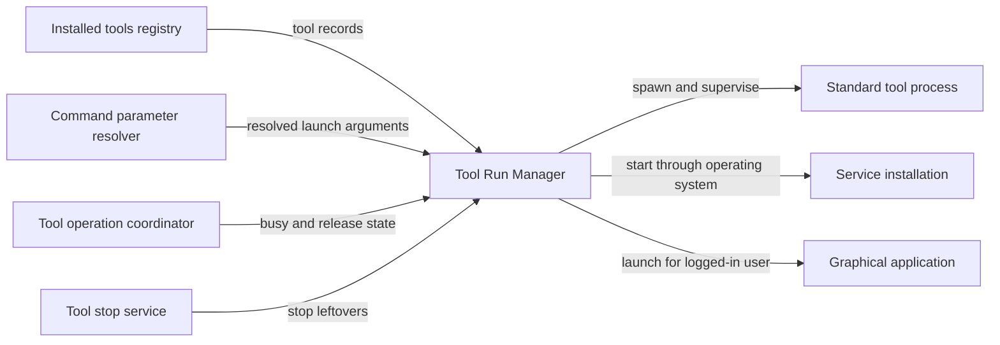
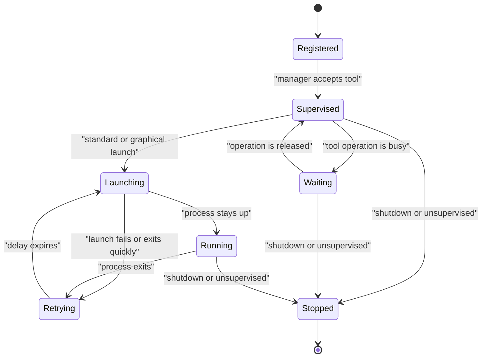
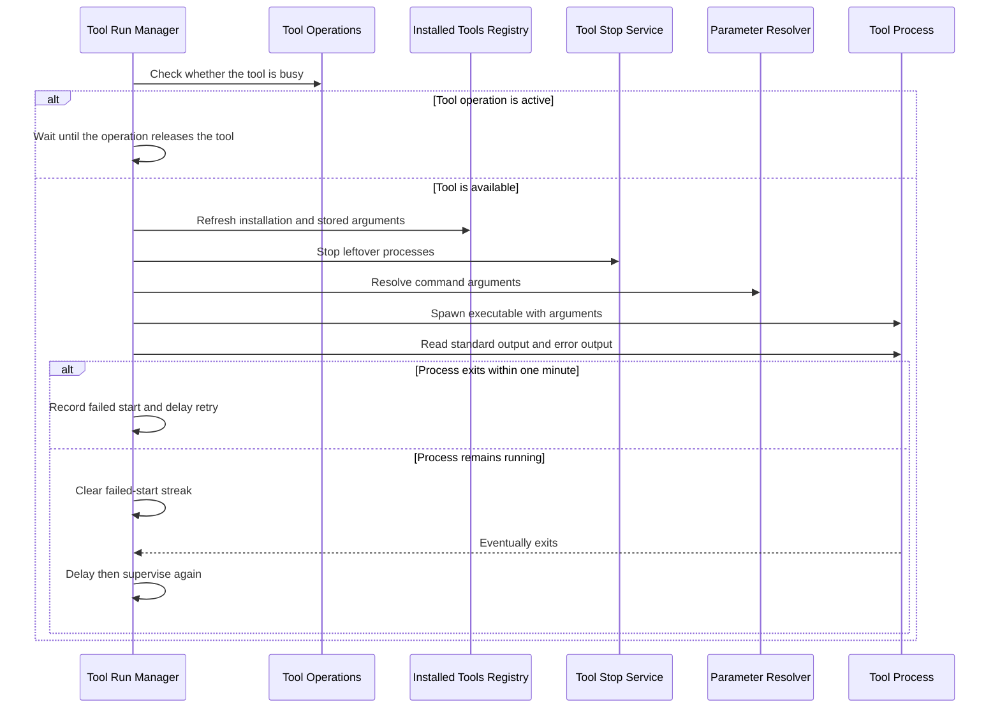
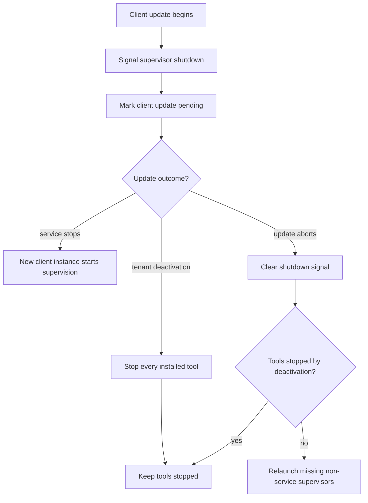

# Tool Run Manager

Tool Run Manager supervises installed endpoint tools in the Rust OpenFrame client. It starts eligible tools, prevents duplicate supervisors, stops stale processes before relaunching them, waits around tool updates, and applies bounded retry behavior when a process cannot be started or exits too early.

The implementation is supplied by the `openframe_agent_lib` dependency from OpenFrame OSS Library and is executed by this repository’s OpenFrame client. The authoritative implementation is [Tool Run Manager source](https://github.com/flamingo-stack/openframe-oss-lib/blob/16e7c1cbd9664e7d10ec5ebca7d53c9bd314decf/clients/openframe-client/src/services/tool_run_manager.rs).

## Responsibilities

Tool Run Manager provides these lifecycle guarantees:

- Reads the persisted installed-tool registry at startup and when recovering from an aborted client update.
- Keeps at most one supervisor loop for each tool identifier using a shared running-tool set.
- Treats service installations as self-managed by the operating system rather than launching child processes for them.
- Supervises standard installations as child processes and relaunches them after exit.
- Uses platform-specific behavior for graphical applications: Windows defers normal launch ownership to the machine autorun entry, while macOS waits for a usable console session and launches under that user.
- Coordinates with exclusive tool operations so an installer or updater can stop, replace, and explicitly release a tool without a concurrent relaunch.
- Supports reversible deactivation stops, client-update shutdown, and recovery when a client update does not complete.
- Repairs selected interrupted installation records only when a non-service executable is present and non-empty.

## Place in the Client

The manager is an in-process coordinator. It does not download or install assets itself; surrounding services persist the installed-tool record, resolve command arguments, hold update locks, and stop existing processes. The manager converts that state into supervised processes.

### Collaborators

| Collaborator | Contribution to Tool Run Manager |
|---|---|
| Installed Tools Service | Persists tool records and exposes the complete registry or a record by tool identifier. The manager also changes a recoverable record from installing to installed. |
| Tool Command Parameters Resolver | Resolves persisted launch arguments and exposes the directory manager used to locate executables and verify artifact presence. |
| Tool Stop Service | Stops a managed installation before a standard process is launched and reports whether a graphical application is already running. |
| Tool Operations | Exposes per-tool busy state and a release signal. A busy tool is not relaunched until its operation completes. |
| Operating-system service support | Starts service installations during a full restart; the normal supervisor deliberately does not own these processes. |
| Failure Log Backoff | Limits repetitive failure logging while retaining a failure streak for retry timing. |

## Tool Eligibility and Installation Forms

The persisted installation describes how Tool Run Manager should handle the tool.

| Installation form | Manager behavior |
|---|---|
| Standard | Stops leftover processes, resolves arguments, spawns the executable with piped output, observes the child, then relaunches it after termination. |
| Graphical application | Uses graphical-session rules. On Windows, a new installation can be launched into a user session while later logon launches are owned by the autorun entry. On macOS, the manager waits for a console user and ready graphical session, writes bundle preferences when a bundle identifier is configured, then launches as that user. |
| Service | Is not spawned by a supervisor loop. A full restart attempts to start its named operating-system service. |

At startup, the manager inspects records still marked as installing. It only changes a record to installed when the executable is present for a non-service installation. Missing artifacts remain awaiting reinstallation; service records remain installing because file presence cannot verify service registration.

## Supervision Model

A shared asynchronous read-write lock protects the set of currently supervised tool identifiers. A tool is entered into this set before its loop is created. Any later request for the same identifier is ignored until the loop removes it. This is also the synchronization boundary for shutdown and recovery decisions.

A process that exits within the first minute is considered a failed start unless a tool operation is active. Failed starts use an escalating delay sequence of 5, 30, 120, 300, and then 900 seconds. Other restart paths use a five-second delay. Long waits are evaluated in one-second slices so shutdown, removal from supervision, or a tool-operation release can interrupt the wait promptly.

Before a fresh standard launch, the manager attempts to stop leftovers. Failures to stop leftovers defer the launch and use an escalating delay capped at 300 seconds. After a successful stop, it also reaps orphaned helper processes. On Windows, graphical applications are excluded from this leftover-kill behavior because the autorun mechanism owns them.

## Standard Process Data Flow

Child standard output and error output are consumed asynchronously. During a failure streak, output forwarding follows the logging backoff decision. Once a process survives the quick-exit window, output forwarding is enabled and a prior failure streak is recorded as recovered.

## Shutdown, Deactivation, and Update Recovery

Tool Run Manager uses separate state for lifecycle intent:

- **Shutdown signal:** prevents new launches and causes active supervision loops to remove their identifiers and exit. This is used before a client self-update terminates the service.
- **Tools stopped flag:** records a deactivation stop. It prevents an aborted client update from restarting tools that were intentionally stopped because their tenant is unavailable.
- **Client update pending flag:** has a timestamp and expires after the configured client-update pending lifetime. Consumers can view this flag and refuse new tool operations as busy until it is cleared or expires.

A reversible full stop first takes the supervision lock, sets the stopped state, signals shutdown, and clears the running set. It then requests the Tool Stop Service to stop every installed tool without uninstalling it. A later full restart clears both flags, clears the running set, starts registered operating-system services, and runs the normal launch path for non-service tools.

If a client update aborts while the client process is still alive, recovery clears only the shutdown signal. It does not resume after a deactivation stop. Otherwise, it reloads the registry and creates supervisors for non-service tools that are not already represented in the running set.

## Graphical Application Behavior

Graphical applications are intentionally not treated exactly like ordinary daemon processes.

- On Windows, a fresh tool request may launch the application in the current user session. If it is already running, no second instance is started. For normal relaunches, the machine autorun entry owns launch at user logon, and the supervisor removes the tool from its running set.
- On macOS, the manager waits until it can identify a console user and the graphical session is ready. It verifies process absence both before and after the waits. When a bundle identifier is present, resolved arguments are written as application preferences and the application receives only the optional background launch flag; otherwise it receives the resolved arguments directly.
- On non-macOS Unix systems, a graphical application falls through to the standard spawn path.

The optional background flag is only selected for the client’s designated chat tool on Windows and macOS.

## Operational Notes

- A service record is intentionally skipped by the per-tool loop. If service execution is unexpectedly needed, investigate service registration and operating-system service state rather than adding child-process supervision.
- A duplicate launch warning usually means the tool is already in the running-tool set. This protects against simultaneous startup, on-demand graphical launch, and update recovery requests.
- Repeated early exits signal either a bad binary, invalid resolved arguments, or an environment problem. The retry sequence reaches fifteen minutes, reducing churn while retaining eventual recovery.
- A loop refreshes its tool record before launch. Installation metadata and stored arguments changed by an update can therefore take effect without recreating Tool Run Manager.
- An update operation that holds the per-tool busy state is allowed to stop the process without that stop being classified as a failed start.

## Maintenance Boundaries

Changes to Tool Run Manager should preserve these invariants:

1. Add a tool identifier to the running set before creating its supervisor, and remove it whenever the loop terminates or transfers ownership to platform launch behavior.
2. Check shutdown while holding the supervision lock immediately before launch, not only at loop entry.
3. Never relaunch a tool while Tool Operations reports it busy.
4. Keep deactivation stops stronger than client-update recovery.
5. Preserve the distinction between service, standard, and graphical installations; each has a different process owner.
6. Treat rapid exits differently from long-running process exits so persistent startup failures back off more aggressively.

The core behaviors are implemented by the `ToolRunManager` type and its constructor, registry startup, single-tool startup, graphical-app assurance, all-tool stop and restart, update-abort recovery, and client-update-pending operations in the linked OpenFrame OSS Library source.
