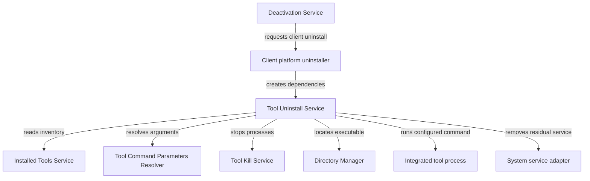
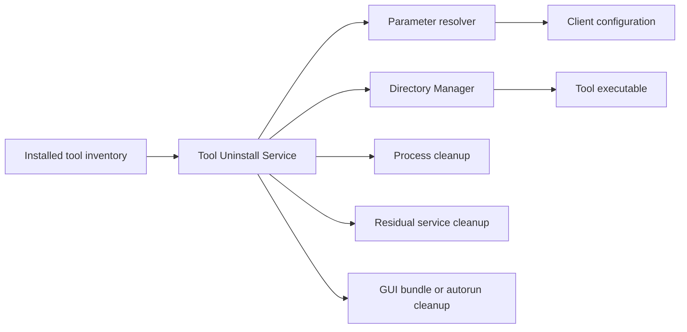
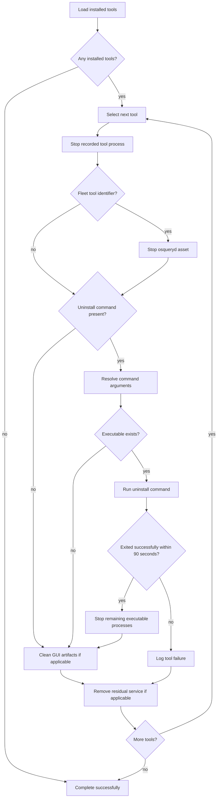
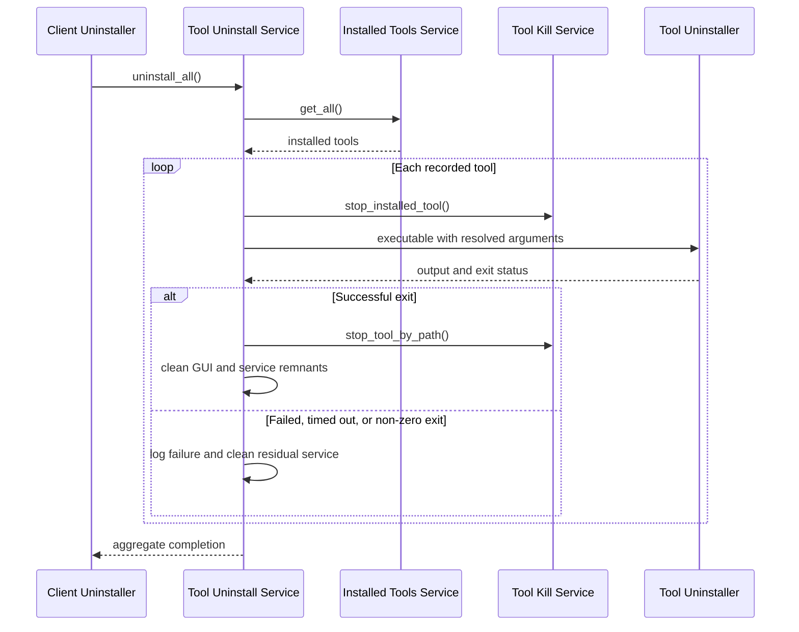

# Tool Uninstall Service

The Tool Uninstall Service removes every integrated tool recorded on an OpenFrame client endpoint. It is implemented by the `openframe_agent_lib` dependency from [OpenFrame OSS Library](https://github.com/flamingo-stack/openframe-oss-lib/blob/16e7c1cbd9664e7d10ec5ebca7d53c9bd314decf/clients/openframe-client/src/services/tool_uninstall_service.rs), which this repository runs through its OpenFrame client. The service is a local cleanup coordinator: it reads the persisted tool inventory, stops processes, invokes each tool's configured uninstall command, and performs platform-specific residual cleanup.

Its primary operation, `uninstall_all`, is deliberately best-effort across the inventory. A failure for one tool is logged and does not prevent attempts to remove later tools. Within a single tool's operation, however, required stages fail fast so a failed stop, command, or command exit status is visible rather than treated as a successful removal.

## Scope and Responsibilities

Tool Uninstall Service is responsible for the following endpoint-local work:

- Load installed-tool records from the client inventory.
- Stop a tool before attempting its uninstaller.
- Stop the `osqueryd` asset for tool identifiers containing `fleet`.
- Resolve uninstall-command placeholders, including configured server, token path, machine identifier, and dynamic asset paths.
- Locate the executable using the installation metadata and the client directory layout.
- Run an uninstaller with captured standard output and error output, a 90-second execution limit, and bounded output-reader cleanup.
- Stop processes that remain after a successful uninstaller invocation.
- Remove macOS GUI application bundles and Windows GUI autorun registration where applicable.
- Attempt to remove a residual system service for service-style installations, even when the tool-specific uninstall path failed.

It does not delete the installed-tool record itself, report a per-tool result to a remote service, or retry a failed uninstaller. Those concerns remain with the surrounding client lifecycle and tool-management services.

## Placement in the Client Lifecycle

The client platform uninstaller assembles this service during integrated-tool cleanup. It creates the installed-tool store, initial-configuration and agent-configuration services, parameter resolver, process-kill service, and directory manager, then calls `uninstall_all`. This cleanup is therefore part of removal of the OpenFrame client, rather than a message-driven tool update workflow.

A deactivation path can request client self-uninstallation; the platform uninstall flow then delegates integrated-tool removal to Tool Uninstall Service. The service works entirely from local state and the recorded tool metadata once invoked.

## Core Components

| Component | Role |
| --- | --- |
| `ToolUninstallService` | Holds the inventory service, command parameter resolver, process-kill service, and directory manager required by the removal workflow. |
| `new` | Receives the four client services and constructs the coordinator without performing I/O. |
| `uninstall_all` | Loads all recorded tools, processes them sequentially, removes any leftover registered service for service installations, and continues after per-tool failures. |
| Internal single-tool workflow | Stops the tool, optionally stops `osqueryd`, resolves arguments, runs the executable, checks its status, and performs post-command cleanup. |

The inventory is represented by `InstalledTool`, including the stable tool-agent identifier, optional uninstall arguments, installation variant, assets, and record state. The installation variant distinguishes standard binaries, GUI applications, and system services; GUI and service variants drive the specialized cleanup behavior.

## Dependency Model

The service uses client-library services supplied by the OpenFrame OSS Library dependency:

| Dependency | Interaction during removal |
| --- | --- |
| Installed Tools Service | Reads the local JSON-backed list of installed tools. If the inventory file does not exist, it returns an empty list and the workflow succeeds without invoking any tool. |
| Tool Command Parameters Resolver | Replaces command placeholders before process launch. Resolution can read the initial server configuration and agent machine identity and can derive local token and asset paths. |
| Tool Kill Service | Stops the installed tool before removal, stops the `osqueryd` asset for Fleet-related tools, and removes processes still associated with the executable path after a successful uninstall command. |
| Directory Manager | Resolves the tool executable path. Absolute executable paths are used directly; relative paths are located under the client application-support directory and tool identifier; missing paths use the platform default agent name. |
| System Service adapter | Attempts a residual service removal for `Service` installations. On Windows this delegates to the platform service implementation; on non-Windows targets it is a no-op. |
| Platform GUI cleanup | On macOS, removes the application bundle for GUI applications. On Windows, unregisters the GUI application's autorun entry. |

## Removal Process

For each record, Tool Uninstall Service performs the following sequence:

1. **Stop the recorded installation.** The Tool Kill Service is asked to stop the installation with deletion allowed. This is a required step; failure prevents command execution for that tool.
2. **Apply the Fleet compatibility cleanup.** If the tool-agent identifier contains `fleet` without regard to case, the service stops the `osqueryd` asset. This is explicitly a targeted compatibility measure for the current Fleet integration.
3. **Check for an uninstall command.** Tools without a non-empty uninstall argument list do not execute a process. The service still attempts the applicable GUI bundle and autorun cleanup and considers that tool complete.
4. **Resolve command arguments.** Placeholder values are expanded using local configuration and assets. Resolution failure stops processing for that tool.
5. **Resolve and validate the executable path.** If the executable no longer exists, the uninstall command is skipped with a warning. GUI cleanup remains eligible.
6. **Launch and observe the uninstaller.** The executable receives the resolved arguments. Its output streams are piped and logged line by line with the tool identifier and stream name.
7. **Enforce outcome rules.** The command must exit successfully within 90 seconds. A non-zero exit status or wait failure fails this tool. On timeout, the child is killed and the tool fails.
8. **Perform post-command cleanup.** The service tries to stop processes matching the resolved executable path, then cleans up GUI artifacts when the installation is a GUI application.
9. **Attempt residual service cleanup.** For service installations, the registered service is removed after the single-tool result is known. Errors are warnings, not a reason to stop the remaining inventory.

## Command Execution and Output Handling

The uninstaller process is launched through Tokio with `kill_on_drop` enabled and separate piped readers for standard output and error output. Readers split byte streams on carriage-return or newline boundaries, convert output lossily to text, trim it, and emit non-empty lines through structured logs. This ensures interactive or verbose uninstallers remain observable without waiting until process completion.

The operation has two time bounds:

| Limit | Value | Behavior |
| --- | ---: | --- |
| Uninstall command execution | 90 seconds | The child is killed and the tool result fails if it does not exit in time. |
| Output drain after command completion | 5 seconds per stream | A reader still held open, such as by a detached child that inherited a pipe, is aborted after a warning. |

The output-drain limit prevents a completed uninstaller from blocking the client cleanup flow indefinitely because a descendant process kept standard output or error open.

## Failure and Continuation Semantics

Tool Uninstall Service distinguishes failure inside a tool workflow from failure across the inventory:

- Inventory-read failure is returned to the caller because no safe inventory iteration is possible.
- Stop, parameter-resolution, command-spawn, command-wait, timeout, and non-zero-exit failures terminate processing of the current tool.
- Process cleanup after a successful command, GUI bundle cleanup, GUI autorun cleanup, and residual service cleanup are best-effort and produce warnings when unsuccessful.
- After an individual tool failure, `uninstall_all` logs the contextual error and continues with the next installed-tool record.
- The aggregate method returns success after completing iteration, even if individual tools failed. Operators must inspect logs to identify per-tool failures.

## Platform-Specific Behavior

| Installation or platform condition | Behavior |
| --- | --- |
| Standard installation | Stops the recorded process, then uses the configured uninstaller when available. |
| Service installation | Follows the standard single-tool flow and additionally attempts to remove the named residual service. |
| GUI application on macOS | Attempts to remove the recorded application bundle after command execution, after a missing command, or after a missing executable. |
| GUI application on Windows | Attempts to unregister the tool's autorun entry on the same GUI cleanup paths. |
| Windows command spawn failure | Emits additional file-lock diagnostics before returning the spawn error. |
| Non-Windows system service cleanup | The system-service removal call is a no-op, preserving cross-platform control flow. |

## Operational Notes for Maintainers

- The order follows the persisted installed-tool list; there is no concurrency or dependency ordering in this service.
- A missing executable is not treated as an error. The configured command is skipped, which supports partial or manually removed installations while allowing GUI cleanup.
- A tool with no uninstall command is also not an error. This accommodates tools that only require process and GUI artifact cleanup.
- The Fleet-specific `osqueryd` handling depends on a substring match in the tool-agent identifier. Changes to Fleet naming or asset ownership should revisit this condition.
- Since individual errors are intentionally absorbed after logging, validate removals through the client logs and endpoint state rather than the aggregate return value alone.

## Source and Runtime Ownership

The implementation belongs to the `openframe_agent_lib` Cargo dependency from OpenFrame OSS Library, pinned by this repository at version `v0.0.5`. The OpenFrame OSS Tenant repository publishes the `openframe_client` Cargo artifact and runs the library code in its OpenFrame client distribution. The authoritative implementation is [tool_uninstall_service.rs](https://github.com/flamingo-stack/openframe-oss-lib/blob/16e7c1cbd9664e7d10ec5ebca7d53c9bd314decf/clients/openframe-client/src/services/tool_uninstall_service.rs).
