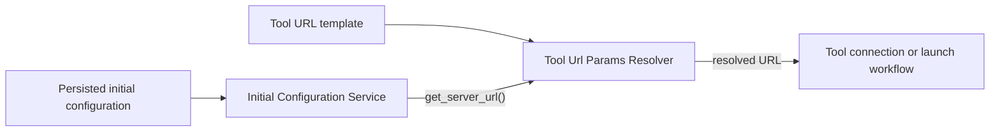
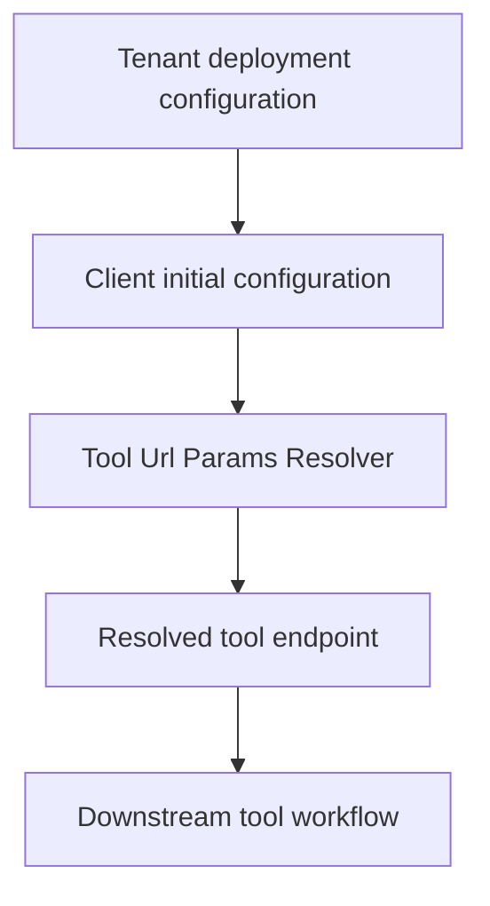
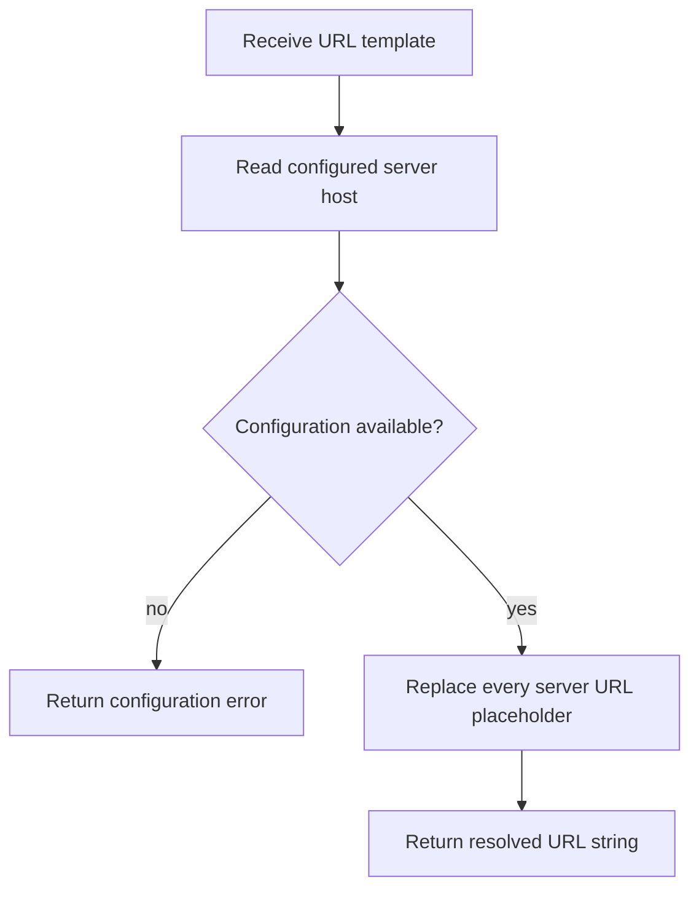
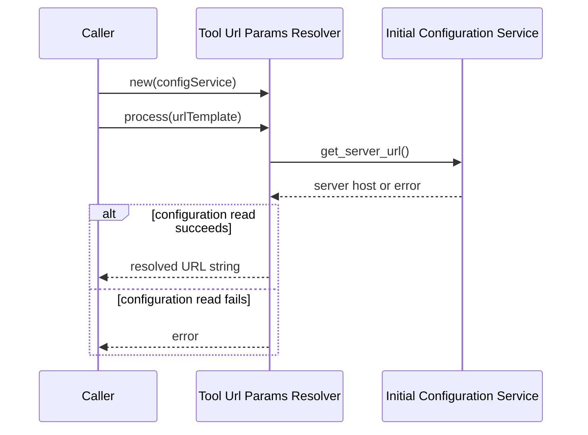

# Tool Url Params Resolver

Tool Url Params Resolver is a small OpenFrame Client component that expands the `${client.serverUrl}` placeholder in a tool URL. It reads the agent's persisted initial configuration and substitutes its configured server host directly into every occurrence of that placeholder. The component is implemented by the `openframe_agent_lib` dependency and is executed by the tenant repository's OpenFrame Client.

The implementation is in the OpenFrame OSS Library source: [tool_url_params_resolver.rs](https://github.com/flamingo-stack/openframe-oss-lib/blob/16e7c1cbd9664e7d10ec5ebca7d53c9bd314decf/clients/openframe-client/src/services/tool_url_params_resolver.rs).

## Responsibilities and Scope

The module has one responsibility: make a URL template specific to the client installation by replacing the literal `${client.serverUrl}` token.

| Component | Responsibility |
| --- | --- |
| `ToolUrlParamsResolver` | Holds the initial configuration dependency and provides URL-template processing. |
| `new` | Constructs the resolver with an `InitialConfigurationService`. |
| `process` | Loads the configured server host, replaces the server URL placeholder, and returns the resolved string. |
| `InitialConfigurationService` | Provides the persisted `server_host` value through `get_server_url`. |

The resolver does not parse or validate URL structure, append a protocol, add a port, escape values, retrieve credentials, or persist the result. It performs a literal string replacement. Callers must therefore supply a URL template and configuration value that together form the endpoint required by the integrated tool.

## Architecture

Tool Url Params Resolver belongs to the Rust OpenFrame Client runtime, supplied by the OpenFrame OSS Library as the `openframe_agent_lib` Cargo dependency. The client agent configuration is the source of the substitution value.



The broader tenant deployment hosts the services that the client is configured to contact. This module itself is client-side and has no direct network call: it only resolves a string before another workflow uses it.



## Resolution Contract

### Input

`process` accepts a borrowed URL-path string. It may contain zero, one, or multiple `${client.serverUrl}` tokens.

### Configuration lookup

Before replacement, the resolver calls `InitialConfigurationService.get_server_url()`. That service loads the initial configuration and returns a clone of its `server_host` field. A configuration read failure is returned to the caller; the resolver does not replace the placeholder with a fallback value.

### Output

On success, `process` returns a new string created by Rust's string replacement operation:

```text
input:  ${client.serverUrl}/tool/connect
value:  tenant.example
output: tenant.example/tool/connect
```

All exact occurrences of the token are replaced. If the input contains no token, the returned string is unchanged after the configuration read succeeds. The configured value is inserted as stored: the resolver does not add `https://`. This is intentionally distinct from command-argument processing, which constructs an HTTPS server URL for its own `${client.serverUrl}` substitution.

## Processing Flow



The flow is synchronous and side-effect free from the resolver's perspective. It reads configuration but does not mutate configuration, invoke HTTP, or start the tool.

## Component Interaction

The constructor uses dependency injection: the caller creates an `InitialConfigurationService` and passes it to `ToolUrlParamsResolver.new`. This keeps URL-template processing separate from configuration storage and makes the replacement behavior dependent on the client configuration selected at runtime.



The OpenFrame Client also contains a separate Tool Command Params Resolver for command-line arguments. That neighboring component supports additional placeholders and uses a different URL normalization rule. Keep template semantics aligned with the resolver selected by the consuming workflow rather than assuming the two components are interchangeable.

## Operational Considerations

- **Initial configuration is required.** A tool URL that uses the placeholder can only be processed when the initial configuration is readable and contains the server host expected by the deployment.
- **Protocol ownership is external.** Include a protocol in the template or stored server value when the downstream tool requires one. This module will not supply it.
- **Replacement is literal.** Only the exact `${client.serverUrl}` sequence is recognized. Similar spellings remain unchanged.
- **No validation boundary.** The returned value may still be an invalid or incomplete URL if the template or stored host is malformed. Validate at the tool-definition or connection boundary when URL correctness is required.
- **Configuration changes are observed per call.** `process` asks the configuration service for the server host each time, rather than storing a server value in the resolver.

## Maintenance Guidance

When changing this module, preserve the distinction between resolving a tool URL and resolving command arguments. Changes to the placeholder token, protocol handling, or replacement behavior can affect previously stored tool definitions. Tests should cover at least the following cases:

- A template containing one placeholder.
- A template containing the placeholder more than once.
- A template with no placeholder.
- Propagation of an initial-configuration read failure.
- A configured value with and without a protocol, confirming that no protocol is added by this module.
