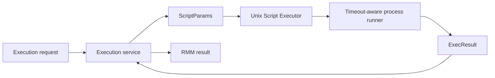
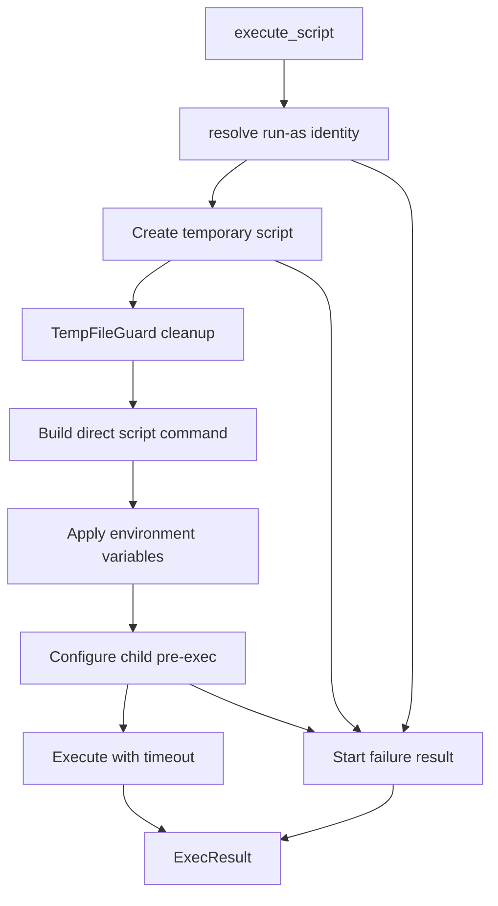
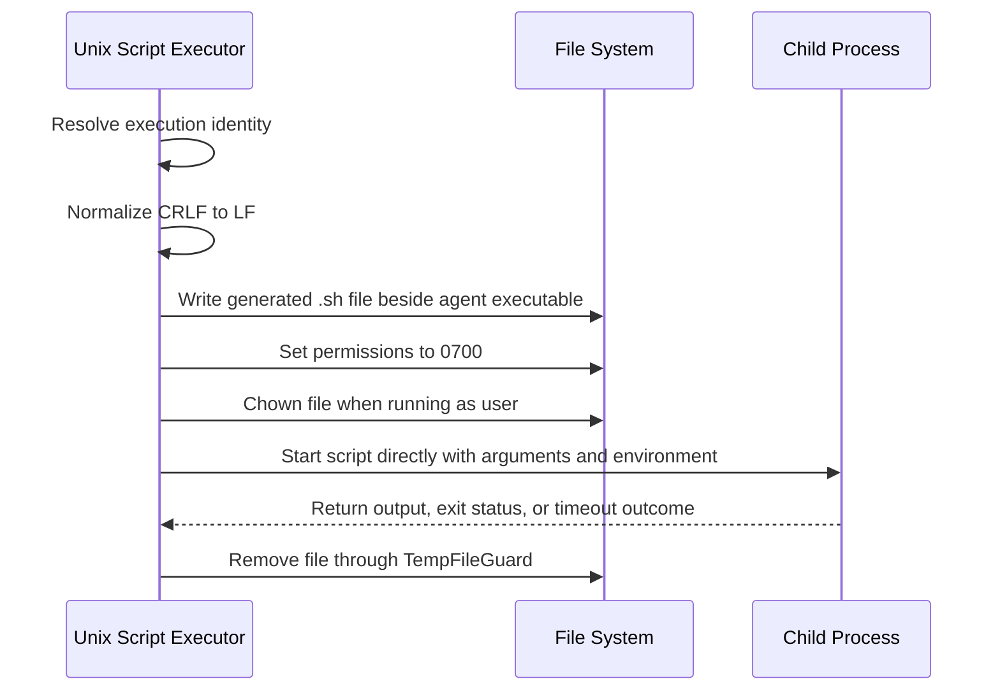
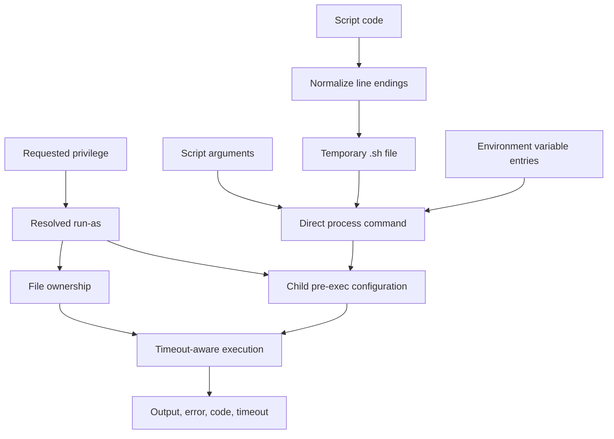

# Unix Script Executor

The Unix Script Executor is the Unix-specific execution backend used by the OpenFrame client agent to run a received script. It resolves the requested execution identity, creates a short-lived executable script beside the agent binary, applies the supplied environment and arguments, configures the child process, and delegates bounded execution to the timeout-aware process runner.

Its implementation is supplied by the `openframe_agent_lib` Cargo dependency from OpenFrame OSS Library version `v0.0.5`. The tenant repository runs this code through its OpenFrame client; the authoritative implementation is [executor/unix/mod.rs](https://github.com/flamingo-stack/openframe-oss-lib/blob/16e7c1cbd9664e7d10ec5ebca7d53c9bd314decf/clients/openframe-client/src/executor/unix/mod.rs).

## Scope and Responsibilities

The module exposes one asynchronous entry point, `execute_script`. It accepts the shared executor contract:

| Input or output | Role in Unix Script Executor |
| --- | --- |
| `ScriptParams` | Provides script text, positional arguments, timeout, requested privilege, environment variables, and a shell field. |
| `Privilege` | Selects agent-context or console-user execution. |
| `ExecResult` | Returns captured standard output, captured standard error, an exit code, and timeout state. |

The Unix implementation deliberately owns local process preparation, not request validation, message delivery, result persistence, or result publication. Those responsibilities remain in the client execution service and its surrounding listener and messaging components.

> **Implementation note:** `ScriptParams` contains a `shell` field, but this Unix implementation does not inspect it. It writes the supplied code to a temporary `.sh` file and invokes that file directly. Script authors must therefore provide Unix-executable script content appropriate for direct execution rather than relying on shell selection in this module.

## Position in the Client Execution Path

The execution service converts an execution request into `ScriptParams`. It uses a default timeout of 900 seconds when the request timeout is zero, caps nonzero values to the `u32` range, resolves the request privilege, tracks the running script, and maps `ExecResult` into the outbound RMM result. The Unix Script Executor performs the platform-specific portion of that flow.

A return code of `85` is reserved by the executor boundary for failures that prevent a script from starting. The execution service treats that code as an error condition and copies the executor's standard-error text into the RMM result error field. A script that starts successfully is instead represented by the result produced by the process runner, including its exit status and timeout flag.

## Internal Architecture

The module is a coordinator around a set of Unix-oriented collaborators. The collaborators are internal implementation details in the same OpenFrame OSS Library source tree.

### Execution Identity

`resolve_run_as` derives a `RunAs` value from the requested `Privilege` before any file is created:

- `Agent` runs in the agent's service context.
- `User` resolves a console user and prepares execution in that user's context.
- If identity resolution fails, the module does not spawn a child process. It returns an `ExecResult` with empty standard output, the failure message in standard error, exit code `85`, and `timed_out` set to `false`.

For user-context execution, the temporary script is chowned to the resolved user's UID and GID. `configure_preexec` then configures the child before it is executed. This separates ownership of the script file from the process-context setup required to run it.

## Script Materialization and Cleanup

The executor normalizes Windows-style line endings by replacing every CRLF sequence with LF before writing the script. It obtains the running agent executable path, requires that executable to have a parent directory, and creates a generated `.sh` filename in that directory.

The file lifecycle is as follows:

The temporary file is protected with Unix mode `0700`, limiting access to its owner. When user execution is selected, ownership is changed before the process is launched. The `TempFileGuard` is created immediately after successful file creation; its scope covers command configuration and asynchronous execution, so cleanup is attempted when the function exits through normal completion or an early return after that point.

Failure to resolve the agent executable, determine its parent directory, write the file, set permissions, or change ownership is converted into the same start-failure result (`retcode` `85`).

## Command Construction and Data Flow

The generated script path is the command executable. The executor passes each supplied argument as a distinct process argument and applies caller-provided environment variables to the `tokio::process::Command` before configuring the Unix pre-execution behavior. It then hands the configured command and requested timeout to `execute_with_timeout`.

The module does not parse script output, translate nonzero script exit codes, publish results, or impose policy over the script body. It preserves the distinction between a spawn/setup failure and a process result by reserving its own `85` code path for setup errors.

## Failure and Timeout Semantics

| Condition | Result behavior |
| --- | --- |
| Run-as identity cannot be resolved | No child process; standard error contains the reason; exit code is `85`. |
| Temporary script cannot be created or prepared | No child process; standard error contains the reason; exit code is `85`. |
| Pre-execution configuration fails | No child process; standard error contains the reason; exit code is `85`. |
| Process starts | Delegated to the timeout-aware runner, which supplies the final `ExecResult`. |

The Unix Script Executor sets `timed_out` only for its own setup failures, where it is always `false`. Timeout behavior after the child starts belongs to the process runner and is propagated unchanged by this module.

## Security and Maintenance Considerations

- Treat received script text, arguments, and environment-variable entries as sensitive execution inputs. This module executes the generated file locally.
- Preserve direct command invocation when changing argument handling. Passing arguments through the process command avoids constructing a single shell command string in this module.
- Keep script-file access restrictive. Changes to placement, permission mode, user ownership, or cleanup affect both confidentiality and correct user-context execution.
- Maintain the `85` startup-failure convention unless all upstream and downstream mappings are updated together. The client execution service explicitly relies on it to populate the RMM error field.
- Validate both agent-context and console-user execution on Unix after modifying identity resolution or pre-execution configuration.
- Exercise CRLF input, file-system failure, permission failure, user ownership failure, nonzero script exits, and timeout behavior when changing this execution path.

## Relationship to Neighboring Components

The Unix Script Executor is the Unix counterpart of the Windows script executor and shares `ScriptParams`, `Privilege`, and `ExecResult` with the platform-neutral script executor contract. The client execution service chooses the platform implementation through the executor module and translates the outcome into the client protocol's RMM result. The Unix Script Executor should remain focused on local Unix process preparation and execution; higher-level execution tracking, request routing, and result transport belong outside this module.
