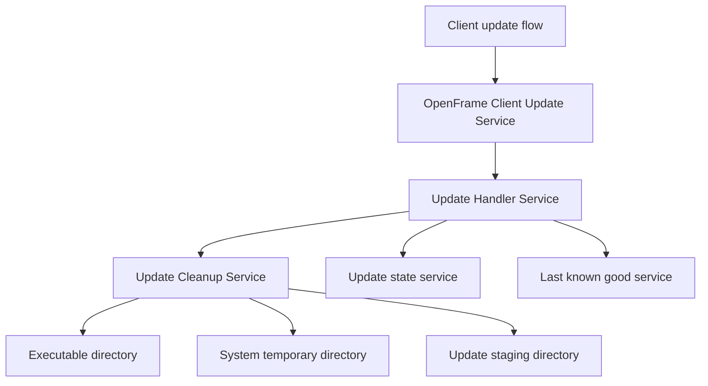
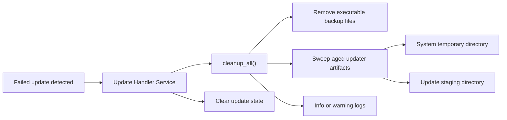
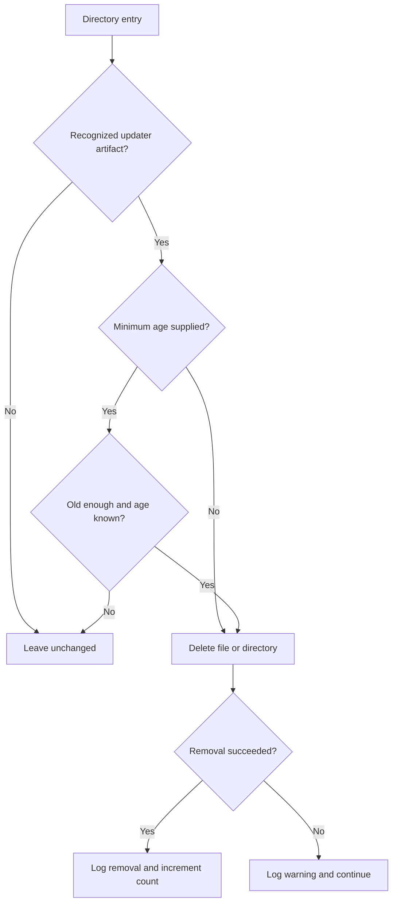

# Update Cleanup Service

The Update Cleanup Service removes files left behind by OpenFrame Client self-update operations. It is implemented in the Rust `openframe_agent_lib` library, supplied by [OpenFrame OSS Library](https://github.com/flamingo-stack/openframe-oss-lib/blob/16e7c1cbd9664e7d10ec5ebca7d53c9bd314decf/clients/openframe-client/src/services/update_cleanup_service.rs), and runs on managed endpoints as part of this repository's OpenFrame Client deployment.

Its purpose is deliberately narrow: reclaim stale update artifacts without deleting files that could belong to an updater still in progress. Cleanup is best effort: an unreadable directory or an individual deletion failure is logged and does not prevent the client from continuing.

## Responsibilities

`UpdateCleanupService` owns the executable path it is cleaning around. `new` discovers the running executable through `current_exe`; `for_binary` creates an instance for a supplied binary path, which is useful when cleanup concerns a non-running binary.

The service performs three cleanup operations:

| Operation | Method | Scope | Deletion rule |
|---|---|---|---|
| Backup removal | internal backup sweep invoked by `cleanup_all` | The executable's parent directory | Deletes files whose names begin with the executable name plus `.backup.`. |
| Pre-swap removal | `remove_pre_swap_copy` | Beside the executable | Deletes the executable path with `.prev` appended, once the new binary has verified its boot. |
| Updater-artifact sweep | `sweep_temp_leftovers` and `sweep_update_leftovers` | System temporary directory and update staging directory | Deletes recognized updater files only when they satisfy the requested age policy. |

Recognized updater artifacts are directories or files beginning with `openframe-update-`, plus script files beginning with `openframe-updater-` and ending in `.ps1` or `.sh`. Other directory entries are ignored.

## Architecture and Dependencies

The cleanup component is a local filesystem service; it makes no network calls and does not itself alter update state or publish update outcomes. Its surrounding update workflow supplies those concerns:

- **OpenFrame Client Update Service** reserves an update, prevents overlap with active tool or package operations, tracks update state, and launches the updater.
- **Update Handler Service** evaluates state at startup. When an update fails, it records a failed client status, reports the delivery failure, calls `cleanup_all`, prunes updater transcripts, and clears update state.
- **Update State Service** persists the phase, target version, and boot-attempt information used by the handler to decide whether an update is unresolved or failed.
- **Last Known Good Service** maintains the verified-version anchor and updater transcripts. It complements cleanup by retaining only the configured transcript history after a failure.
- **Directory management** resolves the staging location. On Windows it is an `update` directory under the installation directory; on non-Windows platforms it is the system temporary directory. The sweep avoids scanning the same directory twice when these locations are equal.

## Cleanup Data Flow

`cleanup_all` first scans next to the configured executable for old backups. It then calls `sweep_temp_leftovers` with `TEMP_LEFTOVER_MIN_AGE_SECS` from the client update configuration. A successful removal increments a count, and the service emits one summary information log when that count is nonzero. Failures during the backup scan are warned about; failures for individual artifact removals are also warned about and the remaining entries continue to be processed.

## Age Protection and Uninstall Behavior

Normal cleanup is conservative. For each recognized artifact, the service reads metadata, obtains its modification time, and checks elapsed time:

1. An artifact younger than the configured minimum age is retained because an active updater might still need it.
2. An artifact with unavailable metadata, modification time, or elapsed time is also retained. Unknown age is treated as too fresh.
3. An aged directory is removed recursively; an aged file is removed directly.
4. If the directory cannot be read, the method returns zero removals rather than failing the caller.

`sweep_update_leftovers` also accepts no minimum age. That mode removes recognized update artifacts regardless of age and is intended for uninstall cleanup, where preserving a live update workspace is no longer required.

## Pre-Swap Copy Lifecycle

The updater may retain a `.prev` copy adjacent to the current executable before swapping binaries. `remove_pre_swap_copy` removes this exact sibling when it exists. The method is separate from `cleanup_all` because the pre-swap copy has a lifecycle dependency: it remains useful until the newly installed binary has completed boot verification. After promotion, no update component needs it.

## Operational Guarantees and Boundaries

- Cleanup is filename-scoped rather than a general temporary-directory purge.
- The normal sweep preserves recent and age-indeterminate artifacts.
- Staging and temporary paths are compared before scanning, preventing duplicate processing on platforms where staging is temporary storage.
- Backup scanning requires both an executable parent directory and file name. If either cannot be derived, the backup sweep reports an error to `cleanup_all`, which logs it and continues with temporary-artifact cleanup.
- The service logs successful removals at information level and problems at warning level; it does not propagate per-file cleanup errors to halt the update recovery path.

## Maintenance Guidance

When changing updater file names, update the recognition rules in `sweep_update_leftovers` in the same change. Otherwise obsolete artifacts may accumulate, or active artifacts may not receive age protection. When adding a new staging location, preserve the existing age gate and ensure it is not scanned twice. Changes to the `.prev` or `.backup.` naming conventions must remain aligned with the updater and binary replacement code, because the cleanup service identifies files solely from these conventions.

The service's source of truth is the [Update Cleanup Service implementation](https://github.com/flamingo-stack/openframe-oss-lib/blob/16e7c1cbd9664e7d10ec5ebca7d53c9bd314decf/clients/openframe-client/src/services/update_cleanup_service.rs) in OpenFrame OSS Library.