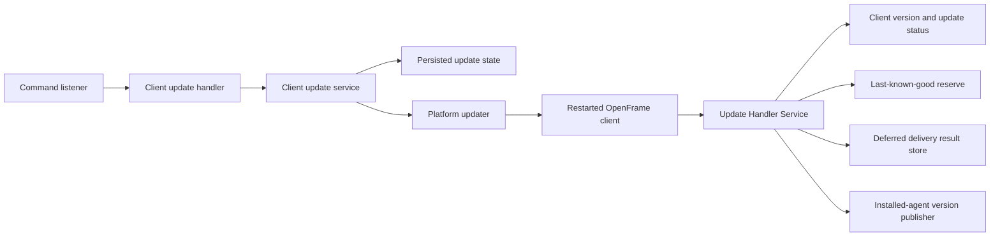
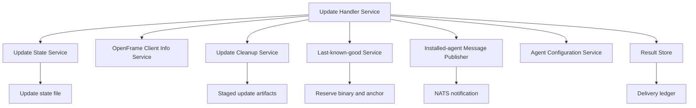
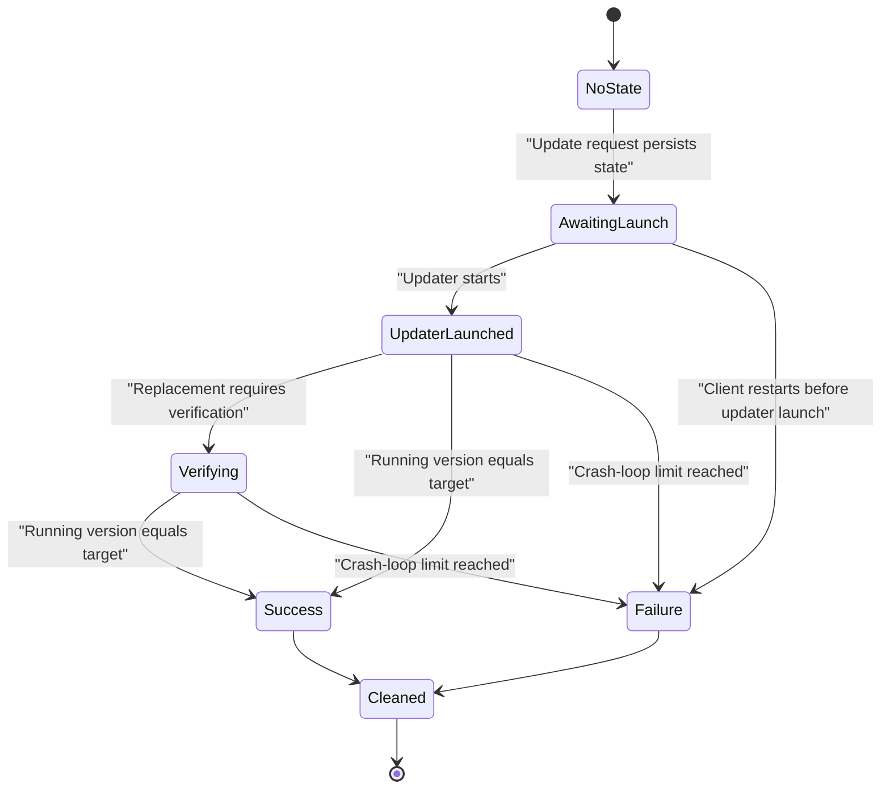
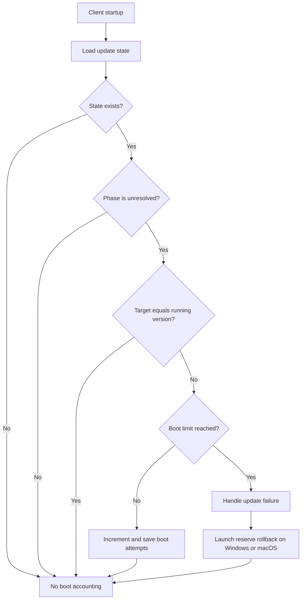
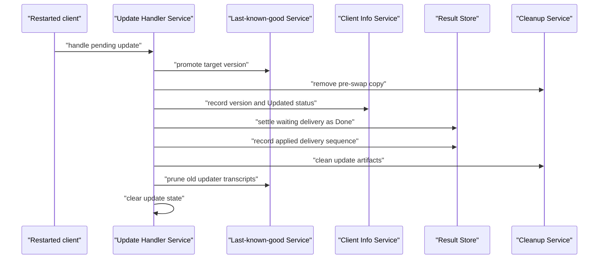

# Update Handler Service

The Update Handler Service finalizes an OpenFrame client self-update after the client process starts again. It is implemented by `UpdateHandlerService` in the OpenFrame OSS Library's Rust client and is assembled into this repository's OpenFrame client runtime through the `openframe_agent_lib` dependency. Its responsibility is recovery-oriented: it reads persisted update state, decides whether the running binary proves success, preserves rollback protection, records failures, settles deferred delivery results, and publishes the version now running on the device.

The implementation is in the [Update Handler Service source](https://github.com/flamingo-stack/openframe-oss-lib/blob/16e7c1cbd9664e7d10ec5ebca7d53c9bd314decf/clients/openframe-client/src/services/update_handler_service.rs).

## Responsibilities

- Construct an `UpdateHandlerService` from persistence, cleanup, version-reporting, identity, last-known-good, and result-store collaborators.
- Count restarts while an update remains in `UpdaterLaunched` or `Verifying`, enforcing the configured crash-loop limit.
- Determine success by comparing the compiled-in `OPENFRAME_VERSION` with the persisted target version.
- Promote a verified binary to the last-known-good reserve and retain only the configured number of updater transcripts.
- Mark client update bookkeeping as `Updated` or `Failed` without letting bookkeeping failures prevent recovery.
- Settle client-update deliveries that were intentionally held while the client restarted, then record their applied sequence when the result is successful.
- On Windows and macOS, attempt a reserve-binary rollback when the crash-loop guard declares an unresolved update failed.
- Publish the running `openframe-client` version through the installed-agent publisher, retrying publication up to five times.

## Position in the Client Update Lifecycle

An update command is processed by the client update path before this service runs. The client update service reserves exclusive update work, rejects invalid versions, avoids an already-running version, applies downgrade protection using the last-known-good anchor, writes update state immediately before updater launch, and changes the client status to `Updating`. The Update Handler Service runs after process startup to reconcile that durable state with the executable that actually started.

The Update Handler Service is not the component that downloads or swaps the executable. That work belongs to the client update service and platform updater. It is the post-restart authority that converts persisted update state into an observed outcome.

## Architecture and Collaborators

The service is constructed with seven collaborators. They separate durable state, cleanup, rollback safety, messaging, machine identity, and delivery completion from the decision logic.

| Collaborator | Role in Update Handler Service |
| --- | --- |
| `UpdateStateService` | Loads, saves, clears, and locates the durable `UpdateState`. Its save operation serializes state as JSON and writes it atomically. |
| `OpenFrameClientInfoService` | Records the target version and the `Updated` or `Failed` update status for client bookkeeping. Failures are logged and do not abort handling. |
| `UpdateCleanupService` | Removes the pre-swap copy on success and performs broader artifact cleanup after either terminal result. |
| `LastKnownGoodService` | Promotes a verified running binary to the reserve, supplies paths for updater rollback, and prunes updater transcripts. Promotion copies the running executable into the reserve before writing the version anchor. |
| `InstalledAgentMessagePublisher` | Publishes the running OpenFrame client version after startup. |
| `AgentConfigurationService` | Provides the device machine identifier required for version publication and successful delivery-sequence recording. |
| `ResultStore` | Settles client-update deliveries in `AwaitingRestart`; successful settlements record their applied delivery sequence. |

## Durable Update State

`UpdateState` includes the requested target version, the updater phase, a boot-attempt counter, an optional start timestamp, and an optional error written by the updater. The handler only makes a success decision from the target version and the compiled-in running version; this prevents a state file alone from being treated as proof that a binary replacement succeeded.

The states relevant to post-start processing are:

`handle_pending_update` implements the reconciliation policy:

1. Load persisted update state.
2. If no state is present, settle any client-update delivery waiting for this restart as failed with the error `interrupted by agent restart before the updater started`.
3. If the running version equals the target version, execute the success path.
4. If the version differs but the phase is `UpdaterLaunched` or `Verifying`, retain the state for a later boot instead of prematurely declaring failure.
5. For any other phase with a version mismatch, execute the failure path.

## Boot Attempt and Crash-Loop Protection

`record_boot_attempt` is intended for startup processing before pending-update reconciliation. It loads state and only accounts for unresolved updates in `UpdaterLaunched` or `Verifying`.

- State in other phases is ignored.
- If the state already targets the version that is currently running, the method does not increment the counter. This avoids classifying a successful update as a crash loop merely because its state has not yet been cleared.
- Otherwise, it increments `boot_attempts`, atomically persists the state, and logs the attempt against `CRASH_LOOP_MAX_BOOT_ATTEMPTS`.
- When the count has reached the configured maximum, the service invokes the failure path and attempts reserve rollback.

Reserve rollback is currently attempted only on Windows and macOS. The handler resolves the current executable and launches the platform updater in rollback-only mode with the state-file path, service name, target version, boot-marker path, reserve path, and a new rollback transcript path. Errors launching rollback are logged; they do not undo failure recording.

## Successful Update Processing

The success path is entered only when `OPENFRAME_VERSION` equals the persisted target version. Its ordering favors recovery and cleanup while making external bookkeeping best-effort.

Specifically, `handle_success`:

1. Attempts to promote the running binary and target version as last-known-good. A promotion failure is logged, preserving any prior anchor rather than blocking completion.
2. Removes the pre-swap binary copy.
3. Updates the stored client version and marks the update `Updated`; either operation is best-effort.
4. Settles deferred client-update delivery results as `Done`.
5. Cleans all update leftovers, prunes updater transcripts to `UPDATER_TRANSCRIPTS_KEPT`, and clears state. Failure to clear state is returned to the caller because stale state would affect later startup processing.

## Failure Processing

`handle_failure` takes the persisted state as evidence of a terminal update failure. It logs the target, phase, and updater-stamped error when available. If the updater did not provide an error, the log directs operators to the updater transcript in the logs directory.

The handler then:

1. Marks client update status `Failed` with the target version, on a best-effort basis.
2. Builds a delivery failure reason from `last_error`, or falls back to a phase-specific message.
3. Settles deferred client-update deliveries as `Failed`.
4. Cleans update artifacts, prunes retained transcripts, and clears persisted state.

This makes failure terminal from the client's perspective while retaining the updater transcript as the diagnostic source.

## Deferred Delivery Completion

A client-update command may be acknowledged as waiting for a restart before the old process exits. The handler uses `delivery_settle_awaiting_restart` with the client-update delivery type to settle only matching ledger records in the `AwaitingRestart` state.

On a successful result, it retrieves the machine identifier and records each settled delivery's sequence where one is present. The result store only replaces an existing applied sequence when the new sequence is newer for the same machine. This maintains monotonic applied-sequence bookkeeping and helps prevent duplicate update application after message redelivery.

Delivery settlement is deliberately non-fatal. If the local result store cannot queue a result, the handler logs that the backend will close the delivery on timeout and continues startup recovery.

## Running-Version Publication

`publish_running_version` sends an installed-agent message containing:

- the configured machine identifier;
- the agent name `openframe-client`; and
- the compiled-in `OPENFRAME_VERSION`.

It retries a failed publication once per second for a maximum of five attempts. A missing machine identifier or a final publication failure is logged. Neither condition changes update state, because running-version publication is observational rather than proof of update success.

## Operational Invariants

- **A version match is the success proof.** The handler does not trust an updater phase alone.
- **Unresolved verification is retained.** A version mismatch in `UpdaterLaunched` or `Verifying` stays durable across boots until it succeeds or hits the crash-loop guard.
- **Terminal outcomes clear state.** Both success and failure remove persisted state after cleanup, preventing repeated completion of the same update.
- **Rollback protection is advanced only after verification.** The last-known-good reserve is promoted during successful reconciliation, not merely when an update is requested.
- **Bookkeeping does not block recovery.** Client information updates, rollback launch, transcript pruning, and delivery work log failures where appropriate rather than preventing cleanup.
- **Platform rollback is constrained.** Reserve rollback is not implemented by this service on platforms other than Windows and macOS.

## Maintenance Considerations

When changing this module, preserve the relationship between persisted update phases and startup behavior. In particular, avoid clearing state for an update still in `UpdaterLaunched` or `Verifying` when the running version does not match the target, because that would bypass crash-loop detection and defer no diagnostic evidence to the next boot.

Changes to the target-version comparison, boot counter, or result-settlement behavior should be evaluated together with the client update service, update state service, last-known-good service, platform updater launcher, and command listener handler. These components together define request admission, durable handoff to the updater, restart verification, rollback protection, and delivery completion.
