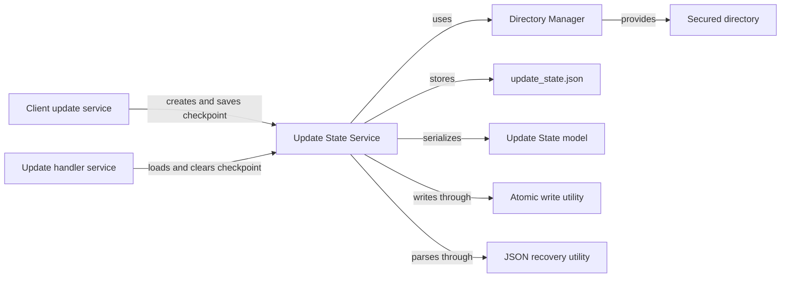
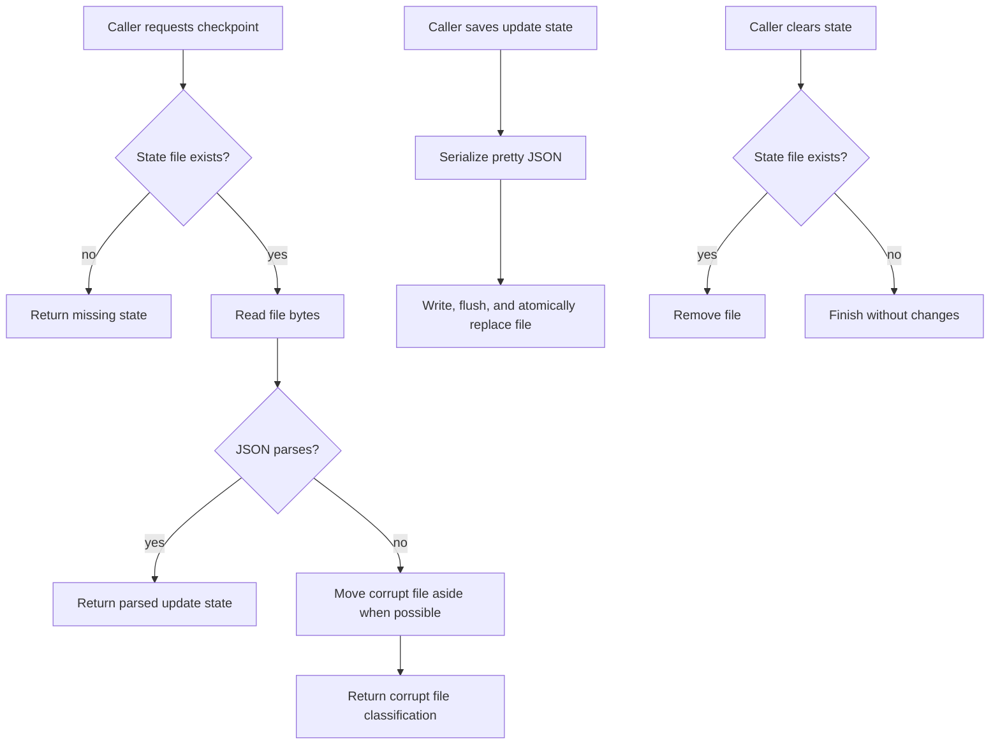
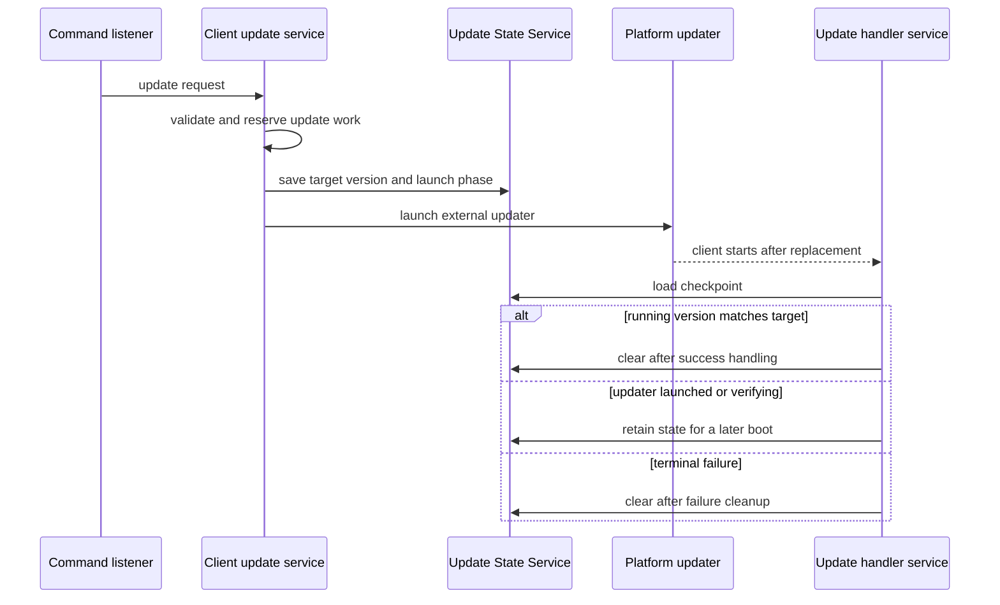

# Update State Service

The Update State Service persists the OpenFrame client update checkpoint on the managed device. It is implemented by the `UpdateStateService` Rust type in the OpenFrame OSS Library's `openframe_agent_lib` artifact, which this repository runs through its OpenFrame client. The checkpoint lets later client starts determine whether an update completed, remains pending verification, or must be handled as a failure.

Source: [update_state_service.rs](https://github.com/flamingo-stack/openframe-oss-lib/blob/16e7c1cbd9664e7d10ec5ebca7d53c9bd314decf/clients/openframe-client/src/services/update_state_service.rs)

## Responsibilities

- Resolve the checkpoint location as `update_state.json` below the client secured directory.
- Ensure the required client directories exist before the service is used.
- Save an `UpdateState` record atomically so an interrupted write does not replace a valid checkpoint with a partial file.
- Read and classify checkpoint files as missing, corrupt, or successfully parsed.
- Quarantine malformed JSON through the shared filesystem utility, allowing a clean update attempt to proceed.
- Remove the checkpoint after update success or terminal failure has been processed.
- Provide a simple pending-update predicate for recovery-oriented callers.

The service is deliberately local-only: it does not download binaries, launch an updater, or publish a network result. Those activities belong to the client update and update handler services; this module supplies their durable handoff record.

## Architecture

### Initialization and file placement

`new(directory_manager)` asks `DirectoryManager` for its secured directory, appends `update_state.json`, and calls `ensure_directories()`. Directory initialization includes creation and verification of the secured directory with administrator-only permissions. Construction fails if that directory cannot be prepared, rather than deferring the failure to the first update.

The persisted path is available through `get_state_file_path()` for diagnostics. The returned value is a displayable path string, not an update protocol field.

## Persisted update record

The service stores the `UpdateState` model as pretty-printed JSON. The model provides these fields:

| Field | Meaning |
| --- | --- |
| `target_version` | Canonical version the client is trying to run after the update. |
| `phase` | Current update lifecycle phase. |
| `boot_attempts` | Count used by recovery logic for unresolved post-launch updates. Missing values default to zero for compatibility. |
| `started_at` | Optional RFC 3339 timestamp established when a new state is created. |
| `last_error` | Optional failure reason written by updater logic. |

`UpdateState::new` initializes a record in the `Validating` phase, with zero boot attempts and a start timestamp. Its `set_phase` method updates the phase in memory; callers must call `save` to persist that transition.

The recognized phases are `Validating`, `Downloading`, `Extracting`, `PreparingUpdater`, `UpdaterLaunched`, `Completed`, `Verifying`, `RolledBack`, and `Failed`. The client comments note that current clients persist state immediately before the external updater launches, while older checkpoint files can contain phases preceding `UpdaterLaunched`. Recovery therefore remains compatible with historical state files.

## Read, save, and cleanup behavior

### Read APIs

`read_state()` is the diagnostic API. It returns the shared `JsonFile<UpdateState>` classification:

- `Missing` when no checkpoint is present.
- `Parsed(state)` when valid JSON deserializes into an update record.
- `Corrupt` when JSON cannot be parsed. The filesystem utility attempts to rename the invalid file to a quarantine path and logs the condition. If the rename fails, the result is still classified as corrupt.

`load()` is a convenience API that maps both `Missing` and `Corrupt` to `None`, while returning `Some(state)` only for a parsed record. Use `read_state()` when recovery code must distinguish an absent checkpoint from data loss or schema corruption.

`has_incomplete_update()` calls `load()` and returns true only for a parsed state. Consequently, a corrupt checkpoint is treated as not incomplete by this predicate after the parser has attempted quarantine. Callers needing explicit corruption handling must use `read_state()` instead.

### Durable writes

`save(state)` serializes JSON and delegates to `atomic_write`. The shared utility creates a temporary file beside the destination, writes and synchronizes its contents, then atomically persists it over the target. On Unix it applies mode `0644` to the temporary file; secured-directory access controls still govern the enclosing location. On Windows, the utility includes a fallback for replacing a held target.

This sequence minimizes the chance that power loss leaves the checkpoint at its final path with incomplete contents. If an existing state is unreadable, parsing quarantines it rather than allowing a subsequent save to silently overwrite the evidence.

`clear()` removes the state file only when it exists. It is idempotent for an absent file and propagates filesystem failures when deletion is attempted.

## Interaction with the update lifecycle

The client update service coordinates the forward path. It validates the requested version, prevents overlapping update work, considers the last-known-good version when downgrade protection applies, records update status, and creates the `UpdateState` model. Its documented flow saves the checkpoint immediately before the updater is launched. If update execution returns an error, it clears stale state so a prior attempt cannot incorrectly influence crash-loop accounting.

On startup, the update handler service loads the persisted record:

1. If no parsed state exists while handling a pending update, it reports that the update was interrupted before launch.
2. If the running client version equals `target_version`, it follows its success path.
3. If the state phase is `UpdaterLaunched` or `Verifying` and the target version is not yet running, it retains the record for a later boot.
4. For other phases, it treats the update as failed, records failure status and delivery output, cleans update artifacts, prunes retained updater transcripts, and clears the checkpoint.

For unresolved `UpdaterLaunched` or `Verifying` states that target a different version, the handler increments and saves `boot_attempts`. After its configured crash-loop threshold is reached, it handles the update as failed and initiates reserve rollback processing. A checkpoint that already targets the currently running version is excluded from this crash-loop accounting.

## Operational guidance

- Treat the checkpoint as recovery metadata, not as a user-editable configuration file.
- Investigate a quarantined file together with client logs and updater transcripts before deleting related diagnostic material.
- Preserve the distinction between `load()` and `read_state()` in new recovery paths: only the latter exposes corruption explicitly.
- Keep state writes on lifecycle boundaries. The checkpoint must describe a recoverable, durable update condition rather than a transient in-memory step.
- Clear state only after the corresponding success or terminal-failure path has completed its required bookkeeping.

## Scope and dependencies

The Update State Service is supplied by the OpenFrame OSS Library artifact `openframe_agent_lib` version `v0.0.5`, consumed by this repository's OpenFrame client runtime. It depends on the library's update-state model, directory manager, and filesystem JSON utilities. It is used by the client update service to establish the durable pre-launch checkpoint and by the update handler service to recover or finalize that checkpoint after a restart.
