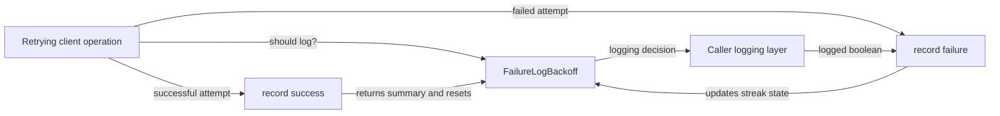
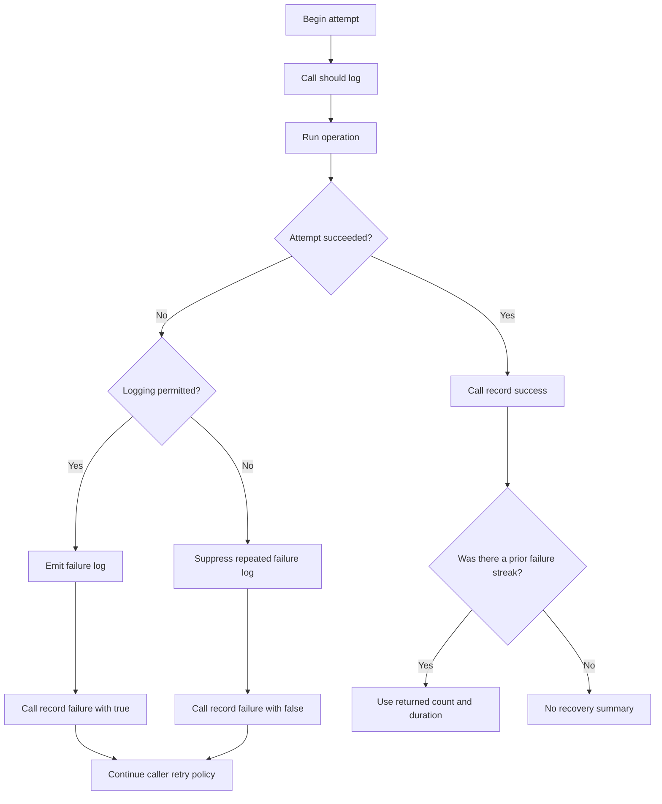
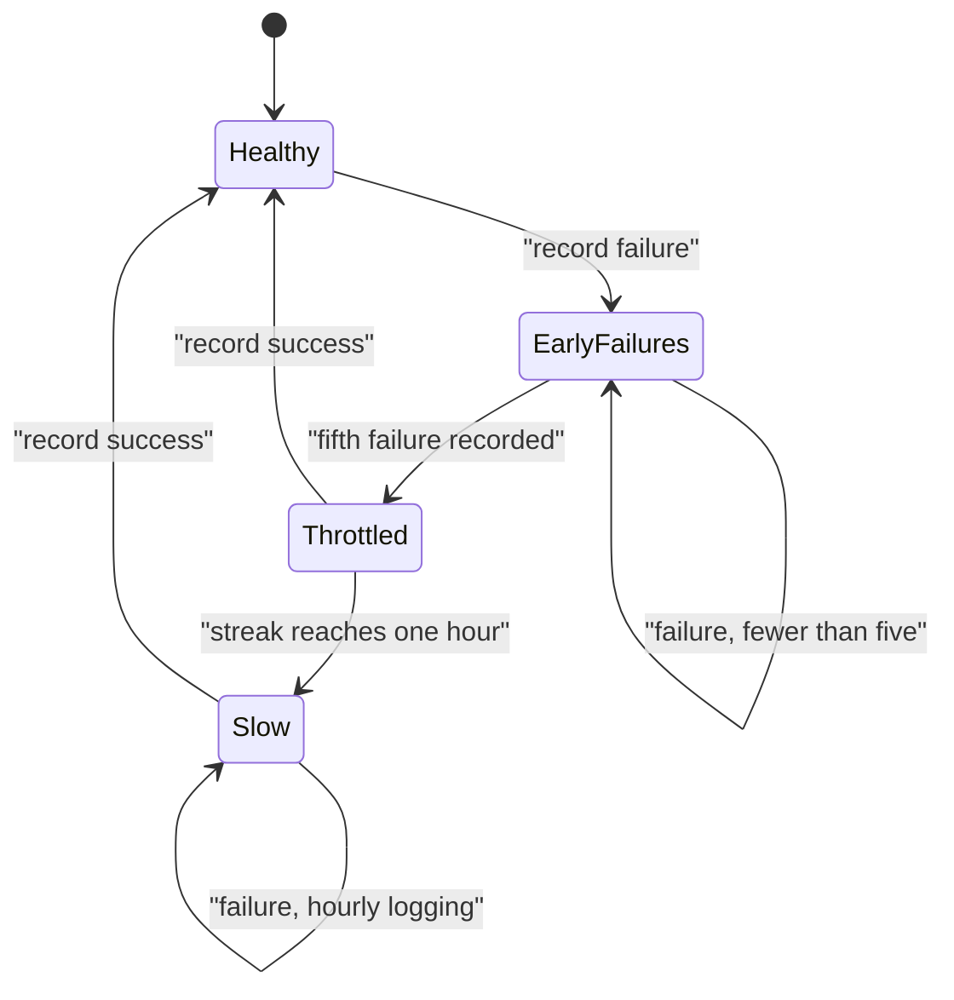

# Utils Failure Log Backoff

Utils Failure Log Backoff is a small, in-memory Rust utility used by the OpenFrame Client agent to keep persistent failures visible without allowing a high-frequency retry loop to flood logs. It deliberately controls **logging only**: callers retain ownership of retry timing, failure handling, and recovery behavior.

The implementation is supplied by the `openframe_agent_lib` Cargo dependency from OpenFrame OSS Library. Its source is available in the [OpenFrame OSS Library source file](https://github.com/flamingo-stack/openframe-oss-lib/blob/7a766f00e4f58b5d89db007b878ac8d6e0c344f4/clients/openframe-client/src/utils/failure_log_backoff.rs).

## Purpose and Scope

A transient operation can fail many times while the client continues retrying. Logging every attempt produces repeated messages, can obscure other diagnostic information, and increases log transport volume. Utils Failure Log Backoff tracks one consecutive failure streak and tells its caller whether the current attempt should be logged.

Its policy is intentionally simple:

- Log each of the first five consecutive failures.
- After the fifth failure, permit one failure log at most every two minutes.
- Once the same streak has lasted for at least one hour, permit one failure log at most every hour.
- When an attempt succeeds, return a summary of the completed streak and reset immediately.

The state is process-local and is not persisted. A restarted client begins a new streak. The utility has no I/O, network, configuration, or retry scheduling responsibilities.

## Architecture

`FailureLogBackoff` holds the state for a single independently tracked operation. The caller must invoke `should_log` before performing or reporting an attempt, then give the resulting decision to `record_failure` if that attempt fails. On success, the caller invokes `record_success`.



### Internal State

| Field | Meaning | Lifecycle |
|---|---|---|
| `failures` | Number of consecutive failures recorded in the current streak. | Starts at zero, increments in `record_failure`, resets after `record_success`. |
| `first_failure` | Monotonic timestamp captured for the first failure in the streak. | Set once when the first failure is recorded, then cleared by reset. |
| `last_logged` | Monotonic timestamp of the most recently emitted failure log. | Updated only when `record_failure(true)` is called, then cleared by reset. |

The timestamps use Rust `Instant`, so elapsed durations are measured with a monotonic clock rather than wall-clock time. This avoids changing the policy due to normal system clock adjustments.

## Public API

| API | Responsibility | Result |
|---|---|---|
| `FailureLogBackoff::new` | Creates an empty tracker. | A tracker with zero failures and no timestamps. |
| `FailureLogBackoff::should_log` | Evaluates whether logs for the next attempt should be emitted. | `true` when the caller should log, otherwise `false`. It does not mutate state. |
| `FailureLogBackoff::record_failure` | Records a failed attempt after the caller decides whether it actually logged it. | The updated consecutive-failure count. A `true` argument updates the last-log timestamp. |
| `FailureLogBackoff::record_success` | Completes the current failure streak. | `Some((count, duration))` when failures preceded the success, otherwise `None`; state is reset in both cases. |

`Default` is equivalent to `new`, allowing the tracker to be constructed through Rust's standard default mechanism.

## Backoff Policy

The policy evaluates the already-recorded failure count and elapsed duration since the first failure. The caller checks before the next failure is recorded; therefore, the first five failures are eligible for immediate logging.

| Streak condition at decision time | Permitted failure-log cadence |
|---|---|
| No recorded failure, no emitted failure log, or fewer than five recorded failures | Every failure |
| At least five recorded failures and the streak is younger than one hour | At most once every two minutes |
| At least five recorded failures and the streak is one hour old or older | At most once every hour |

The two-minute and one-hour intervals are fixed implementation constants, not runtime configuration. A log that is suppressed must be recorded with `record_failure(false)`; otherwise the internal `last_logged` timestamp would incorrectly indicate that a message was emitted.

## Failure and Recovery Flow



### Decision Semantics

`should_log` returns `true` until both a first-failure timestamp and a last-logged timestamp exist. This ensures an initial failure is observable and also prevents accidental permanent suppression if previous failures were deliberately not logged.

Once throttling applies, the method compares the elapsed time since the last **actually logged** failure against the active interval. It does not increment counters or alter timestamps; recording remains an explicit caller action after the operation outcome is known.

### Recovery Semantics

`record_success` snapshots the failure count and total elapsed time from the first recorded failure, then replaces the tracker state with a new empty tracker. Recovery is therefore immediately eligible for reporting even if failure logs had been throttled. A subsequent failure starts a completely new streak and again logs immediately.



## Caller Integration Contract

A caller should retain one `FailureLogBackoff` instance for each failure stream it wants to throttle independently. For example, unrelated network connections or background jobs should not share a tracker when their failures need separate visibility and recovery summaries.

```rust
let mut backoff = FailureLogBackoff::new();

let should_log = backoff.should_log();
match perform_operation() {
    Ok(()) => {
        if let Some((failures, duration)) = backoff.record_success() {
            log_recovery(failures, duration);
        }
    }
    Err(error) => {
        if should_log {
            log_failure(&error);
        }
        backoff.record_failure(should_log);
    }
}
```

The `logged` argument must represent whether the caller truly emitted the failure log, not merely the recommendation returned by `should_log`. If a logging subsystem rejects or intentionally bypasses a permitted message, pass `false` so the utility does not postpone the next eligible log based on a message that was never produced.

## Operational Characteristics and Maintenance Notes

- **Retry independence:** The utility neither sleeps nor returns a retry delay. It is safe to use around any caller-defined retry schedule.
- **No shared synchronization:** Mutation requires a mutable reference. If multiple tasks share a tracker, the owner must provide the appropriate synchronization and define what constitutes one shared streak.
- **No persistence:** State is lost on process restart. This favors simple local behavior but means a recurring failure may emit early-streak logs after each restart.
- **Recovery observability:** Call `record_success` for every successful attempt, including success after a quiet, throttled failure period, so stale state does not carry into later failures.
- **Threshold changes:** Adjusting the count or duration constants changes operational log volume. Maintain the ordering from frequent initial logging to progressively slower logging, and verify that recovery remains immediate.

## System Context

This module runs inside the Rust OpenFrame Client assembled by this repository through the OpenFrame OSS Library dependency. It is a reusable local utility rather than a server endpoint or message consumer. The broader client provides logging, NATS connectivity, authentication, command listeners, and service orchestration; Utils Failure Log Backoff provides only the narrow state machine used to make repeated local failure reporting readable.
