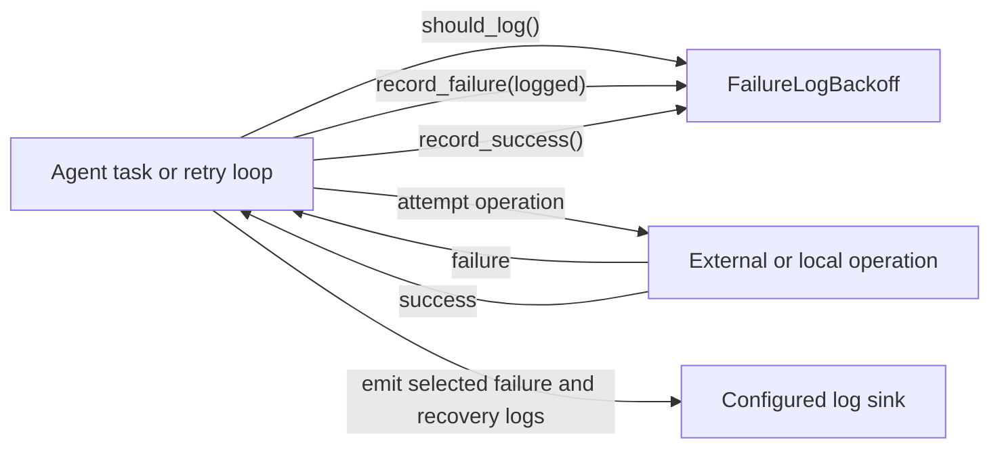
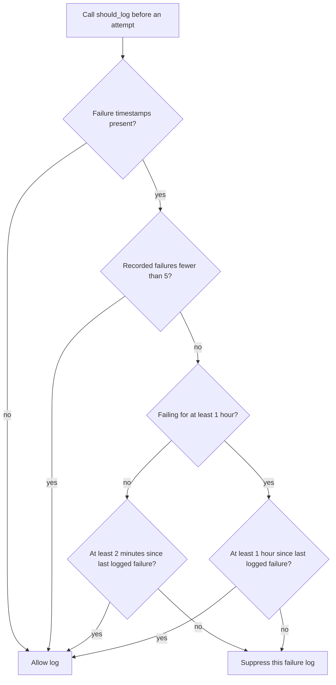
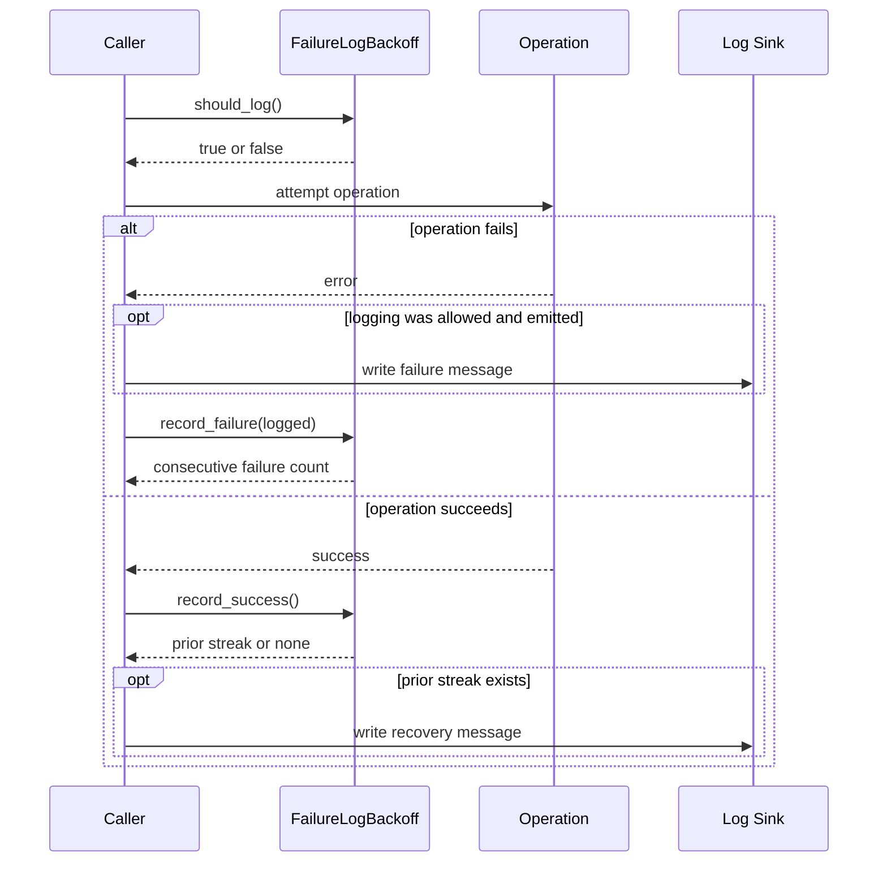
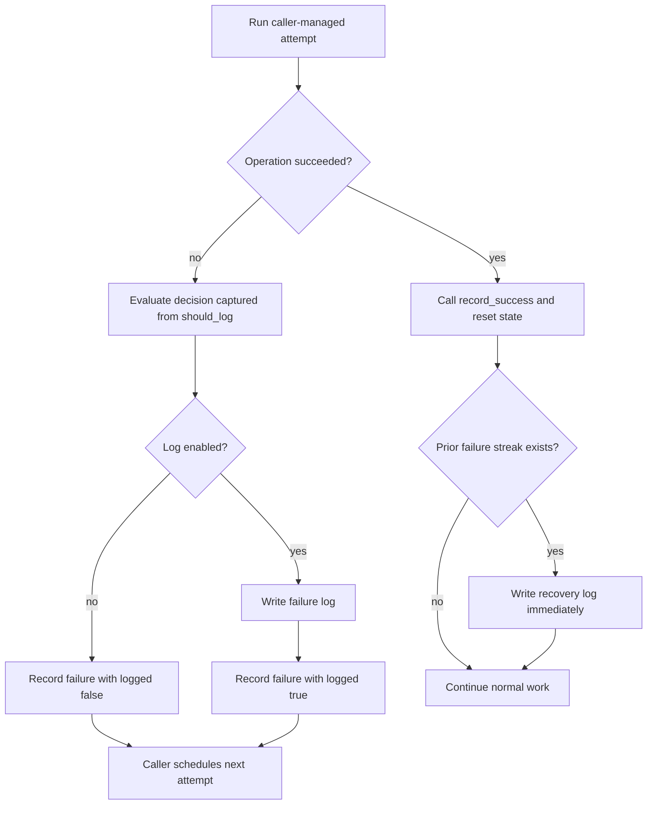

# Utils Failure Log Backoff

Utils Failure Log Backoff is a small, in-memory Rust utility used by the OpenFrame client agent to reduce repeated failure messages while preserving the caller's retry behavior. It logs the first five failures in a consecutive streak, then permits one failure log every two minutes. Once the same streak has lasted an hour, it permits one log per hour. A successful attempt resets the streak and lets the caller report recovery immediately.

The implementation is supplied by the `openframe_agent_lib` Cargo dependency from OpenFrame OSS Library. Its source is [failure log backoff.rs](https://github.com/flamingo-stack/openframe-oss-lib/blob/16e7c1cbd9664e7d10ec5ebca7d53c9bd314decf/clients/openframe-client/src/utils/failure_log_backoff.rs).

## Purpose and Boundaries

Long-running agent tasks can fail repeatedly when an upstream dependency, network path, or local resource remains unavailable. Logging every failed attempt can obscure useful events and increase log volume. Utils Failure Log Backoff separates **observability cadence** from **work cadence**:

- It decides whether the caller should emit logs for the next attempt.
- It records that an attempt failed and whether a failure message was actually emitted.
- It resets state and reports the completed streak when an attempt succeeds.
- It does not delay, schedule, retry, emit logs, persist state, or classify errors.

The caller remains responsible for retry timing, executing the operation, selecting log content, and recording a recovery message from the value returned by `record_success`.



## State Model

`FailureLogBackoff` contains only three pieces of state:

| Field | Meaning | Initial value |
|---|---|---|
| `failures` | Number of consecutive failed attempts in the current streak. | `0` |
| `first_failure` | Monotonic timestamp established by the first recorded failure. | Absent |
| `last_logged` | Monotonic timestamp for the latest failure that the caller confirms it logged. | Absent |

`new()` creates this empty state. The `Default` implementation delegates to `new()`, so either construction path produces the same policy state.

The component uses `std::time::Instant`, rather than wall-clock time. Consequently, elapsed-time decisions are monotonic within the process and are not affected by system clock changes. Its state is process-local: restarting the agent starts a new streak.

## Logging Policy

The internal interval policy has three tiers:

| Consecutive failures and elapsed streak time | Failure-log decision |
|---|---|
| Fewer than 5 failures already recorded | Log every failure. |
| At least 5 failures and the streak is younger than 1 hour | Log at most once every 2 minutes. |
| At least 5 failures and the streak has lasted at least 1 hour | Log at most once every hour. |

The decision is intentionally evaluated **before** an operation is attempted. In the normal call order, failures one through five are all eligible for logging: before the fifth attempt, only four failures have been recorded. After that fifth failure is recorded as logged, the two-minute tier applies to subsequent attempts.



If either timestamp is absent, `should_log()` returns `true`. This includes the first attempt and protects observability when failures were recorded with `logged` set to `false`: throttling starts only after a failure is actually logged.

## Component Operations

### `should_log`

`should_log(&self) -> bool` determines whether logs for the imminent attempt should be emitted. It does not mutate state. When the utility is throttling, it compares the elapsed time since `last_logged` with the interval selected from the current failure count and elapsed streak duration.

Call this before running an operation so the caller can avoid constructing or emitting a noisy failure message when logging is suppressed.

### `record_failure`

`record_failure(&mut self, logged: bool) -> u64` updates the failure streak after an unsuccessful attempt:

1. Increments the consecutive failure count.
2. Captures the first-failure timestamp if this is the first recorded failure.
3. Captures `last_logged` only when `logged` is `true`.
4. Returns the current streak length.

The `logged` argument must reflect what happened, rather than merely the preceding `should_log()` decision. For example, if logging was allowed but an outer condition prevented the log from being emitted, pass `false`; the absence of a recorded log keeps future attempts eligible to report the failure.

### `record_success`

`record_success(&mut self) -> Option<(u64, Duration)>` terminates the current failure streak and resets all state to a fresh instance. When a failure had been recorded, it returns the streak count and total elapsed failure duration. When no failure was active, it returns `None`.

The returned tuple supports a recovery log such as a message that identifies how many failures preceded the successful attempt and how long the condition persisted. Recovery reporting is not subject to the failure-log throttle.



## Caller Integration Pattern

A retry loop should retain one backoff instance for the lifecycle of the operation it monitors. This pseudocode illustrates the required ordering; the retry delay is intentionally owned by the caller.

```rust
let mut backoff = FailureLogBackoff::new();

loop {
    let log_failure = backoff.should_log();

    match attempt_operation() {
        Ok(()) => {
            if let Some((failures, duration)) = backoff.record_success() {
                log_recovery(failures, duration);
            }
        }
        Err(error) => {
            if log_failure {
                log_failure_message(&error);
            }
            let failures = backoff.record_failure(log_failure);
            schedule_next_attempt(failures);
        }
    }
}
```

In production code, pass `true` to `record_failure` only after the log call has actually been made. The `schedule_next_attempt` placeholder represents an independent retry policy; Utils Failure Log Backoff must not be treated as a retry backoff mechanism.

## Failure and Recovery Flow



## Operational Considerations

- **Scope instances carefully.** One instance represents one independently meaningful failure condition. Sharing an instance across unrelated operations combines their failures and can hide useful logs.
- **Keep the call order stable.** Evaluate `should_log` before attempting work, then call exactly one of `record_failure` or `record_success` after the result is known.
- **Do not count suppressed messages as logged.** A suppressed failure must use `logged = false`; otherwise the module may delay the next observable log despite no message being written.
- **Expect no cross-restart continuity.** The module has no durable state, so a process restart re-enables immediate failure logging.
- **Serialize mutation when sharing.** `record_failure` and `record_success` require mutable access. If multiple tasks share an instance, callers need their own synchronization and should confirm that shared aggregation matches their desired logging semantics.
- **Test policy boundaries.** Cover the fifth recorded failure, just-before and just-after the two-minute interval, the one-hour streak transition, a failure that was not logged, and reset after success.

## Relationship to the OpenFrame Client

This utility belongs to the Rust OpenFrame client code that is assembled into the tenant deployment through the `openframe_agent_lib` dependency. It is a local observability primitive, not a network protocol component: it has no direct dependency on NATS, the gateway, or the logging transport. Higher-level client services can use it around reconnect, publication, download, or other repeated operations to make persistent faults visible without producing a message for every retry.

Because the utility is library code from OpenFrame OSS Library, changes to its thresholds or semantics affect every client path that chooses to use the type. Preserve the distinction between logging suppression and retry behavior when modifying it.
