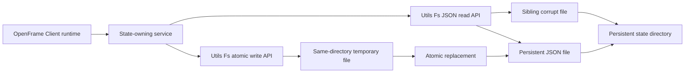
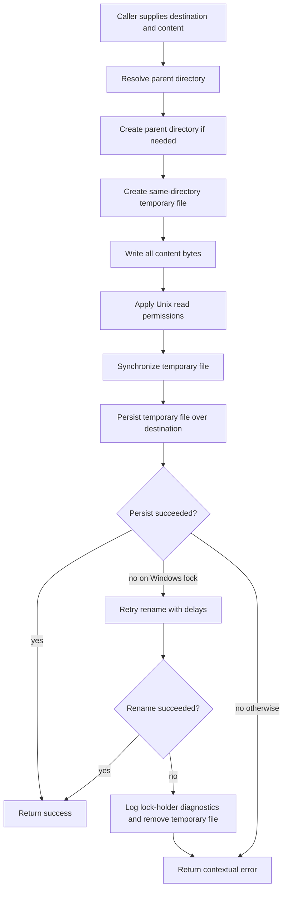
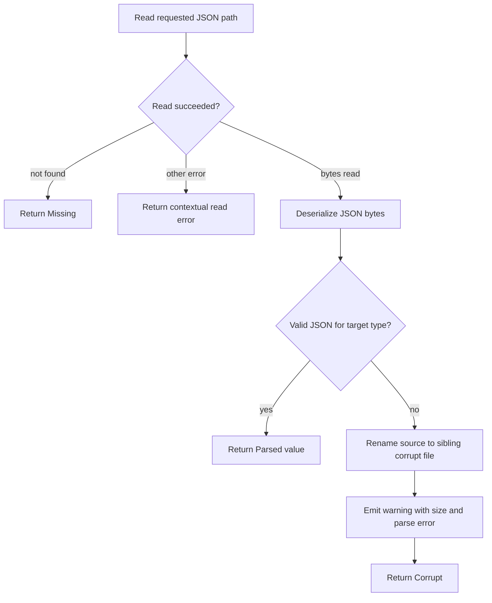
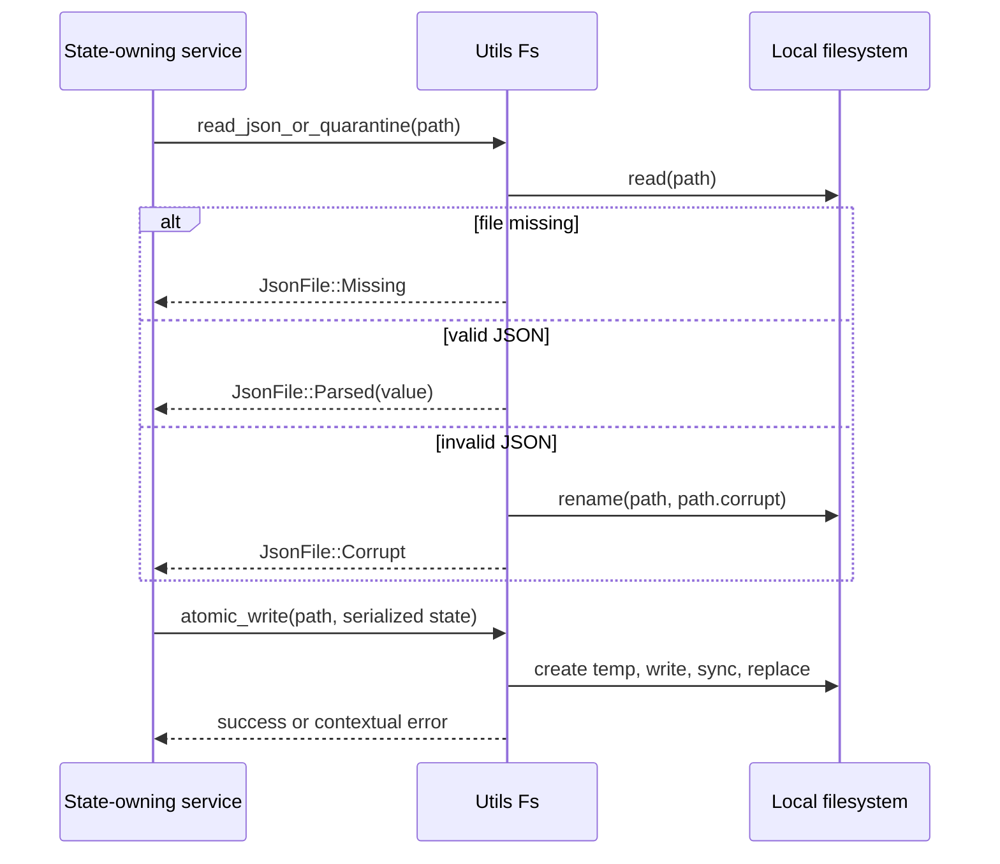

# Utils Fs

Utils Fs is the OpenFrame Client agent's small persistence boundary for JSON state. It is implemented by the `openframe_agent_lib` Cargo dependency from OpenFrame OSS Library and is assembled into the client runtime by this repository. Its design protects state readers from partially written files and lets callers recover from malformed persisted state without preventing a fresh write.

**Source:** [OpenFrame OSS Library `fs.rs`](https://github.com/flamingo-stack/openframe-oss-lib/blob/16e7c1cbd9664e7d10ec5ebca7d53c9bd314decf/clients/openframe-client/src/utils/fs.rs)

## Responsibilities

- Write byte content atomically in the target directory.
- Synchronize temporary-file content before replacement to reduce the risk of a renamed but incomplete file after power loss.
- Restore Unix permissions to `0644` for persisted files so normal user processes can read files created through the helper.
- Read deserializable JSON while distinguishing missing, corrupt, and successfully parsed state.
- Quarantine malformed JSON as a sibling file with a `.corrupt` suffix and emit structured warnings instead of repeatedly consuming the broken file.
- On Windows, retry replacement when a target is temporarily held by another process and report lock-holder diagnostics if retries are exhausted.

Utils Fs deliberately does not define state schemas, choose persistence paths, or retry general I/O errors. Callers own those policies and supply the concrete type through Serde deserialization.

## Architecture and Boundaries

The caller-facing portion consists of `atomic_write`, `read_json_or_quarantine`, and `parse_json_or_quarantine`. `JsonFile<T>` represents the result of a tolerant read, while its `parsed` convenience method projects either a parsed value or `None`. The internal quarantine-path helper derives the sibling name used for a malformed file.

The module is part of the OpenFrame Client Core utility layer. It complements platform directory and permission facilities, which decide where durable agent data belongs and establish the containing directory's access policy. Utils Fs only creates the direct parent directory necessary for an atomic write.

## Component Model

| Component | Role | Observable result |
|---|---|---|
| `atomic_write` | Creates a same-directory temporary file, writes content, synchronizes it, and persists it over the destination. | The destination changes as a replacement operation rather than exposing an in-place partial write. |
| `JsonFile<T>` | Result enum for tolerant JSON reads. | `Missing`, `Corrupt`, or `Parsed(T)`. |
| `JsonFile::parsed` | Consumes a read result and extracts a value when present. | `Some(T)` only for the parsed variant. |
| `read_json_or_quarantine` | Reads a path and delegates JSON decoding and malformed-file handling. | Missing files are normal; other read failures retain context and return an error. |
| `parse_json_or_quarantine` | Deserializes supplied bytes and quarantines invalid source content. | Parsed data or a corrupt result after a rename attempt and warning. |

## Atomic Write Process

The write path places the temporary file in the same directory as the destination. This is essential because the final persistence step can replace the destination atomically only when both paths are on the same filesystem.

### Durability and replacement semantics

`atomic_write` calls `sync_all` before the replacement step. The documented intent is to avoid a power-loss case where a rename becomes visible but file content has not reached durable storage, which can manifest as a zero-filled file. It then persists the named temporary file over the destination. On Unix, the temporary file's default restrictive permissions are changed to `0644` before persistence.

On Windows, a failed replacement caused by access-denied or sharing-violation errors triggers a bounded retry sequence. The fallback uses rename attempts separated by increasing delays of 100, 200, 400, 800, and 1600 milliseconds. If all attempts fail, the module logs diagnostics for both the target and temporary paths, tries to remove the temporary file, and returns the underlying failure with destination context.

## JSON Read and Recovery Flow

`read_json_or_quarantine` treats a missing file as expected state, not as an error. It returns `JsonFile::Missing`. A readable file is decoded through `parse_json_or_quarantine`; non-not-found read failures instead propagate as contextual errors because the module cannot safely classify them as absent or malformed state.

### Quarantine behavior

For invalid JSON, Utils Fs appends `.corrupt` to the original file name in the same directory and attempts a rename. It returns `JsonFile::Corrupt` whether or not that rename succeeds, because the supplied content has already failed deserialization. The warning records the source path, byte count, parser error, and whether the bytes were entirely zeroes. The latter is useful when investigating interrupted or damaged persistence.

A subsequent state save can therefore create a clean replacement file while preserving the malformed content when the rename succeeded. If a `.corrupt` sibling already exists, the rename itself may fail; that failure is warned about rather than converted into a read error.

## Component Interaction

## Integration Guidance

Use Utils Fs for small local state whose loss or reset can be recovered by higher-level client services. Typical callers should:

1. Select and secure an application-owned directory through the platform directory and permission facilities.
2. Call `read_json_or_quarantine` with the desired deserialization type.
3. Treat `Missing` and `Corrupt` as inputs to initialization or recovery, while preserving operational visibility through the emitted warnings.
4. Serialize the replacement state in the owning service.
5. Use `atomic_write` to publish the complete replacement document.

Do not assume that `Corrupt` contains a recoverable value: the type intentionally exposes only the state classification. Do not use this helper for multi-file transactions, concurrent state merging, or durable database semantics; atomic replacement protects a single destination file, not coordination across independent writers.

## Failure Handling Summary

| Situation | Module behavior | Caller responsibility |
|---|---|---|
| Parent directory does not exist during write | Creates it. | Ensure the selected path and directory permissions are appropriate. |
| Write, synchronization, or replacement fails | Returns an error enriched with the affected path where applicable. | Surface, retry, or degrade according to the owning service's policy. |
| Destination is temporarily held on Windows | Retries bounded rename attempts. | Handle the returned failure after retry exhaustion. |
| JSON file is absent | Returns `Missing`. | Initialize default state if appropriate. |
| JSON content is malformed | Attempts quarantine, logs a warning, and returns `Corrupt`. | Rebuild state and write a clean replacement if safe. |
| JSON path cannot be read for another reason | Returns a contextual error. | Investigate access, filesystem, or device failures. |

## Maintenance Notes

- Keep temporary files in the destination directory; moving them elsewhere can invalidate atomic replacement assumptions.
- Preserve the explicit synchronization step when changing write behavior, because it addresses a durability failure mode rather than merely flushing language-level buffers.
- Maintain the distinction between missing, corrupt, and unreadable files. Collapsing these states would hide operational faults or remove recovery behavior.
- Any change to Windows replacement handling should retain bounded retries and meaningful diagnostics, as antivirus and backup software can transiently hold agent files open.
- Quarantine preserves evidence only when its rename succeeds. Operational tooling should collect warnings and `.corrupt` files when investigating recurring state damage.
