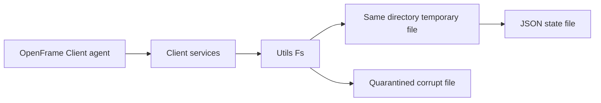
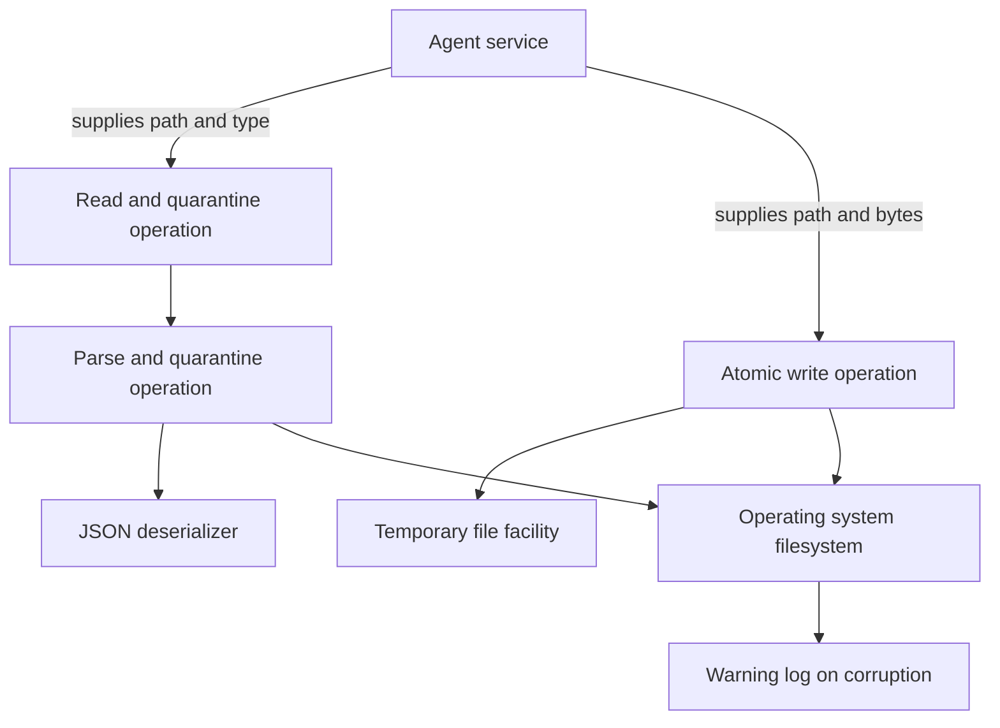
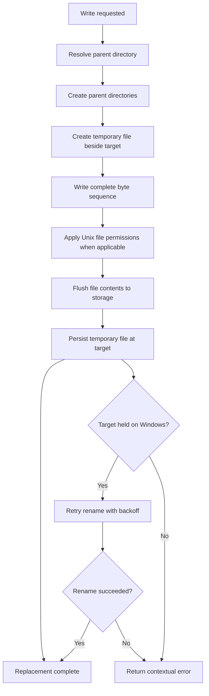
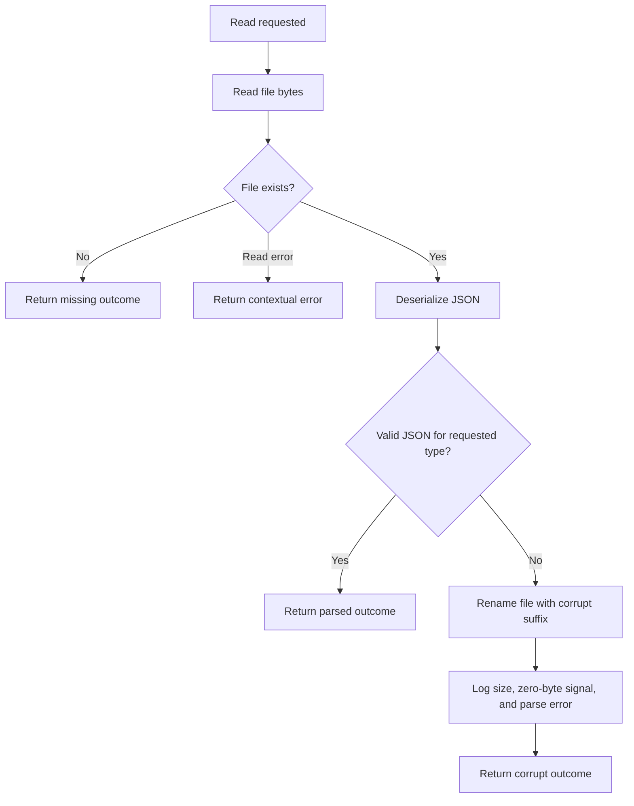

# Utils Fs

Utils Fs is the OpenFrame Client agent's small, defensive persistence boundary for JSON-backed local state. It is implemented by the `openframe_agent_lib` dependency from OpenFrame OSS Library and runs inside this repository's OpenFrame Client deployment. Its responsibilities are deliberately narrow: write complete replacement files, distinguish absence from corruption, and move malformed JSON out of the active path so later writes can recover normally.

The implementation is maintained in [the OpenFrame OSS Library source](https://github.com/flamingo-stack/openframe-oss-lib/blob/7a766f00e4f58b5d89db007b878ac8d6e0c344f4/clients/openframe-client/src/utils/fs.rs). OpenFrame OSS Tenant consumes the library as Cargo artifact `openframe_agent_lib` version `0.0.5`.

## Responsibilities

- **Durable replacement writes:** Create a temporary file in the target directory, write the full byte sequence, flush it to storage, then persist it at the destination.
- **Safe JSON reads:** Treat a missing file as an expected state and report other read failures with path context.
- **Corruption containment:** If JSON decoding fails, log diagnostic metadata and rename the bad file with a `.corrupt` suffix before reporting the condition.
- **Explicit caller outcomes:** Represent missing, corrupt, and successfully parsed files separately, while providing a convenience conversion to an optional parsed value.

Utils Fs does not define the JSON schemas, choose persistence locations, or interpret recovered state. Those concerns belong to the calling client services and platform directory management.

## Architecture and Placement

The module sits below agent services that persist lightweight local state, such as registration data, update state, client information, or durable work records. It accepts a filesystem path and caller-owned bytes or a caller-selected deserialization type. The module has no network, database, or message-bus dependency.

### Component Model

| Component | Role | Observable result |
|---|---|---|
| Atomic write operation | Replaces the destination only after a complete temporary file has been written and flushed. | Readers avoid an in-progress partial file, and a successful return means the replacement step completed. |
| JSON file outcome | Models the three possible read states: missing, corrupt, or parsed. | Callers can differentiate initial startup from damaged persisted state. |
| Read and quarantine operation | Reads bytes from a path and delegates JSON decoding. | A missing file becomes the missing outcome, while non-missing read failures remain errors with path context. |
| Parse and quarantine operation | Deserializes caller-selected JSON and isolates malformed input. | Valid bytes become the parsed outcome and invalid bytes become the corrupt outcome. |
| Parsed value helper | Converts the outcome into an optional value. | Missing and corrupt states both produce no value for callers that do not need the distinction. |

## Dependency Boundaries

The implementation depends on a JSON deserializer for typed decoding, a temporary-file facility for safely creating a file beside its destination, structured tracing for warnings, and operating-system filesystem primitives. It supplies a generic boundary rather than a domain-specific storage abstraction: the caller determines the JSON type and path.

On Unix-like systems, the temporary file permissions are set to mode `0644` before persistence because the temporary-file default is more restrictive. This aligns the eventual file with the normal permissions expected from a standard write. On Windows, replacement can fail when an antivirus scanner, backup process, or similar process briefly holds the target. In that case, the implementation retries a rename after progressively longer delays of 100, 200, 400, 800, and 1600 milliseconds. When retries still fail, it logs the relevant locking-process diagnostics when available and attempts to remove the temporary file.

## Write Flow

### Atomicity and Durability Properties

The temporary file is created in the target's parent directory. This is important because the final persistence operation is a rename within the same directory rather than a copy between filesystems. The code writes all supplied content before attempting the replacement, then calls a full file synchronization before that replacement. The synchronization protects against a failure mode where a rename survives a power loss but written data has not reached durable storage, which could otherwise leave a zero-filled or incomplete state file.

The operation creates missing parent directories. It returns a contextual error if the path has no parent directory, temporary-file creation fails, writing fails, flushing fails, or the final replacement cannot be completed. It does not silently fall back to a non-atomic direct write.

## Read and Recovery Flow

A missing state file is normal for first use and does not produce an error. A different read failure, such as an access or device error, is propagated because the caller cannot safely assume there is no prior state.

For malformed JSON, Utils Fs attempts to move the source to a sibling path formed by appending `.corrupt` to its filename. The warning includes the original path, byte size, deserialization failure, and whether the nonempty file contains only zero bytes. The move is best effort: even if it cannot be completed, the function logs that failure and returns the corrupt outcome so the caller can begin fresh state rather than consuming invalid data.

## Caller Contract

### Writing State

Use the atomic write operation whenever replacing a complete file whose readers must not observe partially serialized content. Serialize the domain value before calling the operation, and treat an error as a failed persistence attempt. The helper writes bytes exactly as supplied and does not serialize, encrypt, validate, or merge them.

### Reading State

Use the read and quarantine operation with the expected deserialization type. Handle outcomes according to the state owner's recovery policy:

- **Missing:** Initialize defaults or wait until the service has data to save.
- **Parsed:** Continue with the returned value.
- **Corrupt:** Initialize safe replacement state and preserve logs plus the quarantined file for diagnosis when it was successfully moved.

Use the parsed value helper only when missing and corrupt can intentionally share the same fallback behavior. Otherwise, match the three outcomes directly so corruption remains visible in service-level decisions and telemetry.

## Operational Considerations

- A `.corrupt` file is diagnostic evidence, not a valid fallback. Do not automatically parse it as part of normal startup.
- The corruption path appends a suffix to the current filename. Operators should collect it before cleanup if the underlying failure needs investigation.
- A successful write replaces the prior file; it is not an append or transactional history mechanism.
- Windows replacement may block the caller thread during its short retry window. Callers should account for that behavior when choosing execution contexts.
- File ownership, directory permissions, paths, encryption, retention, and schema migrations remain the responsibility of higher-level client and platform modules.

## Relationship to the OpenFrame Client

Utils Fs is a foundational local-state primitive within the OpenFrame Client agent supplied by OpenFrame OSS Library. Higher-level client services own registration, authentication, update, delivery, and tool-management workflows; this module protects the small JSON files those workflows choose to persist. Keeping file replacement and malformed-input recovery here gives those services a consistent failure boundary without coupling the utility to any one state schema or workflow.