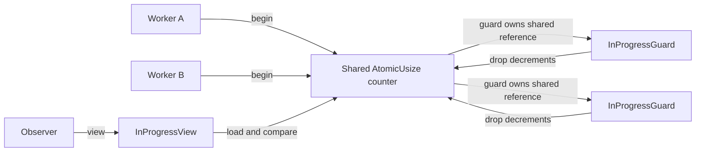
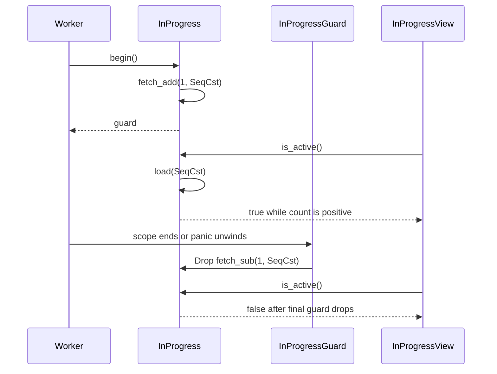
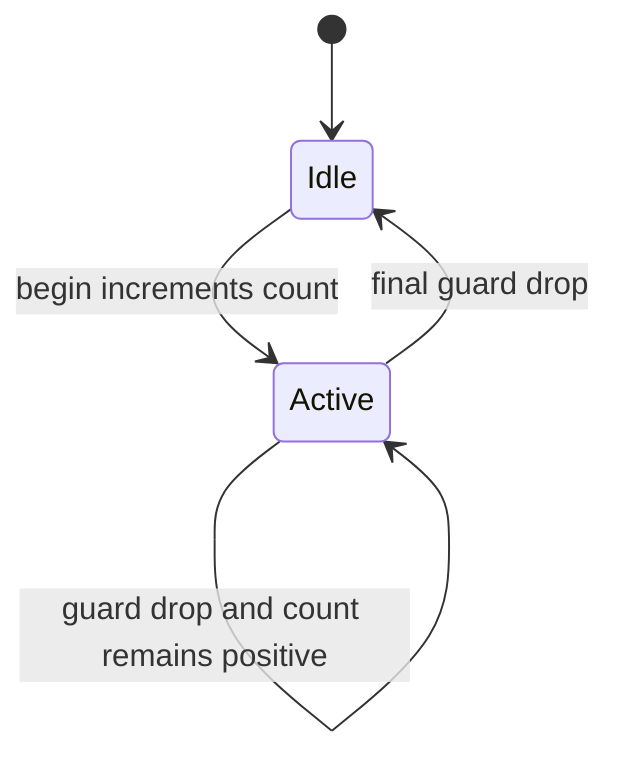

# Utils In Progress

Utils In Progress is a small, in-memory activity indicator used by the OpenFrame client agent. It exposes a reference-counted counter: work calls `begin`, observers obtain `view`, and an `InProgressView` reports whether one or more guarded operations are active. The implementation is supplied by the OpenFrame OSS Library's `openframe_agent_lib` artifact and runs within this repository's OpenFrame client.

Its scope is deliberately narrow. It does not identify operations, queue work, persist state, or provide completion notifications. It answers one concurrency-safe question: whether the shared count is greater than zero.

**Source:** [in progress implementation](https://github.com/flamingo-stack/openframe-oss-lib/blob/16e7c1cbd9664e7d10ec5ebca7d53c9bd314decf/clients/openframe-client/src/utils/in_progress.rs)

## Responsibilities

- Start a tracked operation with `InProgress::begin`.
- Keep the operation active for the lifetime of its returned `InProgressGuard`.
- End the operation automatically when that guard is dropped, including during stack unwinding caused by a panic.
- Produce cloneable, read-only observation handles with `InProgress::view`.
- Report activity through `InProgressView::is_active` without exposing the counter itself.

## Architecture

`InProgress` and `InProgressView` each hold an `Arc<AtomicUsize>` that refers to the same counter. Creating a guard increments the counter; dropping the guard decrements it. A view performs a load and maps any positive value to `true`.



### Components

| Component | Role | Shared state interaction |
|---|---|---|
| `InProgress` | Cloneable owner used to start tracked work and create views. | Holds `Arc<AtomicUsize>`. Its default state has a count of zero. |
| `InProgressGuard` | RAII lifetime token returned by `begin`. | Increments the count when created and decrements it in `Drop`. |
| `InProgressView` | Cloneable observer handle. | Loads the count and returns active when it is greater than zero. |
| `AtomicUsize` | Shared counter. | All mutations and reads use sequentially consistent ordering. |

## Operation Lifecycle

The counter represents the number of guards that have not yet been dropped. Nested and concurrent operations are therefore supported: activity remains reported until the final guard is released.



### State Model



## API Behavior and Guarantees

### Starting work

`InProgress::begin` performs `fetch_add(1, Ordering::SeqCst)` and returns an `InProgressGuard`. The guard retains a clone of the counter reference, so the tracked operation remains associated with the same shared state even if the original `InProgress` handle is moved or dropped.

The guard is annotated with `must_use`. Discarding it immediately ends the activity interval, so callers must bind it for the scope that represents the work.

### Observing work

`InProgress::view` creates an `InProgressView` backed by the same counter. `InProgressView::is_active` executes `load(Ordering::SeqCst) > 0`; it does not reserve work or alter the count. A view is a point-in-time observation, so an operation can start or finish immediately after the read.

### Completion and panic safety

`InProgressGuard` implements `Drop`, where it calls `fetch_sub(1, Ordering::SeqCst)`. Rust runs this destructor when a normal scope exits and while unwinding from a panic. This RAII design prevents the common failure mode in which an early return or panic leaves a manual activity flag set indefinitely.

## Concurrency Semantics

The module uses `Arc` and `AtomicUsize`, allowing cloned owners, guards, and views to share the counter across threads. Every atomic operation uses `Ordering::SeqCst`, giving a single global ordering for these counter operations. This is stronger than the minimum required merely to count operations, but makes the activity transitions straightforward to reason about.

The abstraction relies on balanced use: each active guard is dropped once after `begin` has incremented the count. Callers should not attempt to model individual task identity or cancellation with the counter; it is aggregate state only.

## Integration Guidance

Use Utils In Progress around an operation whose duration must be visible to another part of the client process. Keep the guard local and let scope exit determine completion.

```rust
let work = in_progress.begin();
perform_operation().await?;
drop(work);
```

In most cases, explicit `drop` is unnecessary; retaining the guard until the enclosing scope ends is clearer and preserves the intended lifetime. Obtain an `InProgressView` where a component only needs to query activity, rather than giving that component the ability to start additional tracked operations.

## Limits

- The state is process-local and is reset when the client restarts.
- The counter has no operation metadata, timeout, wait primitive, or callback mechanism.
- `is_active` provides a snapshot, not a guarantee that the system will remain idle after it returns `false`.
- The module does not synchronize the work itself; it only reports aggregate activity.

## Maintenance Notes

Preserve the guard-based decrement path when changing this module. Replacing it with a manually managed completion call would weaken early-return and panic safety. If additional state is needed, keep the observation contract explicit: consumers currently depend on `is_active` being a non-mutating, aggregate predicate over the shared counter.
