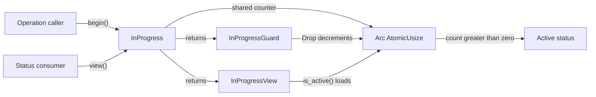
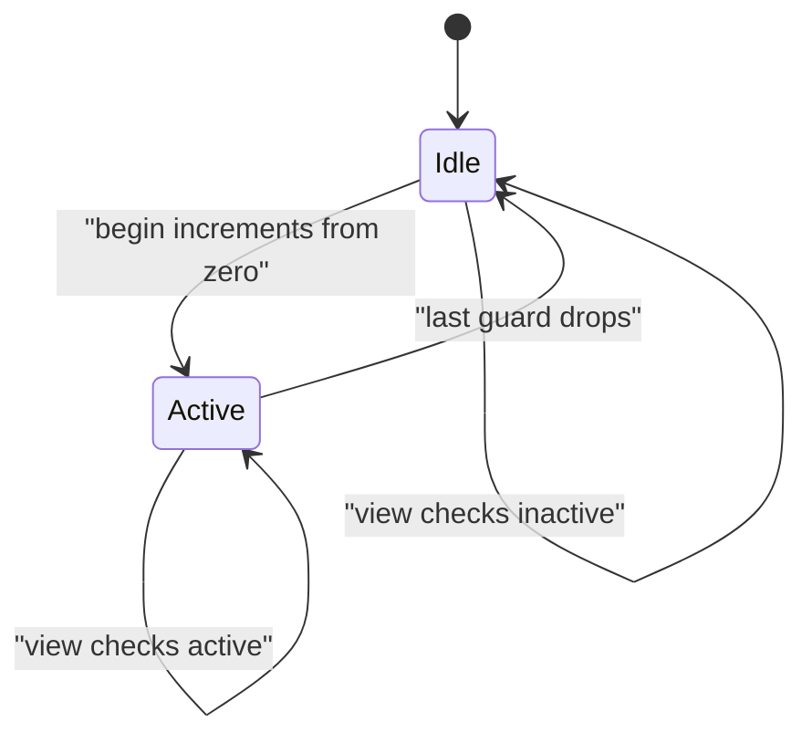
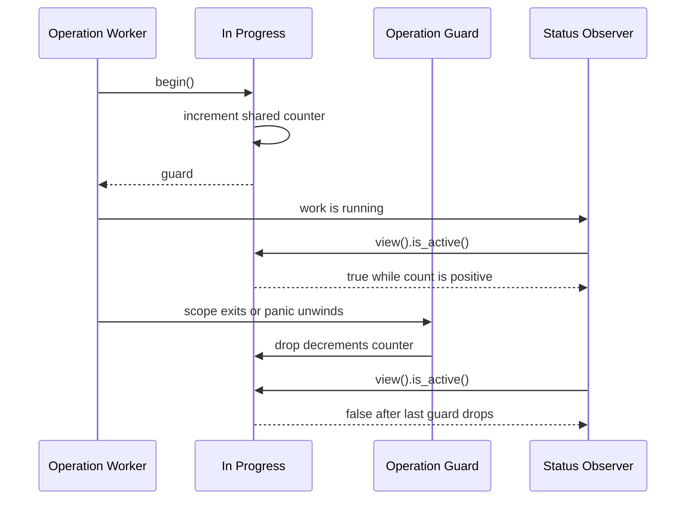

# Utils In Progress

Utils In Progress is a small, concurrency-safe activity indicator used by the OpenFrame Client agent. Its implementation is supplied by the `openframe_agent_lib` Cargo dependency from the OpenFrame OSS Library and runs inside this repository's client deployment. It lets one part of the agent begin a tracked operation while another part observes whether any tracked work remains active.

The implementation is intentionally scope-based: `begin` returns a guard, and dropping that guard decrements the shared count. This includes stack unwinding caused by a panic, so callers do not need a separate completion call in normal control flow.

**Implementation source:** [OpenFrame OSS Library `in_progress.rs`](https://github.com/flamingo-stack/openframe-oss-lib/blob/7a766f00e4f58b5d89db007b878ac8d6e0c344f4/clients/openframe-client/src/utils/in_progress.rs)

## Responsibilities

- Track the number of currently scoped operations with a shared atomic counter.
- Provide a lightweight read-only view for status consumers.
- Keep tracking state valid across cloned handles by sharing the same counter.
- Release an operation automatically when its guard leaves scope, including during panic unwinding.

This utility is a local coordination primitive. It does not persist state, send messages, schedule work, serialize data, or itself prevent duplicate work. It only reports whether at least one holder currently owns an operation guard.

## Architecture

`InProgress` owns an `Arc<AtomicUsize>`. Cloning the tracker shares that allocation. `view` produces an `InProgressView` over the same allocation, and `begin` increments the counter before producing an `InProgressGuard`. The guard's `Drop` implementation decrements the counter.



### Components

| Component | Role | Behavior |
|---|---|---|
| `InProgress` | Mutable tracking handle | Defaults to a zero counter. `begin` increments the counter and creates a guard. `view` creates an observer over the same counter. |
| `InProgressGuard` | Scoped ownership token | Its destructor decrements the counter. The `must_use` annotation warns when a returned guard is immediately discarded, which would end the operation at once. |
| `InProgressView` | Read-only observer | `is_active` returns `true` when the counter is greater than zero. |

## Public Operations

### Begin an operation

`InProgress::begin` performs a sequentially consistent atomic increment and returns an `InProgressGuard`. The operation remains represented in the counter while that guard is retained.

A caller should bind the returned guard to a variable whose lifetime exactly covers the work being tracked. Dropping it early makes the activity invisible to observers even if the work continues.

### Create an observer

`InProgress::view` returns an `InProgressView` backed by the same atomic counter. Views can be cloned and distributed to status checks without granting the ability to start or finish operations.

### Check activity

`InProgressView::is_active` performs a sequentially consistent atomic load and tests whether the value is greater than zero. The result means that an operation guard existed at the instant of that load; it is not a reservation or an exclusive lock.

## Operation Lifecycle

The counter represents the number of outstanding guards, rather than a single Boolean. This preserves correct activity reporting when multiple operations overlap.





## Concurrency Semantics

All reads and updates use `Ordering::SeqCst`. Consequently, counter changes and observations participate in a single sequentially consistent order across threads. This is stronger than required for a simple active flag but gives straightforward, globally ordered behavior to consumers.

The utility provides only a point-in-time status observation:

- A `true` result means the counter was positive during the load.
- A `false` result does not prohibit another thread from calling `begin` immediately afterward.
- A `true` result does not guarantee that the operation will still be active after the check completes.

Consumers that need ownership, exclusion, queuing, or a stable decision must use an additional synchronization or coordination mechanism. Utils In Progress should remain limited to activity visibility.

## Usage Pattern

The intended pattern keeps the guard alive for the full critical work scope and gives an observer to code that needs status reporting.

```rust
let tracker = InProgress::default();
let status = tracker.view();

{
    let _operation = tracker.begin();
    assert!(status.is_active());
    // Perform the tracked operation while _operation remains in scope.
}

assert!(!status.is_active());
```

The leading underscore in `_operation` suppresses an unused-variable warning while retaining the guard. Do not write `tracker.begin();` without binding the result: the temporary guard is dropped at the end of that statement, immediately decrementing the counter.

## Integration Boundaries

Utils In Progress belongs to the Rust OpenFrame Client implementation from the OpenFrame OSS Library. The tenant repository consumes the library as `openframe_agent_lib` version `v0.0.5`; it does not define the utility locally. The module is therefore an in-process agent concern, independent of the tenant services, gateway routes, NATS connections, or persistent data stores.

Within the broader client, it is suitable for exposing whether a background workflow is currently running. It must not be interpreted as a distributed activity signal: its counter exists only in the process that owns the `InProgress` handles.

## Maintenance Notes

- Preserve the guard-based API: manual decrement methods make early returns and panic paths easier to leak.
- Keep increments and decrements balanced. The implementation assumes every constructed guard is dropped exactly once; violating that invariant can cause the unsigned counter to underflow.
- Treat `is_active` as telemetry or UI state, not as a lock-acquisition test.
- If changing memory ordering, document the intended cross-thread guarantees and verify that observers still meet their requirements.
- Add tests for nested guards, cloned trackers, cloned views, and guard release during unwinding whenever lifecycle behavior changes.
