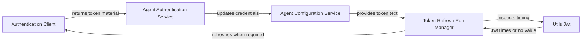
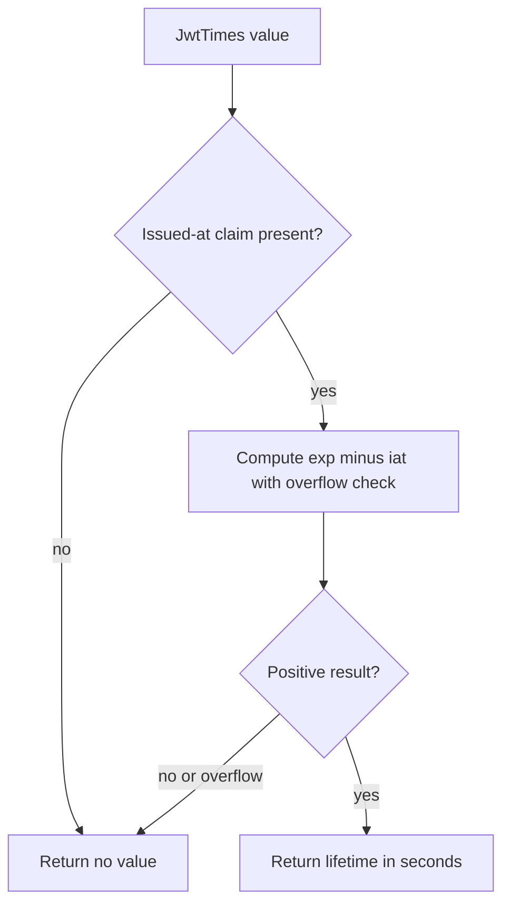
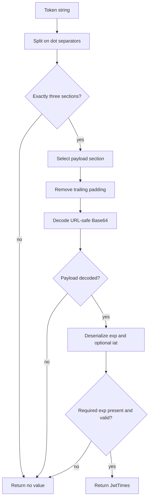
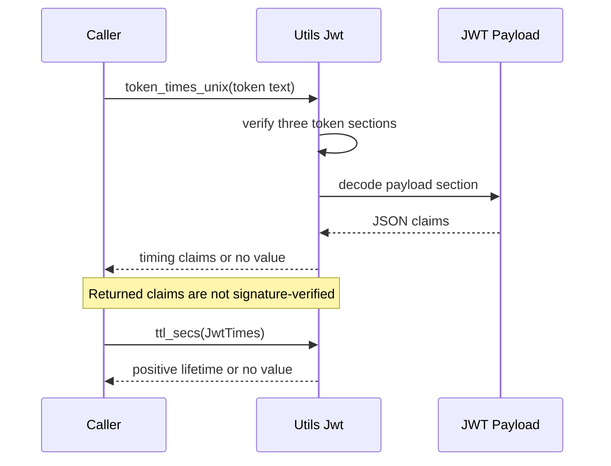

# Utils Jwt

Utils Jwt is a small Rust utility in the OpenFrame client agent that extracts the issued-at and expiration timestamps from a JSON Web Token (JWT). It is intentionally a **metadata reader**, not a token validator: it decodes the payload and deserializes the `iat` and `exp` claims without checking the token signature, issuer, audience, or any authorization policy.

The implementation is supplied by the OpenFrame OSS Library as part of the `openframe_agent_lib` artifact used by this repository's client runtime. Its source is [jwt.rs](https://github.com/flamingo-stack/openframe-oss-lib/blob/16e7c1cbd9664e7d10ec5ebca7d53c9bd314decf/clients/openframe-client/src/utils/jwt.rs).

## Purpose and Scope

Utils Jwt provides a narrow, deterministic interface for code that needs to inspect token timing information:

- `JwtTimes` represents the JWT `exp` claim and an optional `iat` claim as signed 64-bit Unix-epoch seconds.
- `token_times_unix` checks the compact JWT shape, decodes its payload, and deserializes the time claims.
- `ttl_secs` derives the issuer-granted lifetime from `exp - iat` when that duration is positive and representable.

The module does not create, refresh, persist, authenticate, or authorize tokens. Those responsibilities remain with the client authentication, configuration, and refresh services.

## Public API

| Component | Responsibility | Result |
|---|---|---|
| `JwtTimes` | Deserialized timing view of a JWT payload. | Required `exp` and optional `iat` Unix timestamps. |
| `JwtTimes::ttl_secs` | Calculates the lifetime granted by the issuer. | Positive `exp - iat`, otherwise no value. |
| `token_times_unix` | Performs structural splitting, payload decoding, and JSON deserialization. | `JwtTimes` for a parseable token with `exp`, otherwise no value. |

### JwtTimes

`JwtTimes` is deserializable from JWT claims. `exp` is mandatory, while `iat` defaults to no value when absent. This makes expiration time available even for tokens that do not carry an issued-at time, while accurately preventing a lifetime calculation when one endpoint of the interval is missing.

The timestamps are raw Unix seconds. Utils Jwt neither compares them to the system clock nor decides whether the token is expired.

### Token Lifetime Calculation

`ttl_secs` is deliberately conservative:

1. It returns no value when `iat` is absent.
2. It performs subtraction with overflow checking.
3. It accepts only a strictly positive result.

A zero or negative interval is not treated as a valid lifetime. Callers can therefore distinguish a valid positive lifetime from absent, malformed, contradictory, or arithmetic-overflowing claim combinations.

## Token Parsing Flow

`token_times_unix` expects exactly three dot-separated compact-JWT sections: header, payload, and signature. It rejects missing sections and extra sections before attempting to decode the payload.

The payload section is processed as follows:

1. Any trailing padding characters are removed.
2. The remainder is decoded with URL-safe Base64 without required padding.
3. The decoded bytes are parsed as JSON into `JwtTimes`.
4. A missing `exp`, invalid Base64, invalid JSON, incompatible claim type, or invalid JWT section count produces no value.

## Security Boundary

The module's documentation and implementation explicitly define an important boundary: decoding is performed **without signature verification**. A successful result proves only that the input looks structurally like a compact JWT and that its payload can be interpreted as the expected JSON time claims. It does not prove that the token was issued by a trusted authority, remains valid, or grants any permission.

Use Utils Jwt only for non-authoritative timing and scheduling decisions around token material that has already been obtained through the normal client authentication path. Authentication and authorization must rely on the appropriate client and server security mechanisms, not on these decoded claims.

## Integration Notes

Within the OpenFrame client, token lifecycle work is centered on the authentication client, agent authentication service, agent configuration service, shared token service, and token refresh run manager. Utils Jwt supplies only the claim-reading primitive that a lifecycle coordinator can use when it needs the lifetime encoded in an already available token.

The module has no network, disk, clock, or cryptographic-verification dependency of its own. Its direct implementation dependencies are URL-safe Base64 decoding and Serde JSON deserialization. This isolation makes it suitable for handling malformed external input without turning parsing failures into exceptions at its public boundary.

## Maintenance Guidance

- Preserve the exact-three-segment requirement when changing parsing behavior; accepting partial or extended compact-token forms would weaken the input contract.
- Preserve checked arithmetic and the strictly-positive lifetime rule to avoid silently accepting overflowed or nonsensical intervals.
- Keep signature verification out of this utility unless its API and callers are redesigned around key resolution and validation policy.
- Add tests for malformed separators, padded and unpadded payloads, absent `iat`, absent `exp`, invalid claim types, non-positive lifetimes, and arithmetic boundary values when modifying parser or lifetime behavior.
