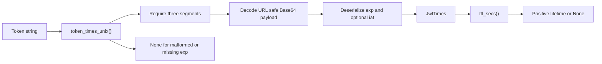
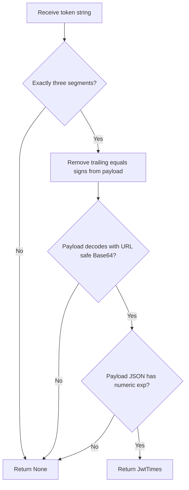
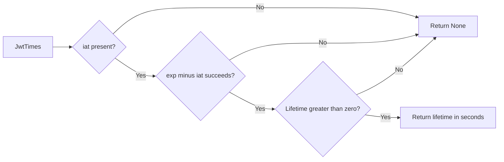
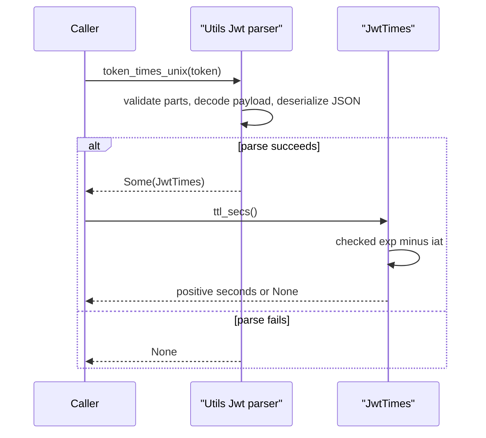

# Utils Jwt

Utils Jwt is a small Rust utility module in the OpenFrame client agent. It extracts the `exp` and optional `iat` time claims from the payload of a compact JSON Web Token (JWT), then safely derives the issuer-granted lifetime when both claims support it. It is implemented by the `openframe_agent_lib` Cargo artifact from the OpenFrame OSS Library, which this repository consumes at version `v0.0.5`.

The module is intentionally an **inspection utility**, not a token validator. It decodes an unverified JWT payload and must therefore never be used to establish identity, authorize an operation, or trust any other claim.

**Source:** [OpenFrame OSS Library JWT utility](https://github.com/flamingo-stack/openframe-oss-lib/blob/7a766f00e4f58b5d89db007b878ac8d6e0c344f4/clients/openframe-client/src/utils/jwt.rs)

## Responsibilities

- Enforce the compact JWT shape of exactly three dot-separated segments.
- Decode the payload with URL-safe Base64 decoding.
- Deserialize the required expiration claim and optional issued-at claim into `JwtTimes`.
- Calculate a strictly positive lifetime without integer overflow.
- Return `None` for invalid input instead of exposing parsing failures to callers.

The module does not verify a signature, decode or validate the header, validate an issuer or audience, compare times against the system clock, or refresh/store tokens.

## Architecture and Scope



`JwtTimes` is the module's data boundary. It stores `exp` as a required signed 64-bit Unix timestamp and `iat` as an optional signed 64-bit Unix timestamp. The utility does not require `iat`, because a JWT with only an expiration claim can still be represented, but it cannot yield an issuer-granted lifetime.

## Components

| Component | Role | Result |
|---|---|---|
| `JwtTimes` | Deserializable representation of the payload time claims. | Required `exp` and optional `iat` values in Unix seconds. |
| `token_times_unix` | Performs structural checking, payload decoding, and JSON deserialization. | `Some(JwtTimes)` or `None`. |
| `JwtTimes::ttl_secs` | Computes `exp - iat` with checked arithmetic and positive-value filtering. | `Some(i64)` or `None`. |

## Token Parsing Flow

`token_times_unix` follows a fail-closed parsing sequence. A failure at any stage produces `None`.



### Compact-token handling

The parser splits the input on periods and accepts the token only when it finds a header, payload, signature, and no fourth segment. This rejects tokens with missing segments and tokens with extra separators. It only decodes the payload segment. Although it removes trailing Base64 padding characters before decoding, callers should treat acceptance as a parsing convenience rather than an assertion that the source token is cryptographically valid.

### Claim deserialization

The payload must deserialize into the equivalent of the following shape:

```rust
struct JwtTimes {
    exp: i64,
    iat: Option<i64>,
}
```

The deserializer requires `exp`. It supplies `None` when `iat` is absent because that field is marked with a serde default. Malformed JSON, an absent or incompatible `exp`, and incompatible time values all cause parsing to return `None`.

## Lifetime Calculation

The lifetime calculation is deliberately narrower than expiration validation. It identifies the duration granted by an issuer; it does not determine whether the token is currently valid.



`ttl_secs` uses checked subtraction rather than ordinary subtraction. This prevents overflow from being turned into a misleading lifetime. It returns `None` in each of these cases:

- `iat` is not present.
- The subtraction overflows the `i64` range.
- `exp - iat` is zero or negative.

## Interaction Boundaries

Utils Jwt has no network, filesystem, persistence, clock, or service-management dependency. It is a pure transformation layer between an opaque token string and a minimal time-claim representation.



The available organization-wide code graph currently records no callers for `token_times_unix`. This means the function is reusable library functionality, but this documentation does not assign it to a particular authentication or refresh path. The module tree identifies adjacent client agent authentication and token-refresh services; those services should use verified authentication flows for trust decisions and may use this utility only for non-authoritative timing metadata.

## Security Considerations

- **No signature verification:** payload claims can be read from a forged token. Cryptographic verification belongs in an authentication boundary that has the issuer keys and validation policy.
- **No current-time check:** `exp` is parsed but never compared with the current Unix time. A caller that needs expiration status must perform a validated time comparison separately.
- **No semantic claim validation:** issuer, audience, subject, nonce, scopes, and header algorithm are outside this module's scope.
- **Treat `None` conservatively:** it denotes malformed input, missing required claims, absent issuance time, invalid lifetime, or arithmetic overflow. It is not a reason to assume a token is valid.

## Maintenance Guidance

When changing Utils Jwt, preserve these behavioral invariants:

1. Require exactly three compact-token segments.
2. Keep parsing fallible and non-panicking for untrusted strings.
3. Keep `exp` mandatory and `iat` optional unless all upstream token contracts are intentionally changed.
4. Use checked arithmetic for time differences and reject zero or negative lifetimes.
5. Do not add validation claims here unless the module is explicitly redesigned as a cryptographic verifier with key-management and policy inputs.

For agent authentication, registration, and token-refresh orchestration, refer to the corresponding OpenFrame client agent service documentation in the platform documentation. This module should remain limited to safe extraction of unverified time metadata.
