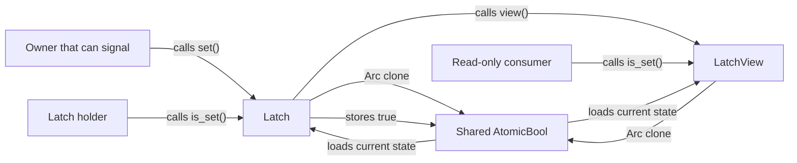
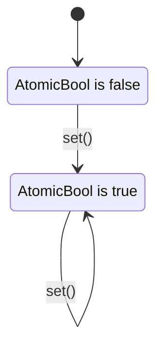
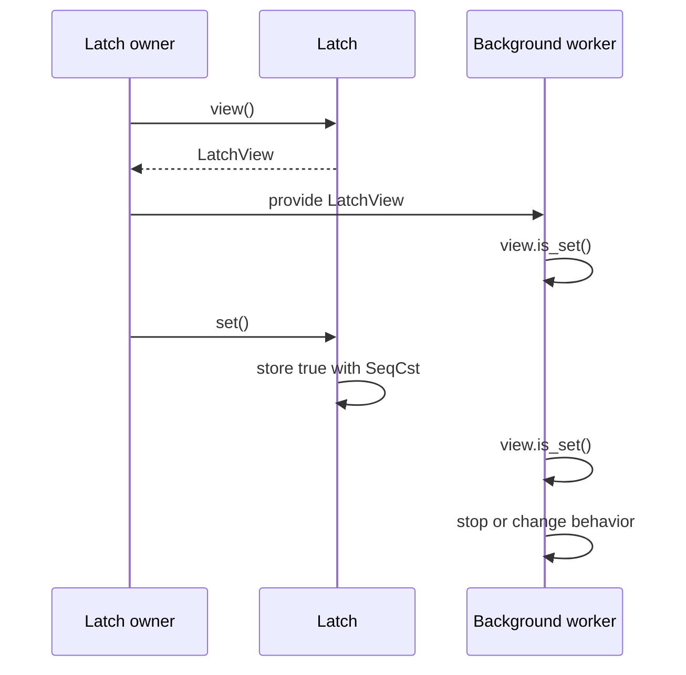

# Utils Latch

Utils Latch is a small, in-memory synchronization primitive used by the Rust OpenFrame client. It provides a one-way, shared boolean signal: one task sets the signal and any holder of the latch or a read-only view can subsequently observe that it has been set. The state starts as `false` and the module deliberately exposes no reset operation.

The implementation is supplied by the `openframe_agent_lib` Cargo artifact from [OpenFrame OSS Library](https://github.com/flamingo-stack/openframe-oss-lib/blob/16e7c1cbd9664e7d10ec5ebca7d53c9bd314decf/clients/openframe-client/src/utils/latch.rs). OpenFrame OSS Tenant consumes that library as part of the endpoint client runtime.

## Purpose and Scope

Use Utils Latch to communicate a permanent state transition within a running process, such as a shutdown, restart, or completion condition. It is intentionally narrower than a lock or notification primitive:

- **Shared:** cloning either handle retains access to the same underlying state.
- **One-way:** `set` changes the state from unset to set; no public API clears it.
- **Non-blocking:** callers poll the state with `is_set`; there is no waiting or wake-up mechanism.
- **Process-local:** state lives only in memory and is lost when the client exits.
- **Thread-safe:** the underlying boolean is atomic and all reads and writes use sequentially consistent ordering.

It is not appropriate when consumers must wait efficiently for an event, when transitions need to be counted, or when a value must be carried with the signal.

## Architecture

The module owns one `Arc<AtomicBool>`. A `Latch` is the mutable-capability handle, while `LatchView` is an observation-only handle. Both clone the same `Arc`, so each observes the same atomic flag.



### Types and Operations

| Component | Responsibility | State-changing capability |
|---|---|---|
| `Latch` | Owns a shared reference to the atomic flag and can create observation views. It derives `Clone` and `Default`. | Can call `set`. |
| `Latch::set` | Stores `true` with `Ordering::SeqCst`. Repeating the call is harmless because the stored value remains `true`. | Yes. |
| `Latch::is_set` | Loads the current flag with `Ordering::SeqCst`. | No. |
| `Latch::view` | Returns a `LatchView` over a cloned shared reference to the same flag. | No. |
| `LatchView` | Read-only wrapper around the shared flag. It derives `Clone`. | No. |
| `LatchView::is_set` | Loads the current flag with `Ordering::SeqCst`. | No. |

`Default` constructs a new latch around a default `AtomicBool`, whose initial value is `false`. The API makes the direction of authority explicit: components that only need to observe the condition should receive `LatchView`, not `Latch`.

## State Model

Utils Latch has two observable states. The public interface permits only the forward transition.



There is no transition from `Set` to `Unset`. A caller that needs reusable cycles must create a new latch or use a different coordination primitive.

## Interaction Flow

A typical flow creates a latch, distributes a read-only view to background work, and later sets the latch from the owning control path. Polling consumers choose their own cadence and termination behavior.



The setter and readers do not communicate through a channel, callback, or condition variable. They communicate solely through the atomic value. Consequently, a reader may continue work until its next poll; setting the latch does not interrupt a task automatically.

## Memory-Ordering Contract

Every operation uses `Ordering::SeqCst`:

- `set` performs a sequentially consistent atomic store of `true`.
- Both `is_set` methods perform sequentially consistent atomic loads.
- All participating threads therefore observe the flag within the strongest ordering model offered by Rust atomics.

This choice favors a simple, conservative cross-thread contract over weaker ordering optimizations. It guarantees atomic flag visibility but does not itself coordinate cancellation, join worker tasks, release external resources, or make unrelated non-atomic data safe to access.

## Usage Guidance

### Recommended ownership pattern

1. Create a `Latch` in the component that owns the lifecycle transition.
2. Call `view` and pass the resulting `LatchView` to consumers that must only observe the condition.
3. Have consumers check `is_set` at safe polling boundaries.
4. Call `set` once the condition becomes permanent.
5. Let consumers perform their own shutdown or completion work after observing the signal.

This separation minimizes the number of components allowed to trigger the transition.

### Example

```rust
let stop_latch = Latch::default();
let worker_view = stop_latch.view();

if !worker_view.is_set() {
    // Perform one unit of work, then check again at the next safe boundary.
}

stop_latch.set();
assert!(stop_latch.is_set());
assert!(worker_view.is_set());
```

The example shows the intended one-way behavior: after `set`, both the owner and the previously-created view report the signal as set.

## Constraints and Maintenance Notes

- Do not treat Utils Latch as a timeout, retry, lock, semaphore, or task join mechanism.
- Do not expect setting a latch to wake blocked I/O or sleeping tasks; combine it with an appropriate cancellation or notification mechanism when prompt wake-up is required.
- A `LatchView` cannot set or reset state by design. Preserve that capability boundary when evolving call sites.
- Clones share state; they do not create independent flags.
- The module includes a separate test module, `latch_tests.rs`, selected through the Rust `cfg(test)` configuration.

## Relationship to the Client Runtime

Within the OpenFrame client codebase, Utils Latch is a low-level utility beneath higher-level runtime concerns such as command listeners, tool lifecycle management, update coordination, and service execution. It contains no networking, persistence, client configuration, platform behavior, or domain-specific policy. Its sole responsibility is safely publishing an in-process, irreversible boolean condition between cloned handles.
