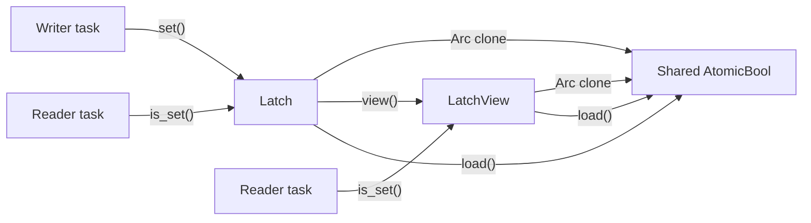
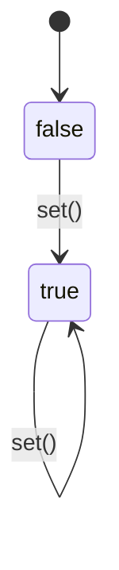
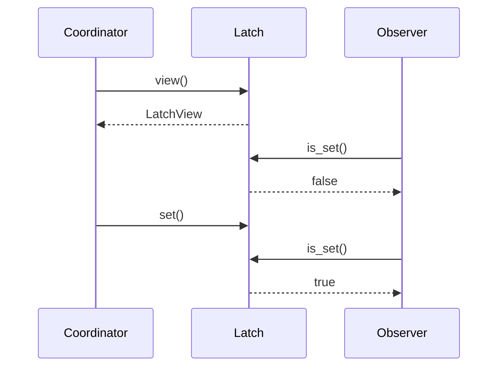
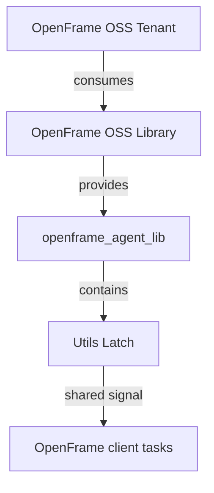

# Utils Latch

Utils Latch is a small, in-process synchronization utility supplied by the `openframe_agent_lib` crate from the OpenFrame OSS Library. It provides a cloneable, one-way shared boolean: one holder sets the latch and every `Latch` or read-only `LatchView` sharing that state can subsequently observe it.

The implementation is defined in the OpenFrame OSS Library's [`latch.rs`](https://github.com/flamingo-stack/openframe-oss-lib/blob/7a766f00e4f58b5d89db007b878ac8d6e0c344f4/clients/openframe-client/src/utils/latch.rs) and is incorporated at runtime by this repository through the pinned `openframe_agent_lib` dependency. It has no network, filesystem, service, or configuration dependency.

## Purpose and Scope

Use Utils Latch to publish a monotonic local signal between concurrently running portions of the OpenFrame client process. The state begins as `false`, can be changed to `true`, and cannot be cleared through this module's public API.

This is deliberately narrower than a general synchronization primitive:

- It shares state within one process only; it is not persistent and cannot coordinate separate processes or hosts.
- It supports observation and setting, not waiting or notification. A consumer must decide whether and how to poll.
- It does not expose compare-and-set, reset, counters, or payload storage.
- `set()` is idempotent: repeated calls retain the `true` state.

## Architecture

The module consists of two lightweight wrapper types over the same reference-counted atomic boolean.

### Components

| Component | Responsibility |
|---|---|
| `Latch` | Owns an `Arc<AtomicBool>`, implements `Clone` and `Default`, and provides mutation, inspection, and read-only view creation. |
| `Latch::set` | Stores `true` in the shared atomic value. |
| `Latch::is_set` | Loads and returns the current shared boolean value. |
| `Latch::view` | Creates a `LatchView` by cloning the same `Arc`; it does not snapshot the current value. |
| `LatchView` | Read-only handle over the same atomic state. It implements `Clone` and exposes only inspection. |
| `LatchView::is_set` | Loads and returns the current shared boolean value. |

## State Model

`Latch::default()` initializes the wrapped `AtomicBool` using its default value, `false`. The only state transition made available by this module is `false` to `true`.

Neither `Latch` nor `LatchView` can transition the value back to `false`. To represent a new cycle, construct a new `Latch` rather than attempting to reuse a set instance.

## Interaction Flow

A common integration pattern is to retain the writable `Latch` with the component that decides the condition has occurred, then distribute `LatchView` instances to observers. Because a view shares the atomic allocation rather than copying a boolean, reads after `set()` observe the live shared state.

The observed order in the diagram is a usage pattern, not a blocking protocol. The observer may read before or after the writer runs; if it must react promptly, the caller needs an external scheduling or notification mechanism.

## Concurrency Semantics

Every read and write uses `Ordering::SeqCst`:

- `set()` executes a sequentially consistent atomic store of `true`.
- Both inspection methods execute sequentially consistent atomic loads.
- Cloned `Latch` values and `LatchView` values all access the same atomic allocation through `Arc`.

This provides the strongest ordering used by Rust atomics for operations in this module. It does **not** make a multi-step workflow atomic. In particular, code that needs to perform an action exactly once cannot safely implement that requirement with an `is_set()` check followed by `set()`, because multiple callers can observe `false` before any writer stores `true`. Such a workflow requires a compare-and-swap-based primitive or separate mutual exclusion.

## Public API Contract

| API | Result | Contract |
|---|---|---|
| `Latch::default()` | New `Latch` | Creates an unset, independently allocated latch. |
| `Latch::clone()` | New `Latch` handle | Shares the original state, rather than copying it. |
| `Latch::set(&self)` | `()` | Permanently records the set state for all shared handles. |
| `Latch::is_set(&self)` | `bool` | Returns the atomic's current state. |
| `Latch::view(&self)` | `LatchView` | Creates a read-only live view of the same state. |
| `LatchView::clone()` | New `LatchView` handle | Shares the same state with the originating latch and other views. |
| `LatchView::is_set(&self)` | `bool` | Returns the atomic's current state without exposing mutation. |

## Dependency and System Placement

Utils Latch belongs to the `utils` area of the Rust OpenFrame client library. At the repository level, OpenFrame OSS Tenant consumes the OpenFrame OSS Library at version `7.0.11`; the relevant Cargo artifact is `openframe_agent_lib` at version `v0.0.5`.

The available organization-wide code graph reports no recorded consumers of `Latch` or `LatchView` at the indexed revision. The module should therefore be treated as a reusable utility whose current callers may be introduced alongside future client coordination work, rather than as an active cross-service interface.

## Maintenance Guidance

- Preserve the shared `Arc<AtomicBool>` ownership model. Changing clones to copy a boolean would break propagation between holders.
- Preserve the one-way contract unless a reset operation is explicitly designed and reviewed. Adding reset changes lifecycle assumptions and can introduce races for existing observers.
- Keep `LatchView` mutation-free to retain capability separation between the component that owns the signal and components that only observe it.
- If changing atomic ordering, document the required happens-before relationship and validate all concurrent call sites. The present implementation explicitly uses sequential consistency.
- Add direct tests for default state, state visibility across cloned latches, view visibility after setting, and repeated `set()` calls when modifying the module.

## Source and Ownership

- Source module: [`clients/openframe-client/src/utils/latch.rs`](https://github.com/flamingo-stack/openframe-oss-lib/blob/7a766f00e4f58b5d89db007b878ac8d6e0c344f4/clients/openframe-client/src/utils/latch.rs)
- Owning library: OpenFrame OSS Library
- Runtime consumer in this repository: the OpenFrame client dependency path
