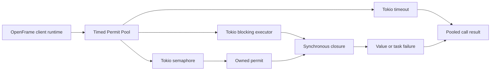
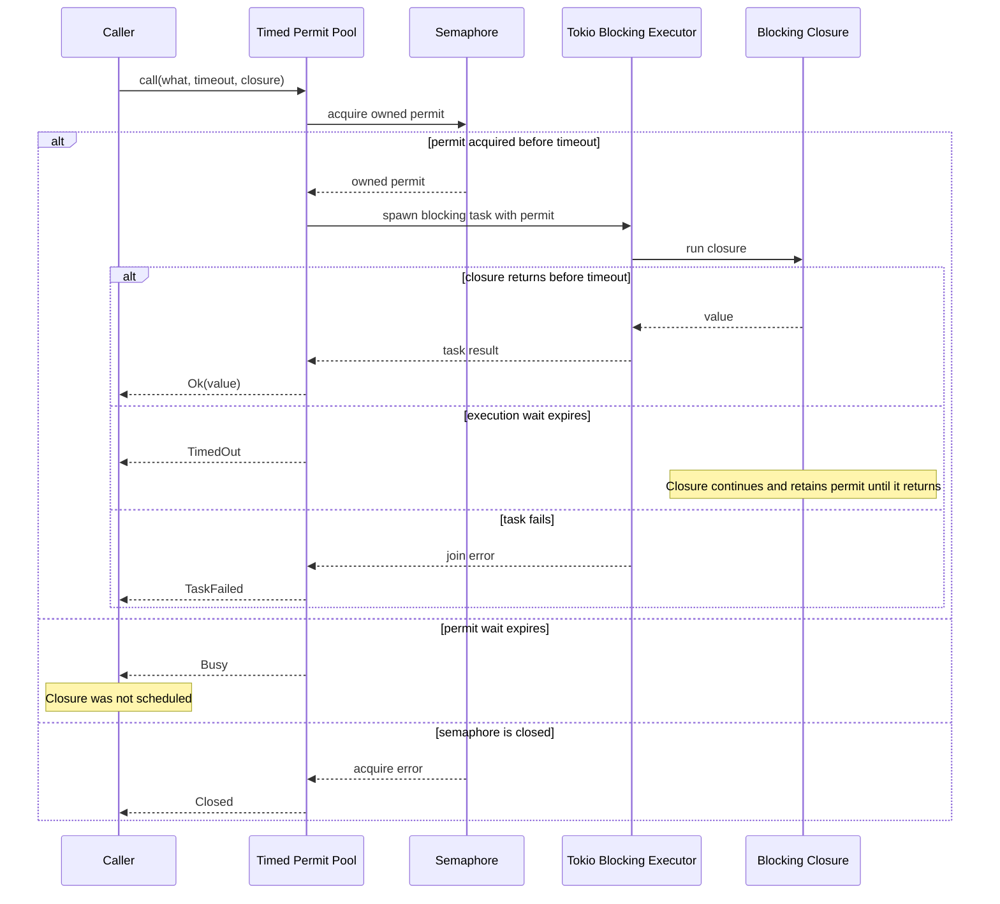
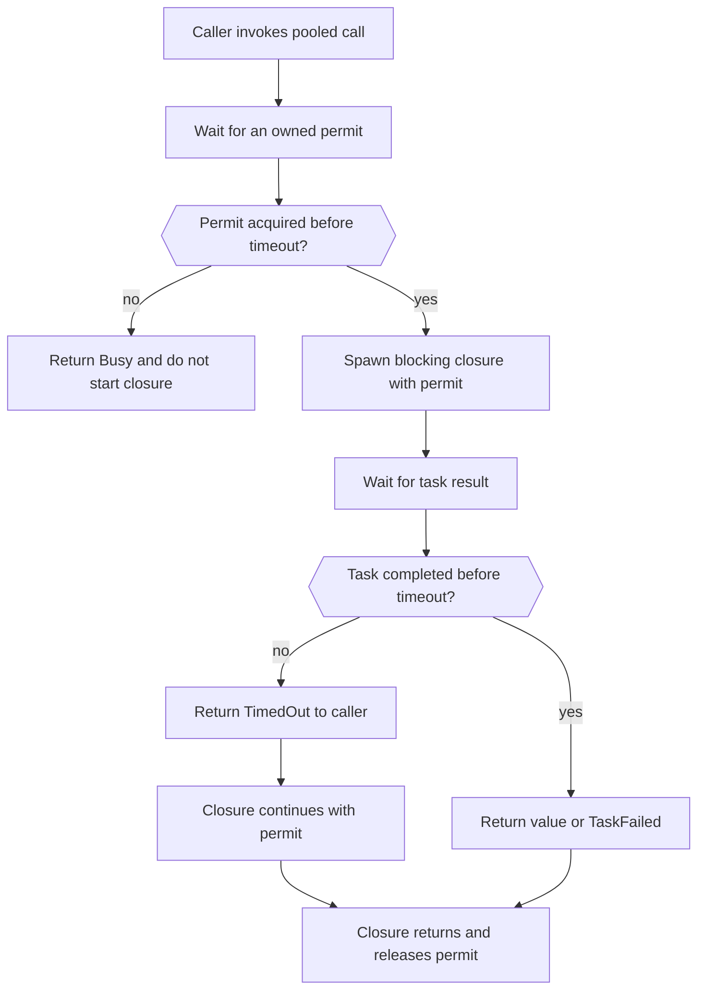

# Utils Timed Permit Pool

Utils Timed Permit Pool is a small Rust concurrency utility in the OpenFrame client agent. It runs a synchronous closure on Tokio's blocking executor while enforcing a bounded number of active blocking calls and independently timing both admission and execution. Its central safety property is that a call that exceeds its caller-visible timeout continues to retain its permit until the underlying blocking closure actually returns. This prevents repeated timeouts from creating an unbounded accumulation of parked blocking work.

The implementation is supplied by the OpenFrame OSS Library as part of the `openframe_agent_lib` Cargo artifact, consumed by this repository's client runtime. The authoritative implementation is [timed permit pool source](https://github.com/flamingo-stack/openframe-oss-lib/blob/16e7c1cbd9664e7d10ec5ebca7d53c9bd314decf/clients/openframe-client/src/utils/timed_permit_pool.rs).

## Responsibilities and Boundaries

The module provides `TimedPermitPool` and its `PermitPoolError` result type. It is deliberately narrow:

- constructs a pool with a fixed maximum number of permits;
- waits only up to a caller-provided duration for an available permit;
- moves an admitted `Send + 'static` closure to `tokio::task::spawn_blocking`;
- waits only up to the same duration for that task's result; and
- classifies admission exhaustion, a closed semaphore, execution timeout, and blocking-task failure.

It does not cancel a closure after the execution timeout, manage a work queue, retry failed work, inspect closure progress, or expose pool resizing and shutdown controls. The closure itself is responsible for eventually returning and for any lower-level timeout or cancellation behavior it needs.

## Architecture and Dependencies



`TimedPermitPool` owns an `Arc<Semaphore>` and records the configured maximum for error reporting. An owned semaphore permit is moved into the blocking closure rather than being held by the async caller. Rust drops that permit only when the closure exits, returning capacity to the semaphore at that time.

| Component | Role |
|---|---|
| `TimedPermitPool` | Holds shared permit state and the configured maximum number of concurrent calls. |
| `new(max)` | Creates a semaphore initialized with `max` permits. No validation or dynamic reconfiguration is performed. |
| `call(what, timeout, f)` | Performs timed admission, schedules `f` off the async runtime, then applies a second timed wait to the task result. |
| `PermitPoolError` | Describes why a value was not returned to the caller. |
| `PermitPoolError::is_busy()` | Identifies the admission-exhaustion case, where the closure was never scheduled. |

## Call Lifecycle

The same `timeout` argument is used twice: once while acquiring a permit and once while awaiting the blocking task. Consequently, an invocation that obtains a permit can take up to roughly two timeout intervals before it returns a timeout-related result. The execution interval begins only after admission succeeds.



### Permit Retention After Timeout

The execution-timeout branch is the module's defining behavior. Timing out the `JoinHandle` wait does not stop `spawn_blocking` work. Because the task captures the owned permit in a local binding, capacity remains occupied while the closure continues. When it returns, normal drop behavior releases the permit. This makes the configured maximum an upper bound on in-flight blocking closures, including closures that have already timed out from the caller's perspective.



## Result Semantics

| Outcome | Meaning | Was the closure started? | Capacity effect |
|---|---|---:|---|
| `Ok(T)` | The blocking closure finished and returned its value within the execution wait. | Yes | Its permit is released as the task exits. |
| `Busy { what, max }` | No permit became available during admission. | No | No permit was acquired and no blocking thread was scheduled. |
| `Closed { what, source }` | Semaphore acquisition reported closure. | No | No permit was acquired. The pool's public API does not expose a close operation, but this branch preserves the underlying semaphore error. |
| `TimedOut { what, ms }` | The blocking task did not finish within the execution wait. | Yes | The permit remains held until the closure actually exits. |
| `TaskFailed { what, source }` | The blocking task produced a Tokio join error. | Yes | Task termination drops the captured permit. |

The `what` label is propagated into each error display message, allowing callers to identify the protected operation in logs. `Busy` additionally reports the pool maximum, while `TimedOut` reports the timeout in milliseconds.

## Using the API

The call closure cannot borrow stack-local data because it must be `Send + 'static`; pass owned data into it with a `move` closure. The result type is also constrained to `Send + 'static` because it crosses from the blocking executor back to the async caller.

```rust
use std::time::Duration;

let pool = TimedPermitPool::new(4);
let operation_name = "read local inventory";
let path = inventory_path.to_owned();

match pool
    .call(operation_name, Duration::from_secs(5), move || read_inventory(path))
    .await
{
    Ok(inventory) => process_inventory(inventory),
    Err(error) if error.is_busy() => schedule_retry(),
    Err(error) => report_operation_failure(error),
}
```

Choose `max` based on the resource being protected, such as the acceptable number of simultaneously parked I/O or native-library calls. A zero-sized pool is allowed by the constructor; it admits no call, so calls wait until their admission timeout and then return `Busy` unless the semaphore is otherwise changed internally.

## Operational Guidance

- Set the outer timeout to the maximum time the async workflow can wait, not as an assumption that the blocking work is stopped.
- Ensure the closure has its own bounded behavior when possible. A closure that never returns permanently consumes one permit and reduces the pool's usable capacity.
- Treat `Busy` differently from `TimedOut`: `Busy` means no call was issued and retrying does not add parked work, while `TimedOut` means work may still be running.
- Use a stable, descriptive `what` value so timeout, capacity, and task-failure logs can be correlated.
- Avoid wrapping async work in this pool. It is specifically for synchronous operations that would otherwise block Tokio runtime worker threads.

## System Placement

The module is part of the OpenFrame client agent utility layer rather than a network endpoint, persistent store, or service controller. It depends only on Rust standard-library synchronization and duration types, Tokio synchronization, timeout, and blocking-task primitives, plus `thiserror` for error presentation. The code graph records no current organization-wide callers for `TimedPermitPool`; this module is therefore a reusable concurrency boundary whose behavior should be preserved if future client workflows adopt it.

The source declares a local test module, but no test definitions are included in the supplied component set. Maintainers changing the implementation should preserve the key invariant: an execution timeout returns promptly to the caller without releasing the permit until the blocking closure has returned.
