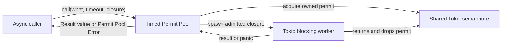
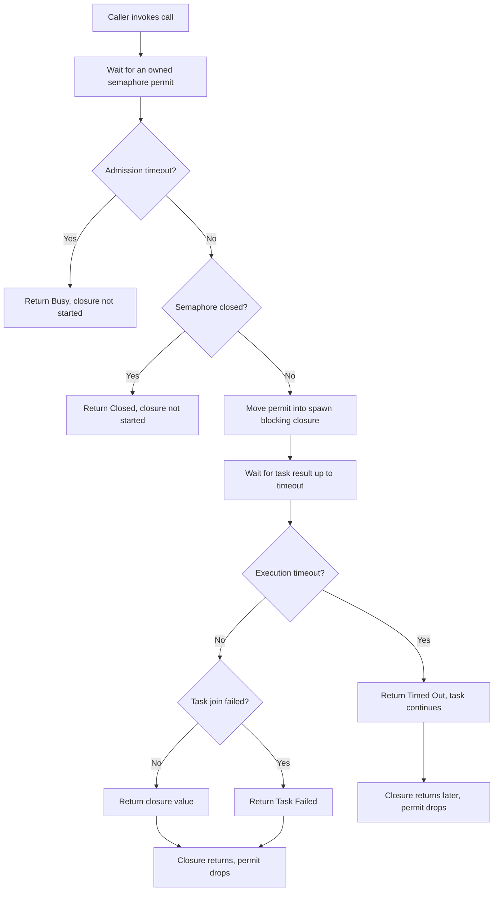
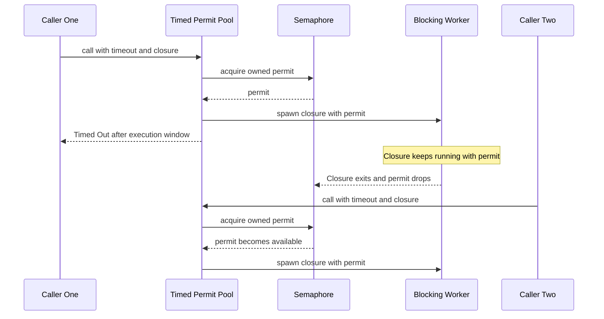

# Utils Timed Permit Pool

Utils Timed Permit Pool is a small asynchronous Rust utility supplied by the `openframe_agent_lib` crate from OpenFrame OSS Library. It runs a blocking closure on Tokio's blocking-worker pool while bounding the number of calls that may still be executing after their callers have timed out. The bound prevents repeated timeouts from accumulating an unbounded number of parked blocking threads.

The implementation is maintained in [the OpenFrame OSS Library source](https://github.com/flamingo-stack/openframe-oss-lib/blob/7a766f00e4f58b5d89db007b878ac8d6e0c344f4/clients/openframe-client/src/utils/timed_permit_pool.rs). OpenFrame OSS Tenant consumes the library as `openframe_agent_lib` version `v0.0.5`; this module runs as part of the OpenFrame client agent, rather than as a tenant-side Java service.

## Responsibilities

- Limit concurrently admitted blocking operations to the capacity selected at construction.
- Wait for admission for at most the caller-provided timeout.
- Execute admitted work with `tokio::task::spawn_blocking`, so the async runtime is not blocked by the closure.
- Apply the same timeout duration to waiting for the closure result.
- Retain a permit inside a timed-out blocking task until the underlying closure actually returns.
- Distinguish overload, a closed semaphore, an execution timeout, and a Tokio task failure.

The pool does **not** cancel or interrupt a closure when the execution timeout expires. A closure may therefore finish later, and its retained permit is released only at that point.

## Architecture

`TimedPermitPool` owns an `Arc<Semaphore>` and stores the configured maximum separately for diagnostic messages. Each `call` clones the semaphore reference and obtains an owned permit. Moving that permit into the blocking closure is the key lifecycle rule: dropping the waiting future after a result timeout cannot return capacity while the blocking operation is still running.

## Public API

| Item | Role |
| --- | --- |
| `TimedPermitPool::new(max)` | Creates a pool with `max` permits. The implementation does not validate the value; with zero permits, no call can be admitted and calls become `Busy` when their admission timeout elapses. |
| `TimedPermitPool::call(what, timeout, f)` | Asynchronously acquires capacity, runs the `Send + 'static` closure off-runtime, and returns its `Send + 'static` result or a `PermitPoolError`. |
| `PermitPoolError::is_busy()` | Returns `true` only for the `Busy` variant, allowing callers to recognize an operation that was never started. |

The `what` label is copied into every error variant generated by `call`. Callers should provide an operation description suitable for logs and diagnostics, without embedding secrets.

## Call Lifecycle

There are two independent timeout windows, each equal to `timeout`:

1. **Admission window:** the pool waits for an owned semaphore permit. Expiry produces `Busy`; the closure has not been submitted, so retrying does not add blocking work.
2. **Execution window:** once admitted, the pool waits for the `spawn_blocking` join handle. Expiry produces `TimedOut`, but Tokio's blocking task is not aborted by this result. It retains the permit until it exits.

Consequently, a caller can receive `TimedOut` while `is_busy()` remains `false`. That result means work was issued and may still have side effects. Treat retries according to the operation's idempotency rather than as an automatically safe retry.

## Error Semantics

| Variant | When it occurs | Was the closure started? | Operational implication |
| --- | --- | --- | --- |
| `Busy { what, max }` | A permit did not become available before the admission timeout. | No | This is the only condition for which `is_busy()` is `true`. Back off or retry if appropriate. |
| `Closed { what, source }` | Semaphore acquisition reports closure. | No | The shown pool does not expose a close operation, but this branch preserves an explicit failure mode if the semaphore is closed through shared ownership or future implementation changes. |
| `TimedOut { what, ms }` | The spawned blocking task did not finish before the execution timeout. | Yes | Work may still be running and still consumes capacity. Do not assume it was canceled. |
| `TaskFailed { what, source }` | Tokio reports a join failure for the blocking task. | Yes | Inspect the join error; the task did not yield a normal value. |

## Permit Ownership and Backpressure

This design makes the configured capacity a cap on **actual unfinished blocking work**, not merely on the number of callers currently awaiting results. It avoids a common timeout failure mode in which a caller gives up, releases an accounting slot, and permits additional blocking calls even though the original operating-system call remains stuck.

The trade-off is deliberate backpressure. If all admitted closures outlive their callers' execution timeouts, later calls wait for a permit and eventually return `Busy`. Capacity recovers only when the abandoned closures complete. Choose the pool size and timeouts based on the maximum acceptable number and duration of such operations.

## Integration Boundaries

The module directly depends only on Rust standard-library synchronization and duration types, `thiserror` for error formatting, and Tokio's semaphore, timer, and blocking-task APIs. It has no network, filesystem, persistence, or configuration responsibilities.

The module tree places Utils Timed Permit Pool alongside other OpenFrame client utility modules, including failure log backoff, filesystem persistence, in-progress tracking, JWT timing, latches, and version comparison. It is a reusable concurrency boundary for client-agent code that must call blocking APIs safely from async workflows; it does not define the policy or domain behavior of those workflows.

The available organization-wide code graph records no consumers of `TimedPermitPool` outside its defining library at the indexed snapshot. That does not change the utility's contract, but it means current usage must be verified in the consuming source revision before modifying behavior or removing the API.

## Maintainer Guidance

- Keep the owned permit in the closure's capture set. Releasing it before the blocking closure returns would break the protection against timed-out work accumulating.
- Keep admission and execution failures distinct. A `Busy` result means no work started; a `TimedOut` result does not.
- Do not put synchronous work directly in `call` before `spawn_blocking`; the async runtime must remain responsive.
- Use a finite, realistic timeout. The same value controls both queueing time and the time the caller waits after dispatch.
- Ensure closures are safe to outlive their caller. They must own or hold valid `Send + 'static` data and should tolerate the caller no longer observing their result.
- Test the critical cases: normal completion, admission exhaustion, execution timeout with delayed permit release, and a panic or cancellation causing a join error.

## Summary

Utils Timed Permit Pool combines Tokio semaphore admission with blocking-task timeouts. Its defining guarantee is conservative capacity accounting: an operation that has timed out to its caller continues to occupy one of the bounded slots until it actually finishes. This makes overload visible as `Busy` and prevents unbounded accumulation of long-running blocking operations in the OpenFrame client agent.
