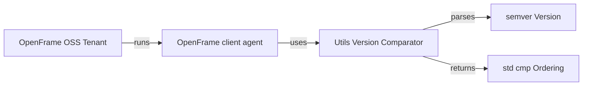
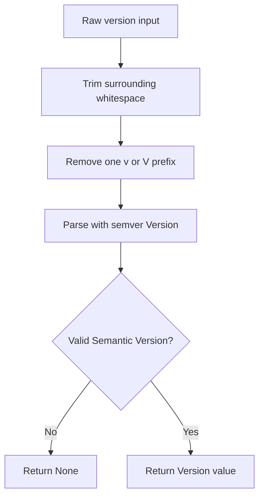
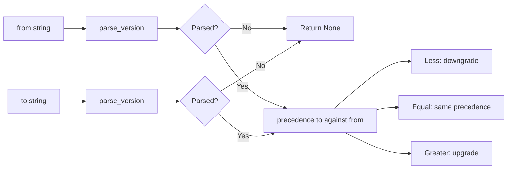
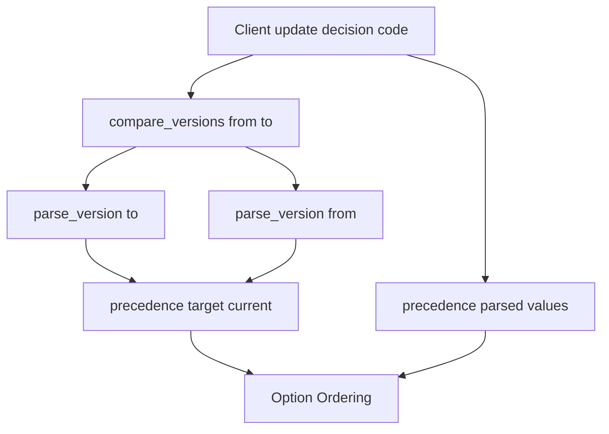

# Utils Version Comparator

Utils Version Comparator is a small, deterministic Rust utility used by the OpenFrame client agent to parse and order Semantic Versioning values. It accepts common release-string formatting such as leading or trailing whitespace and one leading `v` or `V`, then compares the target version with the current version using Semantic Versioning precedence.

The implementation is supplied by the `openframe_agent_lib` Cargo artifact from the OpenFrame OSS Library at version `v0.0.5`; OpenFrame OSS Tenant assembles and runs that client library. The authoritative implementation is [`version_comparator.rs`](https://github.com/flamingo-stack/openframe-oss-lib/blob/7a766f00e4f58b5d89db007b878ac8d6e0c344f4/clients/openframe-client/src/utils/version_comparator.rs).

## Responsibilities

- Normalize a raw version string only enough to support operational input: trim surrounding whitespace and remove one leading `v` or `V`.
- Parse the normalized string into `semver::Version`.
- Compare versions by Semantic Versioning precedence, rather than by the dependency crate's total ordering.
- Report whether a proposed target is older, identical in precedence, or newer than the current version.
- Avoid I/O, persistence, configuration, network calls, and update side effects. Callers decide how to act on the comparison result.

## Position in the Client Agent

The module is a leaf utility in the Rust client agent. It depends on the `semver` crate and the Rust standard library's `Ordering` type, but has no dependency on client configuration, platform services, or network services. A full organization code-graph snapshot records no callers for `compare_versions`; this describes current indexed references, not a restriction on future use.

The implementation belongs to the OpenFrame OSS Library rather than this repository. Its scope remains local to the agent's version-handling path: it transforms supplied strings and returns a value; it does not locate binaries, fetch releases, reserve updates, or install them.

## Public Interface

| Component | Signature | Behavior |
| --- | --- | --- |
| `parse_version` | `(&str) -> Option<Version>` | Trims outer whitespace, removes one optional leading `v` or `V`, and parses the remaining input as a Semantic Versioning value. Invalid input produces `None`. |
| `precedence` | `(&Version, &Version) -> Ordering` | Compares major, minor, patch, and pre-release fields. It deliberately excludes build metadata. |
| `compare_versions` | `(&str, &str) -> Option<Ordering>` | Parses both inputs and returns the precedence of `to` relative to `from`; if either parse fails, returns `None`. |

`Ordering::Less` means `to` is a downgrade, `Ordering::Equal` means both releases have identical Semantic Versioning precedence, and `Ordering::Greater` means `to` is an upgrade.

## Parsing Contract

`parse_version` is intentionally permissive only at the boundary. It first calls `trim`, then removes one leading lowercase or uppercase version marker. The remaining value must be accepted by `semver::Version::parse`.

| Raw input | Normalized input | Result |
| --- | --- | --- |
| `  v1.2.3  ` | `1.2.3` | Parsed |
| `V2.0.0-rc.1` | `2.0.0-rc.1` | Parsed |
| `1.4.0+build.8` | `1.4.0+build.8` | Parsed |
| `vv1.2.3` | `v1.2.3` | Rejected |
| `1.2` | `1.2` | Rejected |
| `release-1.2.3` | `release-1.2.3` | Rejected |

The function does not coerce partial versions, remove arbitrary prefixes, or repair malformed version syntax. This makes invalid configuration and malformed messages observable to its caller through `None` rather than silently changing their meaning.

## Precedence Rules

Semantic Versioning precedence is evaluated in this order:

1. Major version.
2. Minor version.
3. Patch version.
4. Pre-release identifier sequence.

A release with no pre-release identifier has higher precedence than the corresponding pre-release. For example, `1.2.3` is later than `1.2.3-rc.1`. Build metadata is excluded: `1.2.3+build.1` and `1.2.3+build.2` compare as equal for update decisions.

This exclusion is important because `semver::Version` provides a total `Ord` implementation that can distinguish build metadata, while Semantic Versioning precedence explicitly says build metadata must not affect ordering. `precedence` constructs its comparison tuple from `major`, `minor`, `patch`, and `pre`, thereby enforcing the agent's update-oriented contract.

## Comparison Flow

`compare_versions(from, to)` compares the desired destination against the installed or current source version. The argument order matters: it parses `to` first and passes it as the left side of `precedence`, then parses `from` as the right side.

### Examples

| `from` | `to` | Result | Interpretation |
| --- | --- | --- | --- |
| `1.2.3` | `1.3.0` | `Some(Greater)` | Upgrade |
| `v2.0.0` | `1.9.9` | `Some(Less)` | Downgrade |
| `1.2.3+build.1` | `1.2.3+build.2` | `Some(Equal)` | Same Semantic Versioning precedence |
| `1.2.3-rc.1` | `1.2.3` | `Some(Greater)` | Promotion from pre-release to release |
| `1.2.3` | `not-a-version` | `None` | Target cannot be parsed |

## Component Interaction

The three functions form a narrow pipeline. `parse_version` owns input normalization and validation. `compare_versions` invokes it for both textual inputs, and `precedence` owns the ordering semantics after valid versions exist. Keeping these responsibilities separate allows callers that already hold parsed `Version` values to use `precedence` directly.

## Operational Boundaries

The result is a comparison fact, not an update policy. In particular, Utils Version Comparator does not decide whether downgrades are allowed, whether a release is compatible with an operating system, or whether an update should be downloaded and installed. Those concerns remain with the client agent's update, platform, and orchestration services.

When adding a call site:

- Treat `None` as invalid or unsupported version input and handle it explicitly.
- Interpret the result relative to the documented `from`, `to` argument order.
- Do not use build metadata to trigger an update; the module intentionally ignores it for precedence.
- Use `precedence` when versions were parsed earlier, avoiding redundant parsing.
- Keep policy decisions outside this utility so its Semantic Versioning behavior stays deterministic and reusable.

## Maintenance Notes

Changes to parsing permissiveness or the precedence tuple can change update eligibility across deployed agents. Preserve the distinction between Semantic Versioning precedence and a total sort order, and add tests for any newly accepted input normalization or pre-release comparison rule. The source file includes a dedicated test module, `version_comparator_tests.rs`, compiled only during tests.
