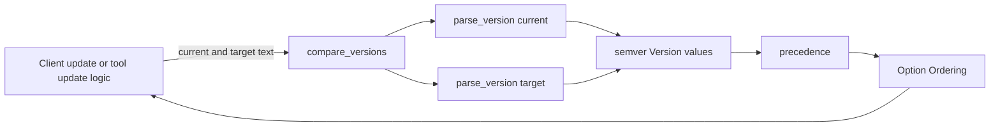
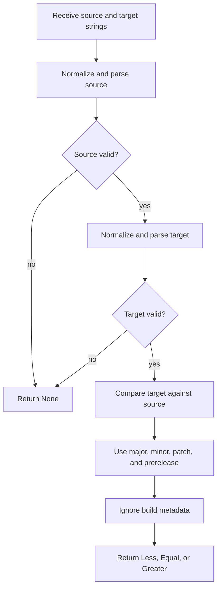
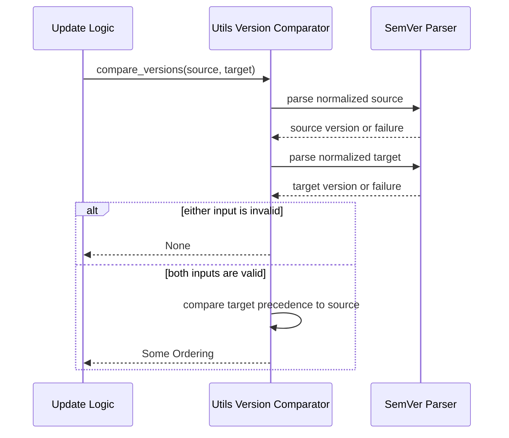

# Utils Version Comparator

Utils Version Comparator is a small, pure Rust utility in the OpenFrame client agent. It normalizes externally supplied version strings, parses them as Semantic Versioning values, and compares releases according to SemVer *precedence*. Its principal role is to make update decisions deterministic: a target that compares as `Less` than the installed version is a downgrade, `Equal` is equivalent for upgrade selection, and `Greater` is a newer target.

The implementation is supplied by the OpenFrame OSS Library as part of the `openframe_agent_lib` Cargo dependency consumed by this repository. The authoritative source is [version comparator source](https://github.com/flamingo-stack/openframe-oss-lib/blob/16e7c1cbd9664e7d10ec5ebca7d53c9bd314decf/clients/openframe-client/src/utils/version_comparator.rs).

## Responsibilities and boundaries

| Responsibility | Behavior |
| --- | --- |
| Input normalization | Trims leading and trailing whitespace and removes at most one leading lowercase `v` or uppercase `V`. |
| Validation and parsing | Delegates parsing to `semver::Version`; malformed or incomplete versions return `None`. |
| SemVer precedence | Compares major, minor, patch, and prerelease components while deliberately ignoring build metadata. |
| Update orientation | Compares the requested target against the current source version, so the result directly describes the proposed transition. |

The module has no I/O, persistence, network calls, mutable shared state, configuration, or platform-specific behavior. It does not choose an update policy or initiate an update; callers must decide how to handle invalid input and each `Ordering` result.

## Position in the client agent

The module belongs to the `utils` area of the OpenFrame client agent. It is intentionally isolated from the installation, download, binary replacement, and update-state mechanisms. Those higher-level components may supply a current and target version, while Utils Version Comparator supplies only the ordering needed to classify their relationship.



The update-oriented client modules identified in the module tree include Client Update Service, Client Info Service, Tool Agent Update Service, and Update Handler Service. This diagram describes the utility's architectural boundary, rather than asserting direct calls from those modules: the supplied source does not expose its call sites.

## Public API

```rust
pub fn parse_version(raw: &str) -> Option<semver::Version>
pub fn precedence(a: &semver::Version, b: &semver::Version) -> std::cmp::Ordering
pub fn compare_versions(from: &str, to: &str) -> Option<std::cmp::Ordering>
```

### `parse_version`

`parse_version` accepts an input string and returns a parsed `semver::Version` when it is valid after lightweight normalization.

1. It removes surrounding whitespace with `trim`.
2. It strips one leading `v` or `V`, if present.
3. It invokes `Version::parse` on the resulting text.
4. It returns `Some(version)` when parsing succeeds, otherwise `None`.

This permits common release-label forms such as `v1.2.3`, `V1.2.3`, and whitespace-padded equivalents. It does not turn arbitrary labels into versions: a second prefix, a missing version component, or other text remains invalid unless the SemVer parser accepts it.

### `precedence`

`precedence` accepts already parsed versions and returns `std::cmp::Ordering`. It compares the following tuple in order:

1. Major version
2. Minor version
3. Patch version
4. Prerelease identifier sequence

Build metadata is intentionally excluded. This is an important distinction from relying on the `semver` crate's general `Ord` implementation: SemVer specification precedence treats `1.2.3+build.1` and `1.2.3+build.2` as equivalent in precedence, even though their metadata strings differ.

A stable release sorts later than the corresponding prerelease. For example, `1.2.3` has higher precedence than `1.2.3-rc.1`; prerelease values are otherwise ordered by the SemVer version representation.

### `compare_versions`

`compare_versions` is the convenience operation for text inputs. It parses both operands and evaluates `precedence(to, from)`.

| Returned value | Meaning for `compare_versions(from, to)` |
| --- | --- |
| `Some(Ordering::Less)` | The target has lower precedence than the source: downgrade. |
| `Some(Ordering::Equal)` | The target and source have equal SemVer precedence. Build metadata may still differ. |
| `Some(Ordering::Greater)` | The target has higher precedence than the source: upgrade. |
| `None` | At least one input could not be parsed after normalization. |

## Comparison process



## Data flow examples

| Source (`from`) | Target (`to`) | Result | Reason |
| --- | --- | --- | --- |
| `1.4.0` | `v1.5.0` | `Some(Greater)` | The target minor version is newer after prefix normalization. |
| `V2.0.0` | `1.9.9` | `Some(Less)` | The target has a lower major version. |
| `1.2.3+build.1` | `1.2.3+build.2` | `Some(Equal)` | Build metadata does not affect precedence. |
| `1.2.3-rc.1` | `1.2.3` | `Some(Greater)` | The stable target is later than its prerelease. |
| `1.2` | `1.2.3` | `None` | The source is not a complete SemVer value. |

## Maintenance guidance

- Preserve the direction of `compare_versions`: it intentionally evaluates target against source. Reversing its arguments reverses upgrade and downgrade interpretation.
- Treat `None` as invalid or unsupported input, not as an equal version. Callers should surface or handle the validation failure according to their update policy.
- Do not replace `precedence` with a direct general ordering comparison unless build metadata is explicitly meant to affect update selection.
- Keep normalization narrow. The current contract tolerates whitespace and exactly one conventional prefix, avoiding silent acceptance of unrelated version formats.
- Extend automated tests whenever the normalization or ordering contract changes, particularly for prerelease identifiers, build metadata, malformed inputs, and argument direction.

## Component interaction



## Source and delivery context

This repository is an OpenFrame OSS Tenant service and consumes the Rust agent library from the OpenFrame OSS Library. The provided component source identifies the comparator as library code executed by the repository's OpenFrame client agent rather than code owned directly by this repository. Changes to the comparator therefore belong in the linked library source and should be evaluated against the client update behavior assembled by this tenant deployment.
