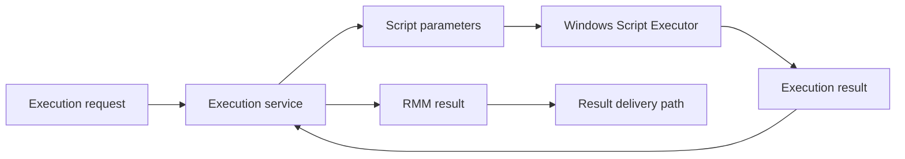
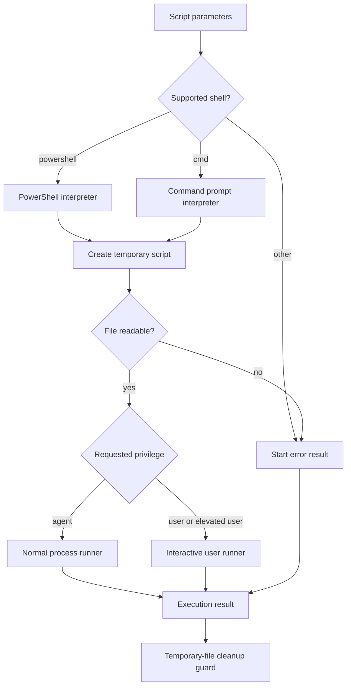
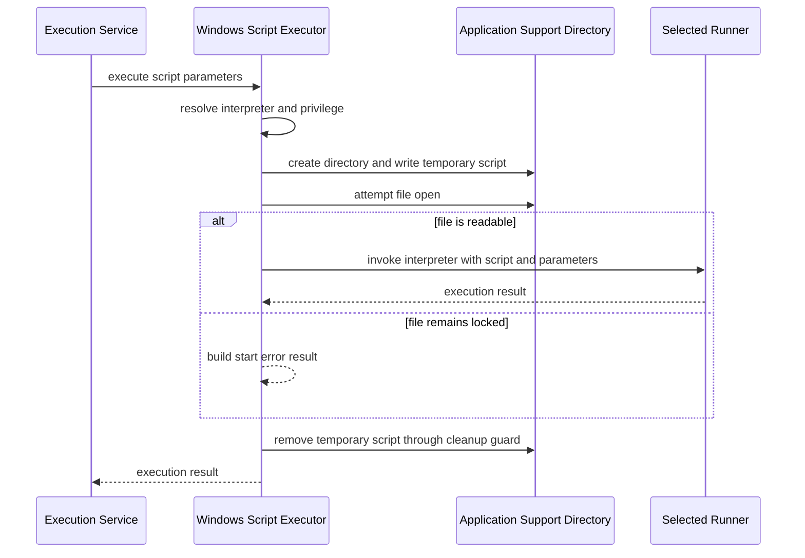
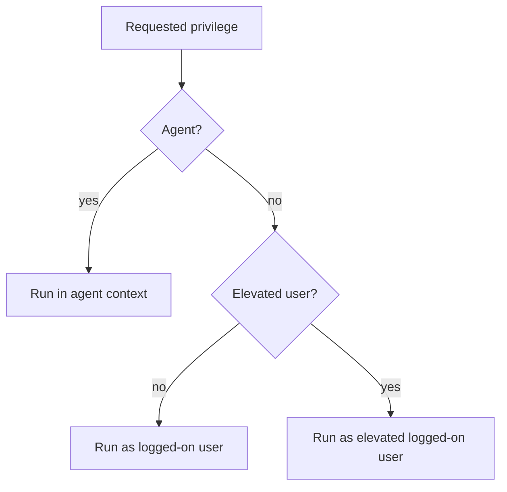

# Windows Script Executor

The Windows Script Executor is the Windows-specific execution backend for the OpenFrame Client agent. It receives a normalized script request, selects the supported Windows interpreter, materializes the script in the agent support directory, verifies that the file can be opened, and dispatches it either in the agent context or through the interactive-user elevation path.

The implementation is supplied by the OpenFrame OSS Library as part of the `openframe_agent_lib` Cargo artifact. Its public entry point is [`execute_script`](https://github.com/flamingo-stack/openframe-oss-lib/blob/16e7c1cbd9664e7d10ec5ebca7d53c9bd314decf/clients/openframe-client/src/executor/windows/mod.rs). The tenant repository assembles and runs the client that uses this library.

## Scope and Responsibilities

The module has one orchestration entry point: `execute_script`. It is responsible for:

- accepting a `ScriptParams` request containing script text, shell, arguments, timeout, requested privilege, and environment variables;
- supporting the `powershell` and `cmd` shell identifiers on Windows;
- writing the supplied script to a uniquely named temporary file in the agent application-support directory;
- removing the temporary file through a guard when execution returns;
- accounting for short-lived file locks that can occur immediately after a script is written, such as an antivirus scan;
- selecting an execution context from the requested privilege; and
- returning a normalized `ExecResult`, including standard output, standard error, exit code, and timeout state.

It does not parse or authorize a remote execution request itself. The client execution service resolves the request policy and invokes the platform executor. Result publication and transport are also handled outside this module.

## Position in the Client Execution Path

The agent's execution service converts an execution request into `ScriptParams`. A zero timeout is normalized there to 900 seconds, and other values are capped to the `u32` range before the Windows Script Executor receives them. The service treats an executor exit code of `85` as a start failure and copies the executor error text into the higher-level result error field.

The execution listener is the long-running client-side transport boundary. It starts a listener task, reconnecting after a listener error, stream end, or NATS client replacement. The exact message subscription and acknowledgement behavior are outside this module; the Windows Script Executor only consumes the already-prepared parameters supplied by the execution service.

## Architecture

### Input and Output Contract

| Element | Meaning in this module |
|---|---|
| `code` | Script source written to a temporary script file. |
| `shell` | Interpreter selector. Only `powershell` and `cmd` are accepted. |
| `args` | Command-line arguments forwarded to the selected runner. |
| `timeout_secs` | Time limit forwarded through the execution path. Timeout enforcement is implemented by the delegated runner. |
| `privilege` | Chooses agent execution, logged-on user execution, or elevated logged-on user execution. |
| `env_vars` | Environment-variable entries forwarded to the delegated runner. |
| `ExecResult` | Captures `stdout`, `stderr`, integer `retcode`, and `timed_out`. |

## Interpreter Resolution

Interpreter selection is explicit rather than inferred from the script content:

| Shell value | Executable resolution | Invocation flags | Temporary extension |
|---|---|---|---|
| `powershell` | Uses the platform PowerShell resolver. | `-NonInteractive`, `-NoProfile`, `-ExecutionPolicy Bypass`, `-File` | `ps1` |
| `cmd` | Resolves `System32\\cmd.exe`, with `cmd.exe` as fallback. | `/C` | `bat` |

PowerShell runs without a profile and non-interactively. The execution-policy bypass is applied only to the process invocation; it does not change machine-wide PowerShell policy. Any shell value other than the two listed values returns an `ExecResult` with no standard output, a descriptive error in standard error, exit code `85`, and `timed_out` set to `false`.

## Temporary Script Lifecycle

The executor writes a uniquely named file beneath the client application-support directory. It creates the directory if necessary and delegates script serialization to the shared temporary-script writer. A `TempFileGuard` is created immediately after a successful write, so the selected path is cleaned up as the execution function unwinds or returns.

### Readability Retry Policy

A just-created file can be temporarily unavailable on Windows. The executor therefore opens the temporary file before launch and retries up to three times, waiting 200 milliseconds between attempts when the OS error is transient:

- sharing violations and lock violations, represented by Windows error codes `32` and `33`; and
- access-denied error code `5`.

A lock or sharing violation that persists through the available attempts produces the start error `Script file locked by another process`. Access-denied is retried when possible, but the final helper return distinguishes persistent lock errors from other failures. This check is intentionally a readiness probe, not a guarantee that the file cannot change after the check.

## Privilege Routing

The executor converts the cross-platform privilege value into a Windows execution route:

- **Agent**: delegates to the normal Windows process runner.
- **User**: delegates to the interactive runner with the logged-on-user elevation mode.
- **Elevated User**: delegates to the interactive runner with its elevated mode. This variant is compiled only on Windows in the shared privilege model.

The module itself does not implement process creation, user-session discovery, or elevation mechanics. Those concerns are encapsulated in its private process and interactive-user runner modules. Failures from either runner are propagated as the returned `ExecResult`.

## Failure Semantics and Operational Notes

The executor reserves return code `85` for errors that prevent a script from starting, including unsupported shells, temporary-directory creation failures, script-write failures, and persistent script-file locks. This convention is significant because the execution service converts it into an explicit RMM error rather than treating it solely as a script exit status.

The implementation logs a warning before each retryable readiness delay. The warning includes the retry attempt, operating-system error, and temporary-file path, which makes antivirus or endpoint-protection interference diagnosable from agent logs.

When investigating a failed execution, distinguish these outcomes:

| Outcome | Interpretation |
|---|---|
| `retcode` is `85` | The executor could not launch the script. Inspect `stderr` for the start failure. |
| `timed_out` is `true` | A delegated runner reported timeout rather than a pre-launch failure. |
| Other exit code | The interpreter launched and returned its own process status. Review captured output. |

## Security Considerations

- The module accepts only an enumerated interpreter name, preventing arbitrary executable selection through the shell field.
- Scripts are staged in the agent application-support directory rather than an unspecified system temporary location.
- Temporary-file cleanup is scope-based, reducing persistence of script content after execution returns.
- PowerShell is launched without a profile, reducing dependence on user profile initialization and profile-side behavior.
- The executor does not independently validate script content, remote authorization, or the requested privilege. Those controls must be enforced before construction of `ScriptParams`.
- The readiness probe reduces a known race with scanners but does not eliminate concurrent access risks; endpoint security exclusions and agent-directory permissions remain operational concerns.

## Maintenance Guidance

When changing this module:

1. Preserve `85` as the pre-launch failure contract unless all higher-level result handling is updated with it.
2. Keep interpreter flags and extensions aligned. The extension determines how the temporary script is written, while the flags determine how the interpreter receives it.
3. Treat retry timing as user-visible execution latency. Changes should account for endpoint-protection behavior without turning transient locks into indefinite waits.
4. Ensure every successful temporary-file creation remains covered by a cleanup guard before any asynchronous wait or delegated execution.
5. Test both agent-context and interactive-user paths on supported Windows environments, including a host where a scanner briefly locks newly written files.

## Source

The authoritative implementation is maintained in the OpenFrame OSS Library:

- [`clients/openframe-client/src/executor/windows/mod.rs`](https://github.com/flamingo-stack/openframe-oss-lib/blob/16e7c1cbd9664e7d10ec5ebca7d53c9bd314decf/clients/openframe-client/src/executor/windows/mod.rs)
