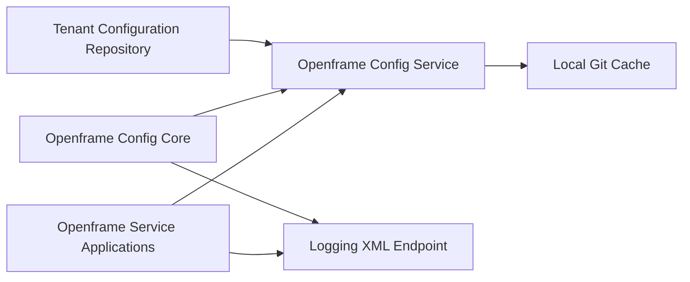
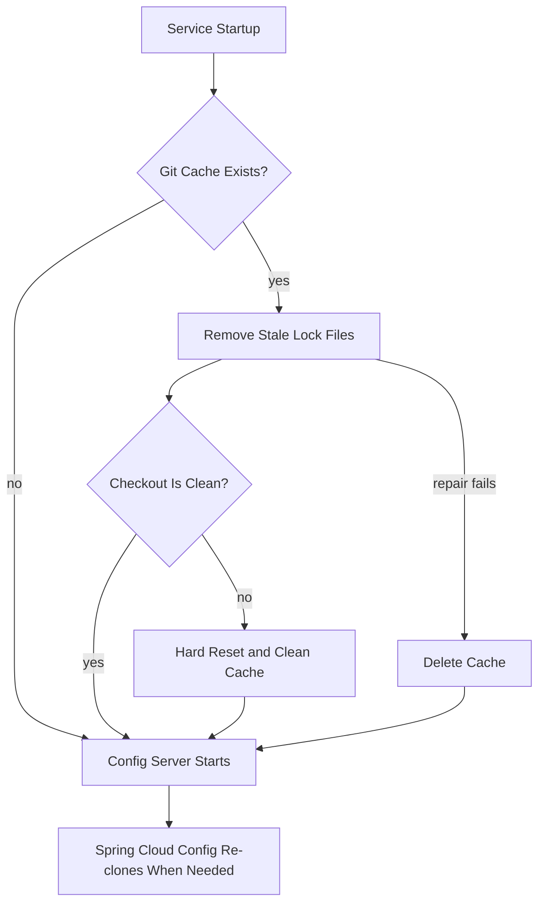
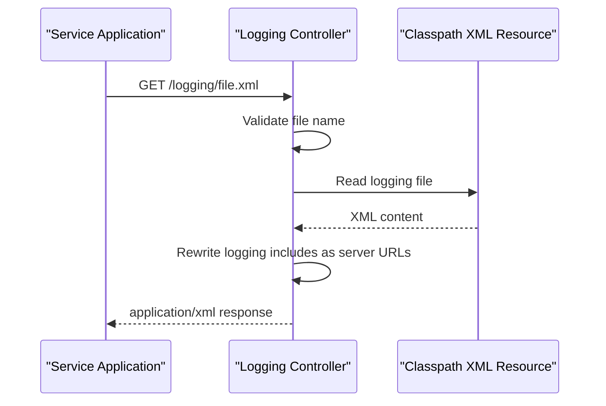
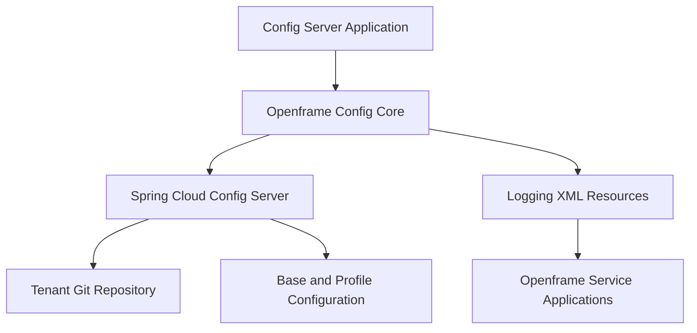

# Openframe Config Core

Openframe Config Core supplies the configuration-server capabilities used by the tenant's `openframe-config` service. The service application is deliberately thin: `ConfigServerApplication` starts Spring Boot, while this library enables Spring Cloud Config, serves reusable Logback XML, and repairs a persistent Git working copy before it can cause configuration requests to fail.

The tenant consumes `com.openframe.oss:openframe-config-core` version `7.0.11` through its `openframe-config` Maven module. At deployment time the service reads configuration from the `flamingo-stack/openframe-oss-tenant` Git repository, using `configs/base` and a profile-specific configuration directory. Its application configuration binds the HTTP server to port `8888` and the management server to port `8889`.

## Responsibilities

- **Enable centralized configuration:** `ConfigServerConfiguration` activates Spring Cloud Config Server in the running service.
- **Serve reusable logging definitions:** `LoggingConfigController` returns packaged Logback XML under the `/logging` path and rewrites classpath includes to server URLs so nested configurations resolve remotely.
- **Recover the Config Server Git cache:** `ConfigGitCacheRepair` removes stale Git lock files and resets dirty checkouts before the application accepts requests. If recovery fails, it deletes the cache so Spring Cloud Config can clone it again.

## Architecture

The service-specific bootstrap application comes from this repository, while the three runtime components below come from the OpenFrame OSS Library artifact. The Config Server itself is configured to clone on startup, search the base directory first, and then apply profile-specific configuration. The base configuration directs services to retrieve their logging configuration from the Config Server's `/logging/shared-logback-spring-logfmt.xml` resource.

## Runtime Lifecycle

`ConfigGitCacheRepair` is conditional on `spring.cloud.config.server.git.basedir`. When a configured cache contains a Git repository, it runs at post-construction time, before the embedded server begins handling requests. It recursively locates regular files ending in `.lock`, deletes them, and checks repository status using JGit. A dirty repository is hard-reset and cleaned, including untracked directories. An I/O, JGit, or runtime failure during repair triggers a full cache deletion rather than leaving a partially usable checkout.

## Components

### Config Server Configuration

[`ConfigServerConfiguration`](https://github.com/flamingo-stack/openframe-oss-lib/blob/16e7c1cbd9664e7d10ec5ebca7d53c9bd314decf/openframe-config-core/src/main/java/com/openframe/config/core/ConfigServerConfiguration.java) is the activation point for Spring Cloud Config Server. It is a Spring configuration class annotated with `EnableConfigServer`; it contains no tenant-specific routing, persistence, or policy logic. Repository selection, default branch, credentials, clone behavior, and search paths remain deployment configuration supplied by the Openframe Config service.

The tenant-side [service configuration](https://github.com/flamingo-stack/openframe-oss-tenant/blob/main/openframe/services/openframe-config/src/main/resources/application.yml) configures:

- the repository URI as `https://github.com/flamingo-stack/openframe-oss-tenant`;
- the default label through `CONFIG_GIT_BRANCH`, defaulting to `main`;
- base-first lookup through `configs/base,configs/{profile}`; and
- clone-on-start behavior.

### Logging Configuration Controller

[`LoggingConfigController`](https://github.com/flamingo-stack/openframe-oss-lib/blob/16e7c1cbd9664e7d10ec5ebca7d53c9bd314decf/openframe-config-core/src/main/java/com/openframe/config/controller/LoggingConfigController.java) exposes a read-only XML endpoint:

| Request | Response | Behavior |
|---|---|---|
| `GET /logging/{filename}` | `application/xml` | Returns a packaged Logback XML configuration when the requested resource exists and the file name passes validation. |

The controller applies the allow-list pattern `[a-z0-9-]+\.xml`. This limits requests to lower-case names, digits, hyphens, and the XML extension; it prevents the path variable from selecting unrelated classpath resources. Missing or disallowed files produce a `404 Not Found` response and a warning log entry.

Before returning a valid resource, the controller replaces classpath logging includes that begin with `logging/` with an HTTP URL rooted at the current request's context path. This matters because the consuming service loads logging XML over HTTP: subsequent includes must resolve from the Config Server, not from the consumer's classpath.

### Config Git Cache Repair

[`ConfigGitCacheRepair`](https://github.com/flamingo-stack/openframe-oss-lib/blob/16e7c1cbd9664e7d10ec5ebca7d53c9bd314decf/openframe-config-core/src/main/java/com/openframe/config/core/ConfigGitCacheRepair.java) protects availability where Spring Cloud Config uses a persistent Git base directory. An interrupted JGit branch switch can leave lock files or a partial checkout that prevents later requests from completing. The repair component handles this condition during startup, when the application is the only process expected to access the clone.

Its fallback is intentionally destructive: if targeted repair cannot complete, it removes the configured cache directory. The component relies on Spring Cloud Config to recreate the clone later. Operators should therefore treat the cache as reconstructible state, not an authoritative configuration source.

## Service Integration

The Openframe Config service starts through [`ConfigServerApplication`](https://github.com/flamingo-stack/openframe-oss-tenant/blob/main/openframe/services/openframe-config/src/main/java/com/openframe/config/ConfigServerApplication.java), which uses standard Spring Boot application startup. Its Maven module declares Openframe Config Core as its only direct service dependency, keeping the tenant application focused on composition and configuration.

The common tenant configuration supplies the logging URL consumed by service applications and defines common data-source, monitoring, security, and platform properties. The Config Server's own logging configuration remains local at startup, using `classpath:logging/shared-logback-spring.xml`, so it can initialize before remote logging resources are requested.

## Operational Considerations

- Configure a persistent `spring.cloud.config.server.git.basedir` only when the deployment supports it. Doing so activates cache repair on startup.
- The Git cache may be reset or deleted after an interrupted operation. Do not store manual changes only in the cache; commit intended configuration to the repository.
- Add packaged logging resources using lower-case, digit, and hyphen file names ending in `.xml`, or the logging endpoint will reject them.
- Preserve relative `logging/` include references in shared Logback files when remote resolution is required; the controller rewrites only those classpath include prefixes.
- Review the [Openframe Config deployment values](https://github.com/flamingo-stack/openframe-oss-tenant/blob/main/manifests/platform/openframe-config/values.yaml) when changing runtime resources, Git branch injection, or pod security settings.
