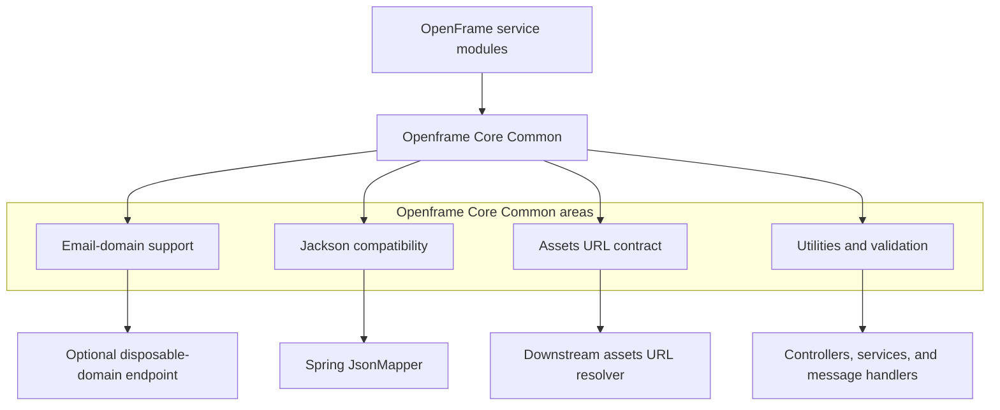
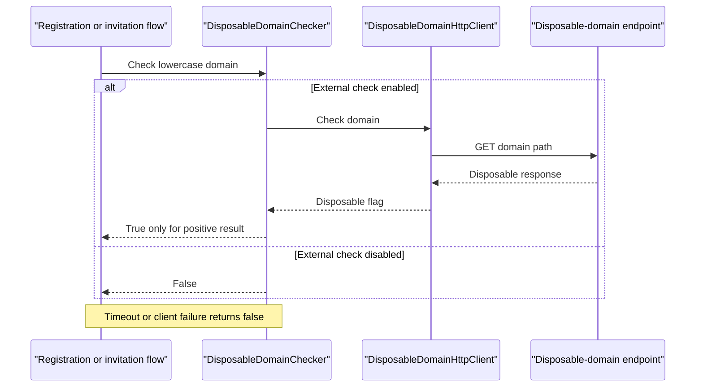
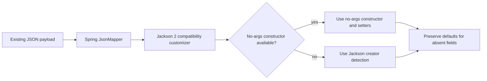

# Openframe Core Common

Openframe Core Common is the small, dependency-conscious foundation supplied by the `com.openframe.oss:openframe-core` library. In this tenant repository it is consumed at version `7.0.11` by the service modules. It provides cross-cutting behavior rather than a runnable service: email-domain policy support, Jackson 2-compatible deserialization, an assets URL extension point, resilient connection-disconnect classification, text handling, and portable validation primitives.

The code described here is supplied by [OpenFrame OSS Library](https://github.com/flamingo-stack/openframe-oss-lib) and assembled into this repository's services through the Openframe Core Common dependency. Its deliberately narrow API lets higher-level services share conventions without taking dependencies on transport-specific or persistence-specific modules.

## Responsibilities

| Area | Responsibility | Principal components |
| --- | --- | --- |
| Email-domain checks | Supplies configuration and an optional bounded external lookup for disposable email domains. | `EmailDomainPolicyProperties`, `DisposableDomainChecker`, `KickboxDisposableDomainChecker`, `NoopDisposableDomainChecker` |
| JSON compatibility | Restores Jackson 2 constructor-selection behavior when reading existing payloads with Jackson 3. | `Jackson2CompatibilityAutoConfiguration`, `PreferNoArgsConstructorIntrospector` |
| Cross-module extension | Defines the dynamically resolved assets-base-URL contract without importing the NATS messaging implementation. | `AssetsBaseUrlProvider` |
| HTTP resilience | Recognizes expected client disconnects across wrapped Reactor and Netty errors. | `ClientDisconnectClassifier` |
| Text and simple validation | Sanitizes notification text, normalizes strings, validates email syntax, and supplies reusable tool-argument predicates. | `PlainText`, `Strings`, `ValidEmailValidator`, `ToolArgumentValueKind`, `ToolArgumentValuePatterns`, `ToolArgumentNormalizationPatterns` |

## Architecture Overview

The module is upstream of service-level policies and request processing. It does not determine registration or invitation workflows itself; instead, it supplies the checker, configuration, and validation building blocks those workflows use. Similarly, it does not implement download-link resolution: `AssetsBaseUrlProvider` is an interface intentionally placed here so downstream implementations do not need a dependency on a messaging binder.

## Email-Domain Policy Support

The email package separates policy configuration, external transport, and lookup behavior.

- `EmailDomainPolicyProperties` binds `openframe.email-domain-policy`. The policy is enabled by default and contains blocked-domain and allowed-domain sets. The bundled library defaults provide the initial blocked-domain list; a deployment may override the sets in its configuration.
- `DisposableDomainChecker` is the lookup seam. Its contract requires **fail-open** behavior: an unavailable or malformed third-party response must return `false`, so it cannot independently prevent registration or invitation.
- `DisposableDomainClientConfig` conditionally creates a declarative `DisposableDomainHttpClient` when `openframe.email-domain-policy.disposable-check.enabled` is `true` or unspecified. It applies the configured timeout to both connection and read operations and configures the client with the Jackson compatibility converters.
- `DisposableDomainHttpClient` performs a `GET` request for the domain path segment and maps the JSON response to `DisposableDomainResponse`.
- `KickboxDisposableDomainChecker` calls that client and treats any exception as an allowed result after logging a warning. `NoopDisposableDomainChecker` is selected only when the external check is explicitly disabled and always reports a domain as non-disposable.

### Disposable-Domain Lookup Flow

### Configuration Surface

| Property | Default | Effect |
| --- | --- | --- |
| `openframe.email-domain-policy.enabled` | `true` | Enables or disables the surrounding domain-policy behavior. |
| `openframe.email-domain-policy.blocked-domains` | Bundled defaults | Defines domains blocked by the policy. |
| `openframe.email-domain-policy.allowed-domains` | Empty set | Creates deployment-specific exceptions to blocked domains. |
| `openframe.email-domain-policy.disposable-check.enabled` | `true` | Selects the external checker or the no-op checker. |
| `openframe.email-domain-policy.disposable-check.url` | Kickbox open endpoint | Supplies the base URL used by the declarative client. |
| `openframe.email-domain-policy.disposable-check.timeout-ms` | `1500` | Caps each connection and read operation in milliseconds. |

The default endpoint and timeout are defined by [EmailDomainPolicyProperties](https://github.com/flamingo-stack/openframe-oss-lib/blob/16e7c1cbd9664e7d10ec5ebca7d53c9bd314decf/openframe-core/src/main/java/com/openframe/core/email/EmailDomainPolicyProperties.java). When configuring a self-hosted deployment, treat the remote checker as an additive signal only: the implementation's availability semantics are intentionally non-blocking.

## Jackson Compatibility

`Jackson2CompatibilityAutoConfiguration` registers a highest-precedence Spring `JsonMapperBuilderCustomizer`. It applies the library's Jackson 2 compatibility behavior before Spring Boot's own customization, while still allowing an explicit Spring deserialization setting to take precedence.

`PreferNoArgsConstructorIntrospector` addresses a Jackson 3 behavior difference. If a non-record type has both a no-argument constructor and an argument-bearing constructor, it disables implicit use of the latter so deserialization proceeds through the no-argument constructor and setters. This preserves field initializers and builder defaults when older JSON omits newly introduced fields. Explicit `JsonCreator` declarations, records, and types with no no-argument constructor keep Jackson's normal creator detection.

## Assets URL Extension Point

`AssetsBaseUrlProvider` is a minimal interface with one method, `getAssetsBaseUrl()`. A deployment can provide a bean that derives an assets base URL dynamically, for example from tenant context. The contract permits a blank or null return value; the downstream download-link resolver then uses its static `openframe.assets.base-url` property fallback.

The interface intentionally has no implementation in Openframe Core Common. This avoids forcing services that only need the contract to bring a Spring Cloud Stream binder onto their classpath. The detailed resolver belongs to the messaging layer, not this shared module.

## Utility and Validation Components

### Connection Classification

`ClientDisconnectClassifier.isClientDisconnect` unwraps Reactor exceptions and walks the causal chain without revisiting the same throwable. It classifies Netty aborted and premature-close errors, closed channels, and I/O errors whose messages indicate a broken pipe, reset connection, premature close, or closed connection. Callers can use that result to distinguish an expected peer disconnect from a server-side failure in logging or error handling.

### Plain Text and Strings

`PlainText` creates single-line notification-safe text from user-authored markup:

1. It strips HTML-like tags and reduces Markdown images, links, emphasis, code, headings, block quotes, and list markers to their text content.
2. It collapses whitespace and returns `null` when the normalized result has no text.
3. It can generate character-limited or UTF-8 byte-limited excerpts using an ellipsis, avoiding surrogate-pair splits and backing off from partial words when possible.

`Strings.lowerTrimmed` returns a trimmed, locale-stable lowercase value when input has text; otherwise it returns `null`. This is useful for canonicalizing case-insensitive inputs such as domain names.

### Email and Tool Argument Predicates

`ValidEmailValidator` implements the `ValidEmail` constraint by compiling the annotation-provided regular expression during initialization and matching non-null values against it.

The tool-argument validation types are SDK-independent primitives:

- `ToolArgumentValueKind` identifies `NON_NULL`, text-presence, trimmed-content, and regular-expression predicate categories.
- `ToolArgumentValuePatterns` evaluates string predicates and caches compiled patterns in a concurrent map. It also exposes an environment-entry expression requiring a non-leading-equals key followed by an equals delimiter.
- `ToolArgumentNormalizationPatterns` derives expressions that accept trimmed values and Unicode case variants while normalizing to existing uppercase enum names or lowercase character classes. It only transforms anchored expressions whose bodies match its supported class-expression form; unsupported patterns return an empty result rather than being rewritten incorrectly.

## Integration Guidance

- Keep email-domain decisions at the application-policy layer. The shared checker only provides a disposable-domain signal and is explicitly designed to fail open.
- Use the Spring-managed JSON mapper so the compatibility auto-configuration participates in deserialization. Avoid duplicating constructor-selection workarounds in individual services.
- Implement `AssetsBaseUrlProvider` only in a layer that can determine tenant-aware values. Return blank or null when the static configuration fallback should apply.
- Use `PlainText.excerptToBytes` where downstream transports enforce byte limits, and `sanitizeAndExcerpt` where content first needs markup removal.
- Treat `ClientDisconnectClassifier` as a logging and classification aid, not as authorization or request-validation logic.

## Source Components

The following representative source files define the public behavior documented here:

- [DisposableDomainChecker](https://github.com/flamingo-stack/openframe-oss-lib/blob/16e7c1cbd9664e7d10ec5ebca7d53c9bd314decf/openframe-core/src/main/java/com/openframe/core/email/DisposableDomainChecker.java)
- [KickboxDisposableDomainChecker](https://github.com/flamingo-stack/openframe-oss-lib/blob/16e7c1cbd9664e7d10ec5ebca7d53c9bd314decf/openframe-core/src/main/java/com/openframe/core/email/KickboxDisposableDomainChecker.java)
- [Jackson2CompatibilityAutoConfiguration](https://github.com/flamingo-stack/openframe-oss-lib/blob/16e7c1cbd9664e7d10ec5ebca7d53c9bd314decf/openframe-core/src/main/java/com/openframe/core/jackson/Jackson2CompatibilityAutoConfiguration.java)
- [AssetsBaseUrlProvider](https://github.com/flamingo-stack/openframe-oss-lib/blob/16e7c1cbd9664e7d10ec5ebca7d53c9bd314decf/openframe-core/src/main/java/com/openframe/core/service/AssetsBaseUrlProvider.java)
- [PlainText](https://github.com/flamingo-stack/openframe-oss-lib/blob/16e7c1cbd9664e7d10ec5ebca7d53c9bd314decf/openframe-core/src/main/java/com/openframe/core/util/PlainText.java)
- [ToolArgumentNormalizationPatterns](https://github.com/flamingo-stack/openframe-oss-lib/blob/16e7c1cbd9664e7d10ec5ebca7d53c9bd314decf/openframe-core/src/main/java/com/openframe/core/validation/tool/ToolArgumentNormalizationPatterns.java)
