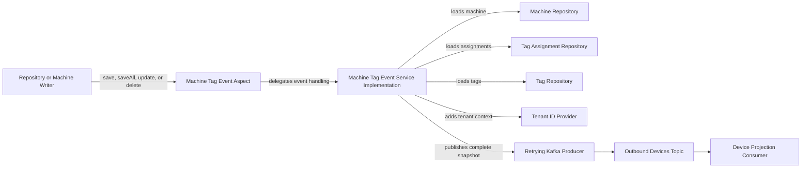
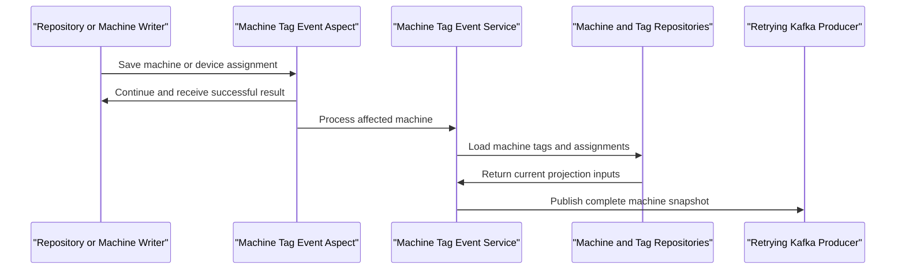
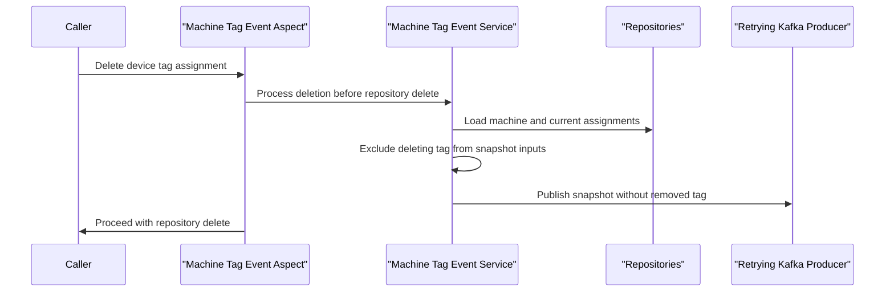

# Openframe Data Device Aspect

Openframe Data Device Aspect is a Spring AOP integration supplied by the OpenFrame OSS Library artifact `com.openframe.oss:openframe-data-device-aspect` at version `7.0.11`. It observes changes to device records and device tag metadata, reconstructs the affected device's searchable representation, and publishes a `MachinePinotMessage` to the configured outbound Kafka topic. This keeps a downstream device projection synchronized without requiring repository callers to publish an event explicitly.

The implementation runs in this tenant through the OpenFrame OSS Library dependency. Its source is maintained in the library repository:

- [Machine Tag Event Aspect](https://github.com/flamingo-stack/openframe-oss-lib/blob/16e7c1cbd9664e7d10ec5ebca7d53c9bd314decf/openframe-data-device-aspect/src/main/java/com/openframe/data/aspect/MachineTagEventAspect.java)
- [Machine Tag Event Service Implementation](https://github.com/flamingo-stack/openframe-oss-lib/blob/16e7c1cbd9664e7d10ec5ebca7d53c9bd314decf/openframe-data-device-aspect/src/main/java/com/openframe/data/service/impl/MachineTagEventServiceImpl.java)

## Purpose and Scope

The module keeps a derived device projection synchronized with changes made through the synchronous data layer. It covers three source entities:

- **Machine** changes, including repository saves and field-scoped writes through `MachineWriter`.
- **Tag assignment** changes for the `DEVICE` entity type.
- **Tag** updates, which affect every device that holds the changed tag.

Its output is a complete device snapshot rather than a small delta. Each message includes tenant and device identity, organization, device state, connectivity, operating-system type, tag keys, tag key/value pairs, directory-source names, directory-user-link state, and an ingestion timestamp.

## Architecture

The aspect and service are enabled together by `openframe.device.aspect.enabled`. The property defaults to enabled because both components use `matchIfMissing = true`; setting it to `false` disables interception and message publication. The Kafka destination is read from `openframe.oss-tenant.kafka.topics.outbound.devices-topic`.

## Component Responsibilities

### Machine Tag Event Aspect

`MachineTagEventAspect` is the boundary between persistence operations and event processing. It targets repository and writer method signatures rather than requiring each caller to know about the projection pipeline.

| Intercepted operation | Advice timing | Delegated action |
|---|---|---|
| `MachineRepository.save` | After a successful return | Processes the saved machine. |
| `MachineRepository.saveAll` | After a successful return | Processes every supplied machine. |
| `MachineWriter.update` | After a successful return | Accepts only an optional `MachineWriteResult`; when present, publishes its post-update machine image. |
| `TagAssignmentRepository.save` and `saveAll` | After a successful return | Rebuilds the affected device projection for device assignments. |
| Device tag-assignment deletion | Around the delete call | Captures and publishes a representation that excludes the assignment before deletion proceeds. |
| Deletion of every assignment for a tag | Around the delete call | Finds affected devices and publishes each representation without the deleting tag. |
| `TagRepository.save` and `saveAll` | Around the save call | Runs the repository call first, then reprocesses devices using the changed persisted tag. |

The distinction between advice types is deliberate. Standard saves are observed after they return. Deletions need the association to remain queryable so the service can determine affected devices and calculate the remaining tags. Tag saves use around advice so notification occurs only after the repository operation succeeds.

The aspect catches and logs failures in post-save and pre-delete processing to avoid turning auxiliary projection publication into a repository-operation failure. In contrast, exceptions from tag-save advice are logged and rethrown after the repository invocation path, preserving failure behavior for that write.

### Machine Tag Event Service Implementation

`MachineTagEventServiceImpl` owns projection construction and publication. Its dependencies define its workflow:

1. Resolve the affected machine through `MachineRepository` when a tag event identifies only a device identifier.
2. Read device tag assignments and resolve the referenced tags through `TagAssignmentRepository` and `TagRepository`.
3. Combine the machine, tags, assignments, and the current tenant identifier into `MachinePinotMessage`.
4. Publish the snapshot with the machine identifier as the Kafka key through `OssTenantRetryingKafkaProducer`.

The service handles machine saves directly. For device tag assignments it ignores assignments whose entity type is not `DEVICE`. Bulk assignment saves deduplicate by device identifier so several assignments in one input collection produce at most one rebuilt snapshot per device.

A tag update takes the inverse path: the service finds every device assigned to the tag, rebuilds each device's complete tag set, and publishes one message per affected machine. This ensures a renamed or otherwise changed tag is reflected on all devices that use it.

## Projection Data and Tag Semantics

The built message contains both `tags` and `tagKeyValues`:

- `tags` contains non-null tag keys for facet-like key lookup.
- `tagKeyValues` contains one `key:value` entry for every value in a matching `TagAssignment`.
- Multiple assignment values result in multiple `key:value` entries.
- Duplicate assignment identifiers are collapsed while building the assignment lookup; the first encountered assignment is retained.

Directory fields are normalized for consumers. Directory source enums become their names. A missing directory user link is emitted as `NONE`, rather than `null`, so devices without a user link remain countable in a user facet.

## Save and Delete Flows

### Machine or Tag Assignment Save

For a `MachineWriter.update`, the aspect uses the `after` image held in `MachineWriteResult`. It does not publish when the result is empty, which represents either no matching device or a rejected guarded update. This prevents indexing a pre-update document or announcing a change that was not applied.

### Tag Assignment Deletion

Deleting all assignments for a tag follows the same pattern for every affected device. Capturing the inputs before deletion is essential: once the association is removed, the service can no longer discover every device that must be reindexed from that association alone.

## Operational Characteristics

- **Activation:** enabled by default; set `openframe.device.aspect.enabled` to `false` to suppress the aspect and service.
- **Tenant isolation:** every message receives its tenant identifier from `TenantIdProvider`, not from the machine record.
- **Ordering key:** Kafka publication uses the machine identifier as the record key, grouping updates for an individual device at the producer partitioning boundary.
- **Error handling:** processing errors are logged. A failed lookup or publication does not retry in this module directly; the configured retrying producer is responsible for producer-side retry behavior.
- **Bulk work:** machine saves are processed one by one; bulk device tag assignments are deduplicated by affected machine; a tag update or bulk tag deletion may fan out to every assigned machine.

## Relationship to the Tenant Runtime

This repository consumes Openframe Data Device Aspect from the OpenFrame OSS Library alongside Mongo data modules, the stream service core, and the OpenFrame API service core. The aspect sits on the write side of device and tag persistence. The generated Kafka records are intended for downstream device-projection processing, while API and external API layers expose device information to clients. The module itself does not define an HTTP endpoint, persistence collection, or Kafka consumer.

The tenant deployment configures Kafka as a shared datasource and starts the stream service separately. Refer to the platform documentation for runtime configuration and downstream Kafka-processing topology.

## Maintenance Notes

When changing repository method signatures, verify that the pointcuts still match the intended save, update, and delete methods. When adding a new way to mutate a machine's indexed fields or device tags, either route it through an intercepted operation or add a corresponding interception point.

When modifying `MachinePinotMessage` fields, update the builder logic as a coherent snapshot contract. In particular, changes to tag key or value normalization affect search and facet behavior, and changes to delete sequencing can leave stale tags in downstream projections.

The module tree defines no child submodules for Openframe Data Device Aspect, so this document covers both supplied components together.
