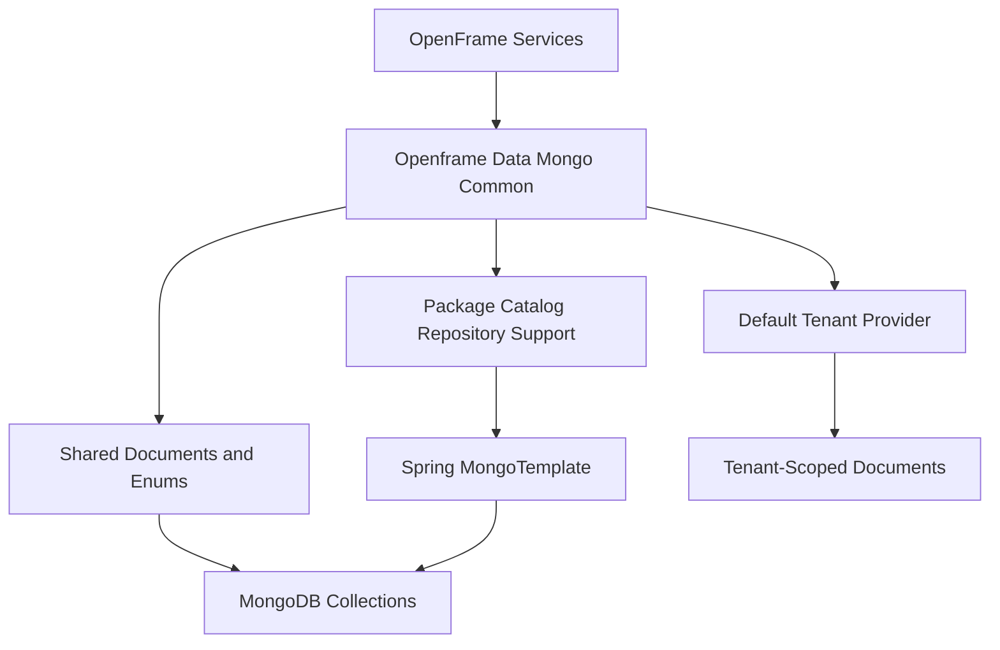
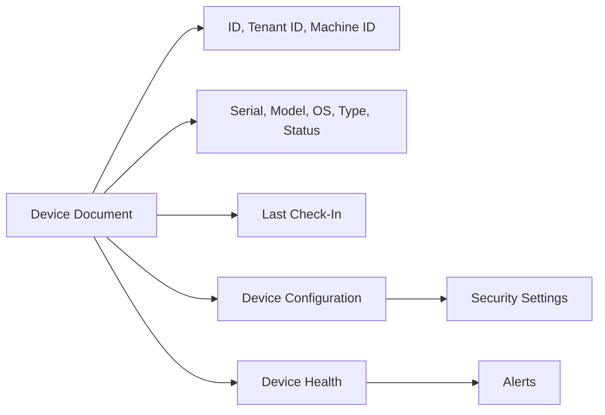
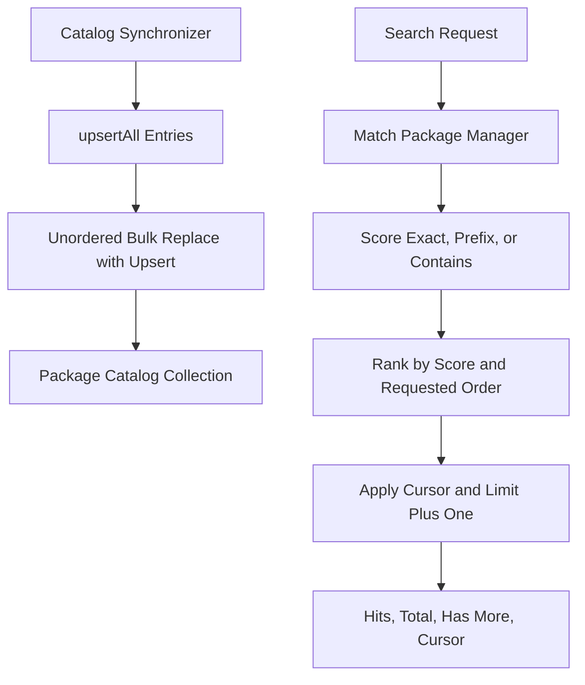

# Openframe Data Mongo Common

Openframe Data Mongo Common is the shared MongoDB domain-model and repository-support artifact used by OpenFrame services. It is supplied by the **OpenFrame OSS Library** as Maven artifact `com.openframe.oss:openframe-data-mongo-common` at version `7.0.11`; this tenant repository consumes it rather than defining its source. The module establishes portable document fragments, stable workflow enums, a tenant identifier fallback, and custom package-catalog persistence behavior that other Mongo modules assemble into service-specific repositories.

The source is maintained in the OpenFrame OSS Library. This document links to the verified source revision used by the artifact.

## Responsibilities

- Define the tenant-scoped `Device` Mongo document and its embedded configuration, health, alert, and security structures.
- Supply shared state vocabularies for client installation, connector failures, compliance, security, onboarding, tickets, and tool agents.
- Model embedded organization contact information without creating independent Mongo collections.
- Define notification-history retention as a 30-day Mongo TTL duration.
- Provide bulk upsert and ranked, cursor-paginated name search for package catalog entries.
- Supply a default `TenantIdProvider` that resolves `TENANT_ID`, falling back to `oss` when no application-specific provider exists.

## Architecture

The module intentionally separates reusable data vocabulary from operational persistence configuration. The neighboring **Openframe Data Mongo Sync** module contributes synchronous Mongo configuration and concrete domain repositories, while **Openframe Data Mongo Reactive** provides reactive repositories. This module is their shared model-level dependency.

## Device Domain

The central document is [`Device`](https://github.com/flamingo-stack/openframe-oss-lib/blob/16e7c1cbd9664e7d10ec5ebca7d53c9bd314decf/openframe-data-mongo-common/src/main/java/com/openframe/data/document/device/Device.java). It is stored in the `devices` collection, has a Mongo identifier, and implements the library's tenant-scoping contract. `tenantId` is indexed, enabling tenant-oriented retrieval. The document records a link to a machine, hardware and operating-system details, operational status and type, a last-check-in timestamp, plus embedded configuration and health snapshots.

### Embedded device structures

| Type | Role |
|---|---|
| [`DeviceConfiguration`](https://github.com/flamingo-stack/openframe-oss-lib/blob/16e7c1cbd9664e7d10ec5ebca7d53c9bd314decf/openframe-data-mongo-common/src/main/java/com/openframe/data/document/device/DeviceConfiguration.java) | Captures generic settings, installed software, network configuration, and nested security settings. |
| [`DeviceHealth`](https://github.com/flamingo-stack/openframe-oss-lib/blob/16e7c1cbd9664e7d10ec5ebca7d53c9bd314decf/openframe-data-mongo-common/src/main/java/com/openframe/data/document/device/DeviceHealth.java) | Holds CPU, memory, and disk usage, active processes, and operational alerts. |
| [`Alert`](https://github.com/flamingo-stack/openframe-oss-lib/blob/16e7c1cbd9664e7d10ec5ebca7d53c9bd314decf/openframe-data-mongo-common/src/main/java/com/openframe/data/document/device/Alert.java) | Represents an operational alert with severity, message, timestamp, and resolution flag. |
| [`SecuritySettings`](https://github.com/flamingo-stack/openframe-oss-lib/blob/16e7c1cbd9664e7d10ec5ebca7d53c9bd314decf/openframe-data-mongo-common/src/main/java/com/openframe/data/document/device/SecuritySettings.java) | Records firewall and antivirus state, encryption status, a security-scan value, and policy settings. |
| [`SecurityAlert`](https://github.com/flamingo-stack/openframe-oss-lib/blob/16e7c1cbd9664e7d10ec5ebca7d53c9bd314decf/openframe-data-mongo-common/src/main/java/com/openframe/data/document/device/SecurityAlert.java) | Represents a security finding with detection and optional resolution timestamps and resolution detail. |
| [`ComplianceRequirement`](https://github.com/flamingo-stack/openframe-oss-lib/blob/16e7c1cbd9664e7d10ec5ebca7d53c9bd314decf/openframe-data-mongo-common/src/main/java/com/openframe/data/document/device/ComplianceRequirement.java) | Tracks the standard, control, result, details, and most recent check for one compliance requirement. |
| [`RequiredTools`](https://github.com/flamingo-stack/openframe-oss-lib/blob/16e7c1cbd9664e7d10ec5ebca7d53c9bd314decf/openframe-data-mongo-common/src/main/java/com/openframe/data/document/device/RequiredTools.java) | Defines Fleet MDM and MeshCentral as the tool connections required before a device counts as managed. |

`ComplianceState` supports `COMPLIANT`, `NON_COMPLIANT`, `IN_REMEDIATION`, and `UNKNOWN`. `SecurityState` uses `COMPLIANT`, `NON_COMPLIANT`, and `UNKNOWN`. These enums prevent ad hoc status values at persistence boundaries.

## Shared workflow vocabulary

The following types are shared persisted values and should be extended cautiously because consumers may rely on their exact serialized names.

| Area | Types and values |
|---|---|
| Client installation | [`InstallationType`](https://github.com/flamingo-stack/openframe-oss-lib/blob/16e7c1cbd9664e7d10ec5ebca7d53c9bd314decf/openframe-data-mongo-common/src/main/java/com/openframe/data/document/clientconfiguration/InstallationType.java): `STANDARD`, `GUI_APP`, `SERVICE`. |
| Connector failures | [`ConnectorAlertType`](https://github.com/flamingo-stack/openframe-oss-lib/blob/16e7c1cbd9664e7d10ec5ebca7d53c9bd314decf/openframe-data-mongo-common/src/main/java/com/openframe/data/document/connector/ConnectorAlertType.java): retry exhaustion or a non-recoverable error. |
| Tenant onboarding | [`TenantOnboardingStep`](https://github.com/flamingo-stack/openframe-oss-lib/blob/16e7c1cbd9664e7d10ec5ebca7d53c9bd314decf/openframe-data-mongo-common/src/main/java/com/openframe/data/document/onboarding/TenantOnboardingStep.java): MSP setup, customer setup, device management, and meeting Mingo. |
| User onboarding | [`UserOnboardingStep`](https://github.com/flamingo-stack/openframe-oss-lib/blob/16e7c1cbd9664e7d10ec5ebca7d53c9bd314decf/openframe-data-mongo-common/src/main/java/com/openframe/data/document/onboarding/UserOnboardingStep.java): Mingo, devices, tickets, scripting, monitoring, logging, incidents, and knowledge management. |
| Ticket activity | [`TicketActivityState`](https://github.com/flamingo-stack/openframe-oss-lib/blob/16e7c1cbd9664e7d10ec5ebca7d53c9bd314decf/openframe-data-mongo-common/src/main/java/com/openframe/data/document/ticket/TicketActivityState.java): AI working, awaiting an external actor, or idle. |
| Tool agent lifecycle | [`IntegratedToolInstallationTaskStatus`](https://github.com/flamingo-stack/openframe-oss-lib/blob/16e7c1cbd9664e7d10ec5ebca7d53c9bd314decf/openframe-data-mongo-common/src/main/java/com/openframe/data/document/toolagent/IntegratedToolInstallationTaskStatus.java): processing, processed, or failed. |
| Tool-agent context | [`SessionType`](https://github.com/flamingo-stack/openframe-oss-lib/blob/16e7c1cbd9664e7d10ec5ebca7d53c9bd314decf/openframe-data-mongo-common/src/main/java/com/openframe/data/document/toolagent/SessionType.java) identifies service, console, or user execution. [`ToolAgentAssetSource`](https://github.com/flamingo-stack/openframe-oss-lib/blob/16e7c1cbd9664e7d10ec5ebca7d53c9bd314decf/openframe-data-mongo-common/src/main/java/com/openframe/data/document/toolagent/ToolAgentAssetSource.java) identifies Tool API or GitHub assets. |

`LocalFilenameConfiguration` pairs a local asset filename with an operating-system value for platform-specific installation selection.

## Organization Contacts and Notification Retention

Organization address and contact data are deliberately embedded. [`Address`](https://github.com/flamingo-stack/openframe-oss-lib/blob/16e7c1cbd9664e7d10ec5ebca7d53c9bd314decf/openframe-data-mongo-common/src/main/java/com/openframe/data/document/organization/Address.java) provides street, locality, region, postal code, and country fields. [`ContactPerson`](https://github.com/flamingo-stack/openframe-oss-lib/blob/16e7c1cbd9664e7d10ec5ebca7d53c9bd314decf/openframe-data-mongo-common/src/main/java/com/openframe/data/document/organization/ContactPerson.java) stores name, title, phone, and email. [`ContactInformation`](https://github.com/flamingo-stack/openframe-oss-lib/blob/16e7c1cbd9664e7d10ec5ebca7d53c9bd314decf/openframe-data-mongo-common/src/main/java/com/openframe/data/document/organization/ContactInformation.java) combines a contact list with physical and mailing addresses; its contact list defaults to empty and its mailing-address flag defaults to false.

[`NotificationRetention`](https://github.com/flamingo-stack/openframe-oss-lib/blob/16e7c1cbd9664e7d10ec5ebca7d53c9bd314decf/openframe-data-mongo-common/src/main/java/com/openframe/data/document/notification/NotificationRetention.java) defines `HISTORY_TTL_SECONDS` as `2_592_000`, or 30 days. Notification collections use this value as the `expireAfterSeconds` setting for a Mongo TTL index on `createdAt`, so history and read-state records expire automatically.

## Package Catalog Persistence

`PackageCatalogRepositoryCustom` defines two operations: bulk replacement upsert of catalog entries and name search constrained to a package manager. `PackageCatalogRepositoryImpl` implements those operations through `MongoTemplate`.

### Write behavior

`upsertAll` builds an unordered bulk operation. Each entry is replaced by its Mongo `_id`, with upsert enabled. This supports efficient catalog refreshes while retaining entries not present in a particular batch unless the caller removes them separately.

### Search and pagination behavior

`searchByName` first filters by package manager, then computes a case-insensitive score from the package name:

| Match | Score |
|---|---:|
| Exact name | 3 |
| Name prefix | 2 |
| Name contains the query after the first character | 1 |
| No match | 0 |

Only positive scores are returned. Searches use an English case-insensitive Mongo collation and lower-case comparison for the substring calculation. Results are ordered by score first, then either popularity descending or name ascending, followed by package identifier ascending as a deterministic tie-breaker.

The result cursor encodes score, package identifier, and the active secondary key. The aggregation retains the total count of all matches, while applying the cursor only to the hit branch. Fetching one item beyond the requested limit determines whether a subsequent page exists. Invalid or malformed cursors are logged and treated as a request for the first page rather than failing the query.

## Tenant Resolution

[`DefaultTenantIdProvider`](https://github.com/flamingo-stack/openframe-oss-lib/blob/16e7c1cbd9664e7d10ec5ebca7d53c9bd314decf/openframe-data-mongo-common/src/main/java/com/openframe/data/service/DefaultTenantIdProvider.java) is a Spring service enabled only when no other `TenantIdProvider` bean is supplied. It returns the `TENANT_ID` property and defaults to `oss`. Applications that establish tenant context dynamically should provide their own `TenantIdProvider`; the conditional default then remains inactive.

## Integration Boundaries

- **Openframe Data Mongo Sync** consumes this common artifact for synchronous Mongo repositories, tenant isolation, conversions, index configuration, and retry support.
- **Openframe Data Mongo Reactive** consumes the shared document vocabulary alongside reactive repositories for tenants, users, onboarding progress, and OAuth clients.
- **Openframe Management Service Core** has package catalog synchronization components, which are natural producers for the package-catalog repository's bulk upsert operation.
- **Openframe Client Core Java** manages device telemetry and delivery state that service-side persistence can represent through shared device concepts.

This module does not expose HTTP endpoints and does not configure a Mongo connection. Those concerns belong to service and Mongo integration modules that depend on it.

## Maintenance Notes

- Treat enum changes as persistence-contract changes. Existing Mongo documents may contain enum names that must remain readable.
- Preserve the `Device` collection name and `tenantId` index unless a data migration and query review accompany the change.
- Keep package-catalog cursor construction and parsing synchronized with sort ordering; a cursor omits no ordering key.
- Use the notification retention constant when adding notification-history TTL indexes so retention remains consistent.
- Supply a service-specific tenant provider where fixed fallback resolution is unsuitable.
