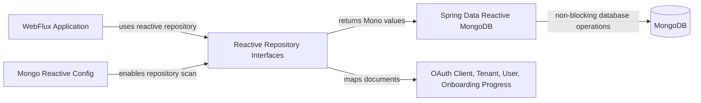
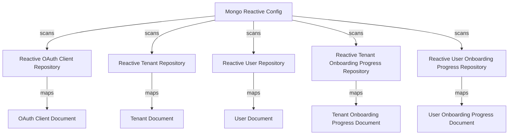
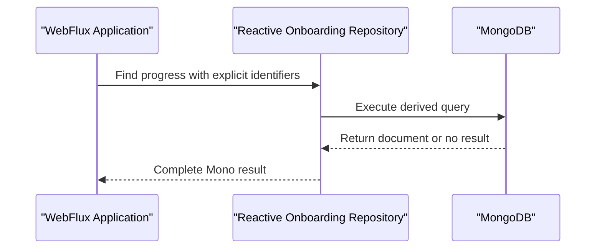

# Openframe Data Mongo Reactive

Openframe Data Mongo Reactive is the reactive MongoDB persistence adapter supplied to this tenant deployment by the OpenFrame OSS Library artifact `com.openframe.oss:openframe-data-mongo-reactive` at version `7.0.11`. It enables Spring Data reactive repository discovery and provides non-blocking access to OAuth client, tenant, user, and onboarding-progress documents.

The module is deliberately small: it defines repository interfaces rather than services, controllers, schemas, or MongoDB connection properties. Applications compose these interfaces with their own WebFlux request flows and MongoDB configuration. The shared configuration in this repository identifies MongoDB as the platform data source.

## Scope and Boundaries

| Concern | Responsibility | Outside this module |
|---|---|---|
| Repository activation | Enables scanning of `com.openframe.data.reactive.repository` for Spring Data reactive repositories. | Connection URI, credentials, database selection, and index management. |
| Reactive persistence | Exposes `ReactiveMongoRepository` CRUD operations with Reactor `Mono` result types. | Business orchestration and HTTP endpoints. |
| Tenant and user lookup | Provides domain and email lookup/existence methods through shared base repository contracts. | Tenant isolation aspect behavior and blocking repository implementations. |
| Onboarding state | Retrieves tenant or user onboarding progress with explicit identifiers. | Advancing onboarding steps or enforcing onboarding policy. |
| OAuth client lookup | Retrieves an OAuth client by its client identifier. | OAuth protocol handling and token issuance. |

## Architecture Overview

`MongoReactiveConfig` is the module entry point. Its `@EnableReactiveMongoRepositories` annotation scopes automatic repository registration to the reactive repository package. Once the module is on an application's classpath, Spring creates implementations for the declared interfaces.

The document classes and base repository contracts are supplied by other OpenFrame data artifacts. This module adds their reactive transport types; it does not redefine document fields.

## Components

### Configuration

| Component | Responsibility |
|---|---|
| [MongoReactiveConfig](https://github.com/flamingo-stack/openframe-oss-lib/blob/16e7c1cbd9664e7d10ec5ebca7d53c9bd314decf/openframe-data-mongo-reactive/src/main/java/com/openframe/data/config/MongoReactiveConfig.java) | Registers reactive Mongo repository scanning for `com.openframe.data.reactive.repository`. |

### Reactive Repositories

| Repository | Document | Query operations beyond inherited reactive CRUD | Notes |
|---|---|---|---|
| [ReactiveOAuthClientRepository](https://github.com/flamingo-stack/openframe-oss-lib/blob/16e7c1cbd9664e7d10ec5ebca7d53c9bd314decf/openframe-data-mongo-reactive/src/main/java/com/openframe/data/reactive/repository/oauth/ReactiveOAuthClientRepository.java) | `OAuthClient` | `findByClientId` | Performs a reactive client-identifier lookup. |
| [ReactiveTenantOnboardingProgressRepository](https://github.com/flamingo-stack/openframe-oss-lib/blob/16e7c1cbd9664e7d10ec5ebca7d53c9bd314decf/openframe-data-mongo-reactive/src/main/java/com/openframe/data/reactive/repository/onboarding/ReactiveTenantOnboardingProgressRepository.java) | `TenantOnboardingProgress` | `findByTenantId` | Reactive view of the tenant onboarding-progress collection. Tenant ID is supplied explicitly. |
| [ReactiveUserOnboardingProgressRepository](https://github.com/flamingo-stack/openframe-oss-lib/blob/16e7c1cbd9664e7d10ec5ebca7d53c9bd314decf/openframe-data-mongo-reactive/src/main/java/com/openframe/data/reactive/repository/onboarding/ReactiveUserOnboardingProgressRepository.java) | `UserOnboardingProgress` | `findByUserIdAndTenantId` | Reactive view of user onboarding progress, scoped by both user and tenant identifiers. |
| [ReactiveTenantRepository](https://github.com/flamingo-stack/openframe-oss-lib/blob/16e7c1cbd9664e7d10ec5ebca7d53c9bd314decf/openframe-data-mongo-reactive/src/main/java/com/openframe/data/reactive/repository/tenant/ReactiveTenantRepository.java) | `Tenant` | `findByDomain`, `existsByDomain` | Extends `BaseTenantRepository` with `Mono` return types, preserving the shared tenant query contract. |
| [ReactiveUserRepository](https://github.com/flamingo-stack/openframe-oss-lib/blob/16e7c1cbd9664e7d10ec5ebca7d53c9bd314decf/openframe-data-mongo-reactive/src/main/java/com/openframe/data/reactive/repository/user/ReactiveUserRepository.java) | `User` | `findByEmail`, `existsByEmail`, `existsByEmailAndStatus`, `existsByTenantIdAndId` | Extends `BaseUserRepository` reactively and supplies an explicitly tenant-scoped identity existence check. |

## Repository Relationships

All five interfaces inherit the reactive CRUD surface from `ReactiveMongoRepository`, including reactive single-result operations represented by `Mono`. The tenant and user repositories additionally inherit shared method declarations from `BaseTenantRepository` and `BaseUserRepository`, then bind those declarations to Reactor types.

## Explicit Tenant Scoping

The two onboarding repositories document an important behavior: they are **not tenant-aware**. In the shared or SaaS execution path, the tenant aspect is bypassed, so callers must supply `tenantId` directly. The user onboarding query requires both `userId` and `tenantId`; the tenant onboarding query requires `tenantId`.

The user repository follows the same principle for cross-tenant-safe identity checks through `existsByTenantIdAndId`. Code using these interfaces must not assume that a tenant context is implicitly attached to a reactive query.

## Integration in This Deployment

This repository consumes the OpenFrame OSS Library reactive Mongo artifact at `7.0.11`. Its shared application configuration points Spring MongoDB at the deployed MongoDB service; the module supplies the repository layer that an application can use once reactive Mongo support is enabled.

Openframe Data Mongo Reactive complements, rather than replaces, the synchronous Mongo module. The onboarding repository source comments explicitly describe these interfaces as reactive views that mirror the corresponding blocking onboarding repositories in `openframe-data-mongo-sync`. Select the reactive interfaces for non-blocking WebFlux flows and avoid mixing blocking calls into a reactive execution path.

## Maintenance Notes

- Keep reactive repository interfaces under `com.openframe.data.reactive.repository`; that is the only package scanned by `MongoReactiveConfig`.
- Preserve `Mono` return types when extending shared tenant or user repository contracts so Spring Data can derive and execute queries reactively.
- Pass tenant identifiers explicitly for onboarding and tenant-scoped identity operations.
- A missing result is represented by an empty `Mono`; consumers should define their own not-found handling rather than relying on a null value.
- Add schema, index, conversion, and tenant-isolation changes to the appropriate data modules or deployment configuration rather than to these interface definitions.
